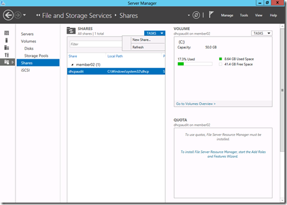
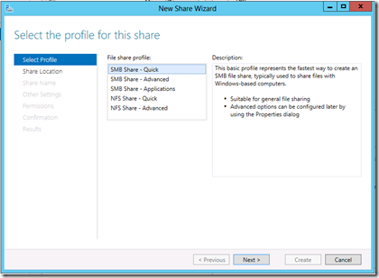
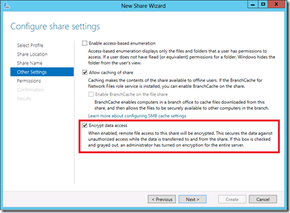
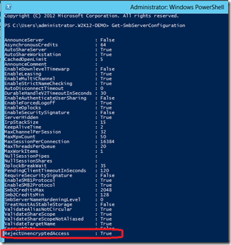

Le protocole de partage de fichiers de Windows a été tout simplement révolutionné dans Windows Server 2012 et Windows 8. Un des changements majeurs concerne les performances mais nous y reviendrons dans un article ultérieur. Regardons plutôt dans un premier temps les améliorations sous l’angle de la sécurité.

<!-- truncate -->

#### Signature

La signature du trafic est une fonctionnalité présente dans SMB depuis longtemps , elle permet d’authentifier les messages échangés entre les clients et serveurs. En SMBv2, on utilisait un hash de 32 octets en avec HMAC-SHA256 pour le message. En SMBv3 on utilise désormais un hash de 16 octets AES-CMAC-128.

#### Chiffrement

SMB est un protocole dans lequel les données circulent en texte clair. Pour les données sensibles en transit sur le réseau, nous recommandons en général de mettre en œuvre IPsec (ce que l’on nomme isolation de serveurs ou de domaine pour les plus valeureux). Avec SMBv3, cela n’est plus obligatoire car le chiffrement est désormais implémenté dans le protocole. La méthode utilisée est AES 128 CCM et l’authentification est habituelle (Kerberos ou NTLM).

Pour mettre cela en place, il suffit d’aller dans la console de partage de fichiers de Windows Server 2012 :

Pour ensuite créer un partage simple:

Dans la catégorie autres options, il suffit ensuite d’activer le chiffrement:

Le paramétrage peut aussi se faire en Powershell avec la commande suivante : Set-SmbShare –Name <nomdupartage> -EncryptData $true

S’il s’agit d’une machine dont tous les partages contiennent des données sensibles, il est également possible de forcer au niveau global, sur la machine, le chiffrement de tous les partages qui vont être crées: Set-SmbServerConfiguration -EncryptData $true

Activer le chiffrement pour SMB est une très bonne idée, mais gardez tout de même à l’esprit que toutes les machines qui ne font pas de SMBv3 (toutes les versions de Windows avant Windows 8) auront un accès refusé au partage. Cela est dû au paramétrage par défaut qui empêche un accès non chiffré. C’est le réglage par défaut car on pourrait imaginer des connections clientes qui se déconnectent et reconnectent en SMBv2 pour avoir une session en texte clair.

On peut voir ce paramètre par défaut avec la commande: Get-SmbServerConfiguration

Vous l’avez donc compris, si vous souhaitez autoriser l’accès aux clients qui n’implémentent pas le chiffrement, il vous faudra donc utiliser la commande: Set-SmbServerConfiguration –RejectUnencryptedAccess $false

#### Désactivation de SMBv1

SMBv1 c’est environ 1000 commandes : beaucoup de complexité pour au final un protocole assez ancien et plus très performant. On vous recommande donc de le désactiver s’il n’est pas nécessaire. Au bémol près évidemment que tous les clients antérieurs à Windows Vista ne sont pas capables de se connecter aux partages SMBv1. Parions donc qu’il y aura encore quelques mois avant que vous ne le désactiviez en utilisant:

Set-SmbServerConfiguration –EnableSMB1Protocol $false

Dans un prochain article, nous étudierons les nouveautés concernant les performances de SMBv3, en attendant, vous pouvez consulter les ressources suivantes:

-   Pour plus d’infos sur les nouveautés du serveur de fichier dans Windows Server 2012 : [https://aka.ms/jeveuxwindows2012](https://aka.ms/jeveuxwindows2012)
-   Pour une vue d’ensemble sur SMBv3 : [http://technet.microsoft.com/fr-fr/library/hh831795.aspx](http://technet.microsoft.com/fr-fr/library/hh831795.aspx)
-   Pour plus de détails sur le support de SMBv3 : [http://support.microsoft.com/kb/2709568](http://support.microsoft.com/kb/2709568)
-   La documentation complète du protocole SMBv3 peut être retrouvée ici : [http://msdn.microsoft.com/en-us/library/cc246482(v=prot.10).aspx](http://msdn.microsoft.com/en-us/library/cc246482\(v=prot.10\).aspx)

Enfin, pour tester Windows Server 2012, téléchargez gratuitement la version d’évaluation disponible sous la forme :

-   d’une image ISO : [http://technet.microsoft.com/fr-fr/evalcenter/hh670538.aspx](http://technet.microsoft.com/fr-fr/evalcenter/hh670538.aspx)
-   d’un fichier VHD avec un système préinstallé : [http://technet.microsoft.com/fr-fr/evalcenter/hh670538.aspx](http://technet.microsoft.com/fr-fr/evalcenter/hh670538.aspx)

Arnaud
