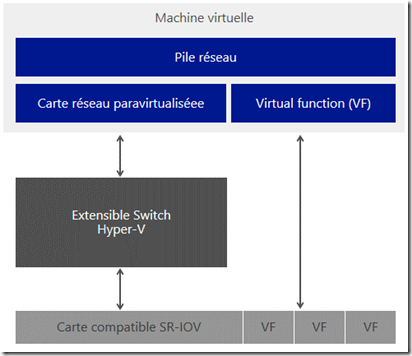
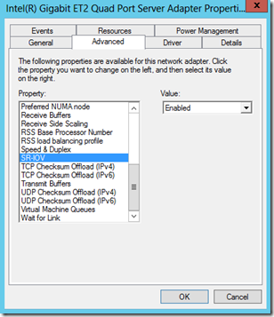
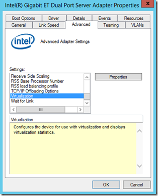
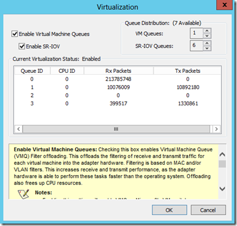
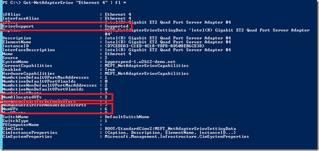
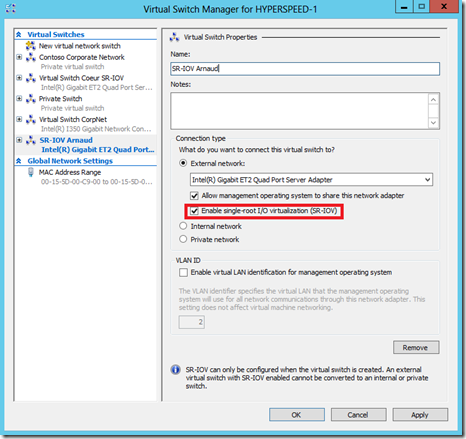
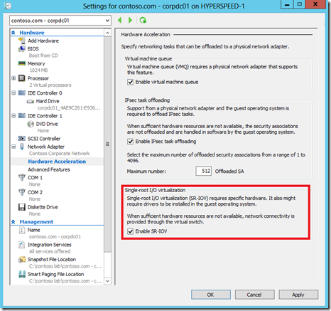
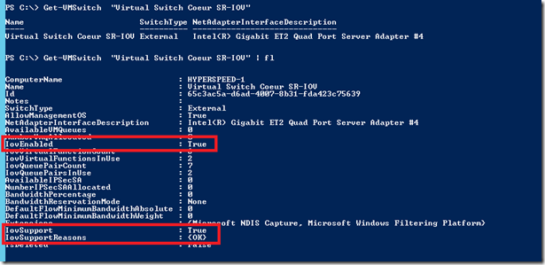
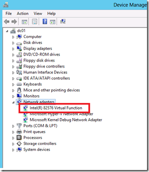
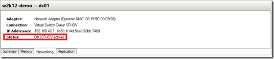

Une des grandes nouveautés pour la virtualisation et les meilleures performances dans Windows Server 2012 est le support de SR-IOV. Cette norme qui fait partie du PCI-SIG n’est pas propre au réseau, mais elle permet d’une manière générale de simplifier le chemin des IO entre une machine virtuelle et les ressources de sa machine physique. Avec des cartes réseaux de plus en plus puissantes, on pense au 40GbE et même au 100GbE qui pointent le bout de leurs nez, ce n’est donc plus la bande passante qui est le souci mais le volume de données, les temps de latence dans le filtrage et la simplification des gestions des IO.

<!-- truncate -->

Schématiquement voici comment se présente SR-IOV:

Ce schéma extrêmement simplifié montre qu’une carte réseau compatible SR-IOV va exposer au système un certain nombre de *Virtual Functions* qui seront autant de slots que pourront consommer des machines virtuelles connectées sur la machine physique.

Pour faire fonctionner SR-IOV, il ne suffit pas d’une carte réseau SR-IOV, on doit vérifier également quelques prérequis :

-   Support de la fonctionnalité par la carte réseau (notons les cartes Intel Gigabit ET Dual Port, ainsi que Gigabit ET2 QuadPort que nous utilisons pour cet article)
-   Un driver et un firmware bien mis à jour (même si les pilotes de Windows reconnaissent votre carte réseau, installez ceux du constructeur pour bénéfice de toutes les fonctionnalités ET n’oubliez pas de les mettre à jour régulièrement.)
-   Support du chipset pour IOMMU (*Input/Output Memory Management Unit, voir références plus bas)*

-   Support du SLAT (*Second Level Address Translation*)

#### Vérifications sur la partition parent

Avec les pilotes réseau par défaut de Windows, vérifions la présence de la section SRIOV dans les fonctionnalités avancées de la carte au sein du gestionnaire de périphériques:

 

Dans notre exemple nous utilisons les cartes carte Intel Gigabit ET Dual Port, ainsi que Gigabit ET2 QuadPort. Lorsque l’on installe les drivers Intel on a beaucoup plus d’options et notamment un contrôle plus fin sur l’utilisation de SR-IOV et VMQ :

Une fois les fonctionnalités activés au niveau du périphérique, vérifions les capacités exposées par la carte réseau à l’aide de la commande PowerShell:

 **Get-NetAdapterSriov**

Premier élément à vérifier est le support de SR-IOV, dans notre cas c’est *supported*, mais dans d’autres cas on aura un message d’erreur indiquant la raison pour laquelle cela ne fonctionne pas.

Autres éléments intéressants le nombre total de VF exposées par la carte (**NumVFs**) et le nombre déjà consommées sur le système (**NumAllocatedVFs**) .

#### Configuration de la partition parent

Une fois tout cela vérifié, il faudra l’activer sur le Switch Virtuel ainsi que sur les cartes réseaux virtuelles des VM qui doivent profiter de la fonctionnalité.

Cela se fait dans le gestionnaire de réseaux virtuels de Hyper-V:

Ensuite pour chaque VM dans les options d’accélération matérielles de la carte virtuelle:

De la même manière on peut vérifier en Powershell l’effectivité de SR-IOV sur le switch en utilisant la commande:

**Get-VMSwitch**

La case cochée dans l’interface graphique est ici représentée par **IovEnabled**.

**IovSupport** et **IovSupportReasons** permettront de comprendre ce qui se passe réellement : si il y a un problème avec la fonctionnalité et quelle en est l’origine.

#### Vérification sur les machines virtuelles

Une fois tout cela effectué, on peut vérifier le fonctionnalité premièrement dans le gestionnaire de périphériques de la VM avec l’apparition d’une "carte réseau" supplémentaire:

Sur la machine physique, on peut aussi s’assurer du fonctionnement de l’ensemble dans le gestionnaire Hyper-V, dans l’onglet Networking de la VM:

Notons que lorsqu’on utilise les fonctions du switch Hyper-V telles que les ACL réseau entre machines virtuelles, cela désactive automatiquement SR-IOV pour passer par le chemin classique des IO réseau.

Dans un prochain article nous étudierons le cas d’une machine qui ne support pas SR-IOV et comment en déterminer les raisons avec Powershell et les journaux d’évènements! 

Pour plus d’informations sur SR-IOV :

**IT Pro :**

Excellent série d’article de John Howard dont je me suis inspiré: [http://blogs.technet.com/b/jhoward/archive/2012/03/12/everything-you-wanted-to-know-about-sr-iov-in-hyper-v-part-1.aspx](http://blogs.technet.com/b/jhoward/archive/2012/03/12/everything-you-wanted-to-know-about-sr-iov-in-hyper-v-part-1.aspx "http://blogs.technet.com/b/jhoward/archive/2012/03/12/everything-you-wanted-to-know-about-sr-iov-in-hyper-v-part-1.aspx") 

A BIOS update may be required for some computers to install the Hyper-V Role and/or start Hyper-V virtual machines – [http://support.microsoft.com/kb/2762297](http://support.microsoft.com/kb/2762297 "http://support.microsoft.com/kb/2762297")

Yellow bang in device manager if SR-IOV NIC is moved to noncapable slot on Windows Server 2012 – [http://support.microsoft.com/kb/2756208](http://support.microsoft.com/kb/2756208 "http://support.microsoft.com/kb/2756208")

Building Your Cloud Infrastructure: Non-Converged Data Center Configuration – [http://technet.microsoft.com/en-us/library/hh831559.aspx](http://technet.microsoft.com/en-us/library/hh831559.aspx "http://technet.microsoft.com/en-us/library/hh831559.aspx")

**Architecture :**

Overview of Single Root I/O Virtualization (SR-IOV) – [http://msdn.microsoft.com/en-us/library/windows/hardware/hh440148(v=vs.85).aspx](http://msdn.microsoft.com/en-us/library/windows/hardware/hh440148\(v=vs.85\).aspx)

Writing SR-IOV PF Miniport Drivers – [http://msdn.microsoft.com/en-us/library/windows/hardware/hh440298(v=vs.85).aspx](http://msdn.microsoft.com/en-us/library/windows/hardware/hh440298\(v=vs.85\).aspx)

Writing SR-IOV VF Miniport Drivers – [http://msdn.microsoft.com/en-us/library/windows/hardware/hh440299(v=vs.85).aspx](http://msdn.microsoft.com/en-us/library/windows/hardware/hh440299\(v=vs.85\).aspx)

Intel’s Virtualization for Directed I/O, a.k.a IOMMU-  [http://software.intel.com/en-us/blogs/2009/03/02/intels-virtualization-for-directed-io-aka-iommu-part-1/](http://software.intel.com/en-us/blogs/2009/03/02/intels-virtualization-for-directed-io-aka-iommu-part-1/ "http://software.intel.com/en-us/blogs/2009/03/02/intels-virtualization-for-directed-io-aka-iommu-part-1/")

**Et toujours, si tu veux Windows Server 2012, c’est par ici:** [**https://aka.ms/jeveuxWindows2012**](https://aka.ms/jeveuxWindows2012)

Arnaud
