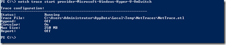
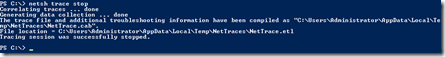
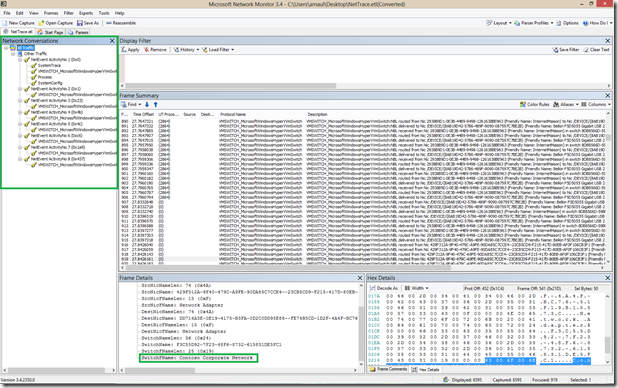
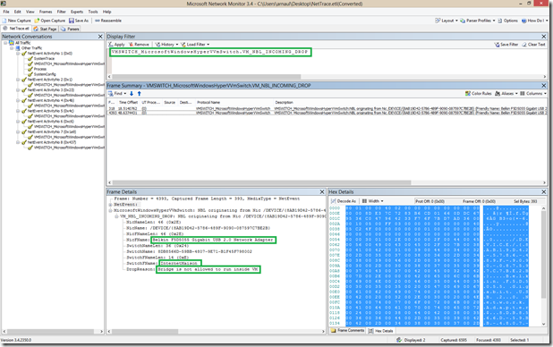
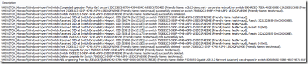
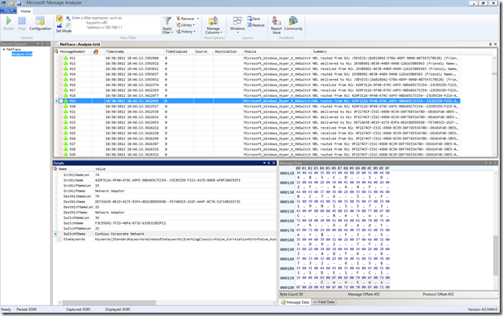
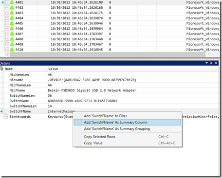
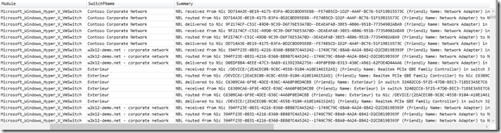

Avec Windows Server 2012 apparait le switch extensible Hyper-V un vrai petit bijou dont on parlera encore souvent sur ce blog. Dans cet article concentrons nous sur les techniques et outils disponibles lorsque l’on veut comprendre ce qui se passe dans la bête.

<!-- truncate -->

# Traces unifiées:

Les traces unifiées sont apparues avec Windows 7 et permettent de récupérer des traces système corrélées via ETW (Event Tracing for Windows). Cela signifie que les différents éléments inclus dans la traces sont mis en relation entre eux pour former un tout plus facile à interpréter.

Pour lancer une trace ETW, utilisons le contexte netsh trace avec le fournisseur approprié:

netsh trace start provider=Microsoft-Windows-Hyper-V-VmSwitch

Si l’on veut une trace réseau en même temps, on peut même y ajouter l’argument qui va bien:

netsh trace start provider=Microsoft-Windows-Hyper-V-VmSwitch capture=yes

Parfois on a besoin de tracer le comportement au boot, on utilise alors l’argument *persistent:*

netsh trace start provider=Microsoft-Windows-Hyper-V-VmSwitch persistent=yes

Par défaut on trace dans le profile de l’utilisateur courant avec une taille max de 250MB:

 

Une fois le comportement problématique reproduit, on arrête la trace avec

netsh trace stop

Une fois la trace obtenue, on peut l’ouvrir avec le journal d’évènements, mais ce n’est pas l’outil le plus efficace pour explorer et filtrer ce genre de traces. Utilisons plutôt des outils appropriés comme Network Monitor et Message Analyzer.

Vous allez entendre parler de plus en plus de Message Analyzer c’est le successeur de Network Monitor, et il permet de tracer à peu près tout et n’importe quoi dans Windows, bien au delà de son prédécesseur.

Vous pouvez suivre le blog de l’équipe produit ici: [http://blogs.technet.com/b/messageanalyzer/](http://blogs.technet.com/b/messageanalyzer/ "http://blogs.technet.com/b/messageanalyzer/") 

\==> Pour l’instant Message Analyzer n’est disponible qu’en beta publique que vous pouvez télécharger ici: [https://connect.microsoft.com/site216](https://connect.microsoft.com/site216) (vous devrez joindre le groupe Message Analyzer et Network Monitor pour télécharger les éléments dont nous discutons ici). <==

Si vous n’avez pas envie de vous familiariser avec Message Analyzer, vous pouvez juste télécharger les *parseurs* pour Network Monitor 3.4, ce qui vous permettra d’interpréter les messages du Switch Virtuel Hyper-V. Etudions les deux cas pour notre exemple.

### Avec Network Monitor 3.4:

La trace suivante (*passage en mode plein écran recommandé*), montre un exemple basique. On remarque dans la partie gauche, les network conversations permettent de filtrer les différent types d’activités du Switch de manière rapide:

On peut voir les opérations courantes sur le Switch: routage, delivery et reception que l’on peut filtrer avec les mécanismes habituels sous Netmon:

VMSWITCH\_MicrosoftWindowsHyperVVmSwitch.VM\_NBL\_DELIVER  
VMSWITCH\_MicrosoftWindowsHyperVVmSwitch.VM\_NBL\_RECEIVE  
VMSWITCH\_MicrosoftWindowsHyperVVmSwitch.VM\_NBL\_ROUTE

Si votre dépannage ne concerne pas ces opérations, vous pouvez déjà retirer ce bruit en utilisant le filtre d’affichage

!(VMSWITCH\_MicrosoftWindowsHyperVVmSwitch.VM\_NBL\_DELIVER OR VMSWITCH\_MicrosoftWindowsHyperVVmSwitch.VM\_NBL\_RECEIVE OR VMSWITCH\_MicrosoftWindowsHyperVVmSwitch.VM\_NBL\_ROUTE)

Selon les scénarios que l’on dépannage on pourra également vouloir mettre en évidence différents problèmes comme les drops de paquets: 

VMSWITCH\_MicrosoftWindowsHyperVVmSwitch.VM\_NBL\_INCOMING\_DROP

Le petit exemple ci-dessous vous permettra d’apprécier les subtilités de ma configuration domestique 

Et pour terminer une séquence de requête de configuration et de suppression de Switch Virtuel:

## Avec Message Analyzer:

Le même message que précédemment, vu avec Message Analyzer:

Message Analyzer est vraiment passionnant et son interface extensible quasiment à l’infini. Rajoutons ici une colonne pour voir rapidement quels sont les switch virtuals des différents messages:

Nous avons alors une vue rapide sur les différents switch et les différents dialogues:

Pour l’instant, aucun soucis dans notre trace, il s’agit juste de se familiariser avec l’outillage, nous verrons prochainement des cas concrets!

Bon amusement avec Message Analyzer et Windows Server 2012!

**Plus d’informations:**

Hyper-V Extensible Switch – [http://msdn.microsoft.com/en-us/library/windows/hardware/hh598161(v=vs.85).aspx](http://msdn.microsoft.com/en-us/library/windows/hardware/hh598161\(v=vs.85\).aspx)

Hyper-V Extensible Switch Components – [http://msdn.microsoft.com/en-us/library/windows/hardware/hh598163(v=vs.85).aspx](http://msdn.microsoft.com/en-us/library/windows/hardware/hh598163\(v=vs.85\).aspx)

Improve Debugging And Performance Tuning With ETW – [http://msdn.microsoft.com/en-us/magazine/cc163437.aspx](http://msdn.microsoft.com/en-us/magazine/cc163437.aspx "http://msdn.microsoft.com/en-us/magazine/cc163437.aspx") 

Unified Tracing Overview – [http://technet.microsoft.com/en-us/library/hh848933.aspx](http://technet.microsoft.com/en-us/library/hh848933.aspx "http://technet.microsoft.com/en-us/library/hh848933.aspx")

[http://www.cisco.com/en/US/solutions/collateral/ns340/ns517/ns224/ns955/ns963/solution\_overview\_c22-687087.html](http://www.cisco.com/en/US/solutions/collateral/ns340/ns517/ns224/ns955/ns963/solution_overview_c22-687087.html "http://www.cisco.com/en/US/solutions/collateral/ns340/ns517/ns224/ns955/ns963/solution_overview_c22-687087.html")

Enfin comme de tradition, pour mettre tout ça en **pratique, Windows Server 2012, c’est par ici:** [**https://aka.ms/jeveuxWindows2012**](https://aka.ms/jeveuxWindows2012)

Arnaud
