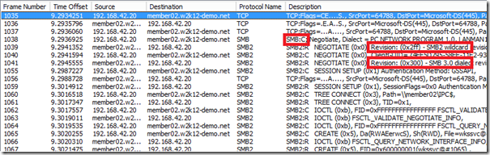
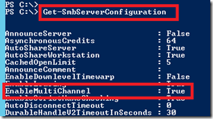
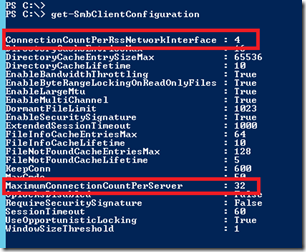
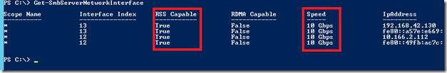
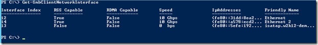
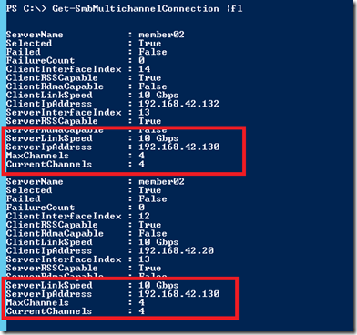
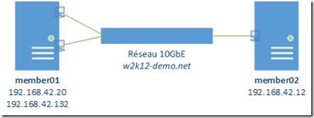
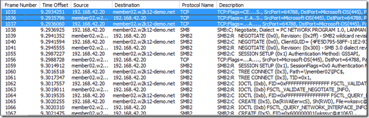
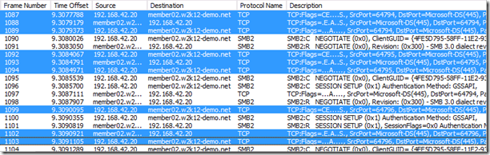
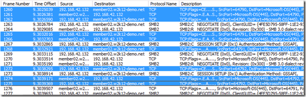

Dans Windows Server 2012, vous aurez remarqué que nous avons massivement investi pour donner au protocole de partage de fichiers que nous utilisons tous les jours une ambition supplémentaire : supporter toutes vos applications les plus exigeantes (hébergement de machines virtuelles, de bases de données SQL Server 2012, etc.)

<!-- truncate -->

Pour cela, le multicanal SMB est un aspect fondamental : offrir aux machines la possibilité d’un accès aux partages de fichiers de manière redondée (un peu comme du multipath IO) ou en agrégeant la bande passante des connexions disponibles sur la machine. Concrètement il s’agit donc dans un dialogue SMB d’établir plusieurs sessions pour accélérer les accès aux fichiers distants en accord avec les capacités de la machine cliente et du serveur.

### Prérequis

Pour pouvoir mettre en œuvre le multicanal de SMB il vous faudra au moins deux machines Windows Server 2012 et/ou Windows 8 qui ont au choix:

-   Plusieurs cartes réseau
-   Au moins une carte réseau qui supporte RSS (Receive Side Scaling)
-   Au moins une carte réseau qui supporte RDMA (Remote Direct Memory Access)

### Détection du multicanal SMB

Lorsque le client SMB va initier un dialogue avec un serveur, cela commence comme d’habitude par un établissement de session TCP sur le port 445 suivi d’un SMB *Negotiate* en SMBv1 (*frame 1038 sur la capture ci-dessous*). La capacité de SMB 3.0 va être annoncé par le serveur ce qui va faire que le client bascule automatiquement en réponse avec le protocole SMB3.0 *(techniquement SMB3.0 n’est que SMB2.2 mais il y a tellement de nouveautés dans le protocole qu’on s’est dit au final qu’un incrément de version était bien mérité)*

Une fois cette bascule en SMB30 effectuée et la connexion établie (*Session Setup* complété), si le client supporte le multicanal, il va demander au serveur la liste de ses interfaces et de leurs capacités (en matière de bande passante notamment, mais aussi la possibilité de faire du RDMA – Remote Direct Memory Access). Charge au client de tester les différents chemins possibles pour atteindre les différentes interfaces. Ceci va s’effectuer quelques secondes après la connexion initiale et en fonction de la qualité du lien (latence et taille de la fenêtre TCP).

### Evaluation des chemins

Un fois les connections établies, la machine va réévaluer le chemin toutes les 10 minutes ou lorsque les évènements suivants se produisent:

-   déconnection d’un câble réseau
-   perte de connexion
-   modification de la configuration SMB multicanal

### Calculs des canaux à disposition

Pour une relation client/serveur, il y aura toujours une limite maximale de 8 connections concourantes et la création des connections va se baser sur le type de carte réseau impliquée comme suit:

<table cellspacing="0" cellpadding="2" width="455" border="0"><tbody><tr><td valign="top" width="180"><strong>Type d’interface réseau</strong></td><td valign="top" width="273"><strong>Nombre maximal de connexions établies</strong></td></tr><tr><td valign="top" width="180">Interface standard</td><td valign="top" width="273">1 connexion TCP</td></tr><tr><td valign="top" width="180">Interface supportant RDMA</td><td valign="top" width="273">2 connexions RDMA</td></tr><tr><td valign="top" width="180">Interface supportant RSS</td><td valign="top" width="273">4 connexions TCP</td></tr></tbody></table>

### Multicanal a une carte

Commençons par un cas simple: le multicanal a une carte. Pourquoi faire ? Avec des cartes réseau a très forte bande passante et faible latence, lorsque l’on copie des gros fichiers tout va bien car on ne perd pas de temps en aller-retour pour effectuer les transactions et l’on remplit aisément la fenêtre TCP. En revanche lorsque l’on copie des petits fichiers, établir plusieurs connections TCP sur les différents cœurs CPU va permettre de mener de front plusieurs transactions et donc de tirer partie au maximum de la bande passante du lien.  Dans l’implémentation actuelle, ceci ne se passe que sur des cartes à minimale 10GbE.

### Multicanal a plusieurs cartes

L’utilisation du multicanal a plusieurs cartes va se faire dans les conditions énumérées précédemment en considérant l’ensemble des NICs avec des capacités égales. Si l’on a une carte 10GbE et une carte 1GbE, il est plus pertinent de n’utiliser que la carte 10GbE sans chercher à multiplexer avec la carte 1GbE.

### Multicanal, et teaming

Le multicanal et la mise en équipe des cartes réseaux de Windows Server 2012 sont cumulatif. La mise en équipe de carte réseau permet d’agréger des liens au niveau logique dans NDIS (couches basses) pour n’avoir qu’une seule carte logique exposant plusieurs cartes physiques. Combiner les deux technologies permet de cumuler les bénéfices et de monter encore plus en charge dans la mesure ou une team ne correspondra alors qu’à une interface réseau du point de vue de l’évaluation des chemins par le système.  

### Commandes utiles

Voici quelques commandes permettant de diagnostiquer le comportement d’un système.

Dans un premier temps il est fondamental de vérifier les capacités RSS avec les commandes suivantes:

-   Get-NetAdapter – affiche la liste des interfaces réseau
-   Get-NetAdapterAdvancedProperty – affiche la liste des interfaces réseau et leurs capacités
-   Get-NetAdapterRSS permet de lister les files RSS associées aux cartes dans le système

Il est ensuite intéressant de vérifier les capacités du composant serveur comme du composant client SMB:  

Get-SmbServerConfiguration -  

Get-SmbClientConfiguration –

Get-SmbServerNetworkInterface – est sans doute la commande la plus importante car elle permet de lister les interfaces liées au serveur SMB et leurs capacités RSS.

Get-SmbClientNetworkInterface – est l’équivalent côté client de la commande précédente :

Get-SmbMultichannelConnection – Permet de voir l’état dynamique des connections établies

*\*\*\* SECTION JACKY TUNING \*\*\**

Enfin notons que même si les réglages par défaut du groupe produit ont été testés pour être les plus favorables dans les cas communs, il est possible de paramétrer le nombre de connections utilisées avec les commandes suivantes:

Set-SmbClientConfiguration –MaximumConnectionCountPerServer <n>

Set-SmbClientConfiguration -ConnectionCountPerRssNetworkInterface <n>

Il est également possible de personnaliser le comportement du multicanal entre plusieurs serveurs pour forcer l’utilisation de certaines cartes et en exclure d’autres. Il faudra alors utiliser les commandes suivantes:

New-SmbMultichannelConstraint -ServerName <monserveur> -InterfaceAlias <macarte1>, <macarte2>

### Exemple avec trace

Etudions un cas simple dans mon environnement de test représenté comme suit:

La configuration est la même que celle utilisée dans les commandes précédentes. Depuis member01, on va établir une connexion depuis l’Explorateur de fichiers vers member02. En parallèle *Microsoft Network Monitor* nous permet de suivre ce qui se passe.

**1\. Première session depuis member 01:**

Dans les frames 1035 à 1037, on voit l’établissement de session TCP entre member01 par sa première adresse IP (192.168.42.20) et member02, puis l’initiation du dialogue SMB.

**2\. Deuxième, troisième, quatrième sessions:**

Si on descend dans la trace, on observe que 3 établissements de sessions vont suivre depuis notre même adresse IP source de member01 (les frames 1087-1089, 1092-1094, 1099,1102 et 1103)

**3\. Cinquième, Sixième, Septième et huitième sessions:**

****

Un peu plus loin dans la session, on voit que member01 va commencer à établir de nouvelles sessions sur sa deuxième carte réseau avec l’adresse IP source 192.168.42.132, avec le serveur member02. Il s’agit des frames 1260-1262, 1265-1266 et 1268; 1272 et 1274-1275 et la dernière que l’on ne voit pas ce la capture d’écran (mais vous me faites confiance non?)

**Explications**:

Comme on peut le voir dans cette capture on a deux interfaces 10GbE, compatibles RSS sur member01. On sait que chaque interface RSS pourra établir 4 connections TCP et qu’au total une relation client/serveur ne peut avoir que 8 connections TCP simultanées. On a donc bien mis en œuvre le multicanal, sans rien avoir configuré. Dans cette configuration, cela nous permettra d’avoir par exemple de bien meilleures performances sur la copie de fichiers en comparaison avec les versions précédentes de Windows *(pour des benchmarks, voir la section référence de cet article)*.

### Suivi à la trace

#### Journaux d’évènements

Les erreurs peuvent être trouvés dans les journaux d’évènements pour la partie cliente et la partie serveur:

-   Application and Services Log, Microsoft, Windows, SMB Client – Operational
-   Application and Services Log, Microsoft, Windows, SMB Server – Operational

#### Compteurs de performance

On notera que Windows Server 2012 sait désormais nous montrer des compteurs de performance propres à chaque partage et non plus seulement de manière globale pour le serveur. On peut ainsi obtenir des informations avancées par chacun des partage en utilisant les compteurs *SMB Client Shares* ainsi que *SMB Server Shares*.

#### Traces unifiées

Enfin, quand plus rien ne va, il reste toujours les traces unifiées pour déterminer les raisons d’un comportement suspect :

netsh trace start scenario=filesharing capture=yes

<repro du problème>

netsh trace stop

Et envoi du package a votre ingénieur support préféré !

Pour références:

– MSDN Protocol documentation: [\[MS-SMB2\]- Server Message Block (SMB) Protocol Versions 2 and 3](http://msdn.microsoft.com/en-us/library/cc246482.aspx "[MS-SMB2]- Server Message Block (SMB) Protocol Versions 2 and 3")

– Windows 8 SMB 2.2 File Sharing Performance – [http://msdn.microsoft.com/en-us/library/windows/hardware/hh457617](http://msdn.microsoft.com/en-us/library/windows/hardware/hh457617 "http://msdn.microsoft.com/en-us/library/windows/hardware/hh457617") 

– Vidéo : Windows Server 2012 NIC Teaming and Multichannel Solutions – [https://channel9.msdn.com/Events/TechEd/NorthAmerica/2012/WSV314](https://channel9.msdn.com/Events/TechEd/NorthAmerica/2012/WSV314 "https://channel9.msdn.com/Events/TechEd/NorthAmerica/2012/WSV314") 

– The basics of SMB Multichannel, a feature of Windows Server 2012 and SMB 3.0-  [http://blogs.technet.com/b/josebda/archive/2012/05/13/the-basics-of-smb-multichannel-a-feature-of-windows-server-2012-and-smb-3-0.aspx](http://blogs.technet.com/b/josebda/archive/2012/05/13/the-basics-of-smb-multichannel-a-feature-of-windows-server-2012-and-smb-3-0.aspx "http://blogs.technet.com/b/josebda/archive/2012/05/13/the-basics-of-smb-multichannel-a-feature-of-windows-server-2012-and-smb-3-0.aspx")

Enfin, pour tester Windows Server 2012, vous pouvez télécharger gratuitement la version d’évaluation disponible sous la forme :  
– d’une image ISO : [https://aka.ms/jeveuxwindows2012](https://aka.ms/jeveuxwindows2012)  
– d’un fichier VHD avec un système préinstallé : [https://aka.ms/jeveuxwindows2012](https://aka.ms/jeveuxwindows2012)

Arnaud Lheureux
