Durant les prochains mois, nous passerons beaucoup de temps sur les infrastructure de type Cloud Hybride, si vous êtes intéressés par le sujet, venez nous voir lors d’un de nos IT CAMPS, il y a forcément une conférence près de chez vous : [Liste des IT CAMPS](https://aka.ms/itcampfr).

<!-- truncate -->

Ce que nous cherchons à réaliser dans cet article est une liaison site-à-site ou site-à-Azure afin d’avoir une connectivité complète entre un datacenter et la plateforme Azure IaaS.

Prenons un exemple simple:

[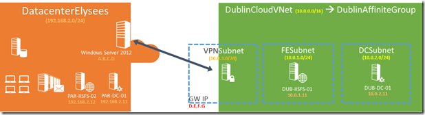](https://msdnshared.blob.core.windows.net/media/TNBlogsFS/prod.evol.blogs.technet.com/CommunityServer.Blogs.Components.WeblogFiles/00/00/00/95/48/metablogapi/6712.SchemaReseaux_3744F9FF.png) 

Dans mon entreprise, j’ai le réseau DatacenterElysees avec pour réseau 192.168.2.0/24, j’ai dans mon Datacenter une passerelle VPN avec Windows Server 2012 qui a pour adresse IPv4 publique A.B.C.D.

Dans Azure, je défini un réseau virtuel 10.0.0.0/16, avec une passerelle Azure qui a pour adresse IPv4 publique D.E.F.G

Voyons les étapes qui me permettent d’établir une liaison sécurisé entre les deux infrastructure pour bénéficier d’un accès IP transparent entre le deux centres de données.

## Configuration du VPN dans Azure IaaS

Nous partirons du postulat que les réseaux virtuels ont été crées dans Azure comme suit :

[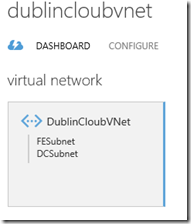](https://msdnshared.blob.core.windows.net/media/TNBlogsFS/prod.evol.blogs.technet.com/CommunityServer.Blogs.Components.WeblogFiles/00/00/00/95/48/metablogapi/8726.vnets_5326092A.png)

[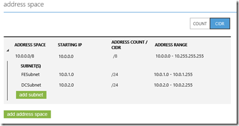](https://msdnshared.blob.core.windows.net/media/TNBlogsFS/prod.evol.blogs.technet.com/CommunityServer.Blogs.Components.WeblogFiles/00/00/00/95/48/metablogapi/8371.vnets2_6A710D9B.png)

*Vue dashboard*

*Vue configuration*

Une fois les réseaux virtuels définis dans Azure, il nous faut :  

1.  Définir le réseau de notre DatacenterElysees et sa passerelle
2.  Activer la connexion au réseau local
3.  Activer la passerelle Azure

#### 1\. Définir notre Datacenter dans Azure

Il nous faut créer un nouveau réseau local, ce qui permettra de donner à Azure les caractéristiques de notre réseau d’entreprise pour y établir les règles de routage.

[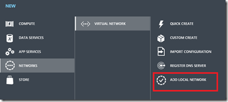](https://msdnshared.blob.core.windows.net/media/TNBlogsFS/prod.evol.blogs.technet.com/CommunityServer.Blogs.Components.WeblogFiles/00/00/00/95/48/metablogapi/6012.newlocalnet_4F583E8D.png)

Choix d’ajout d’un réseau local dans le portail de management Azure.

[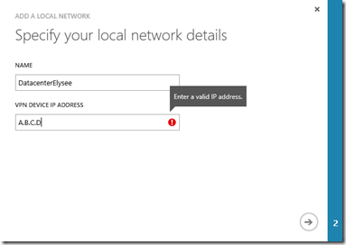](https://msdnshared.blob.core.windows.net/media/TNBlogsFS/prod.evol.blogs.technet.com/CommunityServer.Blogs.Components.WeblogFiles/00/00/00/95/48/metablogapi/2335.localnet1_4D3B3FC4.png)

Ajout des informations concernant votre infrastructure : il s’agit ici des informations concernant votre passerelle IPsec (dans notre exemple, l’adresse IPv4 publique de notre RRAS Windows Server 2012)

[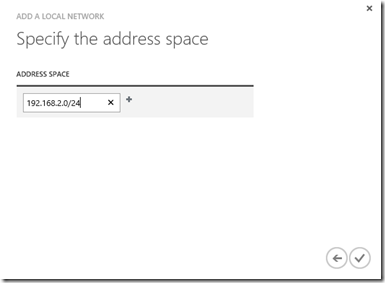](https://msdnshared.blob.core.windows.net/media/TNBlogsFS/prod.evol.blogs.technet.com/CommunityServer.Blogs.Components.WeblogFiles/00/00/00/95/48/metablogapi/0045.localnet2_24502ABB.png)

Définition de la plage d’adresse IPv4 présentes dans votre Datacenter. Cela va permettre à Azure de définir le routage adéquat pour envoyer les paquets sur votre Datacenter.

#### 2\. Activer la connexion au réseau local

Pour activer la connexion au réseau local (notre Datacenter), il nous faut aller dans la section configuration du réseau virtuel Azure et cocher l’option ‘”Connect to the local network”. Il vous demander ensuite de choisir quel réseau local est à connecter. Nous choisissons ici le réseau local que nous venons juste de définir et créer un sous réseau qui sera dédié à la connexion. Notez que cela ci devra se situer dans la plage des sous réseaux virtuels Azure.

[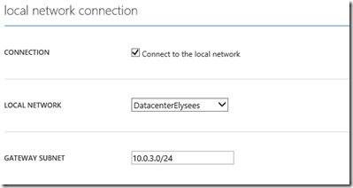](https://msdnshared.blob.core.windows.net/media/TNBlogsFS/prod.evol.blogs.technet.com/CommunityServer.Blogs.Components.WeblogFiles/00/00/00/95/48/metablogapi/2543.activerlocal_42BA6BA4.png)

Une fois la configuration sauvegardée, le tableau de bord de votre réseau virtuel devrait maintenant ressembler à cela :

[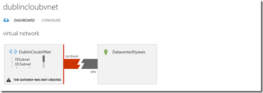](https://msdnshared.blob.core.windows.net/media/TNBlogsFS/prod.evol.blogs.technet.com/CommunityServer.Blogs.Components.WeblogFiles/00/00/00/95/48/metablogapi/4251.dashboard1_5A057015.png)

#### 3\. Activer la passerelle Azure

Dans cette dernière étape, nous allons activer la passerelle Azure. C’est à partir de ce moment là qu’un qu’une adresse IPv4 publique d’Azure nous sera attribuée et que nous pourrons commencer à établir des connexions sécurisées avec le Cloud.

Il nous faut sélectionner l’option suivante :

et après confirmation :

[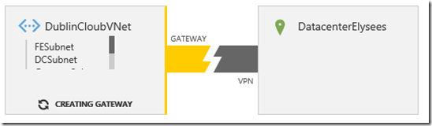](https://msdnshared.blob.core.windows.net/media/TNBlogsFS/prod.evol.blogs.technet.com/CommunityServer.Blogs.Components.WeblogFiles/00/00/00/95/48/metablogapi/1732.gateway2_7DDE21A2.png)

La création de la passerelle peut prendre jusqu’à 15 minutes… au bout desquelles nous obtenons :

[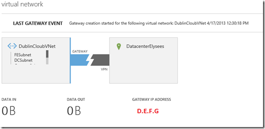](https://msdnshared.blob.core.windows.net/media/TNBlogsFS/prod.evol.blogs.technet.com/CommunityServer.Blogs.Components.WeblogFiles/00/00/00/95/48/metablogapi/3441.gateway3_3BF73C54.png)

La passerelle est désormais opérationnelle !  Vous remarquez que la section Gateway IP Address vous donnera une IP d’Azure et non pas D.E.F.G comme j’ai masqué dans la capture d’écran.

Notons deux aspects intéressants dans la barre du bas :

La section manage key permet de gérer les clés partagées utilisées pour les liaisons IPsec.

“Download" va permettre de télécharger un modèle de script de configuration pour différentes passerelles dont celle que je vais utiliser dans quelques instants :

[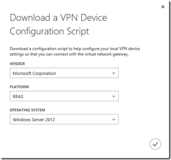](https://msdnshared.blob.core.windows.net/media/TNBlogsFS/prod.evol.blogs.technet.com/CommunityServer.Blogs.Components.WeblogFiles/00/00/00/95/48/metablogapi/2678.downloadmsft_2337EF44.png)

Il est maintenant temps de télécharger ce script de connexion et de le personnaliser pour interconnecter les sites.

## Configuration de Windows Server 2012 comme passerelle RRAS

Dans mon exemple, je pars d’une machine Windows Server 2012 vierge et mise à jour, sur laquelle je vais appliquer le script de configuration que j’aurai personnalisé après son téléchargement du portail Azure.

Le script est en Powershell v3.0 malgré l’extension .cfg et contient au début des fonctions techniques, mais nous avons uniquement besoin de modifier les variables suivantes à la fin du script :

<table cellspacing="0" cellpadding="2" width="601" border="0"><tbody><tr><td valign="top" width="200">&lt;SP_AzureGatewayIpAddress&gt;</td><td valign="top" width="399">Adresse IP de la passerelle Azure, dans notre exemple D.E.F.G</td></tr><tr><td valign="top" width="200">&lt;SP_AzureNetworkCIDR&gt;</td><td valign="top" width="399">Le réseau Azure en notation CIDR, dans notre exemple 10.0.0.0/16</td></tr><tr><td valign="top" width="200">&lt;SP_AzureNetworkMetric&gt;</td><td valign="top" width="399">La métrique réseau nécessaire, dans mon exemple je choisi la valeur 10, il peut être nécessaire de personnaliser selon la complexité de l’environnement.</td></tr><tr><td valign="top" width="200">&lt;SP_PresharedKey&gt;</td><td valign="top" width="399">La clé partagée donnée par le portail Azure</td></tr></tbody></table>

Renommons alors le fichier en .ps1 et autorisons l’exécution de scripts locaux : Set-Execution-Policy RemoteSigned.

Les puristes remarqueront sans doute que le script n’est pas très élaboré et il ne gère pas vraiment les erreurs. Parmi les choses qu’on peut signaler pour optimiser son déroulement :

-   Installer les composants RRAS séparément pour gérer le reboot:

-   Import-Module RemoteAccess
-   Install-RemoteAccess -VpnType VpnS2S

-   Rajouter un timer entre le redémarrage du service RRAS et le déclenchement de la connexion

-   Restart-Service RemoteAccess
-   Connect-VpnS2SInterface –Name D.E.F.G

Une fois tout cela exécuté, cela devrait le faire… Une petite trace réseau vous permettra de vérifier le bon dialogue entre les machines : on s’attend à voir dans un premier temps une négociation d’association de sécurité en utilisant le protocole IKEv2, puis on doit voir du trafic ESP lorsque les réseaux échangent effectivement du contenu :

[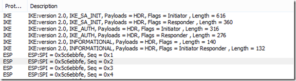](https://msdnshared.blob.core.windows.net/media/TNBlogsFS/prod.evol.blogs.technet.com/CommunityServer.Blogs.Components.WeblogFiles/00/00/00/95/48/metablogapi/4300.SAESP_56277FAB.png)

Le portail Azure nous montre alors une connexion établie :

 [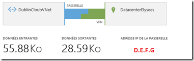](https://msdnshared.blob.core.windows.net/media/TNBlogsFS/prod.evol.blogs.technet.com/CommunityServer.Blogs.Components.WeblogFiles/00/00/00/95/48/metablogapi/8308.connected_39CA17BE.png)

Le serveur RRAS, doit montrer également un état connecté similaire au suivant :

[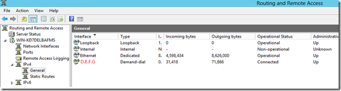](https://msdnshared.blob.core.windows.net/media/TNBlogsFS/prod.evol.blogs.technet.com/CommunityServer.Blogs.Components.WeblogFiles/00/00/00/95/48/metablogapi/5557.RASConnected_57C825B2.png)

Dans un prochain article, nous aborderons la haute disponibilité de cette solution et peut être plus encore selon vos retours !

A bientôt lors d’un [ITCAMP](https://aka.ms/itcampfr)!

Pour tester Windows Server 2012 et Windows 8, vous pouvez télécharger gratuitement la version d’évaluation disponible sous la forme :  
– d’une image ISO : [https://aka.ms/jeveuxwindows2012](https://aka.ms/jeveuxwindows2012)  
– d’un fichier VHD avec un système préinstallé : [https://aka.ms/jeveuxwindows2012](https://aka.ms/jeveuxwindows2012)

**Quelques références :**  

About VPN Devices for Virtual Network – [http://msdn.microsoft.com/en-us/library/windowsazure/jj156075](http://msdn.microsoft.com/en-us/library/windowsazure/jj156075 "http://msdn.microsoft.com/en-us/library/windowsazure/jj156075") 

Routing and Remote Access Service templates **–** [http://msdn.microsoft.com/en-us/library/windowsazure/dn133801.aspx](http://msdn.microsoft.com/en-us/library/windowsazure/dn133801.aspx "http://msdn.microsoft.com/en-us/library/windowsazure/dn133801.aspx")

Create a Virtual Network for Cross-Premises Connectivity – [https://www.windowsazure.com/en-us/manage/services/networking/cross-premises-connectivity/](https://www.windowsazure.com/en-us/manage/services/networking/cross-premises-connectivity/ "https://www.windowsazure.com/en-us/manage/services/networking/cross-premises-connectivity/")

[Arnaud](https://twitter.com/ArnaudLheureux) – les bons tuyaux
