Dans une série d’articles, [Stanislas](https://aka.ms/stanislas) décrit comment mettre en place la virtualisation de réseau avec Hyper-V (HNV). C’est une technique fondamentale qui permet de faire cohabiter de manière isolée plusieurs réseaux IP (de clients d’un cloud par exemple) à l’intérieur d’un réseau IP de Datacenter.

<!-- truncate -->

Lors de la mise sur le câble des paquets échangés entre machines Hyper-V, nous utilisons dans Windows Server 2012 (R2) et System Center Virtual Machine Manager 2012 SP1/R2  l’encapsulation NVGRE telle que définie dans : [http://tools.ietf.org/html/draft-sridharan-virtualization-nvgre-02](http://tools.ietf.org/html/draft-sridharan-virtualization-nvgre-02 "http://tools.ietf.org/html/draft-sridharan-virtualization-nvgre-02") 

Cette encapsulation du trafic d’un client d’un cloud se fait sur le réseau provider (espace d’adressage PA). Alors que l’espace d’adressage PA est unique, plusieurs espaces d’adressages de clients (CA) vont cohabiter sur le PA et seront discriminés grâce à leur identifiant “GRE Key” qui contient les différents réseaux (VSID).

[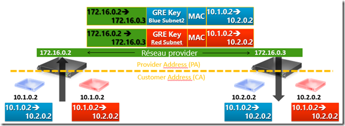](https://msdnshared.blob.core.windows.net/media/TNBlogsFS/prod.evol.blogs.technet.com/CommunityServer.Blogs.Components.WeblogFiles/00/00/00/95/48/metablogapi/3782.SchemaTopo_4D130174.png)

Regardons de plus près à quoi ressemble l’encapsulation réseau avec nos outils préférés: Netmon Monitor et Message Analyzer.

Pour notre exemple nous prendrons, la machine sur le réseau “blue” avec pour adresse IP 10.1.0.2 qui va envoyer un ping vers 10.2.0.2. Les masques de sous réseaux sont /16 donc, les machines sont dans le même réseau virtuel (VM Network), mais dans un “VM Subnet” différent.

## Network Monitor

Lorsque nous activons la virtualisation de réseau Hyper-V, la carte réseau qui y est attachée se voit retirer tous les attachements de protocoles pour n’avoir uniquement :

-   Windows Network Virtualization Filter Driver (uniquement en Windows Server 2012, supprimé en R2 car intégré dans le switch virtuel Hyper-V)
-   Hyper-V Extensible Virtual Switch

[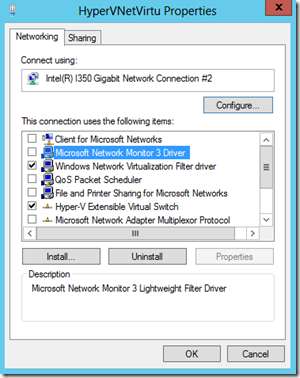](https://msdnshared.blob.core.windows.net/media/TNBlogsFS/prod.evol.blogs.technet.com/CommunityServer.Blogs.Components.WeblogFiles/00/00/00/95/48/metablogapi/6303.bindingsw2k12_5547270B.png)

Si l’on veut effectuer une trace réseau, il faut alors cocher la case “Microsoft Network Monitor 3 Driver”; le filter driver de Netmon qui permet de capturer des paquets.

Cochons cette case et lançons la trace réseau sur l’interface qui a été activé pour la virtualisation de réseau:

[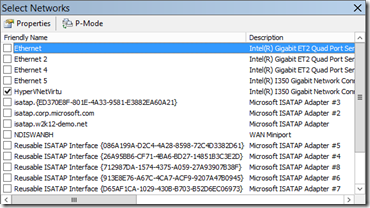](https://msdnshared.blob.core.windows.net/media/TNBlogsFS/prod.evol.blogs.technet.com/CommunityServer.Blogs.Components.WeblogFiles/00/00/00/95/48/metablogapi/0312.NM34-Bindings_330F1B85.png)

Démarrons alors la trace et regardons de plus près à l’encapsulation:

[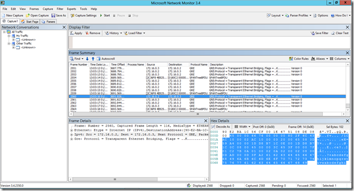](https://msdnshared.blob.core.windows.net/media/TNBlogsFS/prod.evol.blogs.technet.com/CommunityServer.Blogs.Components.WeblogFiles/00/00/00/95/48/metablogapi/8540.NM34-trace_178A1982.png)

Dans notre exemple, nous voyons sur la trace un paquet envoyé depuis 172.16.0.2 vers 172.16.0.3 avec pour protocole GRE. Nous sommes sur le réseau du provider, c’est donc bien ce qu’on s’attend à voir :

[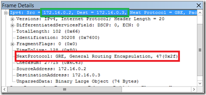](https://msdnshared.blob.core.windows.net/media/TNBlogsFS/prod.evol.blogs.technet.com/CommunityServer.Blogs.Components.WeblogFiles/00/00/00/95/48/metablogapi/7853.NM34-ip_336B28AD.png)

Regardons maintenant au paquet en hexa:

[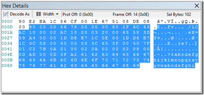](https://msdnshared.blob.core.windows.net/media/TNBlogsFS/prod.evol.blogs.technet.com/CommunityServer.Blogs.Components.WeblogFiles/00/00/00/95/48/metablogapi/4300.NM34-hex_060992DD.png)

Pour nos amis les plus avertis, cela ressemble à une payload de ping (abcd…. à la fin du paquet.) Essayons d’y voir un peu plus clair. D’après ce que l’on sait de l’encapsulation NVGRE, on doit y trouver quelque part l'identifiant de sous réseau virtuel (VSID).

Si l’on veut retrouver les VSID de nos machines virtuelles, on peut faire de la sorte en Powershell:

Get-NetVirtualizationLookupRecord

[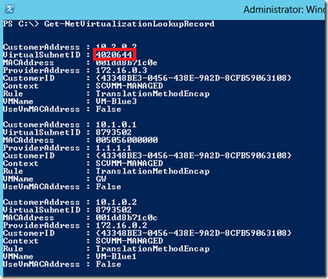](https://msdnshared.blob.core.windows.net/media/TNBlogsFS/prod.evol.blogs.technet.com/CommunityServer.Blogs.Components.WeblogFiles/00/00/00/95/48/metablogapi/8877.Get-NetVirtualizationLookupRecord_3C973E21.png)

Nous avons donc 4020644 (decimal) que nous devons convertir en hexadécimal. un petit coup de calc.exe nous permet de trouver **3D59A4.** Cherchons cette séquence dans le paquet…

[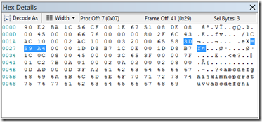](https://msdnshared.blob.core.windows.net/media/TNBlogsFS/prod.evol.blogs.technet.com/CommunityServer.Blogs.Components.WeblogFiles/00/00/00/95/48/metablogapi/7752.NM34-VSIDhex_12D3C32E.png)

Si l’on continue l’exploration du paquet, on voit même l’adresse IP de destination **10.2.0.2**:

[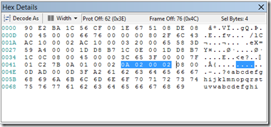](https://msdnshared.blob.core.windows.net/media/TNBlogsFS/prod.evol.blogs.technet.com/CommunityServer.Blogs.Components.WeblogFiles/00/00/00/95/48/metablogapi/0207.NM34-IPCA_5EBF23DA.png)

Voila comment se passe l’encapsulation NVGRE, c’est intéressant si l’on aime faire le parseur humain, sinon Message Analyzer sait interpréter automatiquement ces messages, regardons donc la même trace avec ce dernier outil !

## Message Analyzer

Message Analyzer est le remplaçant de Network Monitor qui permet d'Analyzer bien plus que des traces réseau, il est disponible sur connect ([http://connect.microsoft.com/site216](http://connect.microsoft.com/site216 "http://connect.microsoft.com/site216")) en Beta pour le moment. Ouvrons la trace précédente et observons le résultat :

[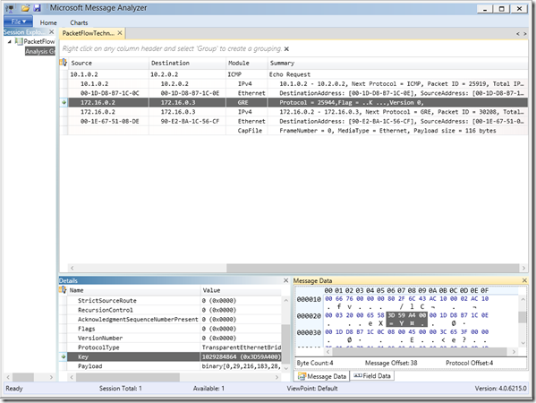](https://msdnshared.blob.core.windows.net/media/TNBlogsFS/prod.evol.blogs.technet.com/CommunityServer.Blogs.Components.WeblogFiles/00/00/00/95/48/metablogapi/4073.MAB3-NVGRE_67CBAF5B.png)

On a ici une meilleure vue sur l’encapsulation de protocoles, on retrouve le VSID dans le champ Key, et on a désormais le paquet complètement parsé. Beaucoup plus facilement utilisable pour dépannage !

**Notons** au passage que pour l’exemple de la démonstration, nous utilisons des machines sur des sous réseaux virtuels (VSID) différents :

[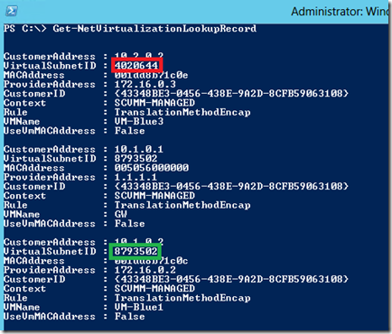](https://msdnshared.blob.core.windows.net/media/TNBlogsFS/prod.evol.blogs.technet.com/CommunityServer.Blogs.Components.WeblogFiles/00/00/00/95/48/metablogapi/5430.Get-NetVirtualizationLookupRecord2_7DD21AED.png)

L’hyperviseur qui envoi le paquet va remplir le GRE Key avec le VSID du destinataire, aussi lorsque la machine 10.2.0.2 va répondre au ping que l’on vient d’émettre, alors l’hyperviseur qui herberge la VM utilisera le VSID 8793502 enfin je veux dire 86 2D 9E !

Si vous en voulez plus, vous pourrez trouver sur **Microsoft Virtual Academy**, un ensemble de contenus dédiés à Windows Server 2012 et le réseau : [http://www.microsoftvirtualacademy.com/training-courses/services-reseaux-de-windows-server-2012](http://www.microsoftvirtualacademy.com/training-courses/services-reseaux-de-windows-server-2012 "http://www.microsoftvirtualacademy.com/training-courses/services-reseaux-de-windows-server-2012") 

Et si vous souhaitez **découvrir en 4 heures nos technologies** telles que Windows Server 2012 R2, Windows 8.1 en entreprise, le Cloud Privé ou Hybride par Microsoft, vous pouvez vous inscrire gratuitement à un de nos **IT Camp** : [https://aka.ms/itCampFr](https://aka.ms/itCampFr).

Références :

[http://blogs.technet.com/b/stanislas/archive/2013/07/19/hyper-v-network-virtualization-montage-pas-224-pas-d-une-plateforme-partie-1-introduction.aspx](https://blogs.technet.com/b/stanislas/archive/2013/07/19/hyper-v-network-virtualization-montage-pas-224-pas-d-une-plateforme-partie-1-introduction.aspx) – Premier article de la série de Stanislas

[http://tools.ietf.org/html/draft-sridharan-virtualization-nvgre-02](http://tools.ietf.org/html/draft-sridharan-virtualization-nvgre-02 "http://tools.ietf.org/html/draft-sridharan-virtualization-nvgre-02") – NVGRE @ IETF

[http://technet.microsoft.com/fr-fr/library/jj134174.aspx](http://technet.microsoft.com/fr-fr/library/jj134174.aspx "http://technet.microsoft.com/fr-fr/library/jj134174.aspx") – Détails techniques sur la virtualisation de réseau

[http://www.microsoft.com/en-us/download/details.aspx?id=39284](http://www.microsoft.com/en-us/download/details.aspx?id=39284 "http://www.microsoft.com/en-us/download/details.aspx?id=39284") – Test Lab Guide: Windows Server 2012 R2 Hyper-V Network Virtualization with System Center 2012 R2 VMM

Arnaud – [les bons tuyaux](https://www.facebook.com/arnaudlheureuxitpro)
