Dans une série d’articles, [Stanislas](https://aka.ms/stanislas) décrit comment mettre en place la virtualisation de réseau avec Hyper-V (HNV). C’est une technique fondamentale qui permet de faire cohabiter sur un réseau IP de Datacenter de multiples réseaux IP (de clients d’un cloud par exemple).

<!-- truncate -->

Pour cela, nous utilisons dans Windows Server 2012 (R2) et System Center Virtual Machine Manager 2012 SP1/R2  l’encapsulation NVGRE ([voir mon article précédent](http://blogs.technet.com/b/arnaud/archive/2013/08/01/hyper-v-network-virtualization-encapsulation-nvgre.aspx))

Puisque la vocation principale de HNV est de virtualiser et d’isoler les réseaux, lorsque nos machines isolées doivent communiquer avec l’extérieur, il faudra donc utiliser une passerelle qui permettra décapsuler/encapsuler pour envoyer ces paquets à :

-   Destination d’un réseau physique de Datacenter
-   Destination d’un autre protocole de virtualisation (VXLAN, ou autre)
-   Destination d’un réseau distant (VPN site-à-site, etc. )

Le but de cet article est de mettre en œuvre, étape par étape le composant Windows Server Gateway de Windows Server 2012 R2, avec l’aide de Virtual Machine Manager 2012 R2. Dans un prochain article, on décrira la mise en œuvre dans un VM Network et son utilisation. 

# Prérequis

Pour mettre en œuvre ces fonctionnalités du point de vue de nos machines virtuelles, il nous faut System Center Virtual Machine Manager 2012 R2.

Pour utiliser le rôle de passerelle “Windows Server Gateway” de Windows Server 2012 R2, ils nous faut deux choses :

-   un hyperviseur Windows Server 2012 R2 Hyper-V : 

> Cet Hyperviseur ne doit pas héberger de machines virtuelles utilisant la virtualisation de réseau (mais il peut héberger des VM classiques)

-   une machine virtuelle Windows Server 2012 R2 avec le rôle d’accès distant activé. C’est celle qui fera réellement toutes les opérations réseau et fera le rôle de passerelle de manière active.

Voici la plateforme que j’utilise :

[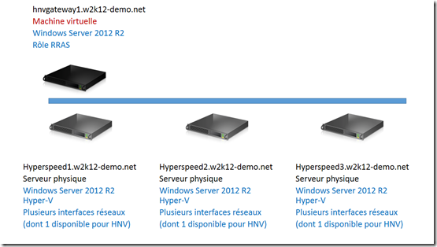](https://msdnshared.blob.core.windows.net/media/TNBlogsFS/prod.evol.blogs.technet.com/CommunityServer.Blogs.Components.WeblogFiles/00/00/00/95/48/metablogapi/7774.plateforme_59C8E4CB.png)

Cette machine virtuelle/passerelle HNV nécessite 3 interfaces réseaux virtuelles :

-   une carte réseau dans le réseau virtualisé HNV (la carte qui est sur le réseau provider/Datacenter, dans l’espace d’adressage PA),
-   une carte réseau sur le réseau extérieur (le réseau physique classique du Datacenter)
-   optionnellement (vraiment?) une carte réseau d’administration

# 1\. Paramétrage de l’hyperviseur pour les opérations de passerelle

La première étape se déroule dans System Center 2012 R2 VMM et consiste à configurer l’hyperviseur pour activer le rôle de passerelle, on va donc pour cela dans les propriétés de l’hyperviseur dans la partie Fabric pour activer l’option **This host is a dedicated network virtualisation Gateway…**  :

[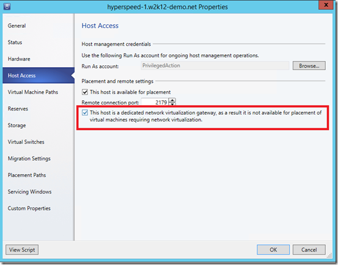](https://msdnshared.blob.core.windows.net/media/TNBlogsFS/prod.evol.blogs.technet.com/CommunityServer.Blogs.Components.WeblogFiles/00/00/00/95/48/metablogapi/4034.host1_447050C5.png)

Une fois cela validé, on va ajouter le couple hyperviseur/machine virtuelle dans notre configuration.

# 2\. Configuration des cartes réseau de la VM

Démarrons la machine virtuelle de la passerelle et vérifions l’état des connexions réseau, on doit avoir :

-   une carte sur le **réseau physique extérieur** (elle obtiendra son adresse IP par le DHCP du réseau physique ou par configuration manuelle).
-   une carte **d’administration** dans l’espace d’adressage du Datacenter (la machine doit pouvoir contacter des contrôleurs de domaine de l’organisation). Dans mon cas, le réseau d’administration et le réseau extérieur sont les mêmes, je n’ai que deux cartes.
-   une carte sur le **réseau NVGRE** (on devra configurer l’adresse IP manuellement dans la VM, on la laisse dans l’état déconnecté au moment du setup pour la repérer.)

La configuration de la carte NVGRE doit se faire via SCVMM, la difficulté est qu’il faut la connecter à un réseau logique sans la connecter à un VM Network, alors que cette option n’est pas présentée dans l’interface graphique !

Il faut alors :

Dans les propriétés de la carte réseau non connectée, on sélectionne l’option **VM Network** et on clique sur **Clear Selection** comme suit :

[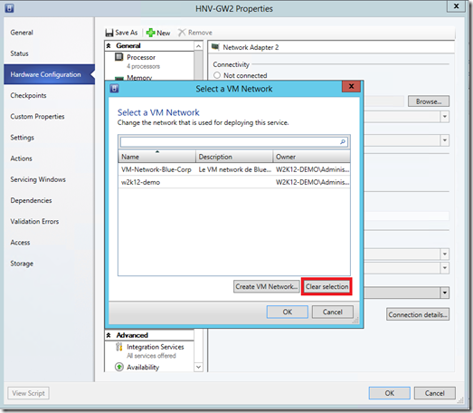](https://msdnshared.blob.core.windows.net/media/TNBlogsFS/prod.evol.blogs.technet.com/CommunityServer.Blogs.Components.WeblogFiles/00/00/00/95/48/metablogapi/8611.HNVbinding1_0A176B95.png)

On vérifie alors que la carte est connectée sur le réseau NVGRE, appelé dans notre cas LogicalSwitch-CloudProvider.

[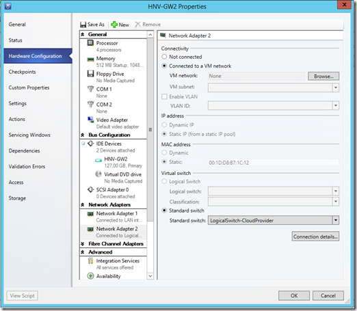](https://msdnshared.blob.core.windows.net/media/TNBlogsFS/prod.evol.blogs.technet.com/CommunityServer.Blogs.Components.WeblogFiles/00/00/00/95/48/metablogapi/2148.HNVbinding2_59867E8D.png)

On valide et continue la configuration.

# 3\. Déploiement de la passerelle dans VMM 2012 R2

Allons maintenant déclarer la passerelle comme ressource de la fabrique. Nous allons donc pour cela dans la console Fabric :

[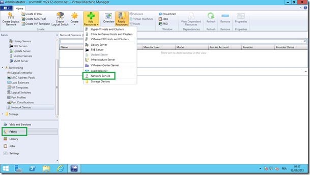](https://msdnshared.blob.core.windows.net/media/TNBlogsFS/prod.evol.blogs.technet.com/CommunityServer.Blogs.Components.WeblogFiles/00/00/00/95/48/metablogapi/1106.addgtw1_65358416.png)

[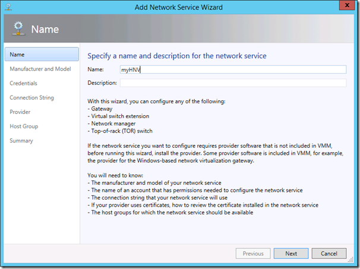](https://msdnshared.blob.core.windows.net/media/TNBlogsFS/prod.evol.blogs.technet.com/CommunityServer.Blogs.Components.WeblogFiles/00/00/00/95/48/metablogapi/7411.addgtw2_5401A673.png)

Nous spécifions ensuite le type de service réseau que nous ajoutons :

[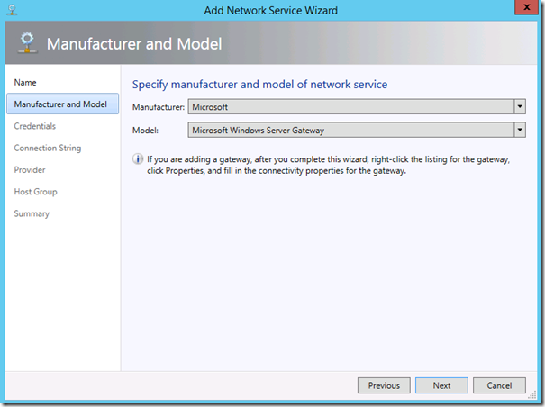](https://msdnshared.blob.core.windows.net/media/TNBlogsFS/prod.evol.blogs.technet.com/CommunityServer.Blogs.Components.WeblogFiles/00/00/00/95/48/metablogapi/4670.addgtw3_63550882.png)

Il s’agit ici de la passerelle implémentée dans Windows Server 2012 R2.

Nous devons ensuite spécifier un compte d’action qui a des droits administratifs :

-   sur l’hyperviseur physique
-   sur la machine virtuelle qui sert de passerelle

[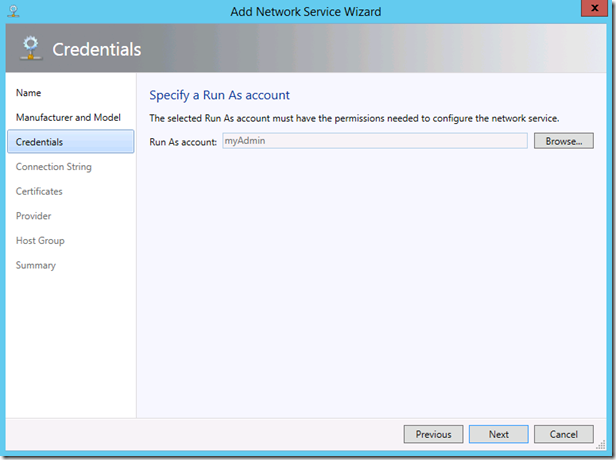](https://msdnshared.blob.core.windows.net/media/TNBlogsFS/prod.evol.blogs.technet.com/CommunityServer.Blogs.Components.WeblogFiles/00/00/00/95/48/metablogapi/7183.addgtw4_3CA67C35.png)

Nous spécifions ensuite la chaine de connexion à la plateforme. Cette chaine se compose comme suit : **VMHost=serveurPhysiqueHyperV;RRASServer=VMquiTourneLeServiceRRASS**

[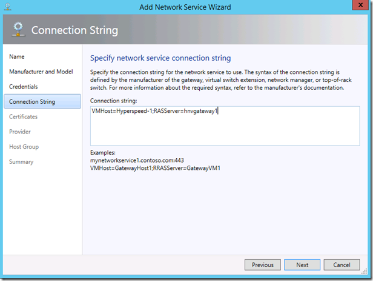](https://msdnshared.blob.core.windows.net/media/TNBlogsFS/prod.evol.blogs.technet.com/CommunityServer.Blogs.Components.WeblogFiles/00/00/00/95/48/metablogapi/5826.addgtw5_3A1D4A77.png)

[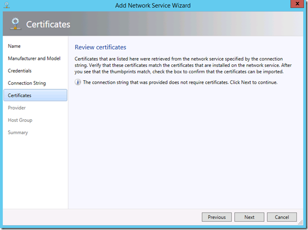](https://msdnshared.blob.core.windows.net/media/TNBlogsFS/prod.evol.blogs.technet.com/CommunityServer.Blogs.Components.WeblogFiles/00/00/00/95/48/metablogapi/5700.addgtw6_775DFF3E.png)

A l’étape étape test, on va se connecter à la machine physique et la machine virtuelle pour vérifier les différentes capacités de virtualisation.

[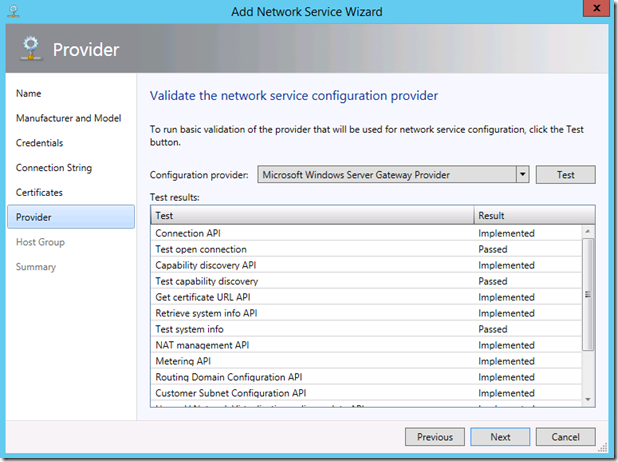](https://msdnshared.blob.core.windows.net/media/TNBlogsFS/prod.evol.blogs.technet.com/CommunityServer.Blogs.Components.WeblogFiles/00/00/00/95/48/metablogapi/2727.addgtw7_0DD09DC6.png)

On spécifie ensuite pour quels groupes d’hyperviseurs est disponible la passerelle.

[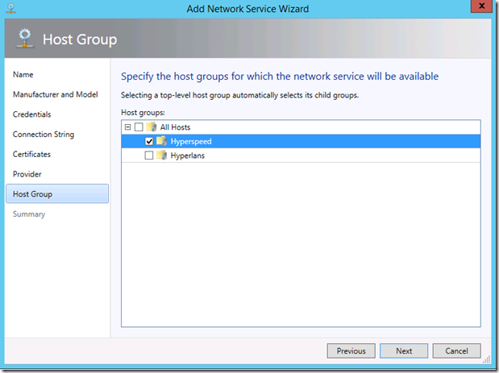](https://msdnshared.blob.core.windows.net/media/TNBlogsFS/prod.evol.blogs.technet.com/CommunityServer.Blogs.Components.WeblogFiles/00/00/00/95/48/metablogapi/8715.addgtw8_2AF645D0.png)

Validons la création.

[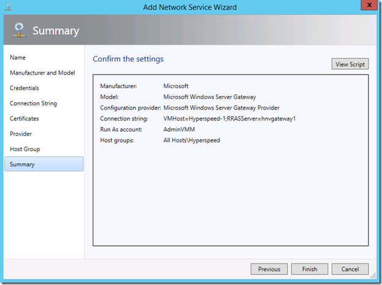](https://msdnshared.blob.core.windows.net/media/TNBlogsFS/prod.evol.blogs.technet.com/CommunityServer.Blogs.Components.WeblogFiles/00/00/00/95/48/metablogapi/0434.addgtw9_33969E5C.png)

Une fois l’ajout validé, on obtient alors l’écran de résumé de la passerelle. On peut alors constater qu’une passerelle HNV peut supporter dans cette version :

-   50 routing domains (VM Networks)
-   500 sous-réseaux virtuels (sous réseaux dans les VM networks)
-   200 connections VPN site à site

Normalement, en situation de production, on devrait avoir saturé le lien avant d’avoir atteint ces chiffres.

[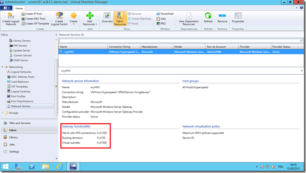](https://msdnshared.blob.core.windows.net/media/TNBlogsFS/prod.evol.blogs.technet.com/CommunityServer.Blogs.Components.WeblogFiles/00/00/00/95/48/metablogapi/1727.addgtw10_5128795B.png)

Lorsque la passerelle est ajoutée, il nous faut ensuite la configurer pour l’environnement.

# 4\. Paramétrage de la passerelle

L’étape de paramétrage est assez simple et va permettre de déterminer à quels usages sont destinées différentes cartes réseaux de la VM et du serveur physique.

[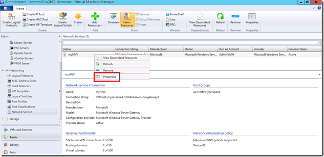](https://msdnshared.blob.core.windows.net/media/TNBlogsFS/prod.evol.blogs.technet.com/CommunityServer.Blogs.Components.WeblogFiles/00/00/00/95/48/metablogapi/0640.setugtw1_29A18724.png)

Nous devons à cette étape déterminer les interfaces réseau et leurs bindings :

-   **front-end** : interface connectée au réseau traditionnel (ici, ma carte réseau appelée “Dehors”). J’ai crée un réseau logique pour le réseau extérieur (InternetLogical), pour configurer dans VMM l’existence mon réseau physique Internet, j’y ai également ajouté un IP Pool, dans la plage 192.168.0.0/24, [pour plus de détails sur le réseau logique et sa création, voir l’article de Stanislas)](http://blogs.technet.com/b/stanislas/archive/2013/07/31/hyper-v-network-virtualization-montage-pas-224-pas-d-une-plateforme-partie-3-logical-network.aspx)

-   **back-end** : interface connectée au réseau virtualisé HNV (réseau PA) (ici ma carte réseau appelée NVGRE, sur le site Paris du réseau logicque NetCloudPRovider)

[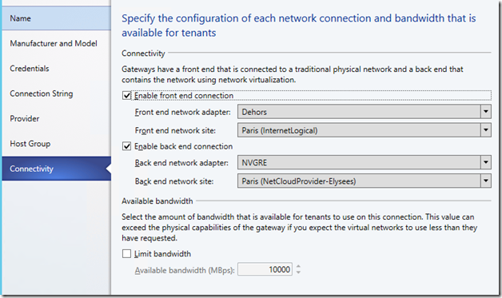](https://msdnshared.blob.core.windows.net/media/TNBlogsFS/prod.evol.blogs.technet.com/CommunityServer.Blogs.Components.WeblogFiles/00/00/00/95/48/metablogapi/2553.gtwbindings_3AD22553.png)

A cette étape, il se passe en fait plusieurs choses, le paramétrage des cartes réseaux virtuelles pour le service RAS, et le paramétrage du mode multi-locataire sur la carte virtuelle. On peut vérifier cela avec la commande PowerShell :

Get-VMNetworkAdapterIsolation

[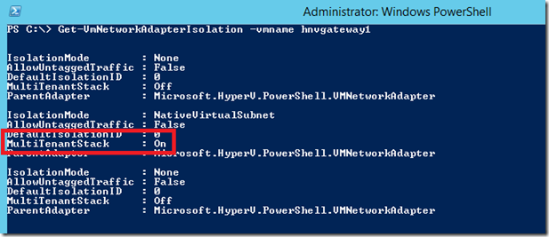](https://msdnshared.blob.core.windows.net/media/TNBlogsFS/prod.evol.blogs.technet.com/CommunityServer.Blogs.Components.WeblogFiles/00/00/00/95/48/metablogapi/0486.Get-VMNetworkAdapterIsolation_23B6BDBE.png)

Dans cet article, nous configurons la plateforme de base, dans un article suivant, nous configurerons les VM networks pour tirer partie de la passerelle ! Stay tuned !

Pour revenir aux premiers articles qui décrivent l’installation de la plateforme pas à pas :

partie 1 (introduction et principe à HNV) : [http://blogs.technet.com/b/stanislas/archive/2013/07/19/hyper-v-network-virtualization-montage-pas-224-pas-d-une-plateforme-partie-1-introduction.aspx](http://blogs.technet.com/b/stanislas/archive/2013/07/19/hyper-v-network-virtualization-montage-pas-224-pas-d-une-plateforme-partie-1-introduction.aspx)

partie 2 (description de la plateforme technique minimale) : [http://blogs.technet.com/b/stanislas/archive/2013/07/22/hyper-v-network-virtualization-montage-pas-224-pas-d-une-plateforme-partie-2-description-de-la-plateforme.aspx](http://blogs.technet.com/b/stanislas/archive/2013/07/22/hyper-v-network-virtualization-montage-pas-224-pas-d-une-plateforme-partie-2-description-de-la-plateforme.aspx)

partie 3 (création du réseau logique) : [http://blogs.technet.com/b/stanislas/archive/2013/07/31/hyper-v-network-virtualization-montage-pas-224-pas-d-une-plateforme-partie-3-logical-network.aspx](http://blogs.technet.com/b/stanislas/archive/2013/07/31/hyper-v-network-virtualization-montage-pas-224-pas-d-une-plateforme-partie-3-logical-network.aspx)

partie 4 (création des IP Pool pour Logical Network) : [http://blogs.technet.com/b/stanislas/archive/2013/08/01/hyper-v-network-virtualization-montage-pas-224-pas-d-une-plateforme-partie-4-ip-pool-pour-logical-network.aspx](http://blogs.technet.com/b/stanislas/archive/2013/08/01/hyper-v-network-virtualization-montage-pas-224-pas-d-une-plateforme-partie-4-ip-pool-pour-logical-network.aspx)

partie 5 (création du switch logique) : [http://blogs.technet.com/b/stanislas/archive/2013/08/02/hyper-v-network-virtualization-montage-pas-224-pas-d-une-plateforme-partie-5-logical-switch.aspx](http://blogs.technet.com/b/stanislas/archive/2013/08/02/hyper-v-network-virtualization-montage-pas-224-pas-d-une-plateforme-partie-5-logical-switch.aspx)

partie 6 (affectation du switch logique aux hyperviseurs de la plateforme) : [http://blogs.technet.com/b/stanislas/archive/2013/08/05/hyper-v-network-virtualization-montage-pas-224-pas-d-une-plateforme-partie-6-affection-du-logical-switch-aux-hyperviseurs.aspx](http://blogs.technet.com/b/stanislas/archive/2013/08/05/hyper-v-network-virtualization-montage-pas-224-pas-d-une-plateforme-partie-6-affection-du-logical-switch-aux-hyperviseurs.aspx)

partie 7 (création d’un VM Network) : [http://blogs.technet.com/b/stanislas/archive/2013/08/06/hyper-v-network-virtualization-montage-pas-224-pas-d-une-plateforme-partie-7-cr-233-ation-des-vm-networks.aspx](http://blogs.technet.com/b/stanislas/archive/2013/08/06/hyper-v-network-virtualization-montage-pas-224-pas-d-une-plateforme-partie-7-cr-233-ation-des-vm-networks.aspx)

partie 8 (création des IP Pool pour Virtual Subnet) : [http://blogs.technet.com/b/stanislas/archive/2013/08/07/hyper-v-network-virtualization-montage-pas-224-pas-d-une-plateforme-partie-8-cr-233-ation-des-ip-pool-ca.aspx](http://blogs.technet.com/b/stanislas/archive/2013/08/07/hyper-v-network-virtualization-montage-pas-224-pas-d-une-plateforme-partie-8-cr-233-ation-des-ip-pool-ca.aspx)

partie 9 – connexion de VM à des VM Networks : [http://blogs.technet.com/b/stanislas/archive/2013/08/08/hyper-v-network-virtualization-montage-pas-224-pas-d-une-plateforme-partie-9-connexion-de-vm-224-des-vm-networks.aspx](http://blogs.technet.com/b/stanislas/archive/2013/08/08/hyper-v-network-virtualization-montage-pas-224-pas-d-une-plateforme-partie-9-connexion-de-vm-224-des-vm-networks.aspx "http://blogs.technet.com/b/stanislas/archive/2013/08/08/hyper-v-network-virtualization-montage-pas-224-pas-d-une-plateforme-partie-9-connexion-de-vm-224-des-vm-networks.aspx")

Encapsulation NVGRE : [http://blogs.technet.com/b/arnaud/archive/2013/08/01/hyper-v-network-virtualization-encapsulation-nvgre.aspx](http://blogs.technet.com/b/arnaud/archive/2013/08/01/hyper-v-network-virtualization-encapsulation-nvgre.aspx "http://blogs.technet.com/b/arnaud/archive/2013/08/01/hyper-v-network-virtualization-encapsulation-nvgre.aspx")

Références :

[http://technet.microsoft.com/en-us/library/dn313101.aspx](http://technet.microsoft.com/en-us/library/dn313101.aspx "http://technet.microsoft.com/en-us/library/dn313101.aspx") – Windows Server Gateway

[http://technet.microsoft.com/library/dn249417.aspx](http://technet.microsoft.com/library/dn249417.aspx "http://technet.microsoft.com/library/dn249417.aspx") – How to Use a Server Running Windows Server 2012 R2 as a Gateway with VMM

[http://technet.microsoft.com/en-us/library/jj721575.aspx](http://technet.microsoft.com/en-us/library/jj721575.aspx "http://technet.microsoft.com/en-us/library/jj721575.aspx") – Configuring VM Networks and Gateways in VMM

Pour tester Windows Server 2012 R2 et Hyper-V, vous pouvez télécharger gratuitement la version d’évaluation disponible sous la forme :  
– d'une image ISO : [https://aka.ms/jeveuxwindows2012r2](https://aka.ms/jeveuxwindows2012r2)  
– d'un fichier VHD avec un système préinstallé : [https://aka.ms/jeveuxwindows2012r2](https://aka.ms/jeveuxwindows2012r2)

Et si vous souhaitez **découvrir en 4 heures nos technologies** telles que Windows Server 2012 R2, Windows 8.1 en entreprise, le Cloud Privé ou Hybride, vous pouvez vous inscrire gratuitement à un de nos IT Camps : [https://aka.ms/itCampFr](http://www.microsoft.com/click/services/Redirect2.ashx?CR_CC=200260510&CR_EAC=300100780). La liste des IT Camps de septembre 2013 à juin 2014 sera bientôt en ligne. Attention, il n’y aura qu’une date par sujet et par semestre par ville et le nombre de place est limité.

Arnaud – [les bons tuyaux](https://www.facebook.com/arnaudlheureuxitpro)
