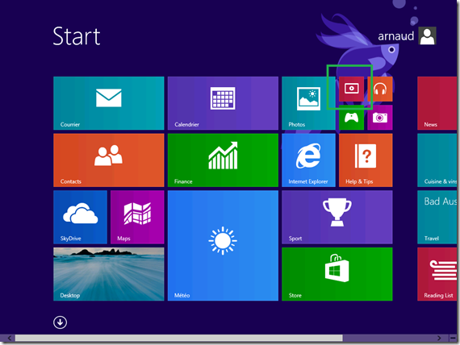
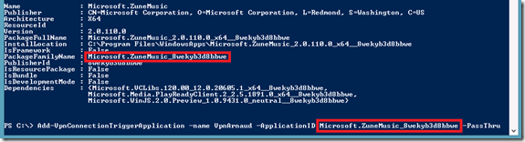
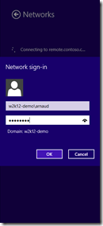
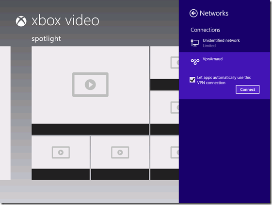
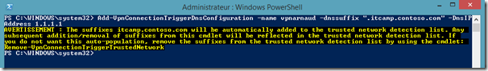
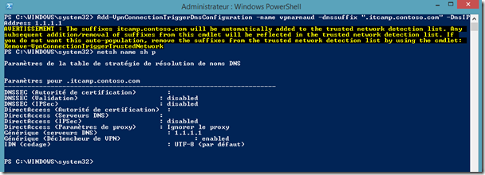
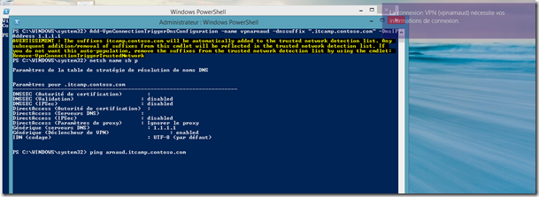

Parmi les nouveautés de Windows 8.1, on compte quelques évolutions concernant les accès distants, dans ce blog nous en couvrirons un certain nombre, regardons aujourd’hui VPN Connect.

<!-- truncate -->

Le principe est simple : monter automatiquement une connexion VPN au réseau d’entreprise lorsque :

-   Une application (moderne ou classique) est lancée
-   La machine/application utilise un suffixe DNS particulier

Bref, une technologie qui permet un accès au réseau d’entreprise quasi transparent, cela devrait vous faire penser à DirectAccess !

Et bien pas du tout ! VPN Connect c’est une technologie d’accès facile et sécurisé au réseau d’entreprise dans le cadre du BYOD (*Bring Your Own Device*). On est assez loin du spectre de fonctionnalités offertes par DirectAccess comme l’accès transparent au réseau y compris avant le logon d’un utilisateur.  

Point à noter TRES important qui devrait confirmer que cette technologie est vraiment faite pour le BYOD, la connexion automatique d’un VPN ne fonctionne PAS sur une machine jointe au domaine.

# Prérequis :

Cette fonctionnalité peut être mise en œuvre avec tout type de VPN supporté dans Windows 8.1 *(nous traiterons dans un article ultérieur les évolutions du client VPN)*. Dans cet article nous ne donnons pas les détails de la plateforme serveur VPN, car ils s’agit d’une plateforme standard configurée avec l’assistant par défaut de Windows Server 2012 R2.

La machine cliente doit être une machine Windows 8.1 NON jointe à un domaine, et PAS d’édition Entreprise.

Le type de VPN est obligatoirement Split Tunneling, ceci permet de ne pas modifier la connectivité des autres applications lorsque l’on établit la liaison pour une application particulière.

# Tests :

Mettons en place cette fonctionnalité pour différents scenarios.

Dans ces rubriques, j’ai au préalable créé sur la machine cliente un profile VPN nommé “VpnArnaud”.

J’ai modifié le type de tunneling avec la commande PowerShell:

Set-VpnConnection –name VpnArnaud –SplitTunneling $true

## Connexion automatique pour une application moderne

La première chose à faire est de trouver l’application que l’on veut utiliser, dans notre exemple, nous connectons automatiquement le VPN lors du lancement de l’application Video :

Pour chercher l’identifiant de cette application, nous utilisons la commande PowerShell :

Get-AppxPackage

Le champ utilisé ici est le PackageFamilyName, nous pouvons alors ajouter la configuration :

Add-VpnConnectionTriggerApplication –name <vpnConnectionName> –ApplicationID <PackageFamilyName>

Au lancement de l’application vidéo, nous avons alors l’avertissement :

Je dois ensuite saisir mes informations de connexion si elles ne sont pas stockées.

 

J’obtiens alors bien la machine connectée :

Lorsque toutes les applications qui ont besoin de la connexion sont fermées, alors la connexion est automatiquement tombée.

## Connexion automatique pour une application classique

Il est possible d’établir une connexion de la même manière pour les applications Windows classiques. On utilisera toujours l’argument –ApplicationID, mais cette fois on précisera la chemin vers l’application :

Add-VpnConnectionTriggerApplication –name <vpnConnectionName> –ApplicationID “c:\\windows\\system32\\notepad.exe”

A noter, on peut utiliser les variables d’environnement avec la forme “$env:windir\\…”

On peut ensuite vérifier la configuration avec la commande Get-VpnConnectionTrigger –name <vpnConnectionName>

## Connexion automatique pour un suffixe DNS

De la même manière, on peut déclencher une connexion lorsqu’un suffixe DNS particulier est utilisé :

Add-VpnConnectionTriggerDnsConfiguration –name <vpnConnectionName> –DnsSuffix “.itcamp.contoso.com” –DnsIPAddress <AdressIPduServeurDNS>

N’oubliez surtout pas le point avant le suffixe DNS !

Remarquons au passage que pour chaque suffixe, on doit mentionner l’adresse IP d’un serveur DNS qui sera utilisé. Nous allons mettre en œuvre un composant de Windows apparu avec Windows 7, la NRPT (*Name Resolution Policy Table*) qui permet de faire de la résolution de nom conditionnelle sur le poste client.

On peut également profiter de cette ligne de commande pour ajouter automatiquement une liste de suffixes de recherche DNS lorsque le VPN est monté, cela permet de résoudre des noms courts sur le réseau d’entreprise, on utilise alors l’argument –DnsSuffixSearchList <listeDeSuffixesàAjouter>.

On a alors une notification lorsque l’on utilise le contexte de noms :

Voilà pour cette petite intro à VPN Connect, a noter, lorsque les credentials sont stockés, on a automatiquement la connexion qui est montée !

Si  vous souhaitez **découvrir en 4 heures nos technologies** telles que Windows Server 2012 R2, Windows 8.1 en entreprise, le Cloud Privé ou Hybride par Microsoft, vous pouvez vous inscrire gratuitement à un de nos **IT Camp** : [https://aka.ms/itCampFr](http://www.microsoft.com/click/services/Redirect2.ashx?CR_CC=200260510&CR_EAC=300100780).

Références :

[http://technet.microsoft.com/en-us/library/jj554820(v=wps.630).aspx](http://technet.microsoft.com/en-us/library/jj554820\(v=wps.630\).aspx "http://technet.microsoft.com/en-us/library/jj554820(v=wps.630).aspx") – VPN Client Cmdlets in Windows PowerShell

Arnaud – [les bons tuyaux](https://www.facebook.com/arnaudlheureuxitpro)
