Dans le cadre du BYOD (Bring Your Own Device), on cherche a ajouter un peu de contrôle et de sécurité sur des périphériques qui sont “moins” gérés que les autres. Gérer des périphériques, on sait faire cela depuis des années avec Active Directory, et si a l’origine ou n’avait que Windows, on peut désormais rajouter tout un ensemble de périphériques dans l’AD pour y apporter plus ou moins de gestion.

<!-- truncate -->

DRS fait partie d’un ensemble des technologies nouvelles dans Windows Server 2012 R2 pour le BYOD. Le rôle de DRS est d’authentifier des machines via Active Directory sans nécessairement les ajouter au domaine au sens classique. Ainsi on tirera partie de cette authentification pour contrôler l’accès à des ressources du réseau d’entreprise (la tablette comme second facteur d’authentification), ou encore pour faire du SSO. 

DRS est implémenté en tant que partie d’AD FS (Active Directory Federation Services) et dans un premier temps on supporte les clients Windows 8.1 et iOS.

Dans cet article nous mettrons en œuvre l’infrastructure qui permettra d’ajouter des tablettes ou périphériques depuis le réseau interne, mais cela est aussi réalisable depuis l’Internet.

**Objectifs de cet article** : Pouvoir authentifier et autoriser l’accès à une application si mes utilisateurs sont authentifiés ET sont connectés depuis une tablette autorisée dans mon environnement.

     Cet article fait partie d’une série :  

1.  **Ce premier article décrit comment mettre en place l’infrastructure pour le réseau interne.**
2.  Un deuxième article décrira les tests basiques côté client
3.  Un troisième article décrira la mise en œuvre du contrôle d’accès sur l’application.

# Configuration côté serveur

J’ai sur mon réseau interne un contrôleur de domaine nommé *dublinr2-1* et une autorité de certification racine d’entreprise nommée *ITCampTestCA* dans mon domaine *TESTITCAMP.CONTOSO.COM*.

/!\\ ALERTE PKI /!\\

Attention, pour toutes les opérations, l’état de révocation des certificats va être vérifié, il faut donc que la PKI soit relativement propre…. C’est à dire un point de vérification du statut de révocation des certificats disponible quelque soit l’emplacement réseau des machines (dans le domaine ou en dehors).

Pour la première étape, j’ajoute le rôle ADFS sur une machine nommé ADFS01 sans y effectuer le paramétrage initial… voyons le reste des étapes de configuration en détails. 

[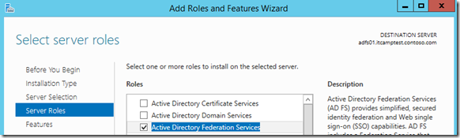](https://msdnshared.blob.core.windows.net/media/TNBlogsFS/prod.evol.blogs.technet.com/CommunityServer.Blogs.Components.WeblogFiles/00/00/00/95/48/metablogapi/1462.adfs01_533E20BF.png)

## Configuration de ADFS

L’installation du rôle ADFS ayant été effectuée, je vais devoir planifier plusieurs facteurs importants, les certificats utilisés ainsi quels comptes de services utilisés.

### Création des comptes de service

Mon domaine est en niveau fonctionnel 2012, je peux donc utiliser les comptes de services gMSA, je les crée en Powershell en utilisant la syntaxe suivante :

Add-KdsRootKey –EffectiveTime (Get-Date).AddHours(-10)

New-ADServiceAccount ADFS-Gmsa -DNSHostName adfs01.itcamptest.contoso.com -ServicePrincipalNames http/adfs01.itcamptest.contoso.com

Le première commande n’est utilisée que la première fois que l’on crée un gMSA dans un environnement ([pour référence](http://technet.microsoft.com/fr-fr/library/jj128430.aspx)).

La seconde ligne permet réellement la création du compte ainsi que son SPN.

### Création des certificats

Nous allons maintenant demander un certificat qui correspond à cette machine et qui a le *subject alternate name* nécessaire pour DRS :

Subject Name (CN): adfs01.itcamptest.contoso.com  
Subject Alternative Name (DNS): adfs01.itcamptest.contoso.com  
**Subject Alternative Name (DNS): enterpriseregistration.itcamptest.contoso.com**

### Paramétrage d’ADFS

On lance l’assistant depuis le gestionnaire de serveur :

[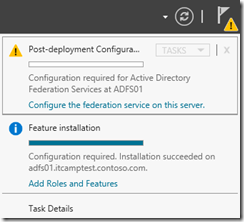](https://msdnshared.blob.core.windows.net/media/TNBlogsFS/prod.evol.blogs.technet.com/CommunityServer.Blogs.Components.WeblogFiles/00/00/00/95/48/metablogapi/5040.adfs02_045FEC11.png)

Nous déployons le premier serveur ADFS de l’organisation :

[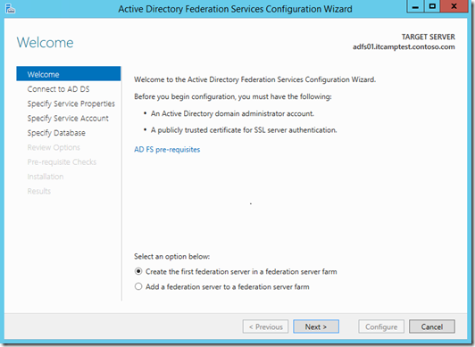](https://msdnshared.blob.core.windows.net/media/TNBlogsFS/prod.evol.blogs.technet.com/CommunityServer.Blogs.Components.WeblogFiles/00/00/00/95/48/metablogapi/1385.adfs03_442C6347.png)

Spécifions des credentiels administrateurs du domaine :

[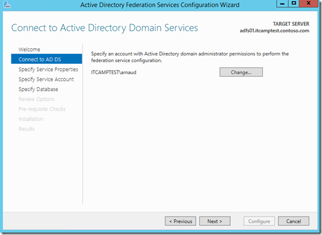](https://msdnshared.blob.core.windows.net/media/TNBlogsFS/prod.evol.blogs.technet.com/CommunityServer.Blogs.Components.WeblogFiles/00/00/00/95/48/metablogapi/7127.adfs04_5C525E53.png)

Nous sélectionnons maintenant le certificat *adfs01.itcamptest.contoso.com* que nous avons créé précédemment:

[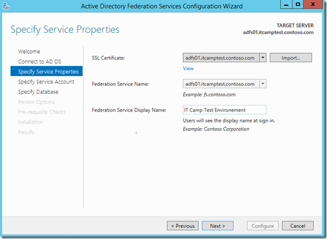](https://msdnshared.blob.core.windows.net/media/TNBlogsFS/prod.evol.blogs.technet.com/CommunityServer.Blogs.Components.WeblogFiles/00/00/00/95/48/metablogapi/5355.adfs05_5052FED0.png)

Spécifions le compte de service que nous avons crée précédemment:

[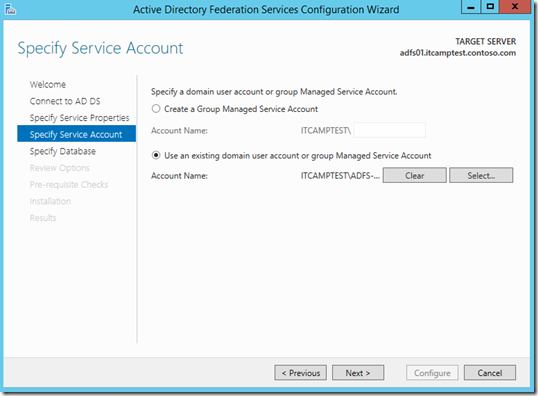](https://msdnshared.blob.core.windows.net/media/TNBlogsFS/prod.evol.blogs.technet.com/CommunityServer.Blogs.Components.WeblogFiles/00/00/00/95/48/metablogapi/2110.adfs06_6159BD64.png)

Dans un environnement de production, j’utiliserai une base SQL, pour mon environnement de test, la base WID devrait faire l’affaire:

[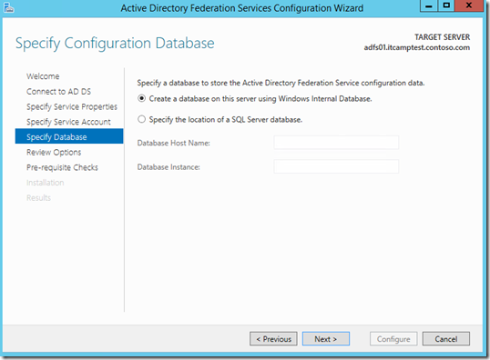](https://msdnshared.blob.core.windows.net/media/TNBlogsFS/prod.evol.blogs.technet.com/CommunityServer.Blogs.Components.WeblogFiles/00/00/00/95/48/metablogapi/4137.adfs07_632CA3DC.png)

Revoyons les options :

[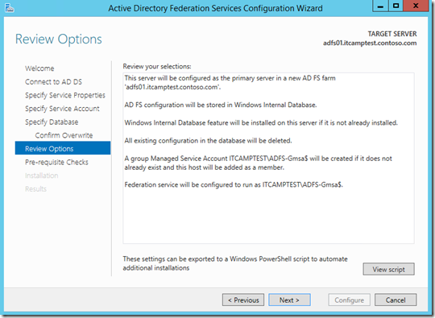](https://msdnshared.blob.core.windows.net/media/TNBlogsFS/prod.evol.blogs.technet.com/CommunityServer.Blogs.Components.WeblogFiles/00/00/00/95/48/metablogapi/3463.adfs08_16F72ADF.png)

[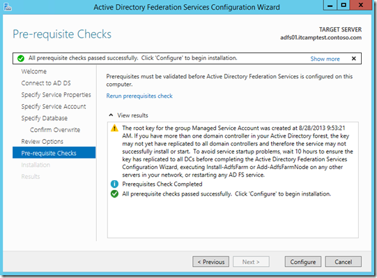](https://msdnshared.blob.core.windows.net/media/TNBlogsFS/prod.evol.blogs.technet.com/CommunityServer.Blogs.Components.WeblogFiles/00/00/00/95/48/metablogapi/2337.adfs09_1CD45F29.png)

Enfin :

[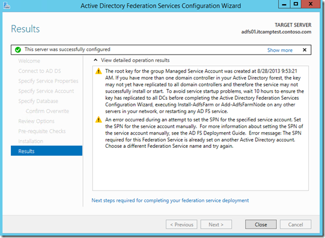](https://msdnshared.blob.core.windows.net/media/TNBlogsFS/prod.evol.blogs.technet.com/CommunityServer.Blogs.Components.WeblogFiles/00/00/00/95/48/metablogapi/5488.adfs10_776CFC6B.png)

On remarquera ici un message d’attention qui nous spécifie que l’enregistrement du SPN ne s’est pas bien passé. C’est sans doute l’assistant qui ne s’attendait pas à ce que je l’ai déjà fait.

Pour en avoir le cœur net, je vérifie avec *setspn –q* <SPNdeMonServeur>

[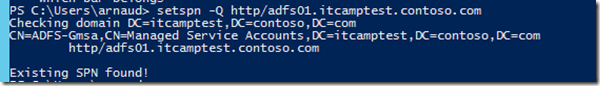](https://msdnshared.blob.core.windows.net/media/TNBlogsFS/prod.evol.blogs.technet.com/CommunityServer.Blogs.Components.WeblogFiles/00/00/00/95/48/metablogapi/4505.setspn01_6A9536FE.png)

Cela m’a l’air correct  

### Activation de DRS

Ouvrons une commande PowerShell pour activer le composant DRS:

Pour Windows Server 2012 R2 Preview :

Enable-AdfsDeviceRegistration –PrepareActiveDirectory –ServiceAccountName **itcamptest\\ADFS-Gmsa$**

[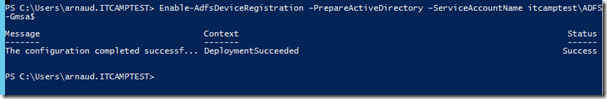](https://msdnshared.blob.core.windows.net/media/TNBlogsFS/prod.evol.blogs.technet.com/CommunityServer.Blogs.Components.WeblogFiles/00/00/00/95/48/metablogapi/3808.Enable-ADFSDeviceReg01_133633B7.png)

Pour Windows Server 2012 R2 RTM :

Initialize-ADDeviceRegistration

On active le service DRS : Enable-AdfsDeviceRegistration

[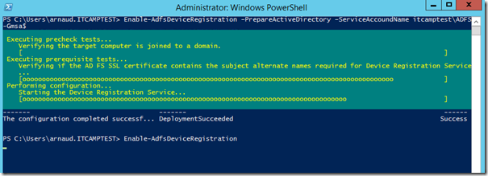](https://msdnshared.blob.core.windows.net/media/TNBlogsFS/prod.evol.blogs.technet.com/CommunityServer.Blogs.Components.WeblogFiles/00/00/00/95/48/metablogapi/3056.Enable-ADFSDeviceReg02_7DDB0EFF.png)

### Création des enregistrements DNS

La machine ADFS01 va s’enregistrer et mettre à jour automatiquement dans le DNS, je dois en revanche crée un alias pour le nom utilisé par les machines clientes DRS soit le nom **enterpriseregistration.<UPN du contexte utilisateur>.**

Dans mon environnement, l’UPN est itcamptest.contoso.com, j’utilise donc *enterpriseregistration.itcamptest.contoso.com*

Dans la vraie vie, je devrais mettre un enregistrement pour tous les UPN présents dans mon organisation.

Dans la console DNS, je modifie la zone de recherche directe liée à mon domaine :

[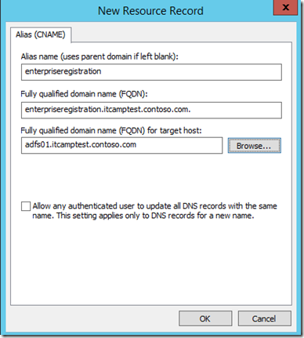](https://msdnshared.blob.core.windows.net/media/TNBlogsFS/prod.evol.blogs.technet.com/CommunityServer.Blogs.Components.WeblogFiles/00/00/00/95/48/metablogapi/7043.dns01_1D204684.png)

### Vérifications

On peut enfin vérifier l’état opérationnel du service en confirmand la présence de l’évènement 100 dans le journal d’évènements “Device Registration Service/DRS/Admin” :

[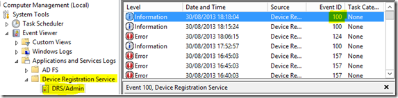](https://msdnshared.blob.core.windows.net/media/TNBlogsFS/prod.evol.blogs.technet.com/CommunityServer.Blogs.Components.WeblogFiles/00/00/00/95/48/metablogapi/3223.eventlogs_0E782B50.png)

L’environnement serveur est maintenant prêt pour accueillir ses périphériques et tester la fonctionnalité de *workplace join* !

Références :

[http://technet.microsoft.com/en-us/library/dn280938.aspx](http://technet.microsoft.com/en-us/library/dn280938.aspx "http://technet.microsoft.com/en-us/library/dn280938.aspx") – Get Started with Workplace Join with a Windows Device: Walkthrough Guide

[http://technet.microsoft.com/en-us/library/dn280939.aspx](http://technet.microsoft.com/en-us/library/dn280939.aspx "http://technet.microsoft.com/en-us/library/dn280939.aspx") – Setting up the lab environment 

[http://technet.microsoft.com/en-us/library/dn303423.aspx](http://technet.microsoft.com/en-us/library/dn303423.aspx "http://technet.microsoft.com/en-us/library/dn303423.aspx") – How to deploy AD FS in Windows Server 2012 R2

[http://blogs.technet.com/b/byod-fr/archive/2013/07/11/byod-le-workplace-join-de-windows-server-2012-r2.aspx](http://blogs.technet.com/b/byod-fr/archive/2013/07/11/byod-le-workplace-join-de-windows-server-2012-r2.aspx "http://blogs.technet.com/b/byod-fr/archive/2013/07/11/byod-le-workplace-join-de-windows-server-2012-r2.aspx") – BYOD : Le “Workplace Join” de Windows Server 2012 R2  –

\*Edit le 10/10/13 pour intégrer changements de Windows Server 2012 R2 RTM

Pour tester Windows Server 2012 R2 et Hyper-V, vous pouvez télécharger gratuitement la version d’évaluation disponible sous la forme :  
– d’une image ISO : [https://aka.ms/jeveuxwindows2012r2](https://aka.ms/jeveuxwindows2012r2)  
– d’un fichier VHD avec un système préinstallé : [https://aka.ms/jeveuxwindows2012r2](https://aka.ms/jeveuxwindows2012r2)

Si vous souhaitez **découvrir en 4 heures nos technologies** telles que **Windows Server 2012 R2**, Windows **8.1 en entreprise**, le Cloud Privé ou Hybride, vous pouvez vous inscrire gratuitement à un de nos IT Camps :

[https://aka.ms/itCampFr](http://www.microsoft.com/click/services/Redirect2.ashx?CR_CC=200260510)

Arnaud – [les bons tuyaux](https://www.facebook.com/arnaudlheureuxitpro)
