IPAM (IP Address Management) est un service d’entreprise qui permet de gérer de manière centralisée, les informations concernant l’utilisation d’adresses IP au sein d’une organisation. Ceci se fait en en consolidant les informations provenant de l’Active Directory, du DHCP, du DNS, de NPS, de Virtual Machine Manager et même d’entrées manuelles (pour remplacer la bonne vieille fiche Excel de gestion des IP).

<!-- truncate -->

Après la [première implémentation de la technologie dans Windows Server 2012](http://blogs.technet.com/b/arnaud/archive/2013/03/12/ip-address-management-ipam-de-windows-server-2012.aspx), nous avons fait évoluer la fonctionnalité dans Windows Server 2012 R2 pour inclure beaucoup d’améliorations et principalement :

1.  Gestion des espaces d’adressages virtualisés avec la virtualisation de réseau de System Center Virtual Machine Manager
2.  Synchronisation des réseaux avec la notion de sites Active Directory
3.  Définition pour granulaire des rôles (administration, vue uniquement d’une partie de l’espace d’adressage ou de noms)
4.  Statistiques détaillées par zones (pour environnement hautement concentrés)
5.  Support de SQL Server pour stocker les informations (dans 2012, uniquement avec Windows Integrated Database)
6.  Support de DHCP amélioré (support de DHCP failover, de l’attribution d’adresses par stratégie, des superscopes, des filtres et réservations)
7.  Support de PowerShell étendu

L’interface est désormais constituée de 7 parties principales :

-   Server inventory management
-   IP address space management
-   Virtualized address space
-   Management and Monitoring of DHCP and DNS
-   Event Catalog
-   IP address tracking
-   Access Control

Comme on peut le voir sur la capture suivante :

[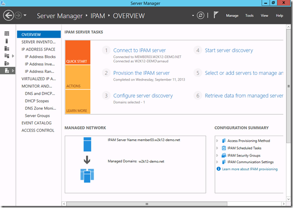](https://msdnshared.blob.core.windows.net/media/TNBlogsFS/prod.evol.blogs.technet.com/CommunityServer.Blogs.Components.WeblogFiles/00/00/00/95/48/metablogapi/4784.mainscreen_25C24965.png)

Prenons un peu de temps pour étudier quelques aspects.

# Améliorations pour le support de DHCP :

Désormais l’interface principale d’IPAM permet de gérer quasiment l’ensemble des informations relatives aux espaces d’adressages configurables dans les MMC de DHCP. On peut ainsi administrer les relations de [failover entre serveurs DHCP](http://blogs.technet.com/b/arnaud/archive/2013/03/21/windows-server-2012-dhcp-failover.aspx), [gérer les attributions d’adresses par stratégies](http://blogs.technet.com/b/arnaud/archive/2013/06/13/windows-server-2012-dhcp-attribution-bas-233-e-sur-des-strat-233-gies.aspx), les réservations, filtres et les superscopes.

Voici quelques unes des options de gestion d’une étendue DHCP :

[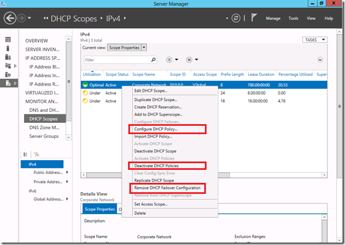](https://msdnshared.blob.core.windows.net/media/TNBlogsFS/prod.evol.blogs.technet.com/CommunityServer.Blogs.Components.WeblogFiles/00/00/00/95/48/metablogapi/2548.scopemanagement_2075F365.png)

On peut par exemple désormais configurer les stratégies d’attribution d’adresses directement dans IPAM :

[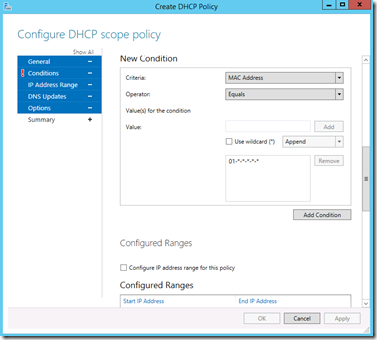](https://msdnshared.blob.core.windows.net/media/TNBlogsFS/prod.evol.blogs.technet.com/CommunityServer.Blogs.Components.WeblogFiles/00/00/00/95/48/metablogapi/2577.configurepolicy_7D4B1963.png)

Nous avons également une vue et une gestion des réservations intégrée, en sélectionnant la vue “Reservations” de la partie DHCP Scopes :

[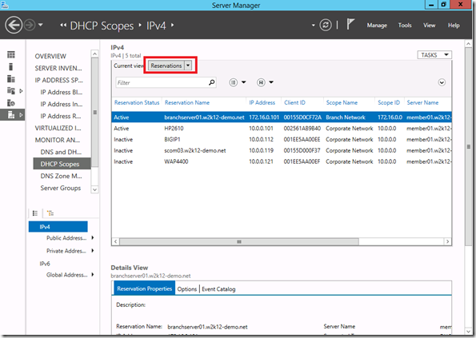](https://msdnshared.blob.core.windows.net/media/TNBlogsFS/prod.evol.blogs.technet.com/CommunityServer.Blogs.Components.WeblogFiles/00/00/00/95/48/metablogapi/6102.reservations_4EF42467.png)

# Gestion des réseaux virtualisés de System Center Virtual Machine Manager 2012 :

La virtualisation de réseau permet, à partir de Windows Server 2012 et System Center 2012 SP1, de faire cohabiter sur un réseau IP de datacenter, plusieurs réseaux de clients qui potentiellement partageraient le même espace d’adressage. Pour plus de détails sur la mise en œuvre de cette technologie, nous vous invitons à vous référer à la [série d’article que Stanislas](http://blogs.technet.com/b/stanislas/archive/2013/07/19/hyper-v-network-virtualization-montage-pas-224-pas-d-une-plateforme-partie-1-introduction.aspx) et [moi même](http://blogs.technet.com/b/arnaud/archive/2013/08/13/hyper-v-network-virtualization-montage-pas-224-pas-d-une-plateforme-partie-10-windows-server-gateway.aspx) avons écrit.

### Comment activer la gestion des espaces d’adressage virtualisés

Pour activer le reporting d’informations de System Center Virtual Machine Manager, il faut modifier la configuration de la fabrique pour activer le composant IPAM qui est désormais intégré.

Ajout d’un service réseau dans la fabrique :

[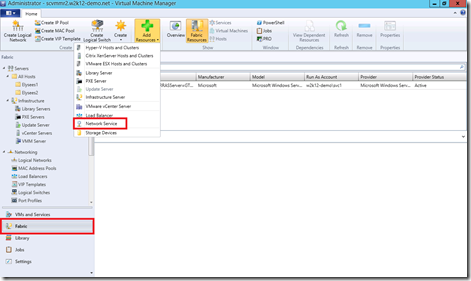](https://msdnshared.blob.core.windows.net/media/TNBlogsFS/prod.evol.blogs.technet.com/CommunityServer.Blogs.Components.WeblogFiles/00/00/00/95/48/metablogapi/8463.scvmm1_1743FAE8.png)

On ajoute ensuite un service que l’on nomme :

[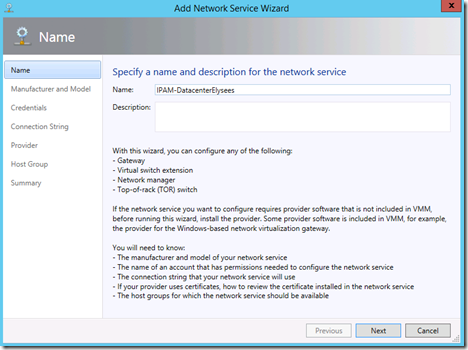](https://msdnshared.blob.core.windows.net/media/TNBlogsFS/prod.evol.blogs.technet.com/CommunityServer.Blogs.Components.WeblogFiles/00/00/00/95/48/metablogapi/0820.scvmm2_03B92BF8.png)

On doit spécifier un service de type Microsoft Windows Server IP Address Management :

[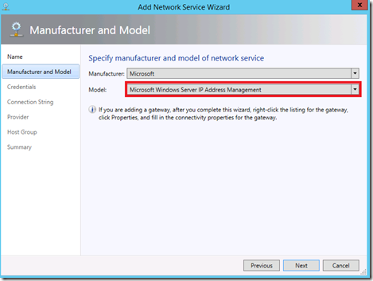](https://msdnshared.blob.core.windows.net/media/TNBlogsFS/prod.evol.blogs.technet.com/CommunityServer.Blogs.Components.WeblogFiles/00/00/00/95/48/metablogapi/8715.scvmm3_10B59CBA.png)

On spécifie un compte avec des droits IPAM Administrator sur le serveur IPAM :

[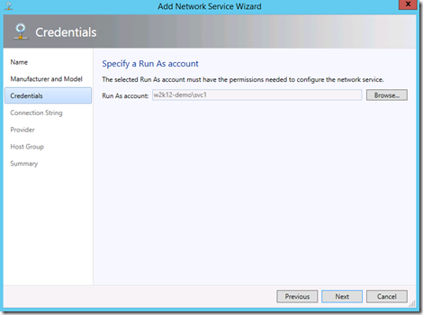](https://msdnshared.blob.core.windows.net/media/TNBlogsFS/prod.evol.blogs.technet.com/CommunityServer.Blogs.Components.WeblogFiles/00/00/00/95/48/metablogapi/0842.scvmm4_28DB97C6.png)

On spécifie ensuite le chemin de connexion (pour IPAM, c’est simple, c’est juste le nom du serveur) :

[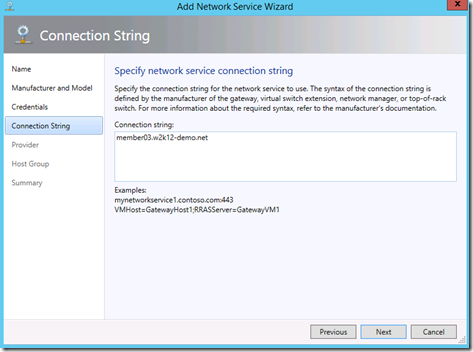](https://msdnshared.blob.core.windows.net/media/TNBlogsFS/prod.evol.blogs.technet.com/CommunityServer.Blogs.Components.WeblogFiles/00/00/00/95/48/metablogapi/3872.scvmm5_0137AC4D.png)

On teste la connexion et vérifie que l’on a bien un résultat “passed” et “implemented” :

[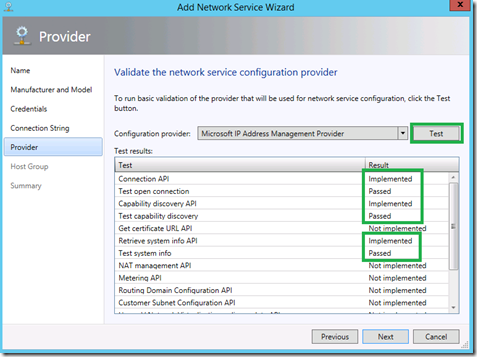](https://msdnshared.blob.core.windows.net/media/TNBlogsFS/prod.evol.blogs.technet.com/CommunityServer.Blogs.Components.WeblogFiles/00/00/00/95/48/metablogapi/4338.scvmm6_2E4F29CC.png)

On spécifie les groupes d’hyperviseurs que l’on souhaite inclure dans le scope du reporting IPAM :

[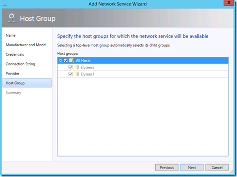](https://msdnshared.blob.core.windows.net/media/TNBlogsFS/prod.evol.blogs.technet.com/CommunityServer.Blogs.Components.WeblogFiles/00/00/00/95/48/metablogapi/5367.scvmm7_224FCA49.png)

On valide :

[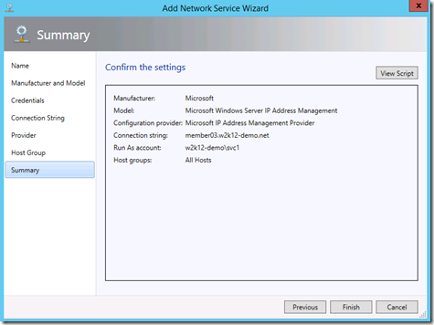](https://msdnshared.blob.core.windows.net/media/TNBlogsFS/prod.evol.blogs.technet.com/CommunityServer.Blogs.Components.WeblogFiles/00/00/00/95/48/metablogapi/6811.scvmm8_05D5691A.png)

et on vérifie que le job s’effectue correctement !

### Administration des espaces virtualisés

Lorsque l’environnement a été paramétré, on peut alors voir l’ensemble des informations relatives aux :

-   Espace d’adressage et adresses utilisées sur le réseau de Datacenter (provider addresses)
-   Espaces d’adressages et adresses des différents réseaux virtualisés (Customer addresses)

**Vision sur l’espace d’adressage PA :**

[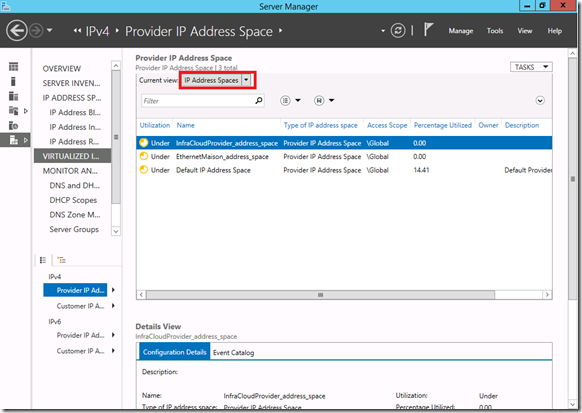](https://msdnshared.blob.core.windows.net/media/TNBlogsFS/prod.evol.blogs.technet.com/CommunityServer.Blogs.Components.WeblogFiles/00/00/00/95/48/metablogapi/1423.pa-spaces_20A41FD7.png)

Avec la vue “IP address spaces”, on peut voir les différents espaces d’adressages utilisés dans le Datacenter pour la virtualisation de réseau (les adresses définies pour les logical network)

**Utilisation des adresses PA:**

[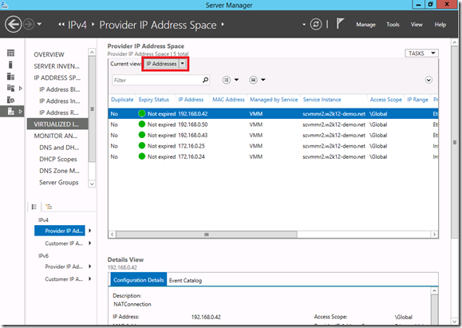](https://msdnshared.blob.core.windows.net/media/TNBlogsFS/prod.evol.blogs.technet.com/CommunityServer.Blogs.Components.WeblogFiles/00/00/00/95/48/metablogapi/8015.pa-addresses_01EFC69D.png)

Si on sélectionne la vue “IP addresses”, on peut alors voir quelles sont les IP attribuées aux hyperviseurs participants à la plateforme de virtualisation (les PA addresses)

**Vision des espaces d’adressages CA :**

[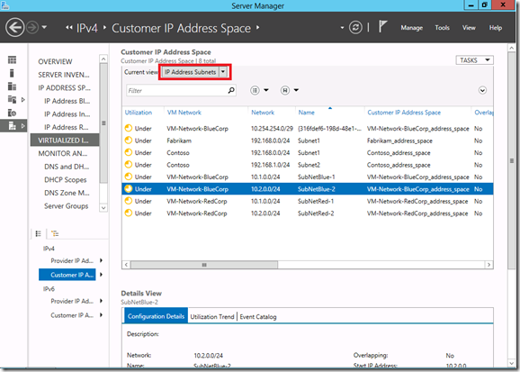](https://msdnshared.blob.core.windows.net/media/TNBlogsFS/prod.evol.blogs.technet.com/CommunityServer.Blogs.Components.WeblogFiles/00/00/00/95/48/metablogapi/4377.ca-adressspace_0A0983A3.png)

Lorsque l’on selectionne la partie Customer IP Addresse en bas à gauche, on a la possibilité de voir l’ensemble des espaces d’adressage pour les différents VM networks définis dans l’ensemble de la configuration.

**Utilisation des adresses CA :**

[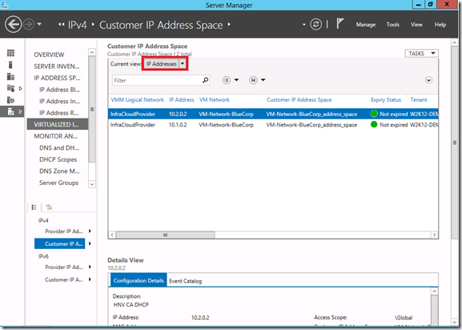](https://msdnshared.blob.core.windows.net/media/TNBlogsFS/prod.evol.blogs.technet.com/CommunityServer.Blogs.Components.WeblogFiles/00/00/00/95/48/metablogapi/7713.ca-addresses_7B63F91F.png)

La vue “IP addresses” permet de voir les IP utilisées par les différentes machines virtuelles dans les différents réseaux virtualisés (ici dans mon exemple, j’ai deux VM dans deux sous réseaux virtualisés du client BlueCorp. A noter que je peux filtrer par “tenant” (locataire).  On peut également donner une vue plus restreinte (typiquement on peut offrir à un locataire une vue uniquement sur son espace d’adressage) en gérant les rôles et les vues comme nous le décrirons plus loin dans l’article.

# Améliorations d’administration

### Stockage des informations dans une base SQL

On peut désormais stocker les informations d’IPAM vers une base SQL, cela facilite grandement la gestion de bases notamment lors de scénarios de reprise après incident. Lors de la mise à jour d’un service IPAM vers 2012 R2, l’assistant de déploiement vous propose de migrer les informations depuis la base WID vers le serveur SQL que vous lui indiquez. Cette opération peut également être effectuée avec la commande PowerShell : Move-IpamDatabase.

Si vous faites une promotion depuis un environnement vierge, on vous propose alors d’entrer les informations de connexion :

[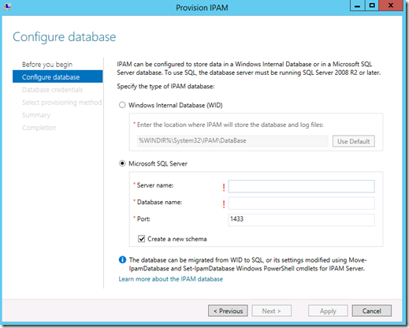](https://msdnshared.blob.core.windows.net/media/TNBlogsFS/prod.evol.blogs.technet.com/CommunityServer.Blogs.Components.WeblogFiles/00/00/00/95/48/metablogapi/7612.dbsetup_47BE1D72.png)

### Gestion des accès basé sur les rôles

La gestion des accès basé sur les rôles utilisateur est fondamentale lorsque l’environnement tend à grandir et être adopté à l’échelle de l’entreprise.

En lieu et place des quelques rôles basiques présents dans Windows Server 2012, on peut désormais définir des :

-   **rôles** : un ensemble d’opérations qui peuvent être permises et associées à des utilisateurs.
-   **étendues d’accès** : un ensemble d’objets auxquels un utilisateur a accès (par défaut l’étendue *Global* inclus l’ensemble des ressources, il est possible d’en personnaliser par géographie ou par locataire de réseau virtualisé par exemple).
-   **stratégies d’accès** : une combinaison de rôles et d’étendues d’accès.

Il existe un ensemble de rôles par défaut :

[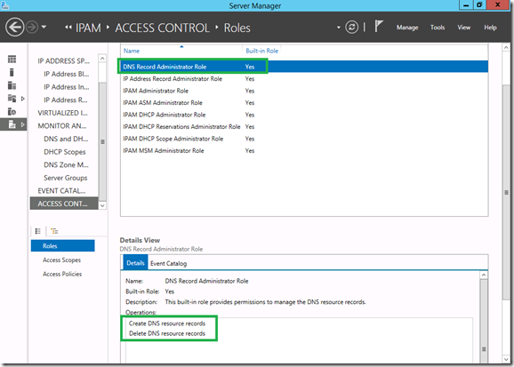](https://msdnshared.blob.core.windows.net/media/TNBlogsFS/prod.evol.blogs.technet.com/CommunityServer.Blogs.Components.WeblogFiles/00/00/00/95/48/metablogapi/5826.ipamroles_74D59AF1.png)

On peut voir par exemple que le rôle “DNS Record Administrator Role”, peut créer et supprimer des enregistrements.

Il est possible de paramétrer tout cela très finement pour répondre aux besoins d’audits et de séparation des rôles telle que toute bonne RSSI vous le recommandera !

En résumé, IPAM dans Windows Server 2012 R2, c’est plus de fonctionnalités pour rendre la plateforme plus robuste à l’échelle de l’organisation.

Références:

What's New in IPAM in Windows Server 2012 R2 – [http://technet.microsoft.com/en-us/library/dn268500.aspx](http://technet.microsoft.com/en-us/library/dn268500.aspx "http://technet.microsoft.com/en-us/library/dn268500.aspx") 

Pour tester Windows Server 2012 R2 et Hyper-V, vous pouvez télécharger gratuitement la version d’évaluation disponible sous la forme :  
– d'une image ISO : [https://aka.ms/jeveuxwindows2012r2](https://aka.ms/jeveuxwindows2012r2)  
– d'un fichier VHD avec un système préinstallé : [https://aka.ms/jeveuxwindows2012r2](https://aka.ms/jeveuxwindows2012r2)

Si vous souhaitez **découvrir en 4 heures nos technologies** telles que **Windows Server 2012 R2**, Windows **8.1 en entreprise**, le Cloud Privé ou Hybride, vous pouvez vous inscrire gratuitement à un de nos IT Camps :

[https://aka.ms/itCampFr](http://www.microsoft.com/click/services/Redirect2.ashx?CR_CC=200260510)

Arnaud – [les bons tuyaux](https://www.facebook.com/arnaudlheureuxitpro)
