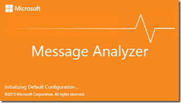
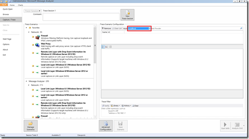
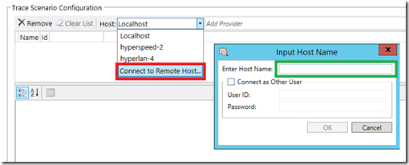
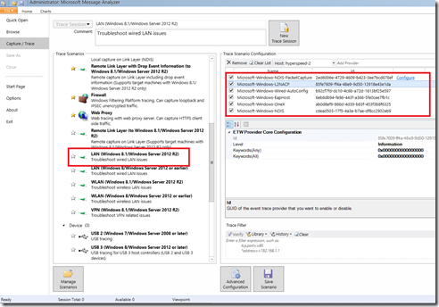
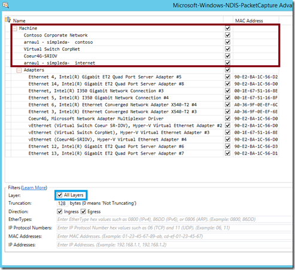
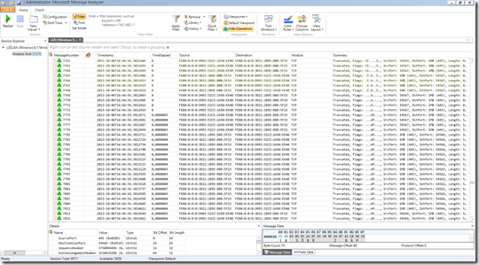
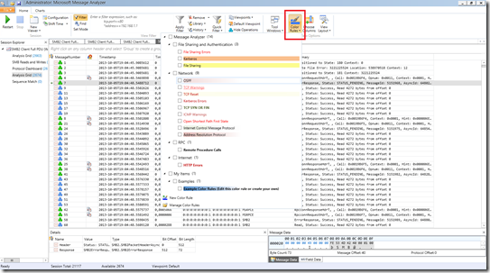
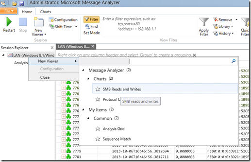
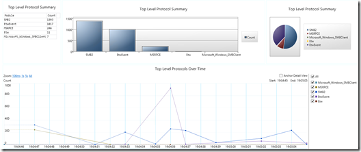
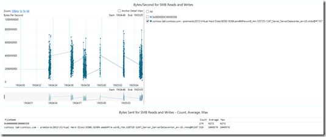

Windows Server 2012 R2 permet désormais de prendre des traces réseau et système à distance. Pour le mettre en œuvre vous devez d’abord télécharger [Message Analyzer](http://www.microsoft.com/en-us/download/details.aspx?id=40308) (le successeur de Network Monitor).

<!-- truncate -->

Ceci est possible grâce au tracing ETW (Event Tracing for Windows) pris en remoting WMI. Plutôt que de philosopher, regardons comment le mettre en place !

## Première trace à distance

Au démarrage de MA, on sélectionne l’écran **Capture/Trace** et on obtient l’écran suivant :

On commence par spécifier l’hôte de capture. Par défaut c’est localhost mais on peut ajouter des machines Windows Server 2012 R2 (et Windows 8.1) distants comme ceci :

On fois l’hôte sélectionné, on spécifie les éléments que l’on veut tracer en sélectionnant le scénario (partie centrale de l’écran), ce qui a pour effet d’ajouter les composants à tracer dans la section de droite :

Dans cette liste on a le premier élément : *Microsoft-Windows-NDIS-PacketCapture* qui a une option **Configure** disponible :

On peut ainsi restreindre la capture :

-   **a des machines virtuelles ou switch virtuel**
-   a des cartes réseau physiques ou logiques

Mon petit conseil, n’oubliez pas de cocher la case “All layers” qui n’est pas mise par défaut. Si vous ne la cochez pas, la capture ne contiendra que les infos de bas niveau (udp/tcp). Une fois cela effectué, on lance la trace réseau avec le bouton Play et on génère un peu de trafic en utilisant le partage SMB sur mon serveur hyperspeed-2.

On obtient alors ce qui commence à ressembler à une trace réseau :

Pour ceux qui ont déjà mis en œuvre de l’Unified Tracing depuis Windows 7 cela devrait leur être familier car on a bien une trace réseau avec en plus des évènements de trace système.

## De la couleur !

Si vous trouvez que la trace est un peu *tristoune* (c’est ce que beaucoup de clients reprochaient à Netmon, le manque de couleurs !!!), il y a maintenant par défaut un ensemble de filtres de couleurs pour discriminer rapidement les éléments d’une trace (le traffic Kerberos, les resets TCP, les débuts et fins de sessions TCP, etc.) :

## Des Dashboards

Regardons rapidement quelques écrans intéressants de Message Analyzer comme les Dashboard de protocoles et les Flux SMB :

Voici le protocol Dashboard :

Celui-ci permet d’avoir un aperçu des trafic présents dans la trace, ainsi que de discriminer les volumes de trafic dans le temps. Il est interactif et permet par exemple de zoomer sur un protocole en particulier pour examiner les flux. 

Le diagramme des flux SMB ressemble à ceci :

Ce deux vues par défaut ont été créées pour offrir une vue rapide sur les protocoles utilisées dans une conversation réseau ainsi que les fichiers échangés SMB dans une trace. Il existe bien d’autres subtilités dans Message Analyzer que nous découvrirons dans d’autres articles.

On est maintenant prêt à tracer à distance ce que se passe, sur une carte réseau physique ou virtuelle ou sur une VM ou un switch virtuel, et cela, c’est plutôt pratique !

Références :

Microsoft Message Analyzer Operating Guide – [http://technet.microsoft.com/en-us/library/jj649776.aspx](http://technet.microsoft.com/en-us/library/jj649776.aspx "http://technet.microsoft.com/en-us/library/jj649776.aspx")

Pour tester Windows Server 2012 R2, vous pouvez télécharger gratuitement la version d’évaluation disponible sous la forme :

-   d'une image ISO : [https://aka.ms/jeveuxwindows2012r2](https://aka.ms/jeveuxwindows2012r2)
-   d'un fichier VHD avec un système préinstallé : [https://aka.ms/jeveuxwindows2012r2](https://aka.ms/jeveuxwindows2012r2)

Si vous souhaitez **découvrir en 4 heures nos technologies** telles que **Windows Server 2012 R2**, Windows **8.1 en entreprise**, le Cloud Privé ou Hybride, vous pouvez vous inscrire gratuitement à un de nos IT Camps :

[https://aka.ms/itCampFr](http://www.microsoft.com/click/services/Redirect2.ashx?CR_CC=200260510)

Arnaud – [les bons tuyaux](https://www.facebook.com/arnaudlheureuxitpro)
