Dans un article précédent, nous discutions de la solution Windows Azure Multi-Factor Authentication pour mettre en place une authentification d’entreprise multi facteur. Commençons à mettre en œuvre la solution en déployant notre premier serveur MFA et testant les fonctionnalités de base.

<!-- truncate -->

Pour rappel, cet article fait partie d’une série :

2.  [Introduction à Windows Azure Multi-Factor Authentication](http://blogs.technet.com/b/arnaud/archive/2013/11/05/authentification-multi-facteur-avec-windows-azure-multi-factor-authentication-partie-1.aspx)
3.  **Installation et paramétrage du serveur Windows Azure Multi Factor Authentication** *(vous êtes ici)*
4.  [Installation et paramétrage de Remote Desktop Gateway](http://blogs.technet.com/b/arnaud/archive/2013/11/25/authentification-multi-facteur-avec-windows-azure-multi-factor-authentication-partie-3-windows-server-2012-r2-remote-desktop-gateway.aspx)
5.  [Installation et paramétrage du portail utilisateur](http://blogs.technet.com/b/arnaud/archive/2014/01/20/authentification-multi-facteurs-avec-windows-azure-multi-factor-authentication-partie-4-portail-utilisateur.aspx)
6.  [Installation et paramétrage pour l’application mobile](http://blogs.technet.com/b/arnaud/archive/2014/06/16/authentification-multi-facteurs-avec-azure-multi-factor-authentication-partie-5-application-mobile.aspx)
7.  [Installation et paramétrage pour ADFS](http://blogs.technet.com/b/arnaud/archive/2014/07/01/authentification-multi-facteurs-avec-azure-multi-factor-authentication-partie-6-int-233-gration-adfs.aspx)

### 1\. Activation du service et téléchargement du serveur MFA

Pour démarrer avec la solution, il faut aller dans le portal Windows Azure ([http://manage.windowsazure.com](http://manage.windowsazure.com)), pour activer l’option *Multi Factor Auth Providers. Au passage si vous n’en avez pas, vous pouvez avoir un abonnement gratuit valable un mois ici : [https://aka.ms/Azure0Euro](https://aka.ms/Azure0Euro)*

Cela se déroule dans l’ajout de nouvelles fonctionnalités :

[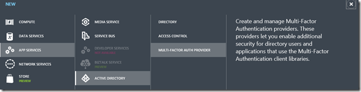](https://msdnshared.blob.core.windows.net/media/TNBlogsFS/prod.evol.blogs.technet.com/CommunityServer.Blogs.Components.WeblogFiles/00/00/00/95/48/metablogapi/5086.activatemfa1_thumb1_2E781196.png)

On choisi ensuite d’activer le service en le synchronisant avec un annuaire WAAD ou pas (dans notre cas, ce n’est pas nécessaire), mais surtout on choisi le modèle de facturation : par utilisateur activés ou par authentification effectuée. Pour déterminer l’option qui correspond à votre besoin, les tarifs sont disponibles ici : [http://www.windowsazure.com/fr-fr/pricing/details/multi-factor-authentication/](http://www.windowsazure.com/fr-fr/pricing/details/multi-factor-authentication/ "http://www.windowsazure.com/fr-fr/pricing/details/multi-factor-authentication/")

[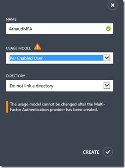](https://msdnshared.blob.core.windows.net/media/TNBlogsFS/prod.evol.blogs.technet.com/CommunityServer.Blogs.Components.WeblogFiles/00/00/00/95/48/metablogapi/1663.activatemfa2_thumb1_025DA556.png)

Un fois le service activé, on va alors sélectionner l’option *Manage* en bas à droite, qui nous redirigera vers le portail d’administration. Allons directement à la section téléchargement et récupérons la version 6.1 qui supporte Windows Server 2012 R2.

[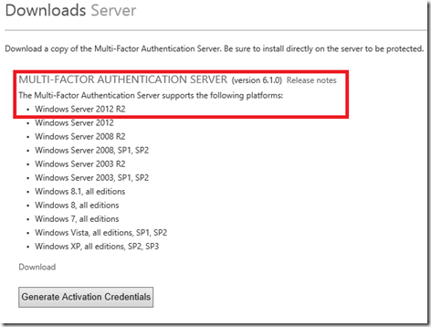](https://msdnshared.blob.core.windows.net/media/TNBlogsFS/prod.evol.blogs.technet.com/CommunityServer.Blogs.Components.WeblogFiles/00/00/00/95/48/metablogapi/5241.dl2_thumb2_33EBA39C.png)

Une fois le téléchargement effectué, on doit activer le serveur en cliquant sur “Generate Activation Credentials”. On utilisera ces informations dans l’étape suivante.

[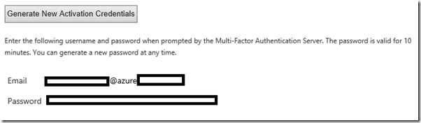](https://msdnshared.blob.core.windows.net/media/TNBlogsFS/prod.evol.blogs.technet.com/CommunityServer.Blogs.Components.WeblogFiles/00/00/00/95/48/metablogapi/5518.activatemfa3_thumb1_79FEF160.png)

### 2\. Installation du serveur d’authentification

On procède ensuite à l’installation du serveur d’authentification sur note machine dédiée, **DUB-SRV4**.

Dans un premier temps on doit passer par l’installation des prérequis : les composants .NET 2.0 sur le serveur, ce qui nécessite un accès au média d’installation et de spécifier le chemin alternatif (sources\\SXS).

On peut ensuite procéder à l’installation des binaires téléchargées à l’étape précédente.

[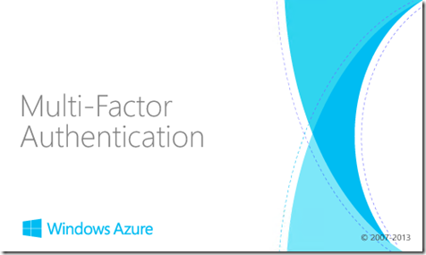](https://msdnshared.blob.core.windows.net/media/TNBlogsFS/prod.evol.blogs.technet.com/CommunityServer.Blogs.Components.WeblogFiles/00/00/00/95/48/metablogapi/1447.mfasplash_thumb1_12911F62.png)

On passe l’assistant, *parce qu’on est des durs*.

[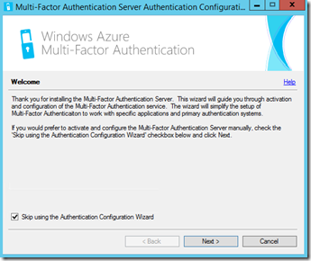](https://msdnshared.blob.core.windows.net/media/TNBlogsFS/prod.evol.blogs.technet.com/CommunityServer.Blogs.Components.WeblogFiles/00/00/00/95/48/metablogapi/6471.setup1_thumb_4A65F436.png)

On active le serveur avec les identifiants fournis par le portail à l’étape précédente :

[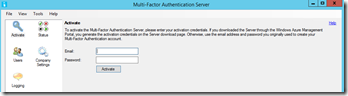](https://msdnshared.blob.core.windows.net/media/TNBlogsFS/prod.evol.blogs.technet.com/CommunityServer.Blogs.Components.WeblogFiles/00/00/00/95/48/metablogapi/2630.setup2_thumb_4E75636A.png)

On crée un groupe de serveurs :

[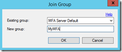](https://msdnshared.blob.core.windows.net/media/TNBlogsFS/prod.evol.blogs.technet.com/CommunityServer.Blogs.Components.WeblogFiles/00/00/00/95/48/metablogapi/5226.setup3_thumb_2428BC40.png)

Et activons le mode multi-serveur pour la gestion d’entreprise :

[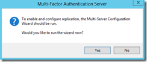](https://msdnshared.blob.core.windows.net/media/TNBlogsFS/prod.evol.blogs.technet.com/CommunityServer.Blogs.Components.WeblogFiles/00/00/00/95/48/metablogapi/4760.setup4_thumb_01678483.png)

[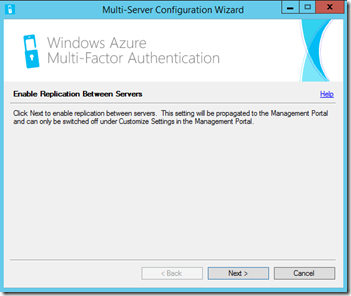](https://msdnshared.blob.core.windows.net/media/TNBlogsFS/prod.evol.blogs.technet.com/CommunityServer.Blogs.Components.WeblogFiles/00/00/00/95/48/metablogapi/2084.setup5_thumb2_53108F86.png)

Sélection des modes d’authentification de la réplication :

[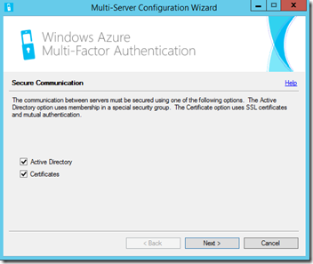](https://msdnshared.blob.core.windows.net/media/TNBlogsFS/prod.evol.blogs.technet.com/CommunityServer.Blogs.Components.WeblogFiles/00/00/00/95/48/metablogapi/4530.setup6_thumb1_54E375FE.png)

[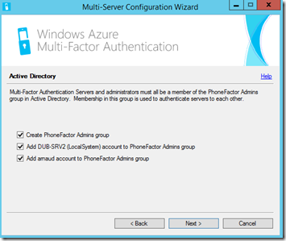](https://msdnshared.blob.core.windows.net/media/TNBlogsFS/prod.evol.blogs.technet.com/CommunityServer.Blogs.Components.WeblogFiles/00/00/00/95/48/metablogapi/0624.setup7_thumb1_2F7C1341.png)

[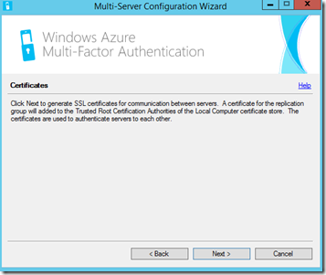](https://msdnshared.blob.core.windows.net/media/TNBlogsFS/prod.evol.blogs.technet.com/CommunityServer.Blogs.Components.WeblogFiles/00/00/00/95/48/metablogapi/6787.setup8_thumb1_30E2C6C4.png)

[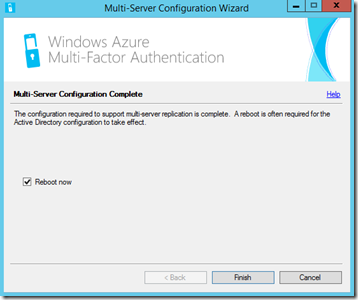](https://msdnshared.blob.core.windows.net/media/TNBlogsFS/prod.evol.blogs.technet.com/CommunityServer.Blogs.Components.WeblogFiles/00/00/00/95/48/metablogapi/3058.setup9_thumb1_44924109.png)

### 3\. Paramétrage du serveur d’authentification MFA

### 3.1 Ajout des utilisateurs

Nous allons importer des utilisateurs de l’Active Directory de notre environnement dans le serveur MFA. Ceci pourra être synchronisé automatiquement, nous verrons cela plus tard.

Choisissons *Import from Active Directory* :

[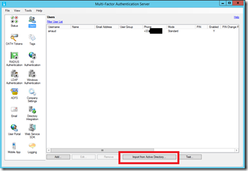](https://msdnshared.blob.core.windows.net/media/TNBlogsFS/prod.evol.blogs.technet.com/CommunityServer.Blogs.Components.WeblogFiles/00/00/00/95/48/metablogapi/3010.adduser1_thumb1_6A1E4F1B.png)

Dans la partie Search, ajoutons un utilisateur :

[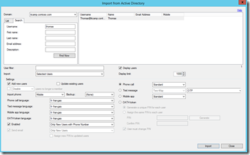](https://msdnshared.blob.core.windows.net/media/TNBlogsFS/prod.evol.blogs.technet.com/CommunityServer.Blogs.Components.WeblogFiles/00/00/00/95/48/metablogapi/0576.adduser2_thumb2_225F56E5.png)

Une fois ajouté, nous allons pouvoir éditer le numéro de téléphone de cet utilisateur si le champ correspondant dans l’AD n’avait pas déjà été renseigné.

[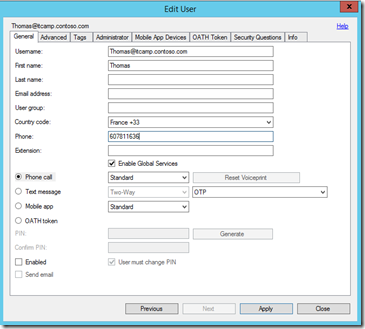](https://msdnshared.blob.core.windows.net/media/TNBlogsFS/prod.evol.blogs.technet.com/CommunityServer.Blogs.Components.WeblogFiles/00/00/00/95/48/metablogapi/5736.adduser3_thumb1_7644EAA4.png)

On remarquera que c’est dans cet écran que l’on sélectionne également la méthode d’authentification retenue pour l’utilisateur : appel téléphonique (avec ou sans code PIN), SMS (avec ou sans code PIN), ou application (avec ou sans code PIN) mobile.

La partie Advanced permet de spécifier les paramètres de type langage (vos utilisateurs n’apprécieront pas forcément les appels ou SMS en anglais !).

[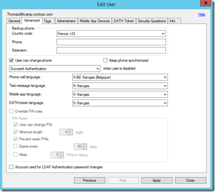](https://msdnshared.blob.core.windows.net/media/TNBlogsFS/prod.evol.blogs.technet.com/CommunityServer.Blogs.Components.WeblogFiles/00/00/00/95/48/metablogapi/2086.config5_430B41EC.png)

Une fois ces paramètres validés, testons la méthode retenue depuis la console principale en sélectionnant le bouton Test :

[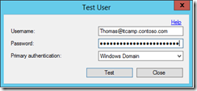](https://msdnshared.blob.core.windows.net/media/TNBlogsFS/prod.evol.blogs.technet.com/CommunityServer.Blogs.Components.WeblogFiles/00/00/00/95/48/metablogapi/0081.adduser4_thumb_0BC74B62.png)

On est alors appelé au numéro spécifié et confirmons la demande avec la touche #

[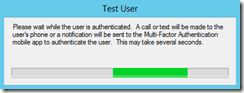](https://msdnshared.blob.core.windows.net/media/TNBlogsFS/prod.evol.blogs.technet.com/CommunityServer.Blogs.Components.WeblogFiles/00/00/00/95/48/metablogapi/7711.adduser5_thumb_2863C735.png)

[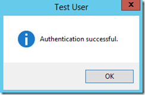](https://msdnshared.blob.core.windows.net/media/TNBlogsFS/prod.evol.blogs.technet.com/CommunityServer.Blogs.Components.WeblogFiles/00/00/00/95/48/metablogapi/6406.testauth_5C9A812C.png)

Une fois l’authentification confirmée, on peut passer à la suite de la configuration pour différentes applications… nous le ferons pour les accès Remote Desktop Gateway dans le prochain article !

En attendant, quelques lectures  :

Technical Scenarios for Windows Azure Multi-Factor Authentication – [http://technet.microsoft.com/en-us/library/dn394279.aspx](http://technet.microsoft.com/en-us/library/dn394279.aspx "http://technet.microsoft.com/en-us/library/dn394279.aspx") 

Windows Azure Multi-Factor Authentication Release Notes – [http://technet.microsoft.com/en-us/library/dn465794.aspx](http://technet.microsoft.com/en-us/library/dn465794.aspx "http://technet.microsoft.com/en-us/library/dn465794.aspx") 

Quelques exemples de mise en œuvre de la technologie chez Fredrikson & Byron, [http://www.microsoft.com/casestudies/Case\_Study\_Detail.aspx?casestudyid=710000003252](http://www.microsoft.com/casestudies/Case_Study_Detail.aspx?casestudyid=710000003252 "http://www.microsoft.com/casestudies/Case_Study_Detail.aspx?casestudyid=710000003252")

Pour tester *Windows Azure Multi-Factor Authentication*, vous pouvez évaluer Windows Azure par ici : [https://aka.ms/Azure0Euro](https://aka.ms/Azure0Euro)

Pour tester Windows Server 2012 R2, vous pouvez télécharger gratuitement la version d’évaluation disponible sous la forme :

-   d'une image ISO : [https://aka.ms/jeveuxwindows2012r2](https://aka.ms/jeveuxwindows2012r2)
-   d'un fichier VHD avec un système préinstallé : [https://aka.ms/jeveuxwindows2012r2](https://aka.ms/jeveuxwindows2012r2)

Si vous souhaitez **découvrir en 4 heures nos technologies** telles que **Windows Server 2012 R2**, Windows **8.1 en entreprise**, le Cloud Privé ou Hybride, vous pouvez vous inscrire gratuitement à un de nos IT Camps :

[https://aka.ms/itCampFr](http://www.microsoft.com/click/services/Redirect2.ashx?CR_CC=200260510&CR_EAC=300100780)

Arnaud – [les bons tuyaux](https://www.facebook.com/arnaudlheureuxitpro)
