Continuons notre série d’articles décrivant la mise en place de la solution Azure Multi-Factor Authentication pour déployer une authentification d’entreprise multi facteur. 

<!-- truncate -->

Pour rappel, cet article fait partie d’une série :

1.  [Introduction à Windows Azure Multi-Factor Authentication](http://blogs.technet.com/b/arnaud/archive/2013/11/05/authentification-multi-facteur-avec-windows-azure-multi-factor-authentication-partie-1.aspx)
2.  [Installation et paramétrage du serveur Windows Azure Multi Factor Authentication](http://blogs.technet.com/b/arnaud/archive/2013/11/08/authentification-multi-facteur-avec-windows-azure-multi-factor-authentication-partie-2.aspx)
3.  **Installation et paramétrage de Remote Desktop Gateway** *(vous êtes ici)*
4.  [Installation et paramétrage du portail utilisateur](http://blogs.technet.com/b/arnaud/archive/2014/01/20/authentification-multi-facteurs-avec-windows-azure-multi-factor-authentication-partie-4-portail-utilisateur.aspx)
5.  [Installation et paramétrage pour l’application mobile](http://blogs.technet.com/b/arnaud/archive/2014/06/16/authentification-multi-facteurs-avec-azure-multi-factor-authentication-partie-5-application-mobile.aspx)
6.  [Installation et paramétrage pour ADFS](http://blogs.technet.com/b/arnaud/archive/2014/07/01/authentification-multi-facteurs-avec-azure-multi-factor-authentication-partie-6-int-233-gration-adfs.aspx)

Nous avons précédemment déployé un serveur d’authentification WAMFA *(acronyme pas forcément officiel).* Intéressons nous maintenant à la protection d’une connexion à un serveur *Remote Desktop Session Host* via la passerelle *Remote Desktop Gateway*.

## Mise en œuvre de l’authentification multi facteur pour Remote Desktop Gateway

L’environnement d’évaluation que nous allons mettre en place est le suivant :

-   **DUB-SRV1** : serveur Remote Desktop Session Host qui héberge la session Remote Desktop que nous souhaitons protéger
-   **DUB-SRV2** : serveur Remote Desktop Gateway : permet d’accéder à un serveur Remote Desktop Session Host ou d’administration à distance, en encapsulant le protocole RDP dans HTTPS. Ce composant effectue également le contrôle d’accès et l’authentification des utilisateurs (en contactant l’AD)
-   **DUB-SRV4** : serveur Azure Multi Factor Authentification : autorise l’accès à l’application. Celui-ci a été configuré de manière basique dans l’article 2 de cette série.

[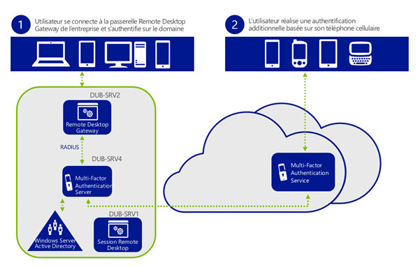](https://msdnshared.blob.core.windows.net/media/TNBlogsFS/prod.evol.blogs.technet.com/CommunityServer.Blogs.Components.WeblogFiles/00/00/00/95/48/metablogapi/5432.topolab_thumb4_thumb_12A9B64D.png)

Notons quelques points importants de cette topologie :  

-   Le service RDG (situé sur DUB-SRV2) redirige ses demandes d’authentification au serveur MFA (DUB-SRV4).
-   Une fois son travail effectué le serveur MFA renvoi les paquets au serveur NPS (installé par défaut) sur DUB-SRV2
-   le serveur MFA doit être configuré en tant que proxy pour l’authentification. Cela veut dire que pour les déploiements d’entreprise il faudra prévoir une ferme de serveurs MFA en frontal de la ferme RADIUS (NPS) d’entreprise.
-   le protocole utilisé pour échanger des messages entre le serveur NPS et le serveur MFA est RADIUS.

Le fonctionnement de la boucle d’authentification est le suivant :

1.  Le composant Remote Desktop Gateway (RDG) reçoit une demande d’authentification d’un utilisateur.
2.  Le composant RDG transmet la requête d’authentification au serveur MFA *(via son composant NPS, et une règle de forwarding de la demande d’authentification).*
3.  Le serveur MFA procède à l’authentification *(accès autorisé ou pas selon la réponse à la demande d’authentification téléphonique)*
4.  Le serveur MFA envoi la réponse *(oui/non)* au serveur NPS *(ici situé également sur la machine RDG)*
5.  Le serveur NPS évalue les critère de la demande envoyé par le serveur MFA et envoi une autorisation de connexion selon les règles configurées localement.
6.  L’utilisateur est connecté à sa session Remote Desktop Connection Session Host sur DUB-SRV1.            

### 1\. Paramétrage de Remote Desktop Gateway pour l’authentification multi-facteur

L’intégration avec Remote Desktop Gateway s’effectue en utilisant le serveur RADIUS embarqué par le serveur MFA en mode proxy, il nous faut pour cela, nous connecter sur **DUB-SRV2** et spécifier dans l’interface de gestion Remote Desktop Gateway que nous utiliserons un serveur centralisé :

[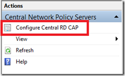](https://msdnshared.blob.core.windows.net/media/TNBlogsFS/prod.evol.blogs.technet.com/CommunityServer.Blogs.Components.WeblogFiles/00/00/00/95/48/metablogapi/5700.rdg1_2895B94E.png)

Nous spécifions alors l’adresses IP du serveur MFA, ici l’adresse IP de DUB-SRV4, soit 10.0.1.4 et spécifions également une clé partagée, notons la car nous devrons spécifier la même à l’étape suivante : configuration du serveur MFA pour RADIUS.

[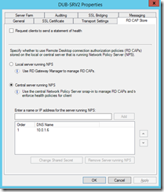](https://msdnshared.blob.core.windows.net/media/TNBlogsFS/prod.evol.blogs.technet.com/CommunityServer.Blogs.Components.WeblogFiles/00/00/00/95/48/metablogapi/8078.rdg2_41941A44.png)

### 2\. Configuration du serveur RADIUS de MFA

Pour cette étape, connectons nous sur **DUB-SRV4** et configurons le rôle serveur RADIUS, cochons le cache “Enable RADIUS Authentication”

[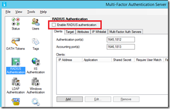](https://msdnshared.blob.core.windows.net/media/TNBlogsFS/prod.evol.blogs.technet.com/CommunityServer.Blogs.Components.WeblogFiles/00/00/00/95/48/metablogapi/2502.radius1_64E39F9A.png)

Ajoutons notre serveur DUB-SRV2 en tant que client RADIUS en spécifiant son adresse IP ainsi que la clé partagée que nous avons définis à l’étape précédente :

[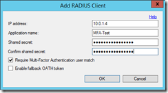](https://msdnshared.blob.core.windows.net/media/TNBlogsFS/prod.evol.blogs.technet.com/CommunityServer.Blogs.Components.WeblogFiles/00/00/00/95/48/metablogapi/7752.radius2_3B05BC16.png)

[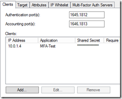](https://msdnshared.blob.core.windows.net/media/TNBlogsFS/prod.evol.blogs.technet.com/CommunityServer.Blogs.Components.WeblogFiles/00/00/00/95/48/metablogapi/2425.radius2b_112547E1.png)

Cliquons ensuite sur l’onglet Target et spécifions également DUB-SRV2 en tant que serveur RADIUS vers lequel nous renverrons les paquets une fois l’authentification MFA effectuée.

[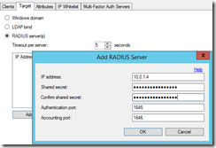](https://msdnshared.blob.core.windows.net/media/TNBlogsFS/prod.evol.blogs.technet.com/CommunityServer.Blogs.Components.WeblogFiles/00/00/00/95/48/metablogapi/7563.radius3_2A23A8D7.png)

Cela peut sembler bizarre de spécifier le serveur DUB-SRV2 à la fois comme client ET serveur RADIUS, mais cela n’est nécessaire dans notre environnement que parce que nous utilisons le serveur DUB-SRV2 pour effectuer l’authentification NPS une fois le travail fait par MFA. 

Dans un déploiement d’entreprise, on spécifiera dans la partie serveur RADIUS (target) une ferme de serveurs RADIUS centralisés, qui fera l’authentification sur le domaine.

### 3\. Configuration du serveur NPS

La configuration du serveur NPS sur le serveur DUB-SRV1 est un peu spéciale :

A l’étape 1 de cet article, nous avons spécifié un transfert automatique des demandes d’authentification vers le serveur MFA (DUB-SRV4) dans la console Remote Desktop Gateway. Cela a eu pour conséquence de modifier la règle par défaut sur le composant NPS installé localement.

Nous allons ajouter ensuite rajouter une règle qui permettra de traiter les authentifications une fois que le serveur MFA a effectué son travail.

#### 3.1 Extension du délai d’authentification

Dans un premier temps vérifions et modifions les règles d’authentification initiale (lorsque la demande d’authentification passe du serveur RDG au serveur MFA):

Observons la règle par défaut :

[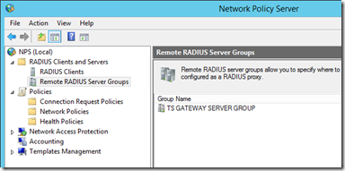](https://msdnshared.blob.core.windows.net/media/TNBlogsFS/prod.evol.blogs.technet.com/CommunityServer.Blogs.Components.WeblogFiles/00/00/00/95/48/metablogapi/3817.rdg3_400D1B27.png) 

On a bien comme serveur distant le serveur 10.0.1.6 soit le serveur MFA.

[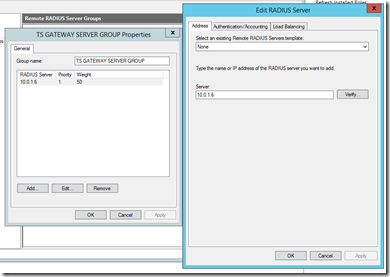](https://msdnshared.blob.core.windows.net/media/TNBlogsFS/prod.evol.blogs.technet.com/CommunityServer.Blogs.Components.WeblogFiles/00/00/00/95/48/metablogapi/7485.rdg4_2D5AB221.png)

Comme l’authentification par téléphone peut prendre un peu de temps, nous devons étendre le délais de réponse du serveur MFA, pour cela prenons l’onglet ”Load Balancing” et modifions la valeur à 60 secondes pour cet environnement de test.

[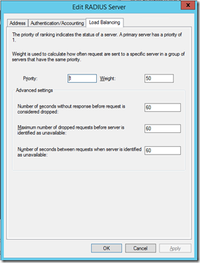](https://msdnshared.blob.core.windows.net/media/TNBlogsFS/prod.evol.blogs.technet.com/CommunityServer.Blogs.Components.WeblogFiles/00/00/00/95/48/metablogapi/5635.rdg6_1EB296ED.png)

Une fois cette opération effectué nous continuons en spécifiant le serveur MFA comme client RADIUS et une règle de traitement spécifique.

#### 3.2 Ajout du client RADIUS

Dans la console principale de NPS, on sélectionne la partie RADIUS client et on fait un click droit pour ajouter un nouveau client RADIUS :

[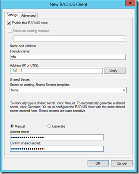](https://msdnshared.blob.core.windows.net/media/TNBlogsFS/prod.evol.blogs.technet.com/CommunityServer.Blogs.Components.WeblogFiles/00/00/00/95/48/metablogapi/4530.rdg7_1729B831.png)

On spécifie ici le serveur MFA ainsi que la clé partagée que nous avons défini dans la partie Target du serveur MFA, ceci afin que le serveur NPS local accepte les requêtes renvoyées par le serveur MFA.

Donnons un friendly-name à ce client RADIUS et notons le quelque part. C’est très important car nous utiliserons cet attribut dans une règle NPS pour filtrer les requêtes et appliquer un traitement spécifique.

#### 3.3 Création d’une règle d’authentification locale

On ouvre la console NPS et on se dirige dans la section Policies. On édite alors la Connection Request Policy. Cette section est utilisée pour faire un filtrage des requêtes basé sur divers critères et déterminer si l’on procède à l'authentification en local ou si on la renvoi à un autre serveur.

On va créer une règle d’authentification basée sur la règle par défaut (TS Gateway Authorization Policy) en ajoutant comme critère que cette règle s’appliquera aux demandes qui proviennent du serveur MFA (basé sur le friendly-name).

[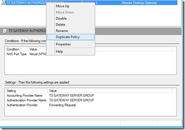](https://msdnshared.blob.core.windows.net/media/TNBlogsFS/prod.evol.blogs.technet.com/CommunityServer.Blogs.Components.WeblogFiles/00/00/00/95/48/metablogapi/3718.rdg9_00FB4EF2.png)

On double click sur la règle, modifie son nom pour être un peu plus explicite et on l’active (Policy Enabled).

[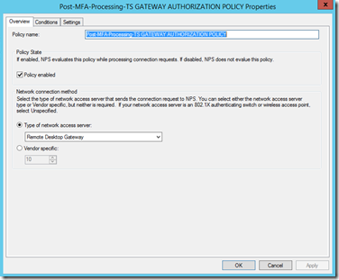](https://msdnshared.blob.core.windows.net/media/TNBlogsFS/prod.evol.blogs.technet.com/CommunityServer.Blogs.Components.WeblogFiles/00/00/00/95/48/metablogapi/2318.rdg10_4B851D7D.png)

Dans l’onglet Conditions, on click sur Add pour ajouter le Client Friendly Name qui correspond à celui entré à l’étape 3.2 (ici le nom “mfa”);

[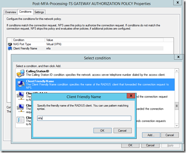](https://msdnshared.blob.core.windows.net/media/TNBlogsFS/prod.evol.blogs.technet.com/CommunityServer.Blogs.Components.WeblogFiles/00/00/00/95/48/metablogapi/5314.rdg11_23E13204.png)

On défini que cette règle sera évaluée localement : dans l’onglet Settings, on prend la partie Authentication et sélectionne “Authenticate requests on the server”.

[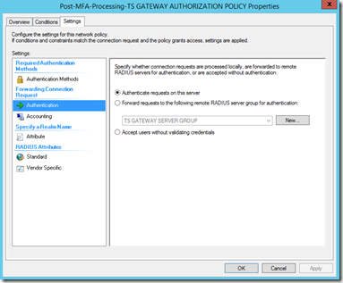](https://msdnshared.blob.core.windows.net/media/TNBlogsFS/prod.evol.blogs.technet.com/CommunityServer.Blogs.Components.WeblogFiles/00/00/00/95/48/metablogapi/4135.rdg12_29BE664E.png)

Enfin, comme il s’agit d’une règle spécifique, on la positionne avant la règle générale dans le processing order des règles NPS (click droit sur la règle, Move up) :

[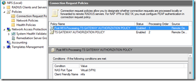](https://msdnshared.blob.core.windows.net/media/TNBlogsFS/prod.evol.blogs.technet.com/CommunityServer.Blogs.Components.WeblogFiles/00/00/00/95/48/metablogapi/5670.processingNPS_727A6FC3.png)

Cela devrait bien se passer… testons cela !

### 4\. Vérification du bon fonctionnement de la solution

Il nous reste alors a configurer une session Remote Desktop utilisant notre passerelle.

[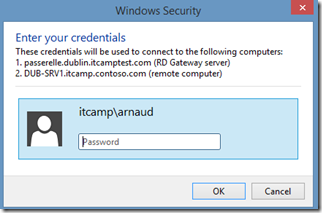](https://msdnshared.blob.core.windows.net/media/TNBlogsFS/prod.evol.blogs.technet.com/CommunityServer.Blogs.Components.WeblogFiles/00/00/00/95/48/metablogapi/7610.testcon_511D5AD8.png)

Après saisie du mot de passe du domaine et à l’établissement de la connexion, on reçoit un coup de fil, on valide selon les paramètres que l’on a spécifié pour le compte utilisateur (code PIN ou touche #) et la magie devrait opérer ; et ceci à plus forte raison sur un [superbe Nokia 1020](http://www.nokia.com/global/products/phone/lumia1020) comme celui-ci :

Dans un prochain article nous étudierons le provisionning avec le portail WAMFA. Bons tests !

Quelques lectures  :

Remote Desktop Gateway and Windows Multi-Factor Authentication Server using RADIUS – [http://technet.microsoft.com/en-us/library/dn394287.aspx](http://technet.microsoft.com/en-us/library/dn394287.aspx "http://technet.microsoft.com/en-us/library/dn394287.aspx") 

Technical Scenarios for Windows Azure Multi-Factor Authentication – [http://technet.microsoft.com/en-us/library/dn394279.aspx](http://technet.microsoft.com/en-us/library/dn394279.aspx "http://technet.microsoft.com/en-us/library/dn394279.aspx") 

Windows Azure Multi-Factor Authentication Release Notes – [http://technet.microsoft.com/en-us/library/dn465794.aspx](http://technet.microsoft.com/en-us/library/dn465794.aspx "http://technet.microsoft.com/en-us/library/dn465794.aspx") 

Quelques exemples de mise en œuvre de la technologie chez Fredrikson & Byron, [http://www.microsoft.com/casestudies/Case\_Study\_Detail.aspx?casestudyid=710000003252](http://www.microsoft.com/casestudies/Case_Study_Detail.aspx?casestudyid=710000003252 "http://www.microsoft.com/casestudies/Case_Study_Detail.aspx?casestudyid=710000003252")

Pour tester *Windows Azure Multi-Factor Authentication*, vous pouvez évaluer Azure par ici : [https://aka.ms/Azure0Euro](https://aka.ms/Azure0Euro)

Nos amis Azuréens vous en parleront avec plus de détails dans l’Azure Camp à venir : [https://msevents.microsoft.com/CUI/EventDetail.aspx?EventID=1032570149&Culture=fr-FR&community=0](https://msevents.microsoft.com/CUI/EventDetail.aspx?EventID=1032570149&Culture=fr-FR&community=0 "https://msevents.microsoft.com/CUI/EventDetail.aspx?EventID=1032570149&Culture=fr-FR&community=0") 

Pour tester Windows Server 2012 R2, vous pouvez télécharger gratuitement la version d’évaluation disponible sous la forme :

-   d'une image ISO : [https://aka.ms/jeveuxwindows2012r2](https://aka.ms/jeveuxwindows2012r2)
-   d'un fichier VHD avec un système préinstallé : [https://aka.ms/jeveuxwindows2012r2](https://aka.ms/jeveuxwindows2012r2)

Si vous souhaitez **découvrir en 4 heures nos technologies** telles que **Windows Server 2012 R2**, Windows **8.1 en entreprise**, le Cloud Privé ou Hybride, vous pouvez vous inscrire gratuitement à un de nos IT Camps :

[https://aka.ms/itCampFr](http://www.microsoft.com/click/services/Redirect2.ashx?CR_CC=200260510&CR_EAC=300100780)

Arnaud – [les bons tuyaux](https://www.facebook.com/arnaudlheureuxitpro)
