Dans un article précédent, nous discutions de la solution Azure Multi-Factor Authentication pour mettre en place une authentification d’entreprise multi facteurs. Ajoutons maintenant une fonctionnalité à cette solution : le portail utilisateur.

<!-- truncate -->

Pour rappel, cet article fait partie d’une série :

1.  [Introduction à Windows Azure Multi-Factor Authentication](http://blogs.technet.com/b/arnaud/archive/2013/11/05/authentification-multi-facteur-avec-windows-azure-multi-factor-authentication-partie-1.aspx)
2.  [Installation et paramétrage du serveur Windows Azure Multi Factor Authentication](http://blogs.technet.com/b/arnaud/archive/2013/11/08/authentification-multi-facteur-avec-windows-azure-multi-factor-authentication-partie-2.aspx)
3.  [Installation et paramétrage de Remote Desktop Gateway](http://blogs.technet.com/b/arnaud/archive/2013/11/25/authentification-multi-facteur-avec-windows-azure-multi-factor-authentication-partie-3-windows-server-2012-r2-remote-desktop-gateway.aspx)
4.  **Installation et paramétrage du portail utilisateur** *(vous êtes ici)*
5.  [Installation et paramétrage pour l’application mobile](http://blogs.technet.com/b/arnaud/archive/2014/06/16/authentification-multi-facteurs-avec-azure-multi-factor-authentication-partie-5-application-mobile.aspx)
6.  [Installation et paramétrage pour ADFS](http://blogs.technet.com/b/arnaud/archive/2014/07/01/authentification-multi-facteurs-avec-azure-multi-factor-authentication-partie-6-int-233-gration-adfs.aspx)

Nous avons vu dans l’article 2 comment mettre en place manuellement pour quelques utilisateurs la fonctionnalité d’authentification multi facteurs. En déploiement d’entreprise, afin d’éviter un surplus de travail pour les administrateurs, nous allons automatiser au maximum les fonctions de provisionning et fournir un portail pour que les utilisateurs puissent effectuer les opérations de base par eux-même.

Il nous faut alors un serveur Web avec IIS et les composants de rétrocompatibilité de la metabase pour IIS6, les composants .NET 2.0.

L’installation du portail peut se faire sur un simple serveur Web, sur lequel on installe les composants, et on spécifie dans le fichier web.config un chemin de connexion, nom d’utilisateur et mot de passe. Cela ne me plait pas beaucoup donc pour éviter cela, installons un nouveau serveur MFA dans le groupe que nous avons crée précédemment, et installons ensuite les composants Web sur ce serveur.

## 1\. Installation du serveur MFA

Nous suivons les étapes telles que décrites dans [l’article 2 de cette série](http://blogs.technet.com/b/arnaud/archive/2013/11/08/authentification-multi-facteur-avec-windows-azure-multi-factor-authentication-partie-2.aspx). 

A l’étape 2., nous spécifions que le serveur rejoint un groupe, le même groupe de spécifié précédemment, en l’occurrence **MyMFA :**

**[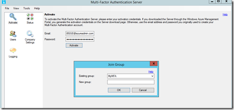](https://msdnshared.blob.core.windows.net/media/TNBlogsFS/prod.evol.blogs.technet.com/CommunityServer.Blogs.Components.WeblogFiles/00/00/00/95/48/metablogapi/portal0_6D41209B.png)**

Nous activons la réplication pour partager les informations avec le serveur spécifié précédemment.

**[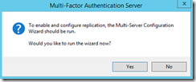](https://msdnshared.blob.core.windows.net/media/TNBlogsFS/prod.evol.blogs.technet.com/CommunityServer.Blogs.Components.WeblogFiles/00/00/00/95/48/metablogapi/portal1_191695ED.png)**

Nous utilisons AD ainsi que les certificats pour authentifier nos serveurs MFA.

**[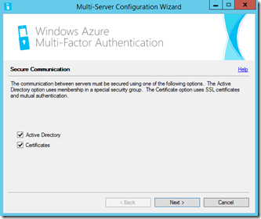](https://msdnshared.blob.core.windows.net/media/TNBlogsFS/prod.evol.blogs.technet.com/CommunityServer.Blogs.Components.WeblogFiles/00/00/00/95/48/metablogapi/portal2_6CFC29AC.png)**

Ajoutons le compte machine aux administrateurs PhoneFactor, c’est obligatoire.

[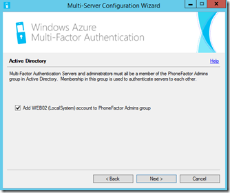](https://msdnshared.blob.core.windows.net/media/TNBlogsFS/prod.evol.blogs.technet.com/CommunityServer.Blogs.Components.WeblogFiles/00/00/00/95/48/metablogapi/portal3_6DF6AA3A.png)

Validons la création des certificats pour l’authentification mutuelle entre serveurs MFA.

[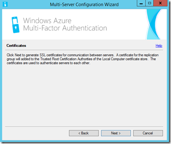](https://msdnshared.blob.core.windows.net/media/TNBlogsFS/prod.evol.blogs.technet.com/CommunityServer.Blogs.Components.WeblogFiles/00/00/00/95/48/metablogapi/portal4_7199E679.png)

Et le traditionnel redémarrage.

[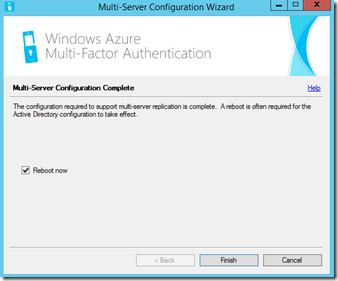](https://msdnshared.blob.core.windows.net/media/TNBlogsFS/prod.evol.blogs.technet.com/CommunityServer.Blogs.Components.WeblogFiles/00/00/00/95/48/metablogapi/portal5_2BAB440A.png)

Les composants serveurs MFA sont bien installés, une fois le serveur redémarré, vérifions la console serveur MFA pour y confirmer la connexions de multiples serveurs :

[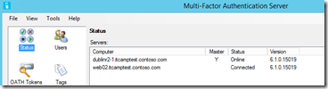](https://msdnshared.blob.core.windows.net/media/TNBlogsFS/prod.evol.blogs.technet.com/CommunityServer.Blogs.Components.WeblogFiles/00/00/00/95/48/metablogapi/portal6_5688C97E.png)

On voit qu’on a bien les deux serveurs listés, qu’ils sont en ligne et que le serveur initial est bien le maitre de la configuration. A noter que cette notion de serveur maitre n’empêche en rien la configuration depuis le serveur “secondaire” que nous venons d’installer.

Passons donc maintenant à l’installation des binaires du portail.

## 2\. Installation du portail

Nous vérifions que le Framework .net 2.0 est bien installé :

[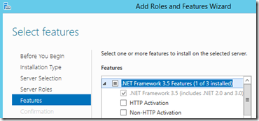](https://msdnshared.blob.core.windows.net/media/TNBlogsFS/prod.evol.blogs.technet.com/CommunityServer.Blogs.Components.WeblogFiles/00/00/00/95/48/metablogapi/dnf2_03341409.png)

Si ce n’est pas le cas, il est toujours temps de l’installer. Notons qu’il faudra spécifier un chemin alternatif (média d’installation de Windows) pour les binaires qui ne se situent pas par défaut dans les fichiers de Windows. Cela nous rappellera le *(bon?)* temps où il fallait insérer le CD à chaque fois qu’on ajoutait des composants à Windows.

Nous pouvons ensuite procéder à l’installation du portail :

[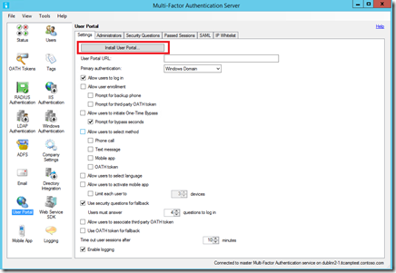](https://msdnshared.blob.core.windows.net/media/TNBlogsFS/prod.evol.blogs.technet.com/CommunityServer.Blogs.Components.WeblogFiles/00/00/00/95/48/metablogapi/portal7_1920170A.png)

La première étape de l’assistant déploiement nous propose de lire la documentation du produit, il s’agit évidemment d’un développeur taquin qui sait que personne ne la lit.

[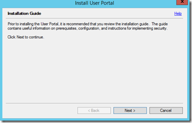](https://msdnshared.blob.core.windows.net/media/TNBlogsFS/prod.evol.blogs.technet.com/CommunityServer.Blogs.Components.WeblogFiles/00/00/00/95/48/metablogapi/portal8_364D7127.png)

Le portail a aussi besoin des composants de rétrocompatibilité avec la meta base de IIS6, ajoutons les sous peine de ne pouvoir continuer.

[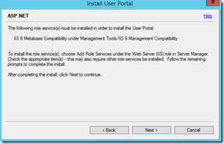](https://msdnshared.blob.core.windows.net/media/TNBlogsFS/prod.evol.blogs.technet.com/CommunityServer.Blogs.Components.WeblogFiles/00/00/00/95/48/metablogapi/portal9_10E60E6A.png)

L’assistant nous propose de créer le compte pour l’application IIS et de l’ajouter aux groupes de sécurité requis.

[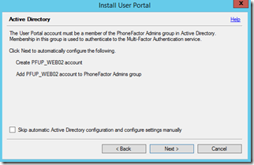](https://msdnshared.blob.core.windows.net/media/TNBlogsFS/prod.evol.blogs.technet.com/CommunityServer.Blogs.Components.WeblogFiles/00/00/00/95/48/metablogapi/portal10_78E4BEB2.png)

Une fois l’opération effectuée, on peut lancer véritablement l’installation des binaires.

[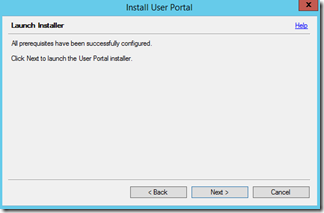](https://msdnshared.blob.core.windows.net/media/TNBlogsFS/prod.evol.blogs.technet.com/CommunityServer.Blogs.Components.WeblogFiles/00/00/00/95/48/metablogapi/portal11_27CC91F9.png)

Choix du répertoire virtuel et du site :

[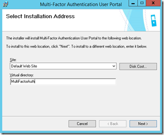](https://msdnshared.blob.core.windows.net/media/TNBlogsFS/prod.evol.blogs.technet.com/CommunityServer.Blogs.Components.WeblogFiles/00/00/00/95/48/metablogapi/portal12_69695EF6.png)

[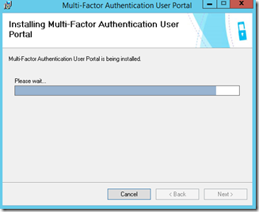](https://msdnshared.blob.core.windows.net/media/TNBlogsFS/prod.evol.blogs.technet.com/CommunityServer.Blogs.Components.WeblogFiles/00/00/00/95/48/metablogapi/portal13_13DAB176.png)

[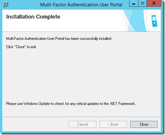](https://msdnshared.blob.core.windows.net/media/TNBlogsFS/prod.evol.blogs.technet.com/CommunityServer.Blogs.Components.WeblogFiles/00/00/00/95/48/metablogapi/portal14_2DD10249.png)

Une fois l’installation terminée, il nous faut maintenant configurer le portail !

## 3\. Configuration du portail

Par défaut, l’application est crée dans `http://<serveur>/MultifactorAuth`. Spécifions cette URL dans notre configuration serveur et ajoutons quelques options pour que les utilisateurs puissent commencer à exploiter le serveur :

[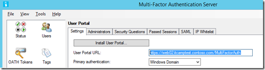](https://msdnshared.blob.core.windows.net/media/TNBlogsFS/prod.evol.blogs.technet.com/CommunityServer.Blogs.Components.WeblogFiles/00/00/00/95/48/metablogapi/portal15_518F4B45.png)

Je vais autoriser l’enrôlement des utilisateurs et leur permettre de choisir les méthodes d’authentification suivantes :

-   appel téléphonique
-   SMS
-   application mobile

[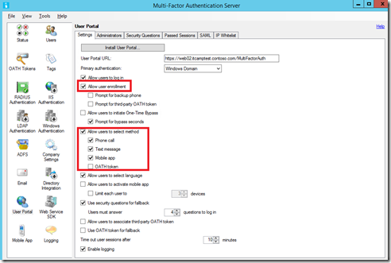](https://msdnshared.blob.core.windows.net/media/TNBlogsFS/prod.evol.blogs.technet.com/CommunityServer.Blogs.Components.WeblogFiles/00/00/00/95/48/metablogapi/portal16_00771E8C.png)

Je vais ajouter mon compte “Arnaud” comme administrateur de la plateforme afin d’avoir un portail avec des rôles spécifiques pour ce compte :

[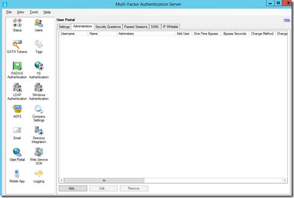](https://msdnshared.blob.core.windows.net/media/TNBlogsFS/prod.evol.blogs.technet.com/CommunityServer.Blogs.Components.WeblogFiles/00/00/00/95/48/metablogapi/portal17_1E7A4DE2.png)

Sélection du compte dans l’AD :

[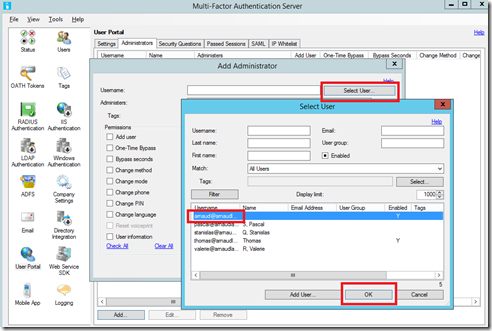](https://msdnshared.blob.core.windows.net/media/TNBlogsFS/prod.evol.blogs.technet.com/CommunityServer.Blogs.Components.WeblogFiles/00/00/00/95/48/metablogapi/portal18_7D1FC9A7.png)

Choix des rôles qui seront permis pour ce compte, il conviendra de déterminer pour chaque organisation les délégations de rôles appropriées.

[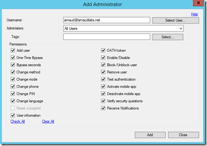](https://msdnshared.blob.core.windows.net/media/TNBlogsFS/prod.evol.blogs.technet.com/CommunityServer.Blogs.Components.WeblogFiles/00/00/00/95/48/metablogapi/portal19_5D959B34.png)

Enfin, la section question de sécurité vous permet d’éditer les questions qui seront posées à vos utilisateurs à l’enrôlement et qui leur permettront de gérer leur authentification multi facteur.

[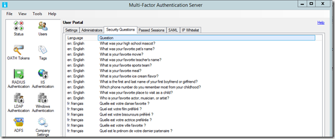](https://msdnshared.blob.core.windows.net/media/TNBlogsFS/prod.evol.blogs.technet.com/CommunityServer.Blogs.Components.WeblogFiles/00/00/00/95/48/metablogapi/portal20_257BCF71.png)

Le portail est maintenant opérationnel, testons-le avec le compte administrateur ainsi qu’un compte utilisateur régulier.

## 4\. Tests du portail

Utilisation de l’URL spécifiée précédemment :  `http://<serveur>/MultifactorAuth` 

En tant qu’administrateur, je devrais avoir un portail bien particulier :

[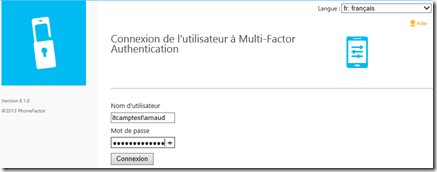](https://msdnshared.blob.core.windows.net/media/TNBlogsFS/prod.evol.blogs.technet.com/CommunityServer.Blogs.Components.WeblogFiles/00/00/00/95/48/metablogapi/web1_2FF6C088.png)

Apres connexion avec utilisateur/mot de passe, je reçois un appel et confirme l’authentification, j’ai donc le prompt pour les questions de sécurité :

[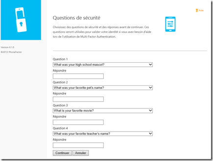](https://msdnshared.blob.core.windows.net/media/TNBlogsFS/prod.evol.blogs.technet.com/CommunityServer.Blogs.Components.WeblogFiles/00/00/00/95/48/metablogapi/web2_45E2C389.png)

Une fois cela effectué, j’ai accès à mon portail administrateur :

[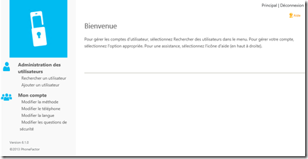](https://msdnshared.blob.core.windows.net/media/TNBlogsFS/prod.evol.blogs.technet.com/CommunityServer.Blogs.Components.WeblogFiles/00/00/00/95/48/metablogapi/web3_5B629395.png)

En tant qu’utilisateur normal avec juste un numéro de téléphone provisionné :

[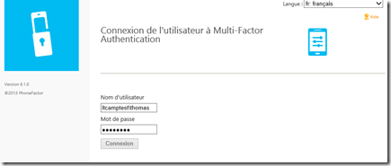](https://msdnshared.blob.core.windows.net/media/TNBlogsFS/prod.evol.blogs.technet.com/CommunityServer.Blogs.Components.WeblogFiles/00/00/00/95/48/metablogapi/webusr1_1C932D9E.png)

Après confirmation, j’ai un écran d’accueil qui explique le fonctionnement de la solution et me laisse effectuer des opérations telles que spécifiées par mon administrateur :

[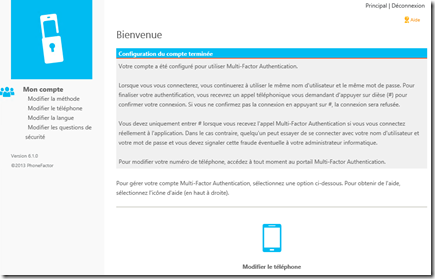](https://msdnshared.blob.core.windows.net/media/TNBlogsFS/prod.evol.blogs.technet.com/CommunityServer.Blogs.Components.WeblogFiles/00/00/00/95/48/metablogapi/webusr2_445BC46C.png)

Par exemple, modification de la langue pour l’appel, l’application et le SMS !

[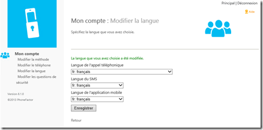](https://msdnshared.blob.core.windows.net/media/TNBlogsFS/prod.evol.blogs.technet.com/CommunityServer.Blogs.Components.WeblogFiles/00/00/00/95/48/metablogapi/webusr3_5C181D34.png)

Lorsque l’utilisateur n’arrive pas à confirmer avec le téléphone, il aura alors la méthode de fallback en répondant aux questions de sécurité auxquelles il a répondu lors de l’enrôlement.

[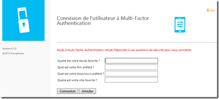](https://msdnshared.blob.core.windows.net/media/TNBlogsFS/prod.evol.blogs.technet.com/CommunityServer.Blogs.Components.WeblogFiles/00/00/00/95/48/metablogapi/webusr4_0DA8AC2C.png)

Et voilà ! Un beau portail pour que nos utilisateurs et administrateurs soient heureux !

Dans un prochaine épisode, nous mettrons en place l’infrastructure nécessaire pour utiliser l’application d’authentification sur le téléphone mobile, si l’on souhaite avoir une expérience utilisateur “améliorée” par rapport au simple appel ou SMS.

Quelques lectures  :

Installing the Windows Azure Multi-Factor Authentication Users Portal – [http://technet.microsoft.com/en-us/library/dn394290.aspx](http://technet.microsoft.com/en-us/library/dn394290.aspx "http://technet.microsoft.com/en-us/library/dn394290.aspx") 

User Enrollment and Self-Management – [http://technet.microsoft.com/en-us/library/dn394292.aspx](http://technet.microsoft.com/en-us/library/dn394292.aspx "http://technet.microsoft.com/en-us/library/dn394292.aspx") 

Technical Scenarios for Windows Azure Multi-Factor Authentication – [http://technet.microsoft.com/en-us/library/dn394279.aspx](http://technet.microsoft.com/en-us/library/dn394279.aspx)

Windows Azure Multi-Factor Authentication Release Notes – [http://technet.microsoft.com/en-us/library/dn465794.aspx](http://technet.microsoft.com/en-us/library/dn465794.aspx)

Quelques exemples de mise en œuvre de la technologie chez Fredrikson & Byron, [http://www.microsoft.com/casestudies/Case\_Study\_Detail.aspx?casestudyid=710000003252](http://www.microsoft.com/casestudies/Case_Study_Detail.aspx?casestudyid=710000003252)

Pour tester *Windows Azure Multi-Factor Authentication*, vous pouvez évaluer Azure par ici :

[https://aka.ms/Azure0Euro](https://aka.ms/Azure0Euro)

Pour tester Windows Server 2012 R2, vous pouvez télécharger gratuitement la version d’évaluation disponible sous la forme :

-   d'une image ISO : [https://aka.ms/jeveuxwindows2012r2](https://aka.ms/jeveuxwindows2012r2)
-   d'un fichier VHD avec un système préinstallé : [https://aka.ms/jeveuxwindows2012r2](https://aka.ms/jeveuxwindows2012r2)

Si vous souhaitez **découvrir en 4 heures nos technologies** telles que **Windows Server 2012 R2**, Windows **8.1 en entreprise**, le Cloud Privé ou Hybride, vous pouvez vous inscrire gratuitement à un de nos IT Camps :

[https://aka.ms/itCampFr](http://www.microsoft.com/click/services/Redirect2.ashx?CR_CC=200260510&CR_EAC=300100780)

Arnaud – [les bons tuyaux](https://www.facebook.com/arnaudlheureuxitpro)
