Dans un article précédent, nous discutions de la solution Azure Multi-Factor Authentication pour mettre en place une authentification d’entreprise multi facteurs.

<!-- truncate -->

Pour rappel, cet article fait partie d’une série :

1.  [Introduction à Windows Azure Multi-Factor Authentication](http://blogs.technet.com/b/arnaud/archive/2013/11/05/authentification-multi-facteur-avec-windows-azure-multi-factor-authentication-partie-1.aspx)
2.  [Installation et paramétrage du serveur Windows Azure Multi Factor Authentication](http://blogs.technet.com/b/arnaud/archive/2013/11/08/authentification-multi-facteur-avec-windows-azure-multi-factor-authentication-partie-2.aspx)
3.  [Installation et paramétrage de Remote Desktop Gateway](http://blogs.technet.com/b/arnaud/archive/2013/11/25/authentification-multi-facteur-avec-windows-azure-multi-factor-authentication-partie-3-windows-server-2012-r2-remote-desktop-gateway.aspx)
4.  [Installation et paramétrage du portail utilisateur](http://blogs.technet.com/b/arnaud/archive/2014/01/20/authentification-multi-facteurs-avec-windows-azure-multi-factor-authentication-partie-4-portail-utilisateur.aspx)
5.  **Installation et paramétrage pour l’application mobile *(vous êtes ici)***
6.  [Installation et paramétrage pour ADFS](http://blogs.technet.com/b/arnaud/archive/2014/07/01/authentification-multi-facteurs-avec-azure-multi-factor-authentication-partie-6-int-233-gration-adfs.aspx)

Parce que l’on n’est pas toujours disponible pour un appel téléphonique, mettons en œuvre la configuration pour faire fonctionner l’application mobile Multifactor Authentication.

Pour rappel, avec Azure Multi Factor Authentication, on peut utiliser une application disponible sur les plateformes suivantes :

[Lien](http://www.windowsphone.com/fr-fr/store/app/multi-factor-auth/0a9691de-c0a1-44ee-ab96-6807f8322bd1)

[Lien](https://play.google.com/store/apps/details?id=com.phonefactor.phonefactor)

[Lien](https://itunes.apple.com/app/phonefactor/id475844606?mt=8)

L’objectif de cet article est de décrire comment mettre en œuvre dans un environnement de test la partie serveur permettant l’utilisation de ces applications.

Pour cela, je vais utiliser un serveur web et y installer les web services et SDK, je publierai ensuite ce serveur web en utilisant le reverse proxy de Windows Server 2012 R2 : Web Application Proxy. 

Les prérequis du serveur Web sont décrits ici : [http://technet.microsoft.com/en-us/library/dn394277.aspx](http://technet.microsoft.com/en-us/library/dn394277.aspx "http://technet.microsoft.com/en-us/library/dn394277.aspx") 

## 1\. Installation du Web Services SDK

Dans un premier temps nous devons installer sur le serveur MFA les composants qui permettront l’appel des API depuis le frontal Web.

[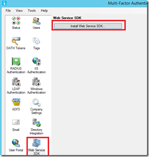](https://msdnshared.blob.core.windows.net/media/TNBlogsFS/prod.evol.blogs.technet.com/CommunityServer.Blogs.Components.WeblogFiles/00/00/00/95/48/metablogapi/setupwebservices_08615638.png)

Comme pour le cas du portail utilisateurs, un assistant permet de s’assurer que les prérequis sont remplis. Il s’agit sans doute du même développeur taquin qui nous propose de lire la documentation ; passons rapidement cette blague.

[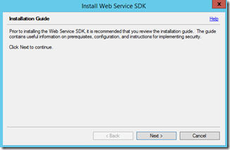](https://msdnshared.blob.core.windows.net/media/TNBlogsFS/prod.evol.blogs.technet.com/CommunityServer.Blogs.Components.WeblogFiles/00/00/00/95/48/metablogapi/setup1_5593E074.png)

Les prérequis étant atteints, on peut lancer le setup.

[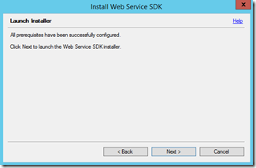](https://msdnshared.blob.core.windows.net/media/TNBlogsFS/prod.evol.blogs.technet.com/CommunityServer.Blogs.Components.WeblogFiles/00/00/00/95/48/metablogapi/setup3_196AA57D.png)

Le choix du Virtual Directory importe assez peu, puisque ce seront des appels uniquement techniques qui seront faits à cette URL, l’utilisateur n’aura jamais à saisir cette URL.

[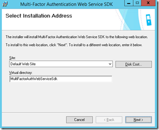](https://msdnshared.blob.core.windows.net/media/TNBlogsFS/prod.evol.blogs.technet.com/CommunityServer.Blogs.Components.WeblogFiles/00/00/00/95/48/metablogapi/setup4_44459A40.png)

Le setup se déroule sans accroc…

## 2\. Installation de l’application mobile

L’application mobile a pour vocation d’être installé sur un serveur Web diffèrent du serveur MFA, dans mon cas pour ne pas multiplier les efforts, je l’installe sur le serveur MFA, cela me fera l’économie d’une machine.

Les binaires d’installation de l’application mobile sont situés dans l’arborescence des exécutables du serveur MFA. Soit dans mon cas, il faut aller chercher cela dans : C:\\Program Files\\Multi-Factor Authentication Server et récupérons MultiFactorAuthenticationMobileAppWebServiceSetup64.msi

[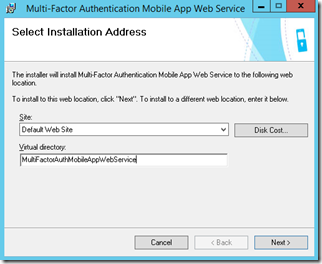](https://msdnshared.blob.core.windows.net/media/TNBlogsFS/prod.evol.blogs.technet.com/CommunityServer.Blogs.Components.WeblogFiles/00/00/00/95/48/metablogapi/setupapp1_49B92C46.png)

[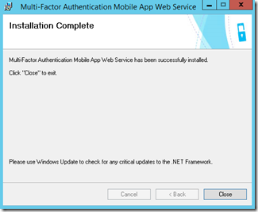](https://msdnshared.blob.core.windows.net/media/TNBlogsFS/prod.evol.blogs.technet.com/CommunityServer.Blogs.Components.WeblogFiles/00/00/00/95/48/metablogapi/setupapp2_7DEFE63D.png)

Notons que le répertoire virtuel utilisé par défaut est MultiFactorAuthMobileAppWebService.

Nous devons maintenant paramétrer cette application web.

## 3\. Paramétrage de l’application mobile

Le paramétrage de l’application consiste à modifier le fichier web.config pour spécifier la chaine de connexion au serveur hébergeant le SDK , ainsi que les credentials nécessaires pour s’authentifier auprès des web services.

Dans le répertoire ou l’application Web a été installée, on va chercher le fichier Web.config et on localise particulièrement la section : WEB\_SERVICE\_SDK\_AUTHENTICATION\_USERNAME et WEB\_SERVICE\_SDK\_AUTHENTICATION\_PASSWORD

On va alors remplir ces rubriques avec les nom d’utilisateur et mot de passe du compte utilisé:

    <appSettings>  
        <add key="WEB\_SERVICE\_SDK\_AUTHENTICATION\_USERNAME" value="mondomain\\monuser"/>  
        <add key="WEB\_SERVICE\_SDK\_AUTHENTICATION\_PASSWORD" value="ahmerdeUnmotdePasseEnClair"/>  
        <add key="WEB\_SERVICE\_SDK\_AUTHENTICATION\_CLIENT\_CERTIFICATE\_FILE\_PATH" value=""/>  
        <add key="WEB\_SERVICE\_SDK\_AUTHENTICATION\_CLIENT\_CERTIFICATE\_FILE\_PASSWORD" value=""/>  
    </appSettings>

### Chaine de connexion

Protection des credentials

Afin de régler le sujet toute de suite, le Technical Writer qui a écrit la doc de la configuration officielle sur Technet devait sans doute être au fond de la salle adossé au radiateur lors des cours de sécurité web, car on vient de stocker le mot de passe du compte en clair dans le fichier web.config.

**Soyons clair, si quelqu’un fait cela chez vous, la réponse la plus appropriée : humiliation en place publique, épandage des tripes sur la place du marché, chacun jugera selon les coutumes les plus en usage dans sa région.**

Sauvegardez le fichier avec les credentials en texte clair, et procédons à un peu de magie.

Localisez le répertoire contenant l’outil **aspnet\_regiis.exe**. Sur mon Windows Server 2012 R2, il s’agit de c:\\windows\\Microsoft.NET\\Framework64\\v4.0.30319

Cela va modifier le fichier web.config et on aura alors chiffré les credentials de la section <appsettings>

.\\aspnet\_regiis -pe "appSettings" -app "/MultiFactorAuthMobileAppWebService" -site "1"

On a alors :

Microsoft (R) ASP.NET RegIIS version 4.0.30319.33440  
Administration utility to install and uninstall ASP.NET on the local machine.  
Copyright (C) Microsoft Corporation.  All rights reserved.  
Encrypting configuration section…  
Succeeded!

Quand on va vérifier le fichier web.config, on a maintenant :

<appSettings configProtectionProvider="RsaProtectedConfigurationProvider">  
        <EncryptedData Type="[http://www.w3.org/2001/04/xmlenc#Element"](http://www.w3.org/2001/04/xmlenc#Element")  
            xmlns="[http://www.w3.org/2001/04/xmlenc#"](http://www.w3.org/2001/04/xmlenc#")\>  
            <EncryptionMethod Algorithm="[http://www.w3.org/2001/04/xmlenc#tripledes-cbc"](http://www.w3.org/2001/04/xmlenc#tripledes-cbc") />  
            <KeyInfo xmlns="[http://www.w3.org/2000/09/xmldsig#"](http://www.w3.org/2000/09/xmldsig#")\>  
                <EncryptedKey xmlns="[http://www.w3.org/2001/04/xmlenc#"](http://www.w3.org/2001/04/xmlenc#")\>  
                    <EncryptionMethod Algorithm="[http://www.w3.org/2001/04/xmlenc#rsa-1\_5"](http://www.w3.org/2001/04/xmlenc#rsa-1_5") />  
                    <KeyInfo xmlns="[http://www.w3.org/2000/09/xmldsig#"](http://www.w3.org/2000/09/xmldsig#")\>  
                        <KeyName>Rsa Key</KeyName>  
                    </KeyInfo>  
                    <CipherData>  
                        <CipherValue>merdiercrypté</CipherValue>  
                    </CipherData>  
                </EncryptedKey>  
            </KeyInfo>  
            <CipherData>  
                <CipherValue>merdiercrypté</CipherValue>  
            </CipherData>  
        </EncryptedData>  
    </appSettings>

Une autre alternative  consiste en l’utilisation d’un certificat pour cette authentification mais nous ne la décrirons pas ici !

### Connection au backend MFA :

On spécifie ensuite la chaine de connexion au serveur MFA en backend, pensez URL complète et valide car on utilise SSL, à moins d’ajouter la valeur : <add key="SSL\_REQUIRED" value="false"/> dans la chaine de connexion.

On spécifie alors :

<setting name="pfpaws\_pfwssdk\_PfWsSdk" serializeAs="String">  
<value>https://URLDUBACKEND/MultiFactorAuthWebServiceSdk/PfWsSdk.asmx</value>  
</setting>

Une fois cela réglé, on publie le site web.

## 4\. Publication du site web 

Dans mon environnement, j’utilise Web Application Proxy de Windows Server 2012 R2, j’utilise une publication en mode pass-through, l’authentification sera faite par l’application. L’URL que je publie est /MultiFactorAuthMobileAppWebService car j’ai déjà publié le portail utilisateur précédemment (/MultiFactorAuth).

## 5\. Test de l’application mobile

L’utilisateur se loggue sur le portail et sélectionne l’option activer l’application.

[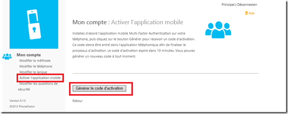](https://msdnshared.blob.core.windows.net/media/TNBlogsFS/prod.evol.blogs.technet.com/CommunityServer.Blogs.Components.WeblogFiles/00/00/00/95/48/metablogapi/appli-enroll1_213F6B94.png)

On a alors un tag qui représente l’URL du Webservice, ce qui est pratique pour éviter de se taper l’URL sur le clavier du téléphone :

[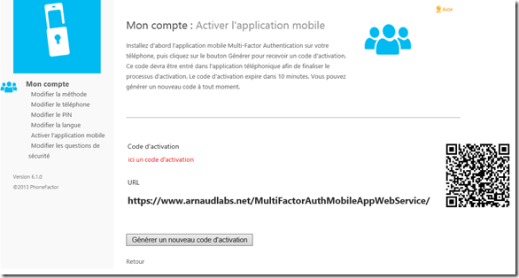](https://msdnshared.blob.core.windows.net/media/TNBlogsFS/prod.evol.blogs.technet.com/CommunityServer.Blogs.Components.WeblogFiles/00/00/00/95/48/metablogapi/appli-enroll2_432D5EC9.png)

Je peux alors prendre mon téléphone et lancer l’application MultiFactor Auth :

Ajout de mon compte :

[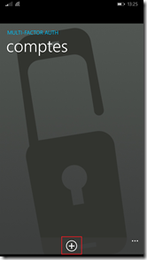](https://msdnshared.blob.core.windows.net/media/TNBlogsFS/prod.evol.blogs.technet.com/CommunityServer.Blogs.Components.WeblogFiles/00/00/00/95/48/metablogapi/app1_17FE307E.png)

Utilisation du bouton de scan de tag :

[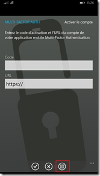](https://msdnshared.blob.core.windows.net/media/TNBlogsFS/prod.evol.blogs.technet.com/CommunityServer.Blogs.Components.WeblogFiles/00/00/00/95/48/metablogapi/app2_23B89912.png)

Validation par la possession de la section relative à notre environnement :

[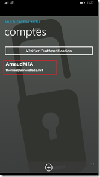](https://msdnshared.blob.core.windows.net/media/TNBlogsFS/prod.evol.blogs.technet.com/CommunityServer.Blogs.Components.WeblogFiles/00/00/00/95/48/metablogapi/app3_7251D6D1.png)

Et voila!

Il ne restera plus qu’a spécifier que l’utilisateur peut utiliser l’application dans l’ensemble des méthodes d’authentification supportées :

[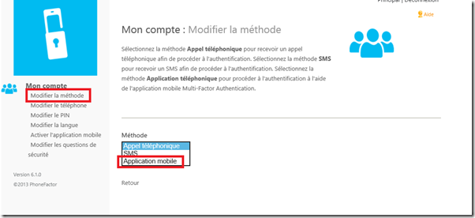](https://msdnshared.blob.core.windows.net/media/TNBlogsFS/prod.evol.blogs.technet.com/CommunityServer.Blogs.Components.WeblogFiles/00/00/00/95/48/metablogapi/applivalid_25B9DDD2.png)

L’utilisateur sera alors notifié qu’une authentification demande sa confirmation :

Il valide avec son code PIN

[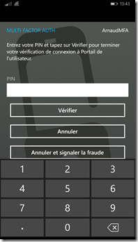](https://msdnshared.blob.core.windows.net/media/TNBlogsFS/prod.evol.blogs.technet.com/CommunityServer.Blogs.Components.WeblogFiles/00/00/00/95/48/metablogapi/app5_2D69F894.png)

Tada!

La suite au prochain épisode !

Pour continuer, l’aventure, quelques lectures et références :

Deploying the Windows Azure Multi-Factor Authentication Server Mobile App Web Service – [http://technet.microsoft.com/en-us/library/dn394277.aspx](http://technet.microsoft.com/en-us/library/dn394277.aspx "http://technet.microsoft.com/en-us/library/dn394277.aspx") 

Encrypting Web.Config Values in ASP.NET 2.0 – [http://weblogs.asp.net/scottgu/archive/2006/01/09/434893.aspx](http://weblogs.asp.net/scottgu/archive/2006/01/09/434893.aspx "http://weblogs.asp.net/scottgu/archive/2006/01/09/434893.aspx")

How To: Encrypt Configuration Sections in ASP.NET 2.0 Using DPAPI : [http://msdn.microsoft.com/en-us/library/ff647398.aspx](http://msdn.microsoft.com/en-us/library/ff647398.aspx "http://msdn.microsoft.com/en-us/library/ff647398.aspx")

Building Secure ASP.NET Applications: Authentication, Authorization, and Secure Communication – [http://msdn.microsoft.com/en-us/library/ff649224.aspx](http://msdn.microsoft.com/en-us/library/ff649224.aspx "http://msdn.microsoft.com/en-us/library/ff649224.aspx")

Technical Scenarios for Windows Azure Multi-Factor Authentication – [http://technet.microsoft.com/en-us/library/dn394279.aspx](http://technet.microsoft.com/en-us/library/dn394279.aspx)

Windows Azure Multi-Factor Authentication Release Notes – [http://technet.microsoft.com/en-us/library/dn465794.aspx](http://technet.microsoft.com/en-us/library/dn465794.aspx)

Quelques exemples de mise en œuvre de la technologie chez Fredrikson & Byron, [http://www.microsoft.com/casestudies/Case\_Study\_Detail.aspx?casestudyid=710000003252](http://www.microsoft.com/casestudies/Case_Study_Detail.aspx?casestudyid=710000003252)

Pour tester *Windows Azure Multi-Factor Authentication*, vous pouvez évaluer Azure par ici :

[https://aka.ms/Azure0Euro](https://aka.ms/Azure0Euro)

Pour tester Windows Server 2012 R2, vous pouvez télécharger gratuitement la version d’évaluation disponible sous la forme :

-   d'une image ISO : [https://aka.ms/jeveuxwindows2012r2](https://aka.ms/jeveuxwindows2012r2)
-   d'un fichier VHD avec un système préinstallé : [https://aka.ms/jeveuxwindows2012r2](https://aka.ms/jeveuxwindows2012r2)

Si vous souhaitez **découvrir en 4 heures nos technologies** telles que **Windows Server 2012 R2**, Windows **8.1 en entreprise**, le Cloud Privé ou Hybride, vous pouvez vous inscrire gratuitement à un de nos IT Camps :

[https://aka.ms/itCampFr](http://www.microsoft.com/click/services/Redirect2.ashx?CR_CC=200260510&CR_EAC=300100780)

Arnaud – [les bons tuyaux](https://www.facebook.com/arnaudlheureuxitpro)
