Dans un article précédent, nous discutions de la solution Azure Multi-Factor Authentication pour mettre en place une authentification d’entreprise multi facteurs.

<!-- truncate -->

Pour rappel, cet article fait partie d’une série :

1.  [Introduction à Windows Azure Multi-Factor Authentication](http://blogs.technet.com/b/arnaud/archive/2013/11/05/authentification-multi-facteur-avec-windows-azure-multi-factor-authentication-partie-1.aspx)
2.  [Installation et paramétrage du serveur Windows Azure Multi Factor Authentication](http://blogs.technet.com/b/arnaud/archive/2013/11/08/authentification-multi-facteur-avec-windows-azure-multi-factor-authentication-partie-2.aspx)
3.  [Installation et paramétrage de Remote Desktop Gateway](http://blogs.technet.com/b/arnaud/archive/2013/11/25/authentification-multi-facteur-avec-windows-azure-multi-factor-authentication-partie-3-windows-server-2012-r2-remote-desktop-gateway.aspx)
4.  [Installation et paramétrage du portail utilisateur](http://blogs.technet.com/b/arnaud/archive/2014/01/20/authentification-multi-facteurs-avec-windows-azure-multi-factor-authentication-partie-4-portail-utilisateur.aspx)
5.  [Installation et paramétrage pour l’application mobile](http://blogs.technet.com/b/arnaud/archive/2014/06/16/authentification-multi-facteurs-avec-azure-multi-factor-authentication-partie-5-application-mobile.aspx)
6.  **Installation et paramétrage pour ADFS *(vous êtes ici)***

L’objectif de ce dernier article et d’ajouter MFA à une infrastructure ADFS déjà en place afin d’enrichir l’authentification fédérée avec l’utilisation du téléphone.

Il sera nécessaire d’installer les binaires MFA sur le ou les serveurs ADFS (si on a une ferme de serveur ADFS). On pourra se référer à [l’article 2](http://blogs.technet.com/b/arnaud/archive/2013/11/08/authentification-multi-facteur-avec-windows-azure-multi-factor-authentication-partie-2.aspx) de cette série pour le premier serveur, et à [l’article 3](http://blogs.technet.com/b/arnaud/archive/2013/11/25/authentification-multi-facteur-avec-windows-azure-multi-factor-authentication-partie-3-windows-server-2012-r2-remote-desktop-gateway.aspx) pour un serveur additionnel.

## 1\. Installation de l’adaptateur ADFS

Une fois les binaires du serveur MFA installés sur le serveur ADFS, on va dans la console MFA, vérifie qu’il est bien partenaire des autres serveurs MFA de l’organisation si nécessaire et on sélectionne **Install ADFS Adapter** dans la partie **ADFS** :

[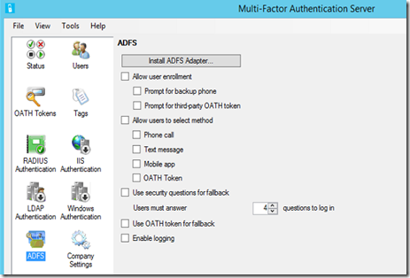](https://msdnshared.blob.core.windows.net/media/TNBlogsFS/prod.evol.blogs.technet.com/CommunityServer.Blogs.Components.WeblogFiles/00/00/00/95/48/metablogapi/adfs01_50C26B7F.png)

[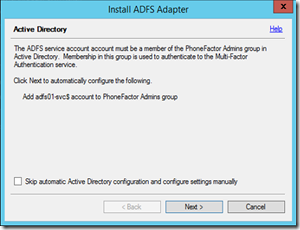](https://msdnshared.blob.core.windows.net/media/TNBlogsFS/prod.evol.blogs.technet.com/CommunityServer.Blogs.Components.WeblogFiles/00/00/00/95/48/metablogapi/adfs02_5D5539FD.png)

[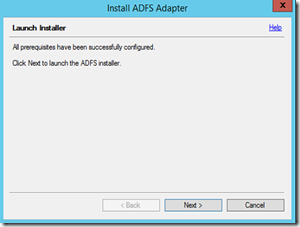](https://msdnshared.blob.core.windows.net/media/TNBlogsFS/prod.evol.blogs.technet.com/CommunityServer.Blogs.Components.WeblogFiles/00/00/00/95/48/metablogapi/adfs03_7C2E3E8C.png)

Une fois le setup passé, on va activer les méthodes d’authentification que l’on souhaite pour les utilisateurs d’ADFS et si on leur autorise l’enrôlement :

[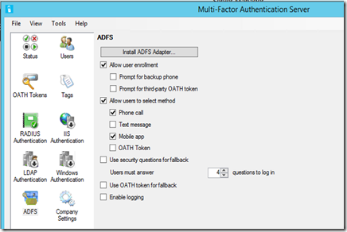](https://msdnshared.blob.core.windows.net/media/TNBlogsFS/prod.evol.blogs.technet.com/CommunityServer.Blogs.Components.WeblogFiles/00/00/00/95/48/metablogapi/adfs05_7675B597.png)

Il nous faut maintenant paramétrer la partie ADFS.

## 2\. Enregistrement de l’adaptateur MFA pour ADFS

La première étape consiste à enregistrer le serveur MFA comme fournisseur d’authentification pour ADFS. On va pour cela lancer le script PowerShell présent dans `` \Program Files\Multi-Factor Authentication Server et qui s’appelle `Register-MultiFactorAuthenticationAdfsAdapter.ps1` ``

`` `` ``

`` `On doit ensuite redémarrer le service ADFS, j’utilise Restart-Service adfssrv –force pour redémarrer automatiquement aussi le service drs, qui en dépend.` ``

`` `` ``

`` `Une fois cela validé, je vais l’activer comme méthode d’authentification disponible sur mon serveur.` ``

`` `Je vais pour cela dans ma console de gestion ADFS et choisi la section Authentication Policies, click droit sur Edit Global Multi-Factor Authentication.` ``

[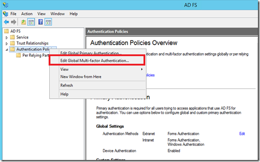](https://msdnshared.blob.core.windows.net/media/TNBlogsFS/prod.evol.blogs.technet.com/CommunityServer.Blogs.Components.WeblogFiles/00/00/00/95/48/metablogapi/adfsman01_3F117373.png)

`` `je choisis d’ajouter la méthode AzureMFA :` ``

`` `` ``

`` `Nous allons maintenant activer cette fonctionnalité pour une application et valider l’expérience utilisateur.` ``

## 3\. Activation pour une application

Pour activer cette fonctionnalité, je vais choisir mon application de base claimapp, et je vais demander une authentification MFA pour un utilisateur en particulier.

Je reste dans ma console ADFS et descend dans l’arborescence pour choisir **Per Relying party trust**. Je clique sur ma partie **claimapp** et selectionne **Add** dans la partie **Multi-factor** :

[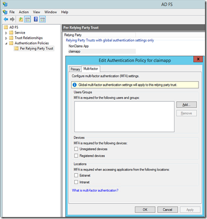](https://msdnshared.blob.core.windows.net/media/TNBlogsFS/prod.evol.blogs.technet.com/CommunityServer.Blogs.Components.WeblogFiles/00/00/00/95/48/metablogapi/authpolicy1_10781839.png)

Ici, je fais le test sur un utilisateur, je prendrais évidemment un groupe dans la vraie vie.

[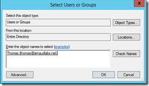](https://msdnshared.blob.core.windows.net/media/TNBlogsFS/prod.evol.blogs.technet.com/CommunityServer.Blogs.Components.WeblogFiles/00/00/00/95/48/metablogapi/authpolicy2_00FA27CC.png)

Il est intéressant de remarquer, que l’on peut exiger du multifacteur SI un utilisateur n’est PAS sur un périphérique enregistré dans l’organisation (via workplace join). On peut alors combiner toutes sortes d’options pour couvrir les différents scenarios BYOD (Bring Your Own Device) que l’entreprise souhaite.

[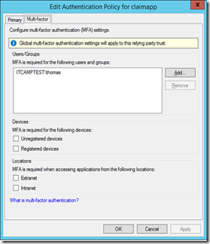](https://msdnshared.blob.core.windows.net/media/TNBlogsFS/prod.evol.blogs.technet.com/CommunityServer.Blogs.Components.WeblogFiles/00/00/00/95/48/metablogapi/authpolicy3_07438F0B.png)

On valide et teste l’application via mon portail ADFS.

## 4\. Expérience utilisateur

J’accède à mon application claimapp, qui fait l’authentification via ADFS (cette application est publié via WAP Web Application Proxy, et je n’ai rien eu à changer sur ce serveur)

[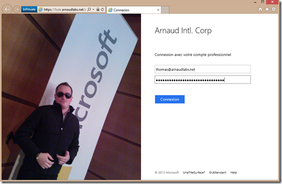](https://msdnshared.blob.core.windows.net/media/TNBlogsFS/prod.evol.blogs.technet.com/CommunityServer.Blogs.Components.WeblogFiles/00/00/00/95/48/metablogapi/testuser1_6ACBBE8C.png)

Une fois que cet utilisateur a validé son mot de passe, on demande une authentification additionnelle, on a la possibilité de choisir si l’on effectue cela par certificat client ou pas Azure Multi Factor Authentication.

[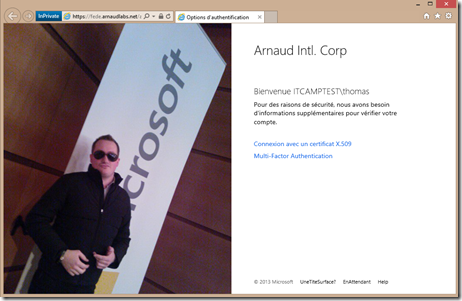](https://msdnshared.blob.core.windows.net/media/TNBlogsFS/prod.evol.blogs.technet.com/CommunityServer.Blogs.Components.WeblogFiles/00/00/00/95/48/metablogapi/testuser2_0413762D.png)

On clique sur MFA et on l’écran suivant qui prévient de la notification ou de l’appel téléphonique :

[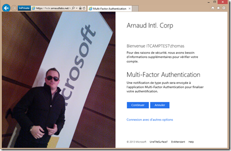](https://msdnshared.blob.core.windows.net/media/TNBlogsFS/prod.evol.blogs.technet.com/CommunityServer.Blogs.Components.WeblogFiles/00/00/00/95/48/metablogapi/testuser3_0F1F458E.png)

Une fois validé, j’ai bien accès à mon application claimapp !

[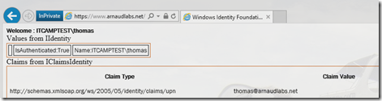](https://msdnshared.blob.core.windows.net/media/TNBlogsFS/prod.evol.blogs.technet.com/CommunityServer.Blogs.Components.WeblogFiles/00/00/00/95/48/metablogapi/testuser5_012F44AA.png)

Voila, c’est la fin de cette série sur Azure Multi Factor Authentication, j’espère qu’elle vous aura intéressé !

N’hésitez pas à m’envoyer vos remarques par ce blog ou sur mon Twitter [@arnaudlheureux](https://twitter.com/ArnaudLheureux) 

Si vous souhaitez découvrir en 4 heures nos technologies telles que Windows Server 2012 R2, Windows 8.1 en entreprise, le Cloud Privé ou Hybride, vous pouvez vous inscrire gratuitement à un de nos IT Camps :

[https://aka.ms/itCampFr](http://www.microsoft.com/click/services/Redirect2.ashx?CR_CC=200260510&CR_EAC=300100780)

Pour finir quelques références additionnelles :

Technical Scenarios for Windows Azure Multi-Factor Authentication – [http://technet.microsoft.com/en-us/library/dn394279.aspx](http://technet.microsoft.com/en-us/library/dn394279.aspx)

Manage Risk with Additional Multi-Factor Authentication for Sensitive Applications – [http://technet.microsoft.com/en-us/library/dn280946.aspx](http://technet.microsoft.com/en-us/library/dn280946.aspx "http://technet.microsoft.com/en-us/library/dn280946.aspx")

Pour tester *Windows Azure Multi-Factor Authentication*, vous pouvez évaluer Windows Azure par ici : [https://aka.ms/Azure0Euro](https://aka.ms/Azure0Euro)

Pour tester Windows Server 2012 R2, vous pouvez télécharger gratuitement la version d’évaluation disponible sous la forme :

-   d'une image ISO : [https://aka.ms/jeveuxwindows2012r2](https://aka.ms/jeveuxwindows2012r2)
-   d'un fichier VHD avec un système préinstallé : [https://aka.ms/jeveuxwindows2012r2](https://aka.ms/jeveuxwindows2012r2)

Arnaud – [les bons tuyaux](https://www.facebook.com/arnaudlheureuxitpro)
