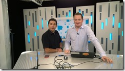

C’est l’été et parfois on a un peu plus de temps libre que d’habitude (vraiment ?) : Pour cela on vous a préparé tout un ensemble de ressources sur Microsoft Virtual Academy qui est notre plateforme en ligne pour apprendre sur les derniers sujets de développement comme d’IT.

<!-- truncate -->

Voici les cours que nous avons pu réaliser dernièrement en français :

-   Virtualisation de réseaux Hyper-V – [http://www.microsoftvirtualacademy.com/training-courses/15cd22ee-3645-4dd6-a2bb-44e850aeefad](http://www.microsoftvirtualacademy.com/training-courses/15cd22ee-3645-4dd6-a2bb-44e850aeefad)
-   Services Réseaux de Windows Server 2012 – [http://www.microsoftvirtualacademy.com/training-courses/services-reseaux-de-windows-server-2012](http://www.microsoftvirtualacademy.com/training-courses/services-reseaux-de-windows-server-2012)
-   Virtualisation avec Windows Server 2012 – [http://www.microsoftvirtualacademy.com/training-courses/virtualisation-avec-windows-server-2012-fr-](http://www.microsoftvirtualacademy.com/training-courses/virtualisation-avec-windows-server-2012-fr-)
-   Introduction à Windows Azure IaaS – [http://www.microsoftvirtualacademy.com/training-courses/introduction-windows-azure-iaas](http://www.microsoftvirtualacademy.com/training-courses/introduction-windows-azure-iaas)

On en publiera de nouveaux tout au long de l’été concernant le stockage avec Windows Server 2012 R2 et de nouveaux sujets sur Azure alors restez branchés !

[www.microsoftvirtualacademy.com](http://www.microsoftvirtualacademy.com)

En attendant vous pouvez également vous référer aux contenus faits par nos collègues américains :

-   Software-Defined Networking with Windows Server and System Center Jump Start – [http://www.microsoftvirtualacademy.com/training-courses/software-defined-networking-with-windows-server-and-system-center-jump-start](http://www.microsoftvirtualacademy.com/training-courses/software-defined-networking-with-windows-server-and-system-center-jump-start "http://www.microsoftvirtualacademy.com/training-courses/software-defined-networking-with-windows-server-and-system-center-jump-start")
-   Moving to Hybrid Cloud with Microsoft Azure – [http://www.microsoftvirtualacademy.com/training-courses/moving-to-hybrid-cloud-with-microsoft-azure](http://www.microsoftvirtualacademy.com/training-courses/moving-to-hybrid-cloud-with-microsoft-azure "http://www.microsoftvirtualacademy.com/training-courses/moving-to-hybrid-cloud-with-microsoft-azure")

Les IT Camps sont toujours présents pendant l’été, en juillet et aout avec des sessions hands-on-lab, vous pouvez vous inscrire ici :

[https://aka.ms/itCampFr](https://aka.ms/itCampFr)

Pour tester Windows Server 2012 R2, vous pouvez télécharger gratuitement la version d’évaluation disponible sous la forme :

-   d'une image ISO : [https://aka.ms/jeveuxwindows2012r2](https://aka.ms/jeveuxwindows2012r2)
-   d'un fichier VHD avec un système préinstallé : [https://aka.ms/jeveuxwindows2012r2](https://aka.ms/jeveuxwindows2012r2)

Enfin vous pourrez retrouver les vidéos des Techdays en ligne :

 [http://www.microsoft.com/france/mstechdays](http://www.microsoft.com/france/mstechdays "http://www.microsoft.com/france/mstechdays") 

Arnaud – [les bons tuyaux](https://www.facebook.com/arnaudlheureuxitpro)
