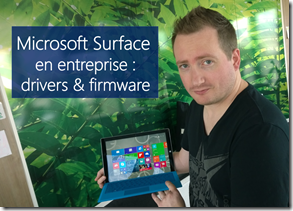

<!-- truncate -->

Par hasard que je naviguais sur Internet à la recherche des **drivers** pour faire une **image** d’entreprise pour mon **Surface Pro 3**, je suis tombé sur une page de download : [http://www.microsoft.com/en-us/download/details.aspx?id=38826](http://www.microsoft.com/en-us/download/details.aspx?id=38826 "http://www.microsoft.com/en-us/download/details.aspx?id=38826") avec du script download.Once pas très bien fait.

Je vous propose donc ici les liens individuels par version de Surface : pour les firmware, drivers, accessoires et un peu de documentation.

Cela n’est utile que pour la création des images en entreprise, une fois l’image installée tous les drivers et mises à jour du firmware UEFI passent évidemment par Microsoft Update.

Et pour l’utiliser désormais fréquemment, Surface Pro 3, c’est vraiment excessivement bon !

## Surface Pro

Pilotes et firmwares : [Surface Pro – July 2014.zip](http://download.microsoft.com/download/2/0/7/2073C22F-2F31-4F4A-8059-E54C91C564A9/Surface%20Pro%20-%20July%202014.zip)

## Surface Pro 2

Pilotes et firmwares : Surface Pro 2 – July 2014.zip

## Surface Pro 3

Pilotes et firmwares : [Surface Pro 3 – September 2014](http://download.microsoft.com/download/2/0/7/2073C22F-2F31-4F4A-8059-E54C91C564A9/Surface%20Pro%203%20-%20September%202014.zip)

Correctif Wifi/Bluetooth [Surface Pro 3 WiFi BT v15\_68\_3044\_85.zip](http://download.microsoft.com/download/2/0/7/2073C22F-2F31-4F4A-8059-E54C91C564A9/Surface%20Pro%203%20WiFi%20BT%20v15_68_3044_85.zip)

## Documentation

[Surface Pro – Enterprise Deployment Quick Start Guide-June2013.pdf](http://download.microsoft.com/download/2/0/7/2073C22F-2F31-4F4A-8059-E54C91C564A9/Surface%20Pro%20-%20Enterprise%20Deployment%20Quick%20Start%20Guide-June2013.pdf)

## Accessoires et autres

[Surface Ethernet Adapter.zip](http://download.microsoft.com/download/2/0/7/2073C22F-2F31-4F4A-8059-E54C91C564A9/Surface%20Ethernet%20Adapter.zip)

[Surface Gigabit Ethernet Adapter.zip](http://download.microsoft.com/download/2/0/7/2073C22F-2F31-4F4A-8059-E54C91C564A9/Surface%20Gigabit%20Ethernet%20Adapter.zip)

[Mise à jour pour Windows 8.1](http://download.microsoft.com/download/2/0/7/2073C22F-2F31-4F4A-8059-E54C91C564A9/Windows8.1-KB2969817-x64.msu)

Plus d’infos sur la Microsoft Virtual Academy :

[www.microsoftvirtualacademy.com](http://www.microsoftvirtualacademy.com/)

Ou venez nous voir en personne dans un IT Camps, il y en a forcément un près de chez vous !

[https://aka.ms/itCampFr](https://aka.ms/itCampFr)

N’hésitez pas à me contacter sur [Facebook](https://www.facebook.com/arnaudlheureuxitpro) et [Twitter](https://twitter.com/ArnaudLheureux).

Arnaud – [les bons tuyaux](https://www.facebook.com/arnaudlheureuxitpro)
