[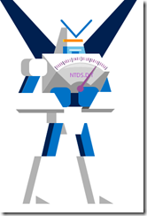](https://msdnshared.blob.core.windows.net/media/TNBlogsFS/prod.evol.blogs.technet.com/CommunityServer.Blogs.Components.WeblogFiles/00/00/00/95/48/metablogapi/superfmon_66B0EF0F.png)Lorsque l’on met en production ou maintient un système on ne pense pas toujours à faire d’évaluation de performances des serveurs, parce qu'on a pas forcément les outils pour le faire et le temps d’analyser les résultats obtenus.

<!-- truncate -->

Lorsque j’étais Premier Field Engineer chez Microsoft, j’utilisais souvent avec mes clients un outil développé par des collègues et qui s’appelle PAL ([Performance Analysis of Logs](http://pal.codeplex.com/)). Le but de PAL est simple : offrir un moteur d’analyse et de génération de rapports pour les performances des serveurs. Cerise sur le gâteau, il vient avec la possibilité de générer les modèles de capture d’informations pour Performance Monitor (perfmon) de Windows, afin de ne collecter que l’essentiel sur une machine. 

Dans mon scénario, je chercher à vérifier si performances de mes contrôleurs de domaines sont bonnes et si ce n’est pas le cas, à en déterminer la cause (disques lents, mémoire saturée, réseau engorgé, processus qui consomment toutes mes ressources, etc.)

## Récupération de l’outil PAL

L’outil est disponible sur [http://pal.codeplex.com/](http://pal.codeplex.com/) et il est mis à jour régulièrement par Clint Huffman. Cette page contient l’outil qui a quelques prérequis parmi lesquels PowerShell qui sera utilisé pour analyser les données et Microsoft Chart Controls for Microsoft .NET Framework 3.5 qui sera utilisé pour générer les graphiques du rapport.

On récupère donc les binaires de l’outils et on l’installe sur un poste client.

## Création des modèles

Sur le poste client toujours, nous allons dans un premier temps générer un modèle pour Perfmon qui permettra de prendre une trace de performance selon le rôle de serveur que je souhaite analyser.

Voici l’écran d’accueil de PAL, pour le moment allons dans la section **Threshold File**

[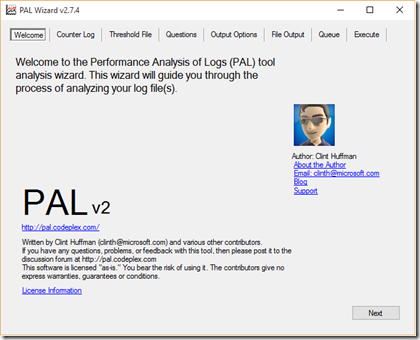](https://msdnshared.blob.core.windows.net/media/TNBlogsFS/prod.evol.blogs.technet.com/CommunityServer.Blogs.Components.WeblogFiles/00/00/00/95/48/metablogapi/PAL1_253B5E18.png)

Lorsque l’on ouvre le menu déroule, on voit qu’il y a pas mal de modèles de capture de compteurs de performances pour différents scenarios serveurs.

[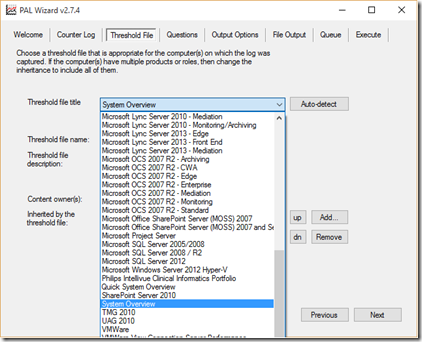](https://msdnshared.blob.core.windows.net/media/TNBlogsFS/prod.evol.blogs.technet.com/CommunityServer.Blogs.Components.WeblogFiles/00/00/00/95/48/metablogapi/PAL2_76112493.png)

Sélectionnons le scénario **Microsoft Active Directory** et cliquons sur **Export to Perfmon template file…**

[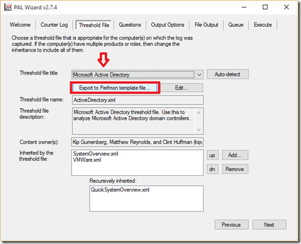](https://msdnshared.blob.core.windows.net/media/TNBlogsFS/prod.evol.blogs.technet.com/CommunityServer.Blogs.Components.WeblogFiles/00/00/00/95/48/metablogapi/PAL3_0F9DD323.png)

On sauvegarde le fichier XML et on le copie sur le serveur où l’on souhaite effectuer la capture.

[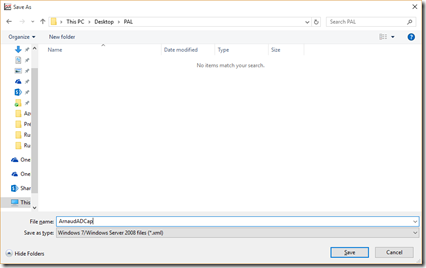](https://msdnshared.blob.core.windows.net/media/TNBlogsFS/prod.evol.blogs.technet.com/CommunityServer.Blogs.Components.WeblogFiles/00/00/00/95/48/metablogapi/PAL4_12D4DC6D.png)

Dans ce modèle, il y a tout simplement la liste des compteurs perfmon que l’on a besoin pour un scénario donné, vous pouvez rajouter vos propres compteurs si le coeur vous en dit. 

## Import du modèle de compteurs de performances sur le serveur

Un fois le fichier de modèle perfmon généré, allons l’importer sur le serveur à analyser.

Lançons perfmon.exe et allons dans la section **User-Defined**

[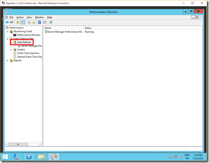](https://msdnshared.blob.core.windows.net/media/TNBlogsFS/prod.evol.blogs.technet.com/CommunityServer.Blogs.Components.WeblogFiles/00/00/00/95/48/metablogapi/perfmon2_2F07B5FC.png)

**Click droit** et sélectionnons **New**, **Data Collector Set**

[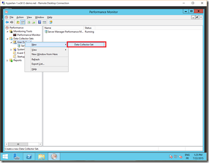](https://msdnshared.blob.core.windows.net/media/TNBlogsFS/prod.evol.blogs.technet.com/CommunityServer.Blogs.Components.WeblogFiles/00/00/00/95/48/metablogapi/perfmon3_609844F3.png)

Spécifions un nom explicite pour retrouver facilement la trace

[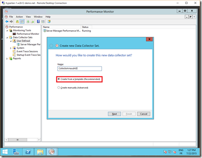](https://msdnshared.blob.core.windows.net/media/TNBlogsFS/prod.evol.blogs.technet.com/CommunityServer.Blogs.Components.WeblogFiles/00/00/00/95/48/metablogapi/perfmon4_6CBC4FCB.png)

Sélectionnons Browse pour importer le modèle que nous avons créé sur le poste de travail et copié sur le serveur.

[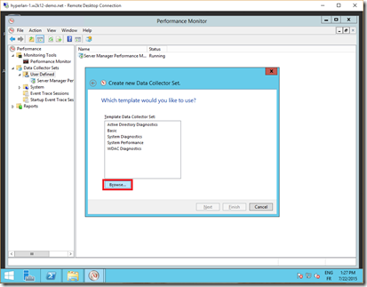](https://msdnshared.blob.core.windows.net/media/TNBlogsFS/prod.evol.blogs.technet.com/CommunityServer.Blogs.Components.WeblogFiles/00/00/00/95/48/metablogapi/perfmon5_14F1198F.png)

Un œil fin aura remarqué que j’aurai pu utiliser également un scénario “Active Directory Diagnostics” déjà inclut dans l’OS. Mais celui ci fait un peu plus que prendre des traces perfmon (en fait, il prend un dump de la configuration de la base de registre et démarre une trace ETL, ce dont je n’ai pas besoin et qui a aussi un impact de performances).

Je confirme donc l’import du fichier XML.

[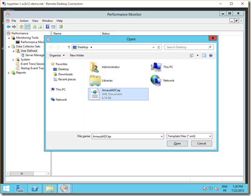](https://msdnshared.blob.core.windows.net/media/TNBlogsFS/prod.evol.blogs.technet.com/CommunityServer.Blogs.Components.WeblogFiles/00/00/00/95/48/metablogapi/perfmon6_38AF628B.png)

J’utilise le modèle “PAL” défini dans le fichier XML.

[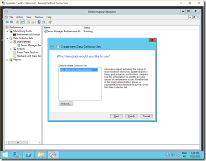](https://msdnshared.blob.core.windows.net/media/TNBlogsFS/prod.evol.blogs.technet.com/CommunityServer.Blogs.Components.WeblogFiles/00/00/00/95/48/metablogapi/perfmon7_32F6D996.png)

Stockage à l’emplacement par défaut.

[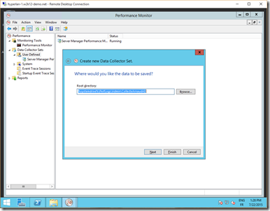](https://msdnshared.blob.core.windows.net/media/TNBlogsFS/prod.evol.blogs.technet.com/CommunityServer.Blogs.Components.WeblogFiles/00/00/00/95/48/metablogapi/perfmon8_56B52292.png)

Utilisation du compte par défaut

[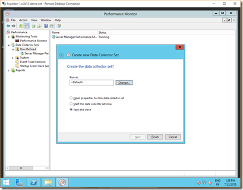](https://msdnshared.blob.core.windows.net/media/TNBlogsFS/prod.evol.blogs.technet.com/CommunityServer.Blogs.Components.WeblogFiles/00/00/00/95/48/metablogapi/perfmon9_093DA167.png)

La collecte est prête et stoppée.

[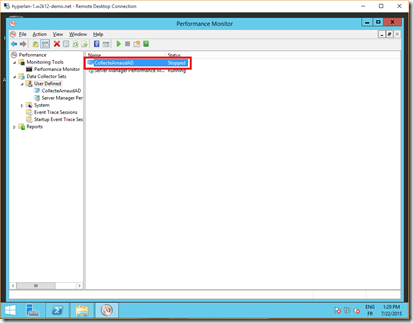](https://msdnshared.blob.core.windows.net/media/TNBlogsFS/prod.evol.blogs.technet.com/CommunityServer.Blogs.Components.WeblogFiles/00/00/00/95/48/metablogapi/perfmon10_2A532EB2.png)

Lorsque nous cliquons deux fois, nous pouvons vérifier la liste des compteurs inclus dans ce modèle ainsi que l’intervalle de capture.

[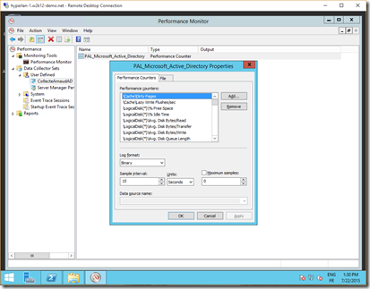](https://msdnshared.blob.core.windows.net/media/TNBlogsFS/prod.evol.blogs.technet.com/CommunityServer.Blogs.Components.WeblogFiles/00/00/00/95/48/metablogapi/perfmon11_0A5F5DFB.png)

## Capture de compteurs de performance

Nous sommes prêts à prendre notre première capture. Nous vérifions dans un premier temps les propriétés définies dans la capture :

[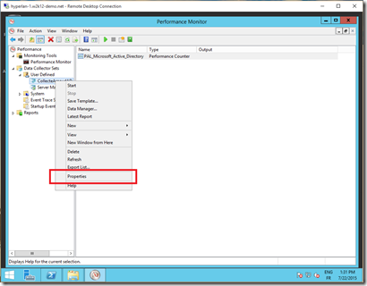](https://msdnshared.blob.core.windows.net/media/TNBlogsFS/prod.evol.blogs.technet.com/CommunityServer.Blogs.Components.WeblogFiles/00/00/00/95/48/metablogapi/capture1_2D47D1BE.png)

Une description du scénario.

[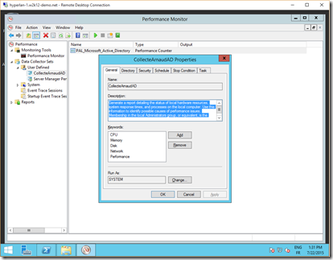](https://msdnshared.blob.core.windows.net/media/TNBlogsFS/prod.evol.blogs.technet.com/CommunityServer.Blogs.Components.WeblogFiles/00/00/00/95/48/metablogapi/capture2_21D6BFD4.png)

Spécifions une limite de taille pour le fichier ainsi qu’une durée dans le temps. Pour une prise de compteurs perfmon, 500 MO, c’est plutôt large, on utilisera des valeurs plus petites lorsque l’espace disque est limité.

[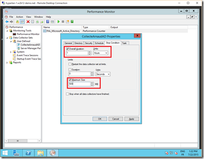](https://msdnshared.blob.core.windows.net/media/TNBlogsFS/prod.evol.blogs.technet.com/CommunityServer.Blogs.Components.WeblogFiles/00/00/00/95/48/metablogapi/capture3_6258C0A9.png)

Je peux lancer ma première capture.

[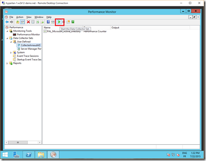](https://msdnshared.blob.core.windows.net/media/TNBlogsFS/prod.evol.blogs.technet.com/CommunityServer.Blogs.Components.WeblogFiles/00/00/00/95/48/metablogapi/capture4_2656C1B8.png)

Je vois bien que la capture commence dans le repertoire attendu, c’est là que j’irai chercher le fichier BLG pour analyse.

[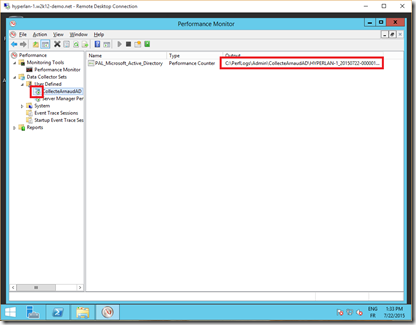](https://msdnshared.blob.core.windows.net/media/TNBlogsFS/prod.evol.blogs.technet.com/CommunityServer.Blogs.Components.WeblogFiles/00/00/00/95/48/metablogapi/capture5_16D8D14B.png)

Nous sommes partis pour une heure de capture, allons prendre un café et faire connaissance avec les nouvelles stagiaires de la compta.  

[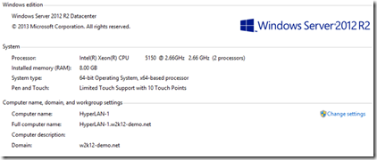](https://msdnshared.blob.core.windows.net/media/TNBlogsFS/prod.evol.blogs.technet.com/CommunityServer.Blogs.Components.WeblogFiles/00/00/00/95/48/metablogapi/config_4D70BF53.png)

De retour sur le serveur, il nous faut vérifier quelle version d’OS on exécute et de combien de RAM est-il doté. Ceci sera utile quand nous lancerons l’analyse des compteurs de performance.

## Analyse automatisée

On récupère le fichier de capture dans le répertoire que l’on a localisé (c:\\perflogs)

[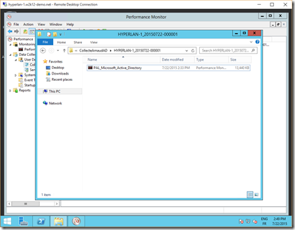](https://msdnshared.blob.core.windows.net/media/TNBlogsFS/prod.evol.blogs.technet.com/CommunityServer.Blogs.Components.WeblogFiles/00/00/00/95/48/metablogapi/BLG1_09BEA5A0.png)

L’étape suivante consiste a analyser le fichier de log généré par perfmon. Le premier contact lorsqu’on double clique sur le fichier n’est pas forcément très engageant :

[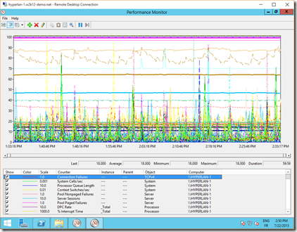](https://msdnshared.blob.core.windows.net/media/TNBlogsFS/prod.evol.blogs.technet.com/CommunityServer.Blogs.Components.WeblogFiles/00/00/00/95/48/metablogapi/BLG2_7872F01C.png)

On a mieux pour analyser tout cela : retournons dans PAL. Pour cela, copions le fichier BLG sur notre machine cliente et lançons à nouveau l’outil.

Déroulons l’assistant, la première étape consiste à lui fournir le fichier de capture que nous avons pris (le fichier .BLG)

[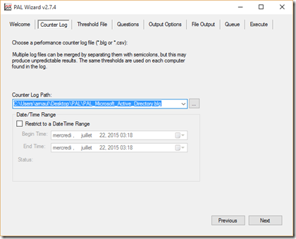](https://msdnshared.blob.core.windows.net/media/TNBlogsFS/prod.evol.blogs.technet.com/CommunityServer.Blogs.Components.WeblogFiles/00/00/00/95/48/metablogapi/APAL1_09374873.png)

Nous validons le modèle Active Directory, cette fois pour l’analyse.

[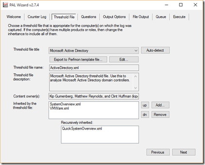](https://msdnshared.blob.core.windows.net/media/TNBlogsFS/prod.evol.blogs.technet.com/CommunityServer.Blogs.Components.WeblogFiles/00/00/00/95/48/metablogapi/APAL2_333C67FD.png)

Sélectionnons l’OS qui est utilisé :

[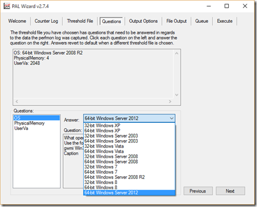](https://msdnshared.blob.core.windows.net/media/TNBlogsFS/prod.evol.blogs.technet.com/CommunityServer.Blogs.Components.WeblogFiles/00/00/00/95/48/metablogapi/APAL3_4D32B8D0.png)

Sélectionnons la quantité de RAM installé sur le serveur :

[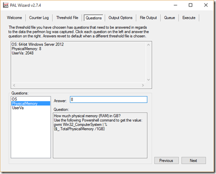](https://msdnshared.blob.core.windows.net/media/TNBlogsFS/prod.evol.blogs.technet.com/CommunityServer.Blogs.Components.WeblogFiles/00/00/00/95/48/metablogapi/APAL4_00FD3FD3.png)

Par défaut, laissons le choisir sa fréquence d’analyse :

[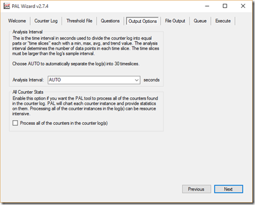](https://msdnshared.blob.core.windows.net/media/TNBlogsFS/prod.evol.blogs.technet.com/CommunityServer.Blogs.Components.WeblogFiles/00/00/00/95/48/metablogapi/APAL5_0029FB4B.png)

Le rapport sera généré dans le répertoire PAL Reports de l’utilisateur actif :

[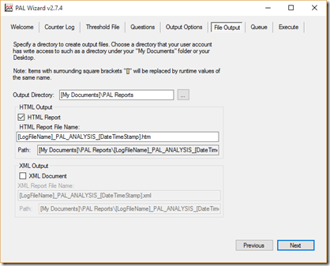](https://msdnshared.blob.core.windows.net/media/TNBlogsFS/prod.evol.blogs.technet.com/CommunityServer.Blogs.Components.WeblogFiles/00/00/00/95/48/metablogapi/APAL6_26223C52.png)

Voici la commande PowerShell qui est lancée automatiquement à la fin de l’assistant :

[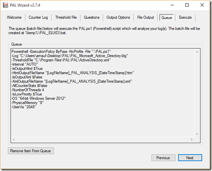](https://msdnshared.blob.core.windows.net/media/TNBlogsFS/prod.evol.blogs.technet.com/CommunityServer.Blogs.Components.WeblogFiles/00/00/00/95/48/metablogapi/APAL7_1303A057.png)

On choisi de l’exécuter immédiatement, mais on peut l’ajouter en file d’attente :

[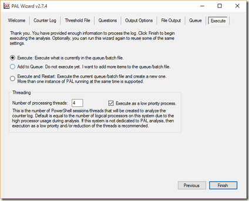](https://msdnshared.blob.core.windows.net/media/TNBlogsFS/prod.evol.blogs.technet.com/CommunityServer.Blogs.Components.WeblogFiles/00/00/00/95/48/metablogapi/APAL8_3ACC3725.png)

Exécution de l’analyse et création du rapport qui prend quelques minutes :

[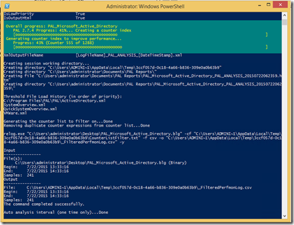](https://msdnshared.blob.core.windows.net/media/TNBlogsFS/prod.evol.blogs.technet.com/CommunityServer.Blogs.Components.WeblogFiles/00/00/00/95/48/metablogapi/APAL9_5E1E4D2C.png)

Une fois le fichier de rapport généré, à vous de partir à l’aventure de son exploration

[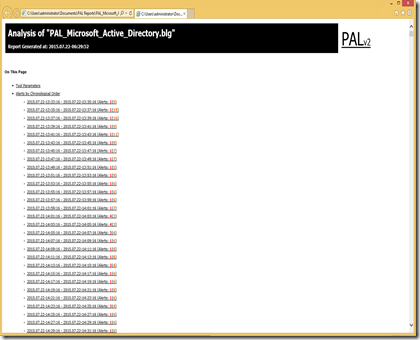](https://msdnshared.blob.core.windows.net/media/TNBlogsFS/prod.evol.blogs.technet.com/CommunityServer.Blogs.Components.WeblogFiles/00/00/00/95/48/metablogapi/APAL10_24C2793B.png)

## Et Voilà

Je commence toujours par la vue chronologique au début du fichier qui permet de voir ce qui s’est passé dans l’intervalle :

[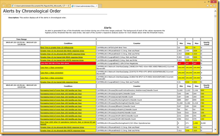](https://msdnshared.blob.core.windows.net/media/TNBlogsFS/prod.evol.blogs.technet.com/CommunityServer.Blogs.Components.WeblogFiles/00/00/00/95/48/metablogapi/image_07DE75C8.png)

On voit dans mon exemple un certain nombre de points rouges et jaunes plus ou moins critiques.

Ici je vois que mon **LDAP Bind Time est un peu lent**, avec une moyenne de **16 ms**. Ceci veut dire qu’un utilisateur qui se connecte au serveur LDAP sur ce serveur a un délai de réponse moyen de 16 ms (ceci n’inclus pas la latence réseau, et donc tout cumulé, ceci peut être considéré comme un peu lent).

Si je corrobore avec d’autres éléments, on voit que le disque sur lequel est stocké AD est également un peu lent avec en moyenne 18 ms pour les écritures et 9 ms pour les lectures : on a donc un coupable tout désigné pour les performances de mon AD.

Ceci n’a pas l’air dramatique, mais c’est vraiment un serveur à surveiller, à fortiori on observe des pics importants :

Dans les détails du rapport, je peux observer les compteurs plus précisément :

[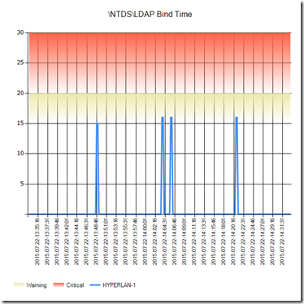](https://msdnshared.blob.core.windows.net/media/TNBlogsFS/prod.evol.blogs.technet.com/CommunityServer.Blogs.Components.WeblogFiles/00/00/00/95/48/metablogapi/NTDS_LDAP_Bind_Time0_5128CCD6.png)

[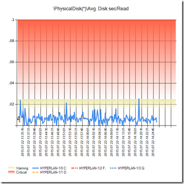](https://msdnshared.blob.core.windows.net/media/TNBlogsFS/prod.evol.blogs.technet.com/CommunityServer.Blogs.Components.WeblogFiles/00/00/00/95/48/metablogapi/PhysicalDisk_Avg_Disk_sec_Read0_32E0A691.png)

[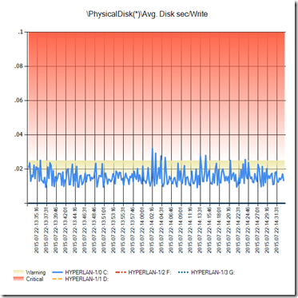](https://msdnshared.blob.core.windows.net/media/TNBlogsFS/prod.evol.blogs.technet.com/CommunityServer.Blogs.Components.WeblogFiles/00/00/00/95/48/metablogapi/PhysicalDisk_Avg_Disk_sec_Write0_75E19660.png)

Ce qui est très sympa également avec PAL, c’est que le rapport généré vous décrit les compteurs utilisés et les valeurs qui sont importantes pour ces compteurs, bref une vraie mine d’or !

Voilà pour cette petite introduction à PAL, j’espère vous avoir initié à des plaisirs insoupçonnés autour de l’analyse de performance de serveurs. Il existe bien d’autres outils, que l’on détaillera dans d’autres articles !

Si vous souhaitez plus d’informations sur le dépannage d’Active Directory et des performances, vous pouvez aussi retrouver un cours dédié sur la Microsoft Virtual Academy : Active Directory – Dépannage et mécanismes internes [http://www.microsoftvirtualacademy.com/training-courses/active-directory-depannage-et-mecanismes-internes-fr](http://www.microsoftvirtualacademy.com/training-courses/active-directory-depannage-et-mecanismes-internes-fr "http://www.microsoftvirtualacademy.com/training-courses/active-directory-depannage-et-mecanismes-internes-fr")

Encore plus de cours sur la Microsoft Virtual Academy : [https://aka.ms/MVAFR](https://aka.ms/MVAFR)

Egalement à suivre, le blog de Clint Huffman [http://blogs.technet.com/b/clinth/](http://blogs.technet.com/b/clinth/ "http://blogs.technet.com/b/clinth/") 

[Arnaud Lheureux](https://twitter.com/ArnaudLheureux)
