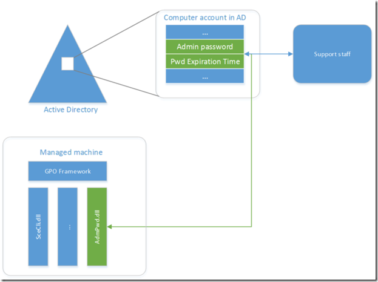
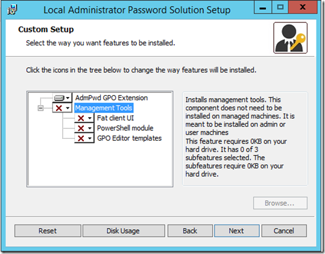
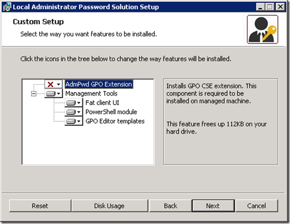
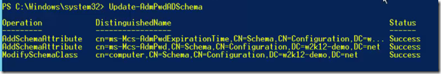
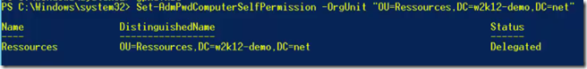
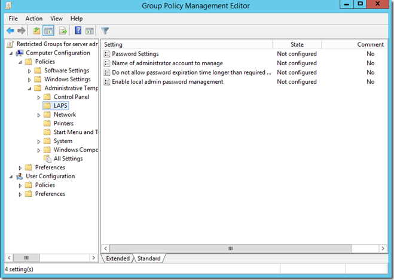
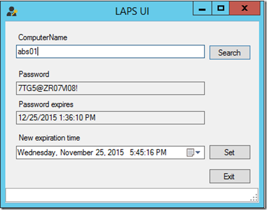
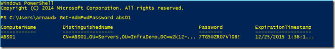

Un problème de sécurité assez commun dans les grandes organisations est la gestion des comptes administrateurs locaux (aussi bien sur les machines clientes que sur les serveurs). En effet, très souvent ces comptes sont toujours actifs alors que nous recommandons de les désactiver et ces comptes ont tous les mêmes mots de passe sur l’ensemble des machines.

<!-- truncate -->

La menace est assez claire et simple à comprendre, si ce mot de passe est compromis sur une seule machine, alors c’est l’ensemble du parc informatique qui est compromis, sans même avoir besoin d’un compte administrateur du domaine. Il faut donc gérer ce mot de passe, s’assurer qu’il soit unique sur l’ensemble de l’organisation.

De grandes organisations avec lesquelles je travaille sur leurs problématiques de sécurité font donc appel à des outils d’éditeurs tiers pour compléter leur stratégie de sécurité. La bonne nouvelle est que Microsoft propose désormais un outil gratuit pour gérer cela : Local Admin Password Solution (ou LAPS).

## Introduction à LAPS

LAPS est une solution de gestion des mots de passe pour les serveurs membres d’un domaine : machines clientes ou serveurs membres. Toutes les éditions de Windows sont supportées depuis Windows Vista (avec dernier SP disponible) et Windows Server 2008 (avec dernier SP disponible) en 32 ou 64 bits.

LAPS c’est :

-   Un composant client qui va mettre à jour le mot de passe dans le contexte système et envoyer le mot de passe aux contrôleurs de domaine Active Directory.
-   Le mot de passe est stocké comme attribut dans l’objet machine de l’Active Directory.
-   Un outillage graphique et de script qui permet de retrouver le mot de passe pour les utilisateurs habilités.
-   Un contexte de déploiement centralisé des paramètres (via stratégies de groupe)

Voici un schéma d’architecture de la solution que je vais vous détailler :

## Déploiement des composants clients

LAPS est fourni comme un fichier MSI qui permet d’installer les composants clients et serveurs. L’installation par défaut n’installe que les composants clients, et on peut facilement scripter son installation avec la commande : msiexec /i <emplacement>\\LAPS.x64.msi /quiet

Concrètement, la partie cliente de LAPS est un CSE (Client Side Extension) : c’est une extension qui vient s’enregister auprès du service client de stratégies de groupe de Windows. On installe donc pas de nouveau service à gérer mais bien un composant de l’OS. Ce CSE va se retrouver par défaut dans %programfiles%\\LAPS\\CSE\\AdmPws.dll

A chaque fois que le CSE va être déclenché, il va vérifier si le mot de passe a expiré (basé sur son dernier changement stocké dans l’attribut ms-Mcs-AdmPwdExpirationTime). Si le mot de passe a expiré, alors il en génère un de manière aléatoire et selon les conditions définies dans la stratégie de groupe (détails plus bas) et met à jour l’attribut ms-Mcs-AdmPwd (le mot de passe en clair) sur l’objet machine dans l’AD ainsi que l’attribut ms-Mcs-AdmPwdExpirationTime (pour mettre à jour l’information d’âge de mot de passe).

Notons que l’échange du mot de passe entre le lien et le contrôleur de domaine se fait de manière authentifiée par Kerberos et le transport par le dialogue sécurisé avec LDAP. La confidentialité du mot de passe est garantie car seulement les administrateurs du domaine ont la possibilité de voir ces informations (l’attribut étant flaggué comme confidentiel).

## Déploiement des composants infrastructure

Sur un serveur membre nous allons installer les composants LAPS, on aura besoin dans un premier temps d’un compte avec les droits d’administrateur local sur le serveur, ensuite on doit disposer des droits d’administrateurs du schéma, puis finalement des droits d’administration sur l’unité d’organisation qu’on veut administrer (ou administrateur du domaine si on veut le déployer sur toute l’organisation).

Les deux attributs que j’ai mentionnés précédemment sont des nouveaux attributs à ajouter au schéma Active Directory qui seront rattachés à la classe « machine ». Il vous faut pour cela faire l’extension de schéma avec les composants PowerShell fournis par l’outil.

Installons LAPS avec les composants serveurs :

On installe l’environnement, et procède à l’extension de schéma en utilisant la commande :

Import-module AdmPwd.PS

Update-AdmPwdADSchema

On va ensuite attribuer aux machines le droit de modifier ces attributs pour leur propre compte machine :

Set-AdmPwdComputerSelfPermission -OrgUnit "OU=InfraDemo,DC=w2k12-demo,DC=net"

Vous remplacerez par le distinguished name de l’OU où vous déployez la solution.

L’étape suivante consiste à déployer les stratégies de groupe qui déterminent le comportement du client LAPS.

Par défaut, LAPS positionne les fichiers ADMX et ADML sur le poste local, si on veut les placer dans le SYSVOL de l’organisation, on ira donc récupérer :

-   C:\\Windows\\PolicyDefinitions\\AdmPwd.admx
-   C:\\Windows\\PolicyDefinitions\\en-us\\AdmPwd.adml

Une fois l’opération effectuée, on ouvre une GPO et on accède aux paramètres :

Ceux-ci permettent d’activer ou inhiber LAPS, de définir l’intervalle de changement de mots de passe, ses critères de complexité ainsi que le nom du compte administrateur si celui-ci n’est pas « administrator ».

Une fois les paramètres changés, on redémarre la machine membre et la magie doit opérer. On peut accéder au mot de passe de plusieurs manières :

En interface graphique :

En PowerShell :

Et voilà !

On a donc une bonne petite solution gratuite qui fait son travail, cela ne résout pas tous les problèmes de sécurité mais constitue une très bonne avancée pour votre stratégie de défense en profondeur, et tout cela pour un temps de mise en œuvre relativement réduit comme vous avez pu le voir.

On parle dans la série [Concrètement](https://channel9.msdn.com/Blogs/Concretement) de Pascal Sauliere, et la vidéo est ici :

[Watch on Channel 9 (archived)](https://channel9.msdn.com/Blogs/Concretement/Episode-6-LAPS)

## Quelques références

Téléchargement – [http://www.microsoft.com/en-us/download/details.aspx?id=46899](http://www.microsoft.com/en-us/download/details.aspx?id=46899)

Security Advisory – [https://technet.microsoft.com/en-us/library/security/3062591](https://technet.microsoft.com/en-us/library/security/3062591)

KB – [https://support.microsoft.com/en-us/kb/3062591](https://support.microsoft.com/en-us/kb/3062591)

Blog – [http://blogs.msdn.com/b/laps/](http://blogs.msdn.com/b/laps/)

A bientôt!

[Arnaud](https://twitter.com/ArnaudLheureux)
