In Nuage Networks solutions family ([see previous post for a quick intro](https://arnaud-web.azurewebsites.net/2016/08/08/got-software-defined-networking/)), Virtualized Services Directory is the foundation for enterprise-class SDN. VSD serves as a policy, business logic and analytics engine for the network services.

<!-- truncate -->

VSD includes the architect role, a HTML5-based UI that allows operations to occur in a user-friendly way. It also comes with a command line interface and every single operation can also be done by REST API calls.

VSD contains a multi-tenanted service directory that supports role-based administration of users, compute and network resources. It also manages network resource assignments such as IP and MAC addresses.

For the purpose of network service assurance, the VSD allows the definition of statistics rules such as collection frequencies, rolling averages and samples, as well as Threshold Crossing Alerts. When a TCA occurs, it will trigger an event that can be exported to external systems through a generic messaging bus. Statistics are aggregated over hours, days and months and stored in an analytics cluster to facilitate data mining and performance reporting.

## VSD Supported Configurations

VSD supported configurations are [detailed here](https://infoproducts.alcatel-lucent.com/aces/cgi-bin/au_doc_list.pl?entry_id=1-0000000000662&srch_how=Title&contype=RLNT&sortby=Issue%20Date&how=all_prod), but in a nutshell, VSD is composed of two roles:

-   VSD Server itself
-   VSD Statistics server (can be a Hadoop or Elastic Search storage)

In this post, I will focus on VSD Server itself.

The VSD can be deployed stand-alone for testing and validation environments, and will be deployed in clusters for production environments in order to achieve high-availability and scaling needs.

As a customer, Nuage Networks provides you with the following form factors for VSD server deployment:

-   VMware Image: supported on ESXi 5.5/6.0
-   QCOW Image: supported on KVM for CentOS 6.X, RHEL 6.X/7.X
-   ISO file for your own setup.

The ISO files allows it to be deployed on a physical server running: CentOS and RHEL versions 6.5, 6.6 and 6.7 with minimal install.

## Objectives of this setup

So there is no reference to Hyper-V in the supported platforms list, but it was too tempting for me not to test it’s installation and running.

> **Warning! This post does not depict any current Nuage Networks best practice nor supported configuration for hosting VSD platform.**

I will provide here some platform-level recommendations to make VSD usable for some small demo/POC environments where you want the platform to be usable and stable.

We will deploy a VSD role on a Hyper-V host name CLOUDHOST, which is running Windows Server 2012 R2. This host has an external virtual switch called “Management” which is linked to the datacenter world and has connectivity to the Internet.

[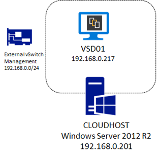](./image.png)

## Prerequisites for this setup

In order to start with this setup, you should have the following elements available:

-   A running Windows Server 2012 R2 host machine with Hyper-V role, management console and PowerShell enabled.
-   Latest VSD binaries from [Nokia Online Support Center](https://support.alcatel-lucent.com/portal/web/support/product-result?entryId=1-0000000000662).
-   CentOS 6.7 ISO Minimal Install Setup files.
-   SSH Client: Anything like P[utty](http://www.putty.org/), I personally like [MobaXterm](http://mobaxterm.mobatek.net/).
-   A NTP server.
-   The VSD VM will need internet connectivity to download various components during the setup process.

## VSD VM Recommendations for Hyper-V

The first step consists of creating a Hyper-V Virtual Machine with CentOS 6.7 binaries installed. The specifics recommended parameters (*Recommended by me, not officially Nuage Networks!*) for this VM are:

<table style="height: 394px;" border="1" width="638" cellspacing="0" cellpadding="0"><tbody><tr><td valign="top" width="175"><b>Configuration item</b></td><td valign="top" width="461"><b>&nbsp; Recommended value</b></td></tr><tr><td valign="top" width="175">VM Generation</td><td valign="top" width="461"><ul><li>Generation 1</li></ul></td></tr><tr><td valign="top" width="175">RAM</td><td valign="top" width="461"><ul><li>8192 GB (bare minimum)</li><li>NO dynamic memory used</li></ul></td></tr><tr><td valign="top" width="175">Processor</td><td valign="top" width="461"><ul><li>4 vCPU or more</li></ul></td></tr><tr><td valign="top" width="175">Disk type and Size</td><td valign="top" width="461"><ul><li>Use VHDX format</li><li>Dynamic Size (127 GB by default)</li></ul></td></tr><tr><td valign="top" width="175">NIC Configuration</td><td valign="top" width="461"><ul><li>1 VNIC for management</li><li>Use Synthetic NIC and not the emulated (legacy)</li></ul></td></tr><tr><td valign="top" width="175">Integration services</td><td valign="top" width="461"><ul><li>NOT using the Time Synchronization option</li><li>Stop action: Shutdown the guest operating system</li></ul></td></tr></tbody></table>

## VM Creation

In Windows Server 2012 R2 UI, the following steps need to be completed:

1.

Open the Hyper-V management console. In the **Server Manager**, select Hyper-V, right click on the **computer name** and select **Hyper-V Manager**.

2.

On the right side on the management console, select **New** then **Virtual Machine**

**[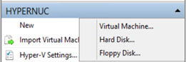](./hv1.png)**

3.

On the New Virtual Machine Wizard, click **Next**

4.

Type a name for the Virtual Machine you created: **CONTOSO-VSD**[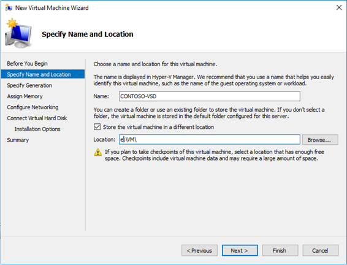](./hv2.png)

5.

Create a **Generation 1** virtual machine:[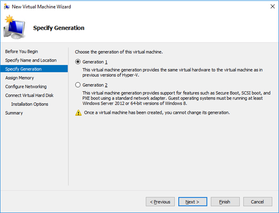](./hv3.png)

6.

Specify **8192MB** of **RAM**, verify that the checkbox **“Use dynamic memory”** is **NOT** enabled.[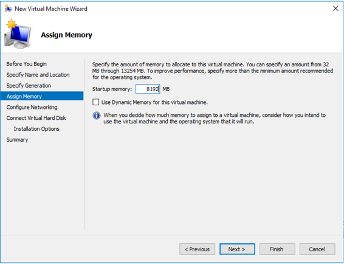](./hv4.png)

7.

Connect the virtual machine to the Management network Interface or any suitable virtual switch for your environment. [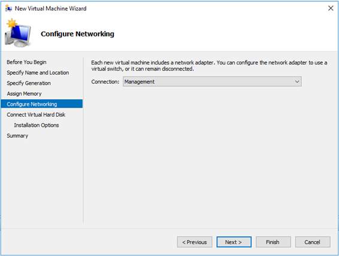](./hv5.png)

8.

Create the virtual hard disk file on the desired path:[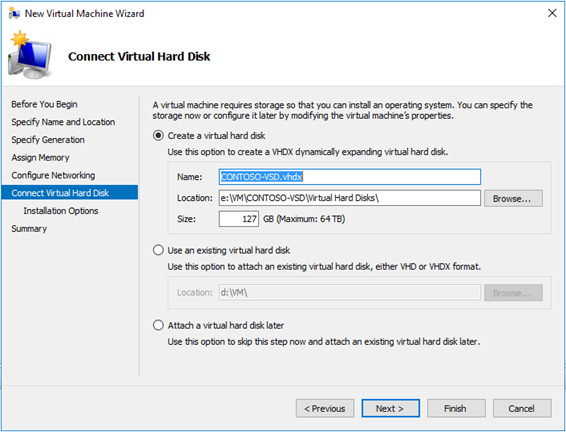](./hv6.png)

9.

Specify “**Install an operating system from a bootable CD/DVD-ROM**” and select the location of your CentOS 6.7 installation media [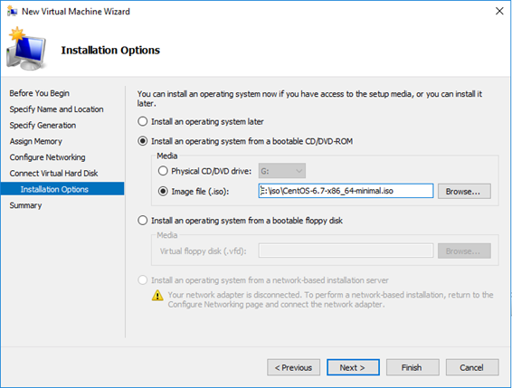](./hv7.png)

10.

Review the parameters and click **Finish**: [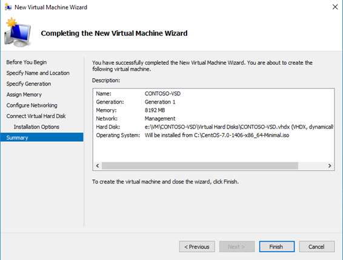](./hv8.png)

Do not start the VM, we need to modify additional settings.

11.

Once the VM has been created, right click on it and select **Settings**[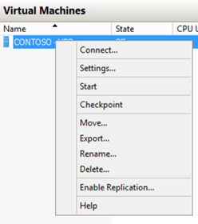](./hv9.png)

12.

In the **processor** section, add cores to have **at least 4 virtual CPU**[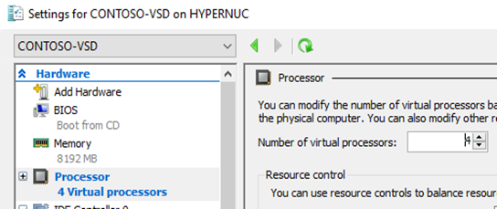](./hv10.png)

13.

Go to the Integration Services section of the Virtual Machine and

-   **Uncheck** the “**Time Synchronization**” item as we will use the NTP service to have consistent time-stamps with the whole Nuage Architecture
-   In the Automatic Stop Action, select “**Shutdown the guest operating system**”. [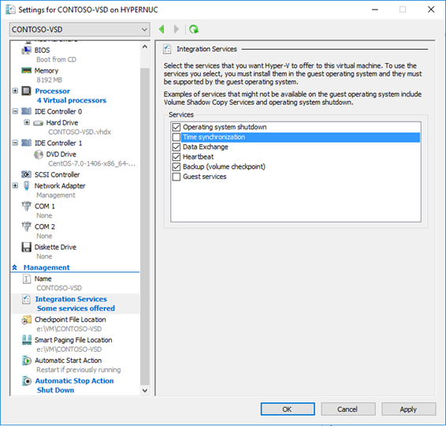](./hv11.png)

14.

Click OK to confirm the VM settings.

## VM Creation: PowerShell

If you prefer to use PowerShell, you can do the previous steps in just a couple of lines where I define the following variables:

-   vmpath and vhdpath as the paths for the VM and the virtual hard disk file to be created.
-   vmname as the name of the VM.
-   vmswitchname as the name of the hyper-v virtual switch where this VM will be attached.
-   Linuxisopath with the path to the CentOS 6.7 minimal install ISO.

> $vmpath=”C:\\VM\\CONTOSOVSD”  
> $vhdpath=”C:\\VM\\CONTOSOVSD\\contoso2.vhdx”  
> $vmname=”CONTOSO-VSD2″  
> $vswitchname=”Management”  
> $linuxisopath=”E:\\iso\\CentOS-6.7-x86\_64-minimal.iso”
> 
> New-VM -NewVHDPath $vhdpath -NewVHDSizeBytes 127GB -Generation 1 -MemoryStartupBytes 8GB -Name $vmname -Path $vmpath -SwitchName $vswitchname  
> Set-VM -Name $vmname -ProcessorCount 4 -AutomaticStopAction ShutDown  
> Get-VMIntegrationService -VMName $vmname -Name “Time Synchronization” | Disable-VMIntegrationService  
> Set-VMDvdDrive -VMName $vmname -Path $linuxisopath  
> Start-VM -Name $vmname

This is quick so in many times, I prefer PowerShell!

That was easy! This is it for this first part of this post, in the second part, we will proceed to Linux CentOS 6.7 setup with the prerequisites for VSD and proceed to VSD server setup!

For more information in the meantime:

-   Homepage: [http://www.nuagenetworks.net/products/virtualized-services-platform/](http://www.nuagenetworks.net/products/virtualized-services-platform/)
-   Datasheet: [http://www.nuagenetworks.net/wp-content/uploads/2014/11/MKT2014097652EN\_NN\_VSP\_Virtualized\_Services\_Platform\_R3\_Datasheet.pdf](https://www.nuagenetworks.net/wp-content/uploads/2014/11/MKT2014097652EN_NN_VSP_Virtualized_Services_Platform_R3_Datasheet.pdf)

[Arnaud](https://twitter.com/arnaudlheureux/)
