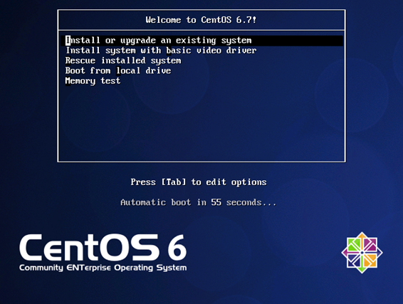
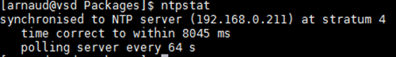
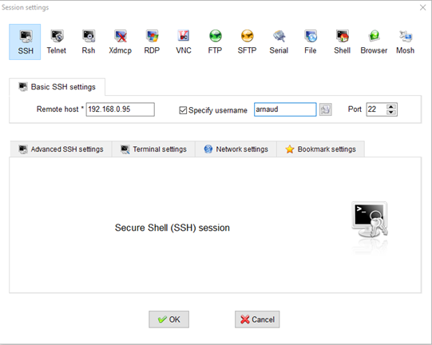
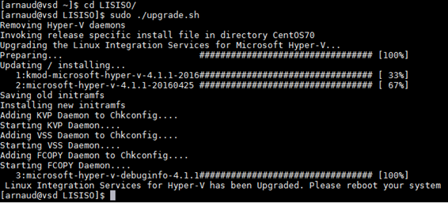
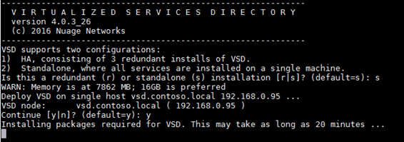
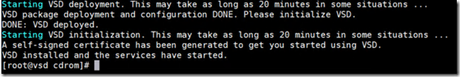
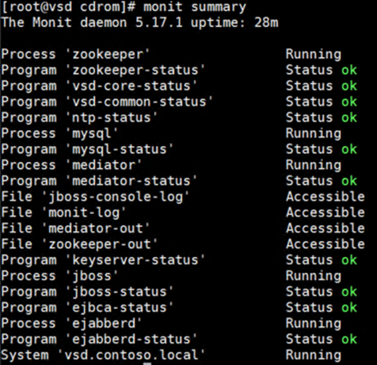
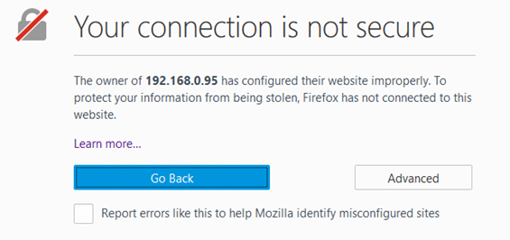
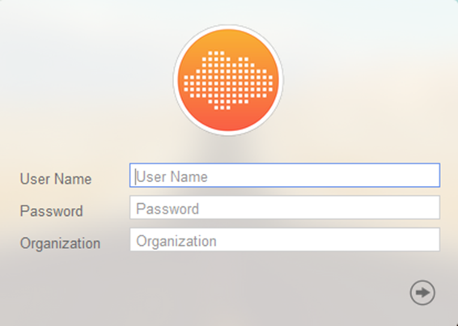
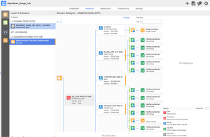

[In the previous article of this serie](https://arnaud-web.azurewebsites.net/2016/08/12/virtualized-services-directory-on-hyper-v-for-windows-server-2012-r2-part-1/), we deployed an empty VM to host our VSD server, in this second part, we are getting serious and deploy the Linux OS and the VSD server role!

<!-- truncate -->

## Proceed to CentOS 6.7 Installation

We will proceed to default minimal install of Centos 6.7:

1.

Double click on the Contoso – VSD VM and click the Power Button to start it.

2.

Start the setup of CentOS:

3.

Proceed to setup choosing the desired keyboard, then select “Basic Storage Device” and “Yes, Discard Any Data”

Type the hostname for this machine “**vsd.contoso.local**” and the desired timezone.

Select the root password and Use All Space, Write Changes to Disk.

Click Done and Begin Installation.

4.

Once the setup is finished, restart the virtual machine and log in to do basic networking setup:

> **dhclient eth0**

In order to edit my configuration files, I don’t like vi and I prefer nano, so I get it online.

> **sudo yum install nano –y**

Edit the file Ethernet NIC settings to match your network:

> **nano /etc/sysconfig/network-scripts/ifcfg-eth0**
> 
> **DEVICE=”eth0″**
> 
> **NM\_CONTROLLED=”no”**
> 
> **ONBOOT=”yes”**
> 
> **TYPE=”Ethernet”**
> 
> **BOOTPROTO=”static”**
> 
> **IPADDR=192.168.0.95**
> 
> **GATEWAY=192.168.0.1**
> 
> **NETMASK=255.255.255.0**

Then verify the network name:

> **nano /etc/sysconfig/network**
> 
> **NETWORKING=yes**
> 
> **HOSTNAME=vsd.contoso.local**

Add the server IP address to the host file:

> **nano /etc/hosts**
> 
> **192.168.0.95 vsd.contoso.local**

Restart networking:

> **nano service network restart**

Check your hostname settings with the following command:

> **hostname -f**

5.

Install and configure NTP service:

> **sudo yum install ntp -y**
> 
> **sudo nano /etc/ntp.conf**

Modify the ntp.conf to have the internal server:

> **nano /etc/ntp.conf**
> 
> **server 192.168.0.211**

We choose to use a local NTP server in our environment with IP address 192.168.0.211. Please note that Microsoft Active Directory provides a NTP server feature, however, we are not able to use it as a time source for VSD, so we use an alternate NTP Server.

Save the file and restart the NTP client:

> **sudo service ntpd restart**

Set the ntpd service to start automatically:

> **sudo chkconfig ntpd on**

Verify that host is synchronized by using the following command:

> **ntpstat**

6.

We will pin our distribution to CentOS 6.7 repository in order to avoid it to be upgraded to later builds.

We create a new file with repo information:

> **sudo nano /etc/yum.repos.d/c67.repo**
> 
> **\[c67\]**
> 
> **name=CentOS67**
> 
> **enabled=1**
> 
> **gpgcheck=0**
> 
> **baseurl=http://vault.centos.org/6.7/os/x86\_64/**

7.

Install dependencies

> **sudo yum install openssh-clients libedit bind-utils -y**

## Linux Integration Services Update

Microsoft regularly updates Kernel driver and user mode components in order to make Linux work best and add new supported features. We need to install Linux Integrated Services (LIS) in order to ensure best behavior.

1.

Open a SSH session to the newly configured machine, in this guide, we use MobaXTerm:

2.

Download LIS 4.1.2 components from Microsoft Website with the following command:

> **sudo yum install wget -y**
> 
> **wget** [https://download.microsoft.com/download/7/6/B/76BE7A6E-E39F-436C-9353-F4B44EF966E9/lis-rpms-4.1.2-1.tar.gz](https://download.microsoft.com/download/7/6/B/76BE7A6E-E39F-436C-9353-F4B44EF966E9/lis-rpms-4.1.2-1.tar.gz)

3.

Extract the files using the following command:

> **tar -xvzf lis-rpms-4.1.2-1.tar.gz**

4.

Update the components using:

> **cd LISISO/**
> 
> **sudo ./upgrade.sh**

5.

Once the setup is finished, restart the virtual machine and **log back in**.

## Deploying the VSD Components on the VM

In this section, we will copy the VSD installation binaries to the VSD VM and proceed to setup.

1.

Extract the “Nuage-VSD-\*-ISO.tar.gz” file that you have downloaded. Get the .ISO file and go to Hyper-V manager and mount it to the “**CONTOSO-VSD**” VM.

2.

Mount the ISO file on your system:

> **sudo mkdir /media/cdrom**
> 
> **sudo mount /dev/sr0 /media/cdrom**

3.

Launch VSD Setup process:

> **cd /media/cdrom**
> 
> **sudo ./install.sh**

Select standalone option by hitting **s** and confirm with **yes**.

4.

Wait for the install to finish, note that it can take several minutes.

Once the setup is finished, you can check that all the components are active using the following command:

> **monit summary**

This should display you the following output for a fully ready environment:

## Verify that VSD is operational

Once the setup has completed, you can verify the configuration and log in the portal for the first time. After reviewing operations, you will be able to install a product key to start using licensed features of your VSD.

1.

Open your favorite browser and enter the URL:

[https://192.168.0.95:8443](https://192.168.0.95:8443)

Add exception to your browser as this is expected for a first configuration running with self-signed certificate

2.

Login with the default credentials:

****

3.

Welcome to the world of VSD!

So that you have VSD installed, you can start playing and creating organizations, networks, network policies.

But in order to have it enforced somewhere, you need a network controller. Monitor this blog and we will review the steps to make Nuage Networks controller run on Hyper-V!

For more information:

-   Homepage: [http://www.nuagenetworks.net/products/virtualized-services-platform/](http://www.nuagenetworks.net/products/virtualized-services-platform/)
-   Datasheet: [http://www.nuagenetworks.net/wp-content/uploads/2014/11/MKT2014097652EN\_NN\_VSP\_Virtualized\_Services\_Platform\_R3\_Datasheet.pdf](https://www.nuagenetworks.net/wp-content/uploads/2014/11/MKT2014097652EN_NN_VSP_Virtualized_Services_Platform_R3_Datasheet.pdf)
-   Supported Linux and FreeBSD virtual machines for Hyper-V on Windows – [https://technet.microsoft.com/en-us/library/dn531030.aspx](https://technet.microsoft.com/en-us/library/dn531030.aspx)
-   Supported CentOS and Red Hat Enterprise Linux virtual machines on Hyper-V – [https://technet.microsoft.com/en-us/library/dn531026.aspx](https://technet.microsoft.com/en-us/library/dn531026.aspx)
-   Best practices for running Linux on Hyper-V – [https://technet.microsoft.com/en-us/library/dn720239.aspx](https://technet.microsoft.com/en-us/library/dn720239.aspx)

You can also reach me at my email if you need more info and trial: \[first\].\[last\]@nuagenetworks.net!

[Arnaud](https://twitter.com/arnaudLheureux/)
