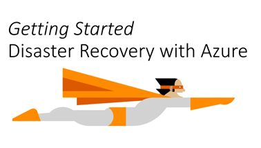

*<updated 14th march 2017>*

<!-- truncate -->

In this series of “Getting Started” articles, I will post the most up-to-date information I use with Microsoft Partners and customers when enabling them with Azure infrastructure services. I follows the same structure which is: getting started, training videos if available, then reference architectures, capacity planning and pricing information.

Disaster Recovery Plans aka DRP is one the most ungrateful work in IT. Because basically you are going to prepare for some situations that will be painful and difficult. However, this is a good exercise to protect against one of the most prevalent laws in IT: “Anything (Everything) will fail at some point, and very likely at the worst time”.

It puts you in a state of mind that most of people don’t like.and you will ask your boss money for something that you hope will never be used.

That’s where the cloud can help, for both virtualized and non virtualized workloads. Here’s how in 4 easy steps:

1.  First step consists of replicating your production workloads as they are running.
2.  Second step is to automating the disaster recovery plan execution.
3.  Run the workloads in Azure.
4.  Replicate your virtual machines back to your datacenter.

<table cellspacing="0" cellpadding="0" border="1"><tbody><tr><td valign="top" width="174">
<b>Overview video</b>
</td><td valign="top" width="450">
<a href="https://www.youtube.com/watch?v=eOOwMQPBKfM">https://www.youtube.com/watch?v=eOOwMQPBKfM</a>
</td></tr><tr><td valign="top" width="174">
<b>Overview article</b>
</td><td valign="top" width="450">
<a href="https://azure.microsoft.com/en-us/documentation/articles/site-recovery-overview/">https://azure.microsoft.com/en-us/documentation/articles/site-recovery-overview/</a>
</td></tr><tr><td valign="top" width="174">
<b>Training Videos</b>
</td><td valign="top" width="450">
<a href="https://channel9.msdn.com/Series/Azure-Site-Recovery">https://channel9.msdn.com/Series/Azure-Site-Recovery</a>
</td></tr><tr><td valign="top" width="174">
<b>Technical References</b>
</td><td valign="top" width="450">
Azure Site Recovery support matrix – <a href="https://docs.microsoft.com/en-us/azure/site-recovery/site-recovery-support-matrix">https://docs.microsoft.com/en-us/azure/site-recovery/site-recovery-support-matrix</a>

Prepare for Azure Site Recovery deployment – <a href="https://docs.microsoft.com/en-us/azure/site-recovery/site-recovery-best-practices">https://docs.microsoft.com/en-us/azure/site-recovery/site-recovery-best-practices</a>

Migrate AWS workloads to Azure – <a href="https://docs.microsoft.com/en-us/azure/site-recovery/site-recovery-migrate-aws-to-azure">https://docs.microsoft.com/en-us/azure/site-recovery/site-recovery-migrate-aws-to-azure</a>
</td></tr><tr><td valign="top" width="174">
<b>Architecture references</b>
</td><td valign="top" width="450">
VMware and Physical Servers to Azure – <a href="https://docs.microsoft.com/en-us/azure/site-recovery/site-recovery-vmware-to-azure">https://docs.microsoft.com/en-us/azure/site-recovery/site-recovery-vmware-to-azure</a>

Hyper-V to Azure – <a href="https://docs.microsoft.com/en-us/azure/site-recovery/site-recovery-hyper-v-site-to-azure">https://docs.microsoft.com/en-us/azure/site-recovery/site-recovery-hyper-v-site-to-azure</a>

VMM to Azure – <a href="https://docs.microsoft.com/en-us/azure/site-recovery/site-recovery-vmm-to-azure">https://docs.microsoft.com/en-us/azure/site-recovery/site-recovery-vmm-to-azure</a>

Network planning for disaster recovery: <a href="https://docs.microsoft.com/en-us/azure/site-recovery/site-recovery-network-design">https://docs.microsoft.com/en-us/azure/site-recovery/site-recovery-network-design</a>
</td></tr><tr><td valign="top" width="174">
<b>Workload guidance</b>
</td><td valign="top" width="450">
What workloads can you protect with Azure Site Recovery? – <a href="https://docs.microsoft.com/en-us/azure/site-recovery/site-recovery-workload">https://docs.microsoft.com/en-us/azure/site-recovery/site-recovery-workload</a>

<a href="https://docs.microsoft.com/en-us/azure/site-recovery/site-recovery-active-directory">Active directory and DNS</a>

<a href="https://docs.microsoft.com/en-us/azure/site-recovery/site-recovery-sql">SQL Server</a>

<a href="https://docs.microsoft.com/en-us/azure/site-recovery/site-recovery-workload#protect-sharepoint">Sharepoint</a>

<a href="https://docs.microsoft.com/en-us/azure/site-recovery/site-recovery-workload#protect-dynamics-ax">Dynamics AX</a>

<a href="https://gallery.technet.microsoft.com/Exchange-DR-Solution-using-11a7dcb6">Exchange</a>

<a href="http://aka.ms/asr-sap">SAP</a>

Running automation in ASR – <a title="https://docs.microsoft.com/en-us/azure/site-recovery/site-recovery-runbook-automation" href="https://docs.microsoft.com/en-us/azure/site-recovery/site-recovery-runbook-automation">https://docs.microsoft.com/en-us/azure/site-recovery/site-recovery-runbook-automation</a>&nbsp;
</td></tr><tr><td valign="top" width="174">
<b>Sizing &amp; capacity planning</b>
</td><td valign="top" width="450">
Capacity planning: <a href="https://docs.microsoft.com/en-us/azure/site-recovery/site-recovery-capacity-planner">https://docs.microsoft.com/en-us/azure/site-recovery/site-recovery-capacity-planner</a>

Azure Site Recovery Deployment Planner: <a title="https://aka.ms/asr-deployment-planner-doc" href="https://aka.ms/asr-deployment-planner-doc">https://aka.ms/asr-deployment-planner-doc</a>&nbsp;
</td></tr><tr><td valign="top" width="174">
<b>Pricing reference</b>
</td><td valign="top" width="450">
<a href="https://azure.microsoft.com/en-us/pricing/details/site-recovery/">https://azure.microsoft.com/en-us/pricing/details/site-recovery/</a>
</td></tr><tr><td valign="top" width="174">
<b>Service updates information</b>
</td><td valign="top" width="450">
<a href="https://azure.microsoft.com/en-us/updates/?product=site-recovery">https://azure.microsoft.com/en-us/updates/?product=site-recovery</a>
</td></tr></tbody></table>

When you have put the infrastructure in place and are in the process of fully automating the disaster recovery plan, you need skills on Azure Automation. There’s a pretty nice course on Microsoft OpenEDX: [https://openedx.microsoft.com/courses/course-v1:Microsoft+AZURE210x+2016\_T4/about](https://openedx.microsoft.com/courses/course-v1:Microsoft+AZURE210x+2016_T4/about "https://openedx.microsoft.com/courses/course-v1:Microsoft+AZURE210x+2016_T4/about") 

Feel free to connect with me and provide feedbacks!

[Arnaud](https://twitter.com/arnaudlheureux)
