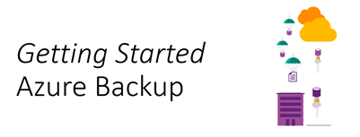

<!-- truncate -->

We continue our series of “Getting Started” articles, with most up-to-date information I use with Microsoft Partners and customers when enabling them with Azure infrastructure services. I follows the same structure which is: getting started, training videos if available, then reference architectures, capacity planning and pricing information.

Backup is generally not creating a lot of excitement in IT teams, that’s the very least we can say. The fundamentally difficult parts of it are:

1.  defining data retention and archival policies.
2.  defining the appropriate sizing for the solution.
3.  executing the offsite data copy policy.

I’m not even talking about testing the restore of the backup, because people usually don’t do it 

Here’s really why Azure can help:

1.  You only have to size for the local backup storage system, archival is done is the cloud.
2.  With all hidden costs of tape systems included like offsite processing, storage on cloud is very likely to be always cheaper than any on-premises storage.
3.  You can easily test restoring data in a separate and isolated environment.
4.  You can easily backup files on servers and client with a small backup agent
5.  You can easily backup your applications running on Hyper-V on Vmware with Azure Backup Server.

Here’s what you need to get started building solutions on Azure:

<table cellspacing="0" cellpadding="0" border="1"><tbody><tr><td valign="top" width="152">
<b>Overview video</b>
</td><td valign="top" width="472">
<a href="https://azure.microsoft.com/en-us/resources/videos/what-is-azure-backup/">https://azure.microsoft.com/en-us/resources/videos/what-is-azure-backup/</a>
</td></tr><tr><td valign="top" width="152">
<b>Overview article</b>
</td><td valign="top" width="472">
<a href="https://docs.microsoft.com/en-us/azure/backup/backup-introduction-to-azure-backup">https://docs.microsoft.com/en-us/azure/backup/backup-introduction-to-azure-backup</a>
</td></tr><tr><td valign="top" width="152">
<b>Training Videos:</b>
</td><td valign="top" width="472">
<a href="https://mva.microsoft.com/en-us/training-courses/hybrid-cloud-workloads-storage-and-backup-8335?l=QeQ9Uyay_6204984382">https://mva.microsoft.com/en-us/training-courses/hybrid-cloud-workloads-storage-and-backup-8335?l=QeQ9Uyay_6204984382</a>
</td></tr><tr><td valign="top" width="152">
<b>Pricing reference:</b>
</td><td valign="top" width="472">
<a href="http://azure.microsoft.com/en-us/pricing/details/backup/">http://azure.microsoft.com/en-us/pricing/details/backup/</a>
</td></tr><tr><td valign="top" width="152">
<b>Technical References:</b>
</td><td valign="top" width="472">
<em>Azure Virtual Machine Backup</em>: <a href="https://azure.microsoft.com/en-us/documentation/articles/backup-azure-vms/">https://azure.microsoft.com/en-us/documentation/articles/backup-azure-vms/</a><i></i><i></i>

<em>Microsoft Azure Backup</em>: <a href="https://azure.microsoft.com/en-us/documentation/articles/backup-azure-backup-windows-server/">https://azure.microsoft.com/en-us/documentation/articles/backup-azure-backup-windows-server/</a><i></i>

<em>Microsoft Azure Backup Server</em>: <a href="https://azure.microsoft.com/en-us/documentation/articles/backup-azure-dpm-introduction/">https://azure.microsoft.com/en-us/documentation/articles/backup-azure-dpm-introduction/</a><i></i>
</td></tr><tr><td valign="top" width="152">
<b>Architecture references:</b>
</td><td valign="top" width="472">
Azure Backup Limitations – <a href="http://social.technet.microsoft.com/wiki/contents/articles/28395.azure-backup-limits.aspx">http://social.technet.microsoft.com/wiki/contents/articles/28395.azure-backup-limits.aspx</a>

Security features for protecting hybrid backups using Azure Backup – <a href="https://docs.microsoft.com/en-us/azure/backup/backup-azure-security-feature">https://docs.microsoft.com/en-us/azure/backup/backup-azure-security-feature</a>
</td></tr><tr><td valign="top" width="152">
<b>Third parties’ backup solutions supporting Azure</b>
</td><td valign="top" width="472">
Commvault – <a href="https://www.commvault.com/solutions/by-technology/virtual-machine-and-cloud/microsoft-azure">https://www.commvault.com/solutions/by-technology/virtual-machine-and-cloud/microsoft-azure</a>

Veaam – <a href="https://www.veeam.com/cloud-connect.html">https://www.veeam.com/cloud-connect.html</a>

Veritas – <a href="https://www.veritas.com/solution/azure">https://www.veritas.com/solution/azure</a>
</td></tr><tr><td valign="top" width="152">
<b>Service updates information</b>
</td><td valign="top" width="472">
<a href="https://azure.microsoft.com/en-us/updates/?product=backup">https://azure.microsoft.com/en-us/updates/?product=backup</a>
</td></tr></tbody></table>

When you have deployed the solution and want to go further with Automation, there’s a pretty nice course on Microsoft OpenEDX: [https://openedx.microsoft.com/courses/course-v1:Microsoft+AZURE210x+2016\_T4/about](https://openedx.microsoft.com/courses/course-v1:Microsoft+AZURE210x+2016_T4/about "https://openedx.microsoft.com/courses/course-v1:Microsoft+AZURE210x+2016_T4/about") 

If you want to get started on Azure the good way, you can register to IT Pro Cloud Essentials, it includes online trainings, MCP vouchers and  monthly free credits to use Azure: [https://www.microsoft.com/itprocloudessentials/en-US](https://www.microsoft.com/itprocloudessentials/en-US "https://www.microsoft.com/itprocloudessentials/en-US") 

Feel free to connect with me and provide feedbacks!

[Arnaud](https://twitter.com/arnaudlheureux)
