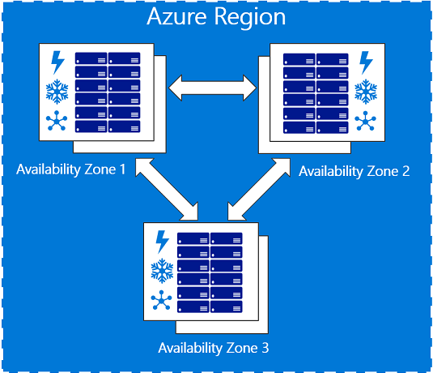

*<Updated on 24th July 2018>*

<!-- truncate -->

During the last years as an architect for Azure services, there is a set of questions and areas that always come-up, you will find here the reference materials I use to answer RFP or customer enquiries. This post assumes you already have some Azure expertise in the subjects covered, but are in search of good reference materials for documentation purposes.

## Networking and connectivity

When you design a solution running in Azure, it will most of the time run on Virtual Networks, you can connect those to:

-   Your datacenter via [**IPsec VPN**](https://docs.microsoft.com/en-us/azure/vpn-gateway/vpn-gateway-about-vpngateways): you use the internet to transport IPsec-encrypted packets. Since it’s the internet, there’s no SLA on the link availability, but the IPsec gateway is backed by a 99.95% SLA and the speed can go up to 1 Gbps.
-   Your datacenter via [**ExpressRoute**](https://docs.microsoft.com/en-us/azure/expressroute/expressroute-introduction): it’s a private connection, SLA-backed by your service provider up to 99.95%. The speed can go up to 10 Gbps if necessary.
-   **Internet** via a **Public IP**: that public IP endpoint is highly available, load balanced if needed, protected by our [**DoS protection service**](https://docs.microsoft.com/en-us/azure/best-practices-network-security?toc=%2fazure%2fsecurity%2ftoc.json). Those operations are done by Azure but you can leverage [**Network Virtual Appliances**](https://azure.microsoft.com/en-in/solutions/network-appliances/) from the marketplace in order to add additional features like layer-7 inspection. If you want to use WAF-as-a-Service, you can also leverage **[Azure Application Gateway](https://docs.microsoft.com/en-us/azure/application-gateway/application-gateway-introduction)**.  
    

ExpressRoute Locations – [https://docs.microsoft.com/en-us/azure/expressroute/expressroute-locations](https://docs.microsoft.com/en-us/azure/expressroute/expressroute-locations)

Microsoft cloud services and network security – [https://docs.microsoft.com/en-us/azure/best-practices-network-security](https://docs.microsoft.com/en-us/azure/best-practices-network-security)

Azure Network Security Best Practices – [https://docs.microsoft.com/en-us/azure/security/azure-security-network-security-best-practices](https://docs.microsoft.com/en-us/azure/security/azure-security-network-security-best-practices)

Reference architecture – Hybrid Networking – [https://docs.microsoft.com/en-us/azure/architecture/reference-architectures/hybrid-networking/](https://docs.microsoft.com/en-us/azure/architecture/reference-architectures/hybrid-networking/) 

## High availability, Disaster Recovery and SLA

When you build solutions on Azure, your choose the physical location of your data, which is replicated on 3 hard disk drives (based on [Locally Redundant Storage](https://docs.microsoft.com/en-us/azure/storage/common/storage-redundancy)), it can be replicated to another region in order to offer additional redundancy in a location with hundreds miles from the previous (3 [additional copies of your data](https://docs.microsoft.com/en-us/azure/storage/common/storage-redundancy)).

High availability for virtual machines is achieved:

-   **[In-Region](https://docs.microsoft.com/en-us/azure/virtual-machines/windows/regions-and-availability)**:
    -   If you deploy an Azure VM on Premium storage, the VM automatically gets a **99.9%** uptime SLA!
    -   You can achieve HA at **99.95%** uptime by placing multiples machines serving users inside an **[availability set](https://docs.microsoft.com/en-us/azure/virtual-machines/windows/manage-availability)** with a **[load balancer](https://docs.microsoft.com/en-us/azure/load-balancer/load-balancer-overview)** in front.
    -   You can achieve HA at **99.99%** uptime by placing multiples machines serving users inside an [availability zone](https://docs.microsoft.com/en-us/azure/availability-zones/az-overview) with a [standard load balancer](https://docs.microsoft.com/en-us/azure/load-balancer/load-balancer-standard-overview) in front.
-   **Across-regions**: by duplicating the first deployment in another region. You replicate the data using application-level replication or **[Azure Site Recovery](https://docs.microsoft.com/en-us/azure/site-recovery/site-recovery-azure-to-azure)**, then you load balance the solution using **[Traffic Manager](https://docs.microsoft.com/en-us/azure/traffic-manager/traffic-manager-overview)**. 

[SLA for the main Azure elements:](https://azure.microsoft.com/en-us/support/legal/sla/)

<table border="2" cellspacing="0" cellpadding="2"><tbody><tr><td valign="top"><a href="https://azure.microsoft.com/en-us/support/legal/sla/virtual-machines/">VM</a></td><td valign="top">For all Virtual Machines that have two or more instances deployed in the same Availability Set, we guarantee you will have Virtual Machine Connectivity to at least one instance at least 99.95% of the time.For any Single Instance Virtual Machine using premium storage for all Operating System Disks and Data Disks, we guarantee you will have Virtual Machine Connectivity of at least 99.9%.</td></tr><tr><td valign="top"><a href="https://azure.microsoft.com/en-us/support/legal/sla/storage/">Storage</a></td><td valign="top">We guarantee that at least 99.9% (99% for Cool Access Tier) of the time, we will successfully process requests to read data from Locally Redundant Storage (LRS), Zone Redundant Storage (ZRS), and Geo Redundant Storage (GRS) Accounts.</td></tr><tr><td valign="top"><a href="https://azure.microsoft.com/en-us/support/legal/sla/expressroute/">ExpressRoute</a></td><td valign="top">We guarantee a minimum of 99.95% ExpressRoute Dedicated Circuit availability.</td></tr><tr><td valign="top"><a href="https://azure.microsoft.com/en-us/support/legal/sla/vpn-gateway/">IPsec Gateway</a></td><td valign="top">We guarantee 99.9% availability for each Basic Gateway for VPN or Basic Gateway for ExpressRoute.

We guarantee 99.95% availability for each Standard, High Performance, VpnGw1, VpnGw2, VpnGw3 Gateway for VPN.

We guarantee 99.95% availability for each Standard, High Performance, Ultra Performance Gateway for ExpressRoute.
</td></tr><tr><td valign="top"><a href="https://azure.microsoft.com/en-us/support/legal/sla/application-gateway/">Application Gateway</a></td><td valign="top">We guarantee that each Application Gateway Cloud Service having two or more medium or larger instances will be available at least 99.95% of the time.</td></tr><tr><td valign="top"><a href="https://azure.microsoft.com/en-us/support/legal/sla/site-recovery/">Azure Site Recovery</a></td><td valign="top">For each Protected Instance configured for On-Premises-to-On-Premises Failover, we guarantee at least 99.9% availability of the Site Recovery service.

For each Protected Instance configured for On-Premises-to-Azure planned and unplanned Failover, we guarantee a two-hour Recovery Time Objective
</td></tr></tbody></table>

Datacenter and Service Recovery: How Microsoft services recovers from a DC loss – [https://gallery.technet.microsoft.com/Datacenter-and-Service-d64cf003](https://gallery.technet.microsoft.com/Datacenter-and-Service-d64cf003)

Availability checklist – [https://docs.microsoft.com/en-us/azure/architecture/checklist/availability?toc=%2Fazure%2Fsecurity%2Ftoc.json](https://docs.microsoft.com/en-us/azure/architecture/checklist/availability?toc=%2Fazure%2Fsecurity%2Ftoc.json "https://docs.microsoft.com/en-us/azure/architecture/checklist/availability?toc=%2Fazure%2Fsecurity%2Ftoc.json")

## Data security, isolation and confidentiality

In a context of datacenter migration, usual questions are: how is my data secured, how is it isolated from other tenants and how can I protect my data in-transit, at-rest, and even in-processing.

You can get started with our RFI standard responses templates: [http://aka.ms/azurerfi](http://aka.ms/azurerfi)

A good reference is the getting started with Azure security paper: [https://docs.microsoft.com/en-us/azure/security/azure-security-getting-started](https://docs.microsoft.com/en-us/azure/security/azure-security-getting-started "https://docs.microsoft.com/en-us/azure/security/azure-security-getting-started")

#### 

#### Encryption at rest:

Isolation in the Azure Public Cloud – [https://docs.microsoft.com/en-us/azure/security/azure-isolation](https://docs.microsoft.com/en-us/azure/security/azure-isolation "https://docs.microsoft.com/en-us/azure/security/azure-isolation")

Azure Data Encryption-at-Rest – [https://docs.microsoft.com/en-us/azure/security/azure-security-encryption-atrest](https://docs.microsoft.com/en-us/azure/security/azure-security-encryption-atrest "https://docs.microsoft.com/en-us/azure/security/azure-security-encryption-atrest")

#### Encryption in transit:

Azure encryption technologies: Protect personal data in transit with encryption – [https://docs.microsoft.com/en-us/azure/security/protect-personal-data-in-transit-encryption](https://docs.microsoft.com/en-us/azure/security/protect-personal-data-in-transit-encryption "https://docs.microsoft.com/en-us/azure/security/protect-personal-data-in-transit-encryption")

#### Encryption in processing:

Azure confidential computing : [https://azure.microsoft.com/en-us/blog/introducing-azure-confidential-computing/](https://azure.microsoft.com/en-us/blog/introducing-azure-confidential-computing/ "https://azure.microsoft.com/en-us/blog/introducing-azure-confidential-computing/")

Data security is also about backup, wo you can use:

-   Azure Backup:
    -   [Backup VM on Azure using snapshot-based built-in technologies](https://docs.microsoft.com/en-us/azure/backup/backup-azure-vms-first-look-arm) 
    -   [Small agent to backup files and system states on Windows Clients and Servers](https://docs.microsoft.com/en-us/azure/backup/backup-try-azure-backup-in-10-mins) 
    -   [Azure Backup Server to backup Linux/Windows VM, Exchange, SQL, SharePoint and VSS-aware applications](https://docs.microsoft.com/en-us/azure/backup/backup-mabs-protection-matrix) 
-   Any third party backup solution and use [Azure Cool Storage](https://azure.microsoft.com/en-us/blog/introducing-azure-cool-storage/) or [Azure Archive Storage](https://azure.microsoft.com/en-us/blog/announcing-the-public-preview-of-azure-archive-blob-storage-and-blob-level-tiering/) to store the backups.

## Datacenter operations & compliance

Azure will very likely exceed any possible best practices and compliance regulation level that you see in a customer-run datacenter. Azure does not usually allow customers to directly audit against best practices, however we are working to certify Azure against the most relevant certifications, in the world, regionally, and locally as well as the most strict industry standards.

All certifications information can be found in the Azure Trust Center – [https://azure.microsoft.com/en-us/support/trust-center/](https://azure.microsoft.com/en-us/support/trust-center/)

If you need to download the certification audit reports or the certificate Service Trust Portal – [http://aka.ms/stp](http://aka.ms/stp) 

Overview of Microsoft Azure compliance – [https://gallery.technet.microsoft.com/Overview-of-Azure-c1be3942](https://gallery.technet.microsoft.com/Overview-of-Azure-c1be3942 "https://gallery.technet.microsoft.com/Overview-of-Azure-c1be3942")

How Microsoft Azure can help organizations become compliant with the EU GDPR – [https://gallery.technet.microsoft.com/How-Azure-Can-Help-788a4979](https://gallery.technet.microsoft.com/How-Azure-Can-Help-788a4979 "https://gallery.technet.microsoft.com/How-Azure-Can-Help-788a4979")

Azure Solutions Blueprint for PCI DSS-compliant environments – [https://docs.microsoft.com/en-us/azure/architecture/compliance/pci-dss/](https://docs.microsoft.com/en-us/azure/architecture/compliance/pci-dss/ "https://docs.microsoft.com/en-us/azure/architecture/compliance/pci-dss/")

Microsoft Azure HIPAA/HITECH Act Implementation Guidance – [https://gallery.technet.microsoft.com/Azure-HIPAAHITECH-Act-1d27efb0](https://gallery.technet.microsoft.com/Azure-HIPAAHITECH-Act-1d27efb0 "https://gallery.technet.microsoft.com/Azure-HIPAAHITECH-Act-1d27efb0")

## Threat protection, detection and incident response

How does Microsoft protect instances, how does Microsoft and I do incident response? Is there a DoS protection service include and IDS/IPS? Can I or a partner conduct penetration testing to a solution in Azure?

Azure Advanced Threat Detection – [https://docs.microsoft.com/en-us/azure/security/azure-threat-detection](https://docs.microsoft.com/en-us/azure/security/azure-threat-detection "https://docs.microsoft.com/en-us/azure/security/azure-threat-detection")

Azure Logging and auditing – [https://docs.microsoft.com/en-us/azure/security/azure-log-audit](https://docs.microsoft.com/en-us/azure/security/azure-log-audit "https://docs.microsoft.com/en-us/azure/security/azure-log-audit")

Security Incent Response in Azure – [http://aka.ms/SecurityResponsepaper](http://aka.ms/SecurityResponsepaper)

Penetration testing of your solution – [https://docs.microsoft.com/en-us/azure/security/azure-security-pen-testing](https://docs.microsoft.com/en-us/azure/security/azure-security-pen-testing) 

Integration of SIEM with Azure – [https://docs.microsoft.com/en-us/azure/security/security-azure-log-integration-overview](https://docs.microsoft.com/en-us/azure/security/security-azure-log-integration-overview) 

Azure Security Center is a great complement to all the security mechanisms present in Azure, and the good news is, there’s a free tier, so use it everywhere.

Azure Security Center Detection Capabilities – [https://docs.microsoft.com/en-us/azure/security-center/security-center-detection-capabilities](https://docs.microsoft.com/en-us/azure/security-center/security-center-detection-capabilities)

Using Azure Security Center for an incident response – [https://docs.microsoft.com/en-us/azure/security-center/security-center-incident-response](https://docs.microsoft.com/en-us/azure/security-center/security-center-incident-response)

## Operations Excellence

How do I operate, manage, an environment in Azure, how do I manage separation of roles and duties, how is done RBAC?

Customers can integrate their on-premises Active Directory with Azure Active Directory and then manage, delegate access using RBAC. When customer use Azure Active Directory, they can use all feature of Azure Active Directory Premium and also enable Just in time admin, which will elevat

Introduction to operational security in Azure – [https://docs.microsoft.com/en-us/azure/security/azure-operational-security](https://docs.microsoft.com/en-us/azure/security/azure-operational-security "https://docs.microsoft.com/en-us/azure/security/azure-operational-security")

Azure Security Management and Monitoring Overview – [https://docs.microsoft.com/en-us/azure/security/security-management-and-monitoring-overview](https://docs.microsoft.com/en-us/azure/security/security-management-and-monitoring-overview "https://docs.microsoft.com/en-us/azure/security/security-management-and-monitoring-overview")

Governance in Azure – [https://docs.microsoft.com/en-us/azure/security/governance-in-azure](https://docs.microsoft.com/en-us/azure/security/governance-in-azure "https://docs.microsoft.com/en-us/azure/security/governance-in-azure")

Identity management – [https://docs.microsoft.com/en-us/azure/security/security-identity-management-overview](https://docs.microsoft.com/en-us/azure/security/security-identity-management-overview "https://docs.microsoft.com/en-us/azure/security/security-identity-management-overview")

Let’s conclude with the Azure Security best practices and patterns collection: [https://docs.microsoft.com/en-us/azure/security/security-best-practices-and-patterns](https://docs.microsoft.com/en-us/azure/security/security-best-practices-and-patterns "https://docs.microsoft.com/en-us/azure/security/security-best-practices-and-patterns")

Our VM sizes reference: [https://azure.microsoft.com/en-us/documentation/articles/virtual-machines-linux-sizes/](https://azure.microsoft.com/en-us/documentation/articles/virtual-machines-linux-sizes/ "https://azure.microsoft.com/en-us/documentation/articles/virtual-machines-linux-sizes/")

You might also need the Visio template in order to produce the architecture diagrams: [http://download.microsoft.com/download/1/5/6/1569703C-0A82-4A9C-8334-F13D0DF2F472/RAs.vsdx](http://download.microsoft.com/download/1/5/6/1569703C-0A82-4A9C-8334-F13D0DF2F472/RAs.vsdx) 

Have fun answering RFP, don’t hesitate to suggest your additional items in the comments section!

Stay updated on Twitter: [https://twitter.com/arnaudlheureux](https://twitter.com/arnaudlheureux)
