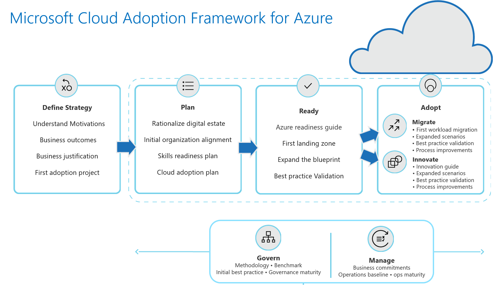
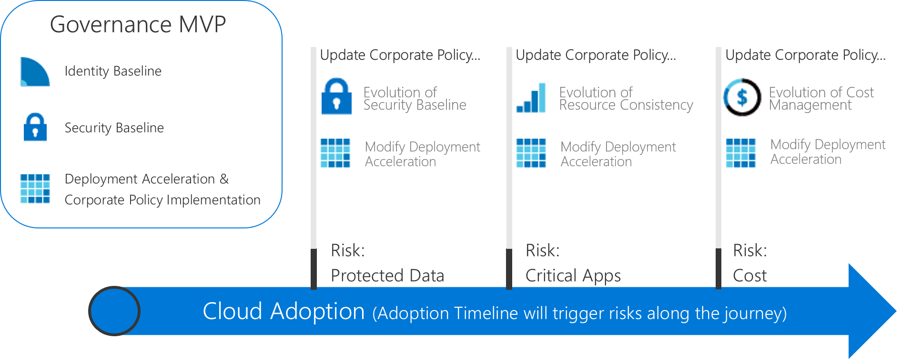
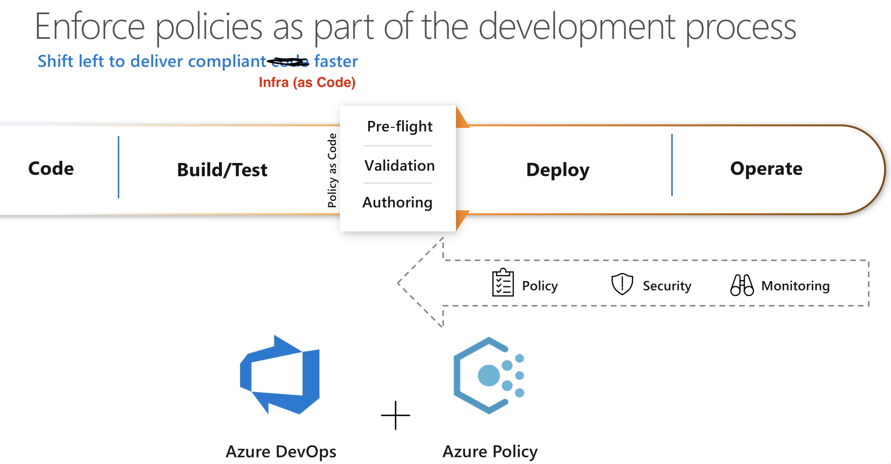
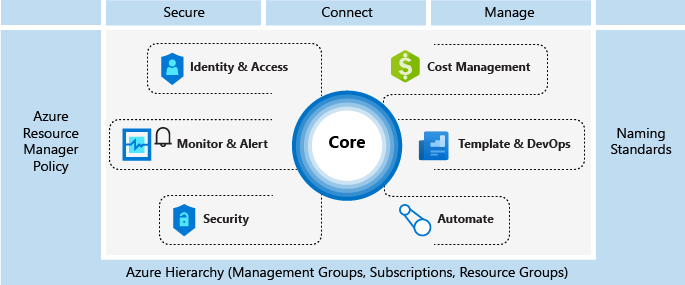
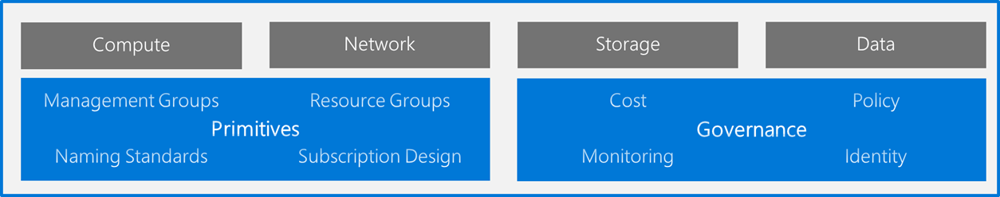
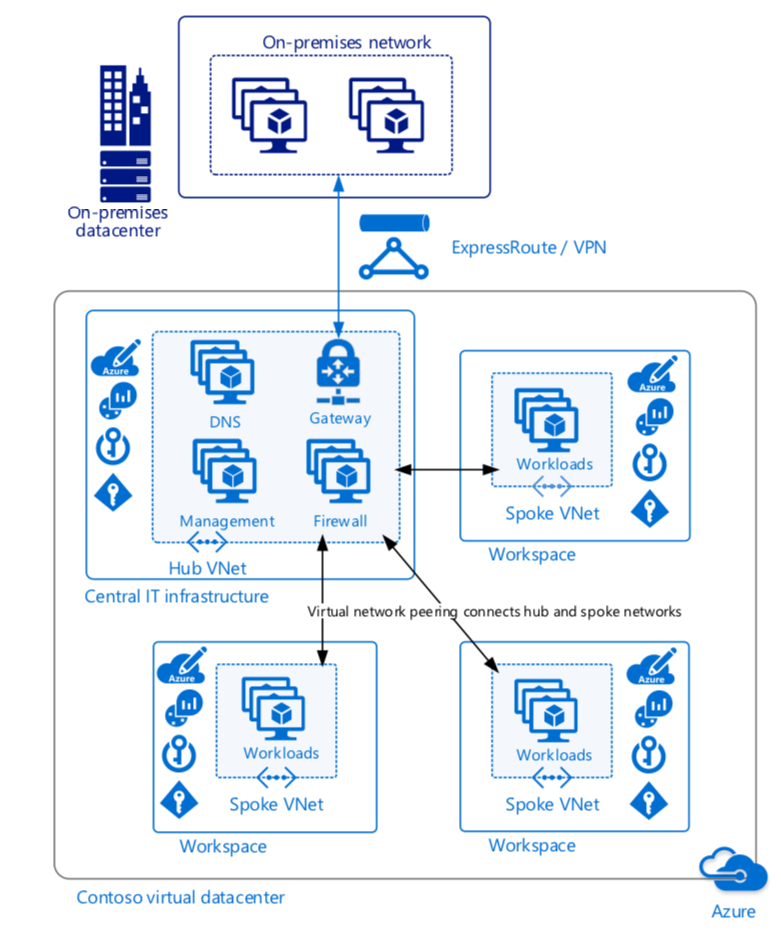

<Updated 11th July 2019>

Since we started to help customers of all sizes to deploy cloud technologies, we have developed many frameworks which all evolved in parallel over time. You may have heard about: Cloud Adoption Framework, Cloud Operations Model, Entreprise Cloud Strategy, Entreprise Scaffolding and maybe a couple more.

<!-- truncate -->

## The CAF is dead, long live the CAF!

A couple of weeks ago, we published a [new version of CAF – Cloud Adoption Framework for Azure](http://aka.ms/caf), which consolidates all of our engineering and field best practices, as well as patterns that we’ve seen from big entreprises going to the cloud.

CAF has now five main sections which guide you throughout the whole circle:

1.  [Plan](https://docs.microsoft.com/en-gb/azure/architecture/cloud-adoption/business-strategy/)
2.  [Ready](https://docs.microsoft.com/en-gb/azure/architecture/cloud-adoption/ready/)
3.  [Migrate](https://docs.microsoft.com/en-gb/azure/architecture/cloud-adoption/migrate/)
4.  [Manage](https://docs.microsoft.com/en-gb/azure/architecture/cloud-adoption/operations/)
5.  [Govern](https://docs.microsoft.com/en-gb/azure/architecture/cloud-adoption/governance/)

This model is very realistic and field inspired, including some discussions around adoption with [one or more cloud providers](https://docs.microsoft.com/en-us/azure/architecture/cloud-adoption/governance/journeys/large-enterprise/multicloud-evolution).

## Governance

One of the most intimidating aspects of cloud adoption is the governance: how to manage new risks that are involved with cloud deployments and how to accompany that with entreprise processes and policies (and how does it remain current).

It is of course an iterative process that will evolve as you add new services into your environment: from dev/test to prod, and from legacy 3-tiers application to a brand new cloud-native application.

We distinguish 5 disciplines in governance:

1.  Cost management
2.  Security baseline
3.  Resource consistency
4.  Identity baseline
5.  Deployment Acceleration

But the difficulty is the first step: how do I get a minimal viable product (MVP) for my first cloud deployment?

**Actions**: In order to avoid you the blank page syndrome, we have prepared you some actions:

1.  Determine your immediate objectives with cloud, and the readiness of your organization. Cloud Assessment Tool: [https://aka.ms/CAF/gov/assess](https://aka.ms/CAF/gov/assess) 
2.  [Establish your governance MVP:](https://docs.microsoft.com/en-gb/azure/architecture/cloud-adoption/governance/journeys/index)
    1.  [Small to Medium Entreprises](https://docs.microsoft.com/en-gb/azure/architecture/cloud-adoption/governance/journeys/small-to-medium-enterprise/index)
    2.  [Large Entreprises](https://docs.microsoft.com/en-gb/azure/architecture/cloud-adoption/governance/journeys/large-enterprise/index)

For all those journey we document a minimum viable product across the five disciplines, we explain the design decisions we took for you, the discussion points and alternative design considerations.

When we define governance, we also think about compliance to the rules, and automatic remediation methods for it: this is called [Azure Policy](https://docs.microsoft.com/en-us/azure/governance/policy/overview).

Along the way, if you are going for ongoing compliance, why not going to continuous integration and continuous deployment for your infrastructure?

If you want to have a look at all of that in action, check at:

-   Our [webinar on Azure Cloud and Compliance](https://info.microsoft.com/AP-AzureINFRA-WBNR-FY19-01Jan-24-Azuregovernancemanagement-MCW0010995_02OnDemandRegistration-ForminBody.html?wt.mc_id=undefined)
-   Infra as Code hands-on-labs – [https://www.azuredevopslabs.com/labs/vstsextend/terraform/](https://www.azuredevopslabs.com/labs/vstsextend/terraform/) 

## Azure Scaffolding

We used to talk a lot of  “scaffolding” as it is an excellent checklist, or set of mandatory technical implentation details for a good cloud deployment. It is *being replaced* by the “landing zone” construct (see next section).

Here is a refresher picture about what scaffolding includes:

Important readings on Azure Scaffolding:

-   the documentation: [https://docs.microsoft.com/en-gb/azure/architecture/cloud-adoption/appendix/azure-scaffold](https://docs.microsoft.com/en-gb/azure/architecture/cloud-adoption/appendix/azure-scaffold) 
-   an example: [https://docs.microsoft.com/en-gb/azure/architecture/cloud-adoption/appendix/azure-scaffold-examples](https://docs.microsoft.com/en-gb/azure/architecture/cloud-adoption/appendix/azure-scaffold-examples) 

## Azure Landing Zones

Landing Zone is our new construct to describe a good deployment, its replacing the scaffolding idea but takes all of its good ideas.

It has the idea of **primitives** which includes all mandatory decisions:

-   Management Groups
-   Resource Groups
-   Naming Standards
-   Number of subscriptions

On the technical implementations of Governance it includes all of:

-   Policies
-   Cost
-   Monitoring
-   Identity

Moreover, it comes with all set of decision trees in order to help you when it comes to implementation with your customers/partners:

-   **[Compute decisions](https://docs.microsoft.com/en-us/azure/architecture/cloud-adoption/ready/considerations/compute-decisions)**
-   **[Storage decisions](https://docs.microsoft.com/en-us/azure/architecture/cloud-adoption/ready/considerations/storage-guidance)**
-   **[Networking decisions](https://docs.microsoft.com/en-us/azure/architecture/cloud-adoption/ready/considerations/network-decisions)**
-   **[Database decisions](https://docs.microsoft.com/en-us/azure/architecture/cloud-adoption/ready/considerations/data-decisions)**

## Azure Virtual Datacenter

Azure VDC is a set of concepts, implentation guidance and automation scripts that allows you to build a highly available and highly secure datacenter, based on Microsoft Azure services.

You can find all the materials here: [https://docs.microsoft.com/en-gb/azure/architecture/vdc/](https://docs.microsoft.com/en-gb/azure/architecture/vdc/) 

Check at the automation scripts and all the archetypes that allow you to deploy a VDC environment fast – based on Docker and Python : [https://github.com/Azure/vdc](https://github.com/Azure/vdc)

As last reference, as usual, [our Azure Architecture Center](https://docs.microsoft.com/en-us/azure/architecture/)

That’s it, now you will have a very well architected Azure deployment!

[Arnaud](https://twitter.com/ArnaudLheureux)
