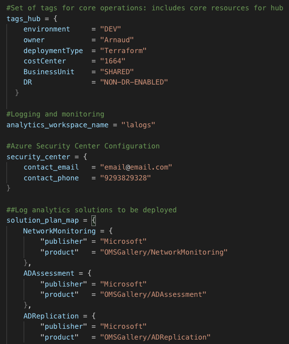
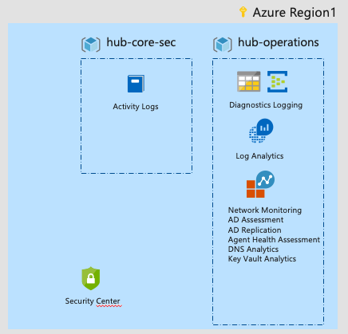

This article describes the old experience for Azure CAF landing zones on Terraform, please refer to this article for the new updated experience:

<!-- truncate -->

[https://arnaud-web.azurewebsites.net/2019/11/15/cloud-adoption-framework-landing-zones-with-terraform/](https://arnaud-web.azurewebsites.net/2019/11/15/cloud-adoption-framework-landing-zones-with-terraform/)

Cloud Adoption Framework for Azure has a great set of recommendations to accelerate deployment of Azure for entreprises who seek to consolidate their IT environment in the cloud and innovate on their applications.

[CAF](https://arnaud-web.azurewebsites.net/2019/06/20/cloud-adoption-framework-scaffolding-and-azure-virtual-datacenter/) introduces landing zones as a concept that describes all the elements that must be in place to deploy a production-grade quality deployment (ie, that includes a minimal set of auditing, controls, policies, etc).

In order to accelerate that, let’s review how to deploy our first landing zone for Azure based on Terraform! We assume that you know Terraform and Azure already, if thats not the case, spend some time on [my previous post](https://arnaud-web.azurewebsites.net/2019/08/29/introduction-to-terraform-on-azure/).

We have published and will keep on updating a repository on GitHub: [http://aka.ms/tf-landingzones](http://aka.ms/tf-landingzones)

## Getting started

The fastest way is to use Azure Cloud Shell:

1.  Open **[https://shell.azure.com](https://shell.azure.com)**
2.  Go to the clouddrive directory: **cd clouddrive**
3.  Clone the GitHub repo from **http://aka.ms/tf-landingzones git clone https://github.com/aztfmod/blueprints.git**
4.  Initialize the environment – this will create the fundamentals for the Terraform state, like Storage Account, Azure Key Vault, and the managed identities: **./launchpad.sh**
5.  Deploy your first tranquility blueprint: **./launchpad.sh landingzone\_vdc\_level1 plan**
6.  Review the configuration and if you are ok with it, deploy it by running: **./launchpad.sh landingzone\_vdc\_level1 apply**

Below is a quick demo of doing that:  

<iframe width="560" height="315" src="https://www.youtube-nocookie.com/embed/Igg_v25JUqw" title="YouTube video" frameborder="0" allowfullscreen></iframe>

## Customization

In order to ease your first contact with the landing zone, we created a sample configuration file **[proto.landing\_zone\_vdc\_level1.auto.tfvars](https://github.com/aztfmod/blueprints/blob/master/landingzone_vdc_level1/proto.landing_zone_vdc_level1.auto.tfvars "proto.landing_zone_vdc_level1.auto.tfvars").** As any **.auto.tfvars** file, it is going to be picked up automatically by Terraform when running. This file automatically configures all variables needed to get started:

-   Retention period for Activity logs, and operations logs.
-   Names of the resource groups to be created.
-   Location of the resources to be deployed.
-   Tags for the resources.
-   Name of log analytics and list of solutions to be deployed.
-   Security center contact details.

You can tune it to match your criteria, we hope the syntax is self explanatory, feel free to provide feedback on it!

## Quick tour of the architecture:

Currently the solution is composed of 3 main components:

### 1\. Launchpad.sh

Is a shell script, it initiates the Terraform state locally, uploads it to the Azure storage account, manages the environment variables and communication accross landing zones and other components.

### 2\. Level0\_launchpad

Creates a Key Vault, an Azure managed identity a storage account that is used to create store the Terraform state of our environment. It also creates a serie of service principals to be used to access the Terraform state and to integrate with Azure DevOps (in a future release). For full documentation, refer to the [readme file](https://github.com/aztfmod/blueprints/blob/master/level0_launchpad/readme.md).

### 3\. Landingzone\_vdc\_level1

This vdc level1 landing zones leverages one blueprint (called tranquility) that sets the foundation for everything accounting and operations logs in your Azure subscription:

-   Resource groups
-   Activity Logging
-   Diagnostics Logging
-   Log Analytics
    
-   Security Center

Each of those features deployments are accomplished by a respective module, which is also on the [GitHub](http://aka.ms/tf-landingzones), which Terraform download when it needs it (at the plan stage).

A diagram of landingzone\_vdc\_level1 would look something like that:

For full documentation, refer to the [readme file](https://github.com/aztfmod/blueprints/blob/master/blueprint_tranquility/readme.md).

That’s it for now, it should be enough for you to get started on the Azure Landing Zones using Terraform. Keep in mind there is much more to come on the Landing Zones, we will keep on publishing more and we will have a couple of webinars to go deep dive on the subject!

Happy landing landing zones crafting!

[Arnaud Lheureux](https://twitter.com/arnaudlheureux)
