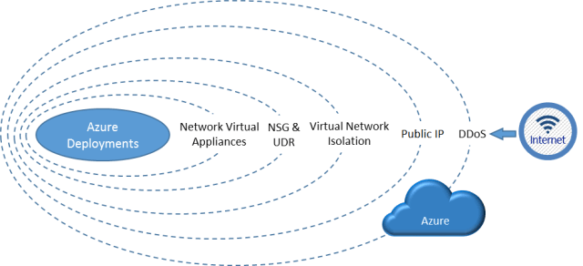

Azure DDoS Protection Standard is a service that enables AI-based protection of your cloud applications. Below is the list of resources of our webinar aired on 19th September 2019.

<!-- truncate -->

As a quick reminder, below is the set of network protections in front of your Azure instances. DDoS protection exists in a free tier which is present by default on all resources you publish using a public IP address. In this session we discuss about the addition of the “Standard” edition of the Azure DDos protection.

## On demand session

[https://info.microsoft.com/AP-AzureINFRA-WBNR-FY20-09Sep-19-AzureDDoSProtectionStandard-SRDEM4832\_LP01Registration-ForminBody.html \\](https://info.microsoft.com/AP-AzureINFRA-WBNR-FY20-09Sep-19-AzureDDoSProtectionStandard-SRDEM4832_LP01Registration-ForminBody.html)

## Slides

[View the slides on SlideShare](https://www.slideshare.net/slideshow/embed_code/key/4ic9Wx75SAjBt8)

### Demo

<iframe width="560" height="315" src="https://www.youtube-nocookie.com/embed/9TbvkE4HoQ8" title="YouTube video" frameborder="0" allowfullscreen></iframe>

### Additionnal links:

-   Overview: [https://docs.microsoft.com/en-us/azure/virtual-network/ddos-protection-overview](https://docs.microsoft.com/en-us/azure/virtual-network/ddos-protection-overview) 
-   BreakingPoint.cloud: [https://www.ixiacom.com/products/breakingpoint-cloud](https://www.ixiacom.com/products/breakingpoint-cloud)

As usual, feel free to send your feedbacks and suggestions!

[Arnaud](https://twitter.com/arnaudlheureux)
