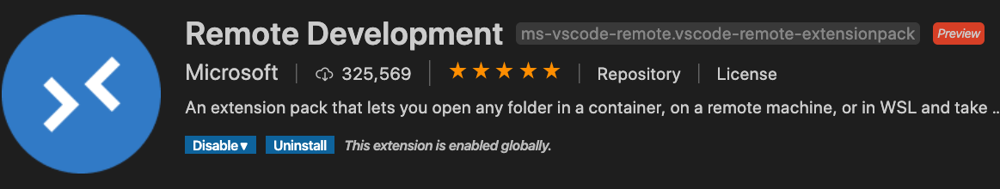
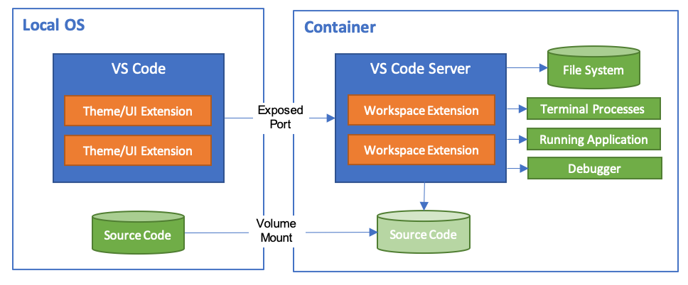
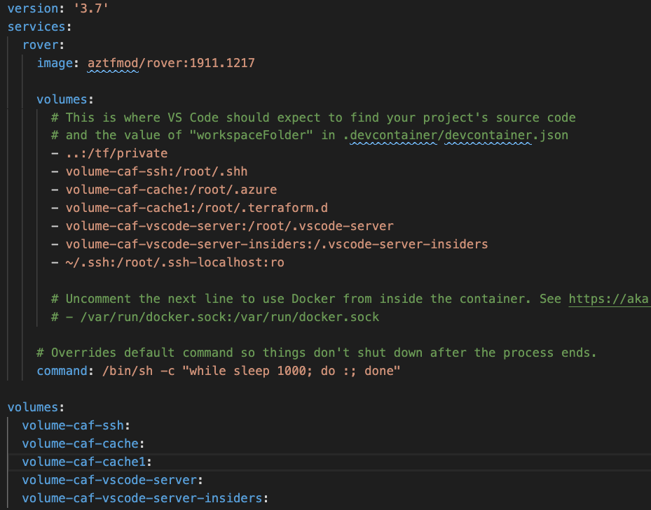
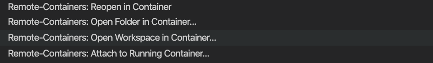
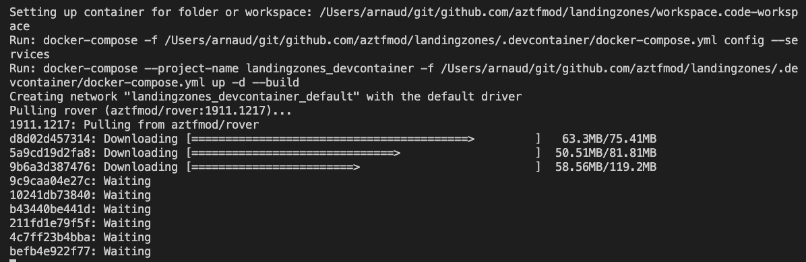
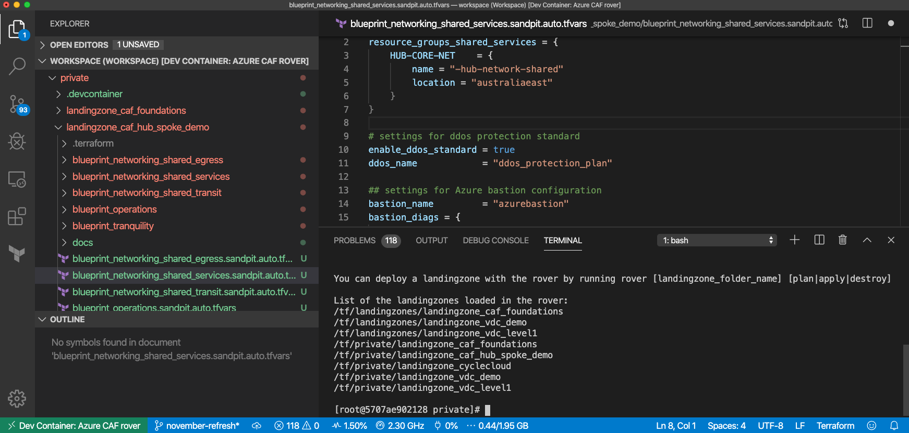

At Microsoft Ignite 2019, we announced that Cloud Adoption Framework for Azure now has a Terraform edition of it’s landing zones. We see landing zones as a great way to enable value quicker on Azure, and as we see tremendous excitment and growth in this area, we are evolving the experience to make it simpler and more powerful.

<!-- truncate -->

Adopting CAF landing zones with Terraform, customer consistenly realize they can:

-   deploy foundations of cloud environments fast
-   easily deploy governance and policies as code (with ongoing compliance enforcement and remediation)
-   have consistent ways to deploy innovation (infra as code, policies as code or application code are using the same mechanisms).
-   *and many more.*

This overall enables them to: optimize their operations, innovate faster and cheaper, but we will come back to that in another article.

For now, let’s get you started with landing zones development and deployment!

# Setting up development environment

When deploying Infra-As-Code environments, we found it extremely important to have:

-   **strong versioning** (accross dev environment, DevOps pipelines, etc.).
-   **short feedback loops**: ability to innovate fast on your development, test new code without having to go through the whole pull-request and so mechanisms.
-   accomodate **diversity of environments** (running Windows, Mac, Linux).
-   **strong identity consistency** and **no secret** in **any code.**

In order to enable that, we use Docker containers as development (on your laptop) and deployment (CI/CD pipelines) environement. **The toolset is packaged inside what we called [the rover](https://github.com/aztfmod/rover)** and in order to get started – whichever your platform is, just:

-   [Install Docker](https://docs.docker.com/docker-for-windows/install/)
-   [Install Visual Studio Code](https://code.visualstudio.com)

Once its done, make sure Docker is up and running, then Open Visual Studio Code:

We need to install “Remote Development” extension, so click the Extensions icon and then find and install “Remote Development” from Microsoft:

To make your life easier, we are going to leverage [Visual Studio Development Containers](https://code.visualstudio.com/docs/remote/containers), which allows you to seamlessly work on your machine and execute your code in the rover container.:

So on your machine, you will have your Terraform files, with your Git connection and other tools, but when you run the code, its seemlessly integrated with the Rover running in the container, so you can develop, test, run the complete environment.

# Deploying your first landing zone

Once you have deployed the prerequisites, you can just clone (with [Git](https://git-scm.com/downloads), or [GitHub Desktop)](https://desktop.github.com) from our repository: [http://aka.ms/tf-landingzones](http://aka.ms/tf-landingzones) and open it in Visual Studio.

If you look at the files, it’s classic Terraform scripts except for the  .**devcontainer** folder where we have two files:

-   devcontainer.json: describes how to connect to the container, the mounting points and extensions.
-   docker-compose.yml: describes the container configuration needed, especially where to get the rover image (tip: we put it on the Docker registry so you dont have to manage it)

You can then go to the bottom left, green part of Visual Studio Code and select 

Open **Remote-Containers: Open Workspace in Container**, then select the default workspace we created for you (**workspace.code-workspace**). You will see a new window opening and you can see the details of the Docker container operations:

-   downloading the container from registry
-   mounting the volumes
-   creating the network
-   installing VSCode drivers in the containers

You are now ready to start hacking, you can start by launching:

1.  **rover login** 
2.  **rover /tf/caf/landingzones/landingzone\_caf\_foundations plan** 
3.  **rover /tf/caf/landingzones/landingzone\_caf\_foundations apply** 

So let the fun begin!

# Demo

TLDR; Here is a video with the different steps I described:

<iframe width="560" height="315" src="https://www.youtube-nocookie.com/embed/vWyBAT8C7xY" title="YouTube video" frameborder="0" allowfullscreen></iframe>

Happy hacking, let me know your feedbacks and lets connect!

[@arnaudlheureux](https://twitter.com/arnaudlheureux)
