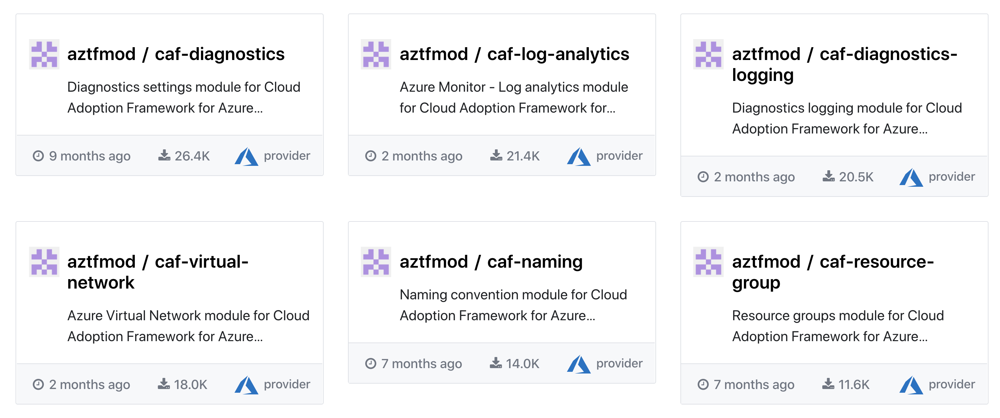
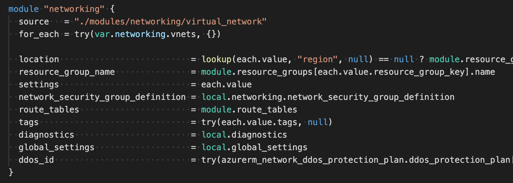
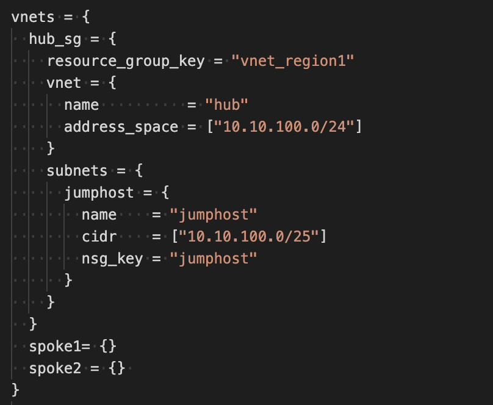
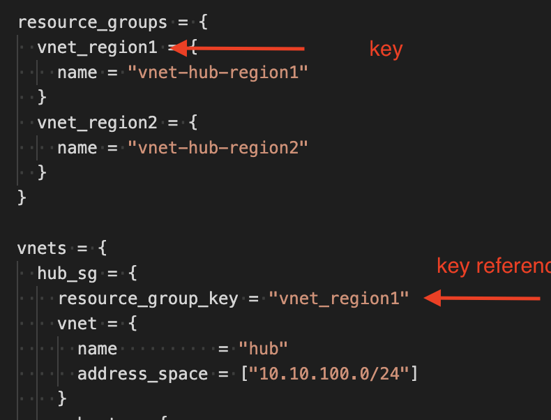
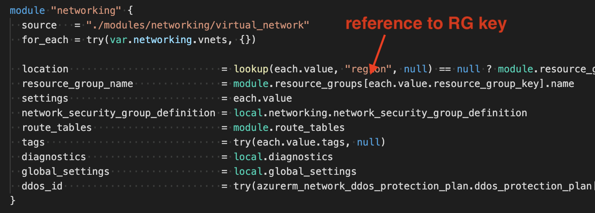
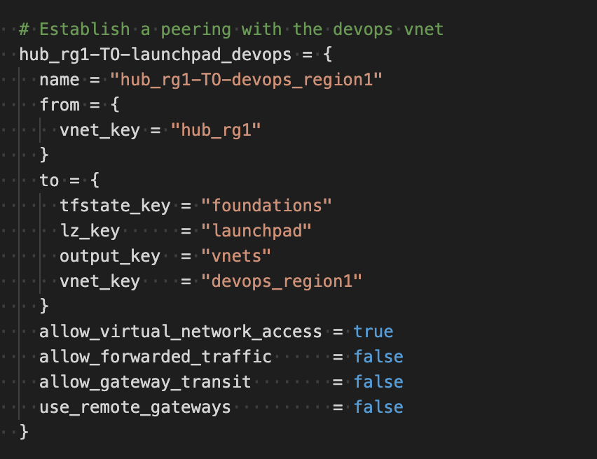
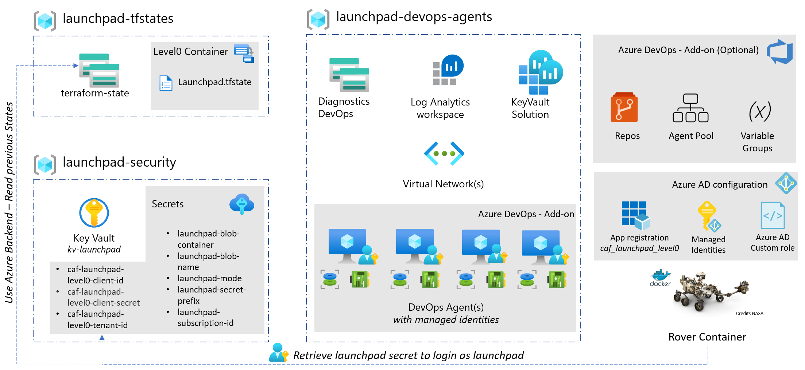
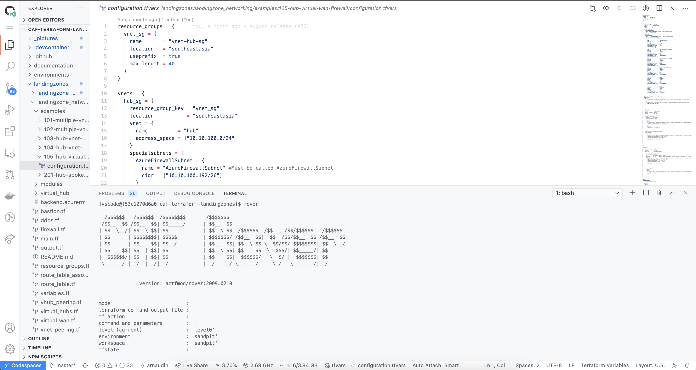
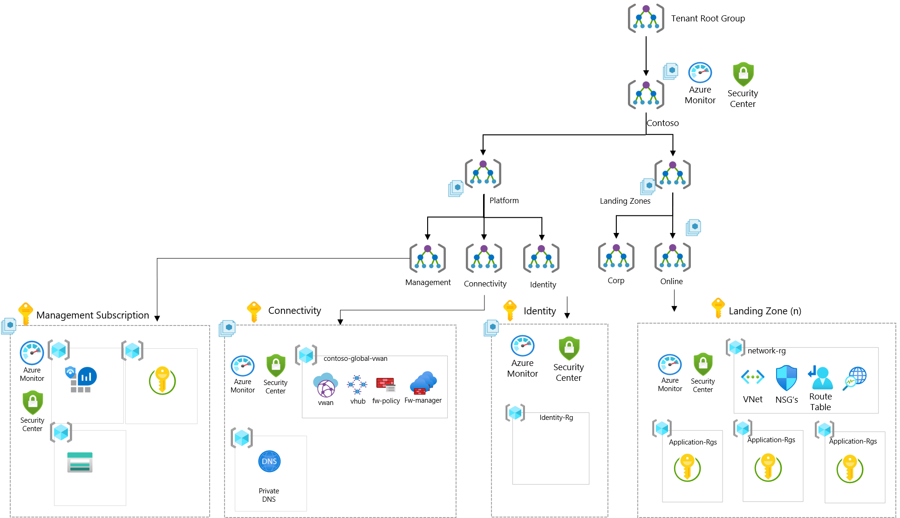

More than a year ago we announced at Ignite 2019 that Cloud Adoption Framework proposes an implementation on Terraform. Since then, we have seen a tremendous feedbacks from customers and partners architects.

<!-- truncate -->

In the meantime lot of great things have happened: an enterprise-scale reference architecture and it’s ARM-based implementation, alongside with an incredible acceleration on the release rhythm of the Azure Terraform provider reducing the delay between features appearing in Azure and time it is available in native Terraform.

## Terraform 0.13

Terraform 0.13 has been released mid August, and you can read the full details [here](https://www.hashicorp.com/blog/announcing-hashicorp-terraform-0-13). For us, the major improvements are:

-   **Registry-based provider sourcing**: No more need to side-load our custom provider, you can leverage it directly from the Terraform registry just like we for modules: our CAF provider is published [here](https://registry.terraform.io/providers/aztfmod/azurecaf/latest)
-   **Variables validation**: Only allow variable to be within a certain range or validating a regex.
-   **Iterations and conditions on modules**: more later in this article.

### Testing Terraform 0.13 with rover

After weeks of testing reliability of Terraform 0.13 during this summer’s beta, we were very happy with the stability and performance so we decided to push further our way of operating.

[rover](https://github.com/aztfmod/rover) is part of the DevOps toolset we provide you with and recommend using for development teams and pipelines deployment. During this testing stage, it played full role allowing us to switch fast from one codebase to the other and also to one version of Terraform to the other.

## What’s new in CAF landing zones

Leveraging Terraform 0.13, we were able to introduce new concepts in landing zones on Azure:

### One module to rule them all

We have been curating 20+ modules during the last year, all published on the [Terraform registry](https://registry.terraform.io/namespaces/aztfmod) and some of them being consumed more than 26,000 times.

While it was important to have different modules to maintain a very fine-grained versioning of the components we use, we found it to be a lot of work, for little added value.

We then decided to explore a model where we use only one module, that would call and iterate on different submodules – that permitted by Terraform 0.13.

We must admit we have been impressed by the results on how the graph performs, and the speed at which it works.

So the new module is still in preview but already available available here [https://registry.terraform.io/modules/aztfmod/caf/azurerm/latest](https://registry.terraform.io/modules/aztfmod/caf/azurerm/latest)

### Iteration-based objects deployment

To deploy core features, landing zones are now calling one module. This master module has all the major components we need to deploy within landing zones, and it iterates on every objects in the following way:

So from the configuration prospective, you define your network configuration with a complex object like this one:

So wether you need one or ten virtual networks, we iterate automatically for you.  
By default the `vnets` like all the other variables are set to {}. So it means nothing will be created, only the variables you populate will be iterated on.

### Key-based configuration and customization

All configuration objects will call each other based on the object keys. As we just seen, we use complex objects that are iterated and referenced via their keys.

It means for instance we create all the resource groups using the following object:

In that example, we create two resource groups which keys are `vnet_region1` and `vnet_region2`. We we create the virtual network called hub (and which key is `hub_sg` we reference the resource group via the `resource_group_key` property.

Under the hood, the module is mapping back the resource group to the key with the following logic:  

### No-code environment composition

Overall this makes writing the modules code slightly more complicated, but what it means for users is the possibility to compose complex environment without changing anything in the code.

A good example for that is the networking landing zone where we are able to compose all kind of Azure network topologies (like Hub-and-Spokes virtual networks, Virtual WAN-based hub-and-spokes, etc.).

We can establish peering between on object in the current landing zone and a remote landing zones (this is very common to have separate states for the hub and the spokes)

Overall we have tested it internally and externally and have found:

-   We have been able to compose any kind of architecture using this pattern.
-   It is very fast to compose a new environment.
-   It is very fast to process by Terraform and Terraform graph.

### DevOps from the ground-up

At the root of deployments, we have our `launchpad` which sets the Azure backend and collaboration requirements.  

We want to offer our customers choices and options so the new launchpad is modular: allowing add-ons to complement the configuration like:

-   DevOps Pipelines configuration and secret management leveraging the official [Microsoft Azure DevOps provider for Terraform](https://www.terraform.io/docs/providers/azuredevops/index.html)
-   Terraform Cloud and Terraform Enterprise
-   GitHub and GitHub Enterprise
-   Any other solution.

For an example of landing zones on **Azure DevOps**, you can refer to the following demo:

<iframe width="560" height="315" src="https://www.youtube-nocookie.com/embed/r6RUiFOl-JU" title="YouTube video" frameborder="0" allowfullscreen></iframe>

  
For an example of landing zones on **Terraform Cloud**, you can refer to the following demo:

<iframe width="560" height="315" src="https://www.youtube-nocookie.com/embed/3yZHIDbKDUc" title="YouTube video" frameborder="0" allowfullscreen></iframe>

### Coding everywhere

Using Visual Studio Codespaces or [GitHub Codespaces](https://github.com/features/codespaces), you can develop and deploy landing zones without installing anything on your laptop, with full access to the rover and development environment.  

You can try it now:  or on [GitHub Codespaces](https://github.com/features/codespaces)

## The journey ahead

### Enterprise-scale landing zones

Enterprise-scale is a reference architecture, set of design guidelines, and reference implementation for an Azure enterprise environment.  
You can find all the details [here](https://docs.microsoft.com/en-gb/azure/cloud-adoption-framework/ready/enterprise-scale/)..

We are working on it with the team and are integrating the module on the foundations layers. You can also try out the module [here](https://github.com/Azure/terraform-azurerm-caf-enterprise-scale).

### Delivering solutions

We found a lot of interest from customers and partners to leverage the DevOps and everything-as-code environment we setup in order to accelerate the development and the deployment of ready-to-use solutions.

We are currently working to publish solutions that you can stack-up on top of the lower levels of landing zones, amongst them, you will be able to find:  
\* [AKS topologies including layer 4 applications](https://github.com/aztfmod/landingzone_aks)  
\* [Data and analytics, to deploy Azure Synapse, Databricks, Machine Learning, etc.](https://github.com/aztfmod/landingzone_data_analytics).  
\* More to come…

### On the way to Terraform 0.14

Just announced, Terraform 0.14 will also bring some good features, you will be able to test it out soon in a new rover. You can read the news [here](https://www.hashicorp.com/blog/announcing-hashicorp-terraform-0-14-beta)

## Contribute

All of that is still work in progress and you can contribute by opening an issue, a pull request or just testing it!

The repo is here: [https://github.com/Azure/caf-terraform-landingzones](https://github.com/Azure/caf-terraform-landingzones) and (most) of the things described are currently in the 0.4 branch, and will be available on this month release (2010 Update)

We’d love to hear from you, so don’t hesitate to give us feedback here or on [Gitter](https://gitter.im/aztfmod/community?utm_source=badge&utm_medium=badge&utm_campaign=pr-badge)

Arnaud
