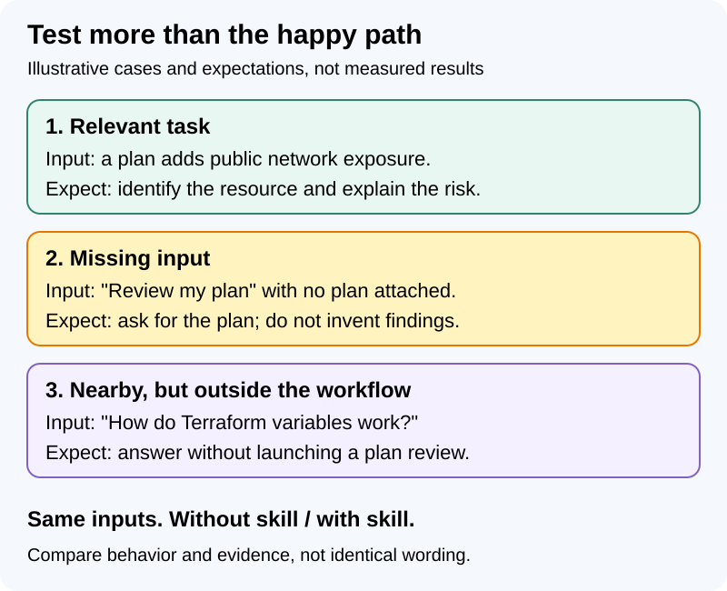
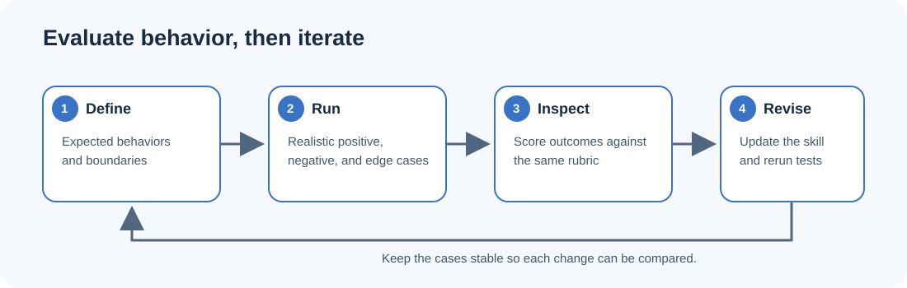

Reviewing a Terraform plan, checking deployment prerequisites, or assessing Azure policies: these are tasks we repeat across projects. We usually have a process for each one, spread across documentation, scripts, and repository instructions.

GitHub Copilot plugins give us a way to package those practices and share them with an engineering team, whether we work in **VS Code, the GitHub Copilot app, or Copilot CLI**. A plugin can include skills, agents, hooks, and MCP server configuration. In this post, we will use Git-Ape as a concrete example, look at a simplified engineering skill, and see how to evaluate whether it is actually helping.

<!-- truncate -->

*Engineering plugins series:* **1. Build and evaluate** | 2. Distribute to the team (coming soon) | 3. Manage across the enterprise (coming soon)

*Technical references checked October 24, 2026. The examples below are based on documentation and source review; the installation and evaluation steps have not been reproduced end to end.*

## Where can we use plugins?

We can use the plugin package from several Copilot clients:

| Client | Where to start |
|---|---|
| VS Code | Discover agent plugins in the Extensions view with `@agentPlugins`. |
| GitHub Copilot app | Open **Customize > Plugins** to browse marketplaces and install plugins. |
| Copilot CLI | Use the plugin commands shown later in this walkthrough. |

GitHub also supports plugins in Copilot cloud agent through repository configuration. See the [VS Code plugin guide](https://code.visualstudio.com/docs/agent-customization/agent-plugins) for editor-specific discovery and installation.


*The Copilot app's plugin inventory. Browse shows available plugins; Installed shows packages already present. Screenshots in this series show the app as captured in October 2026.*

Check the plugin's supported components, required tools, and authentication in each client. GitHub's [plugin overview](https://docs.github.com/en/copilot/concepts/customizations/plugins) documents the supported surfaces and installation entry points.

For this walkthrough, we will use CLI commands for local installation and an SDK-based harness for automated evaluations. We will also look at what to check separately in VS Code and the app.

## Choose one task and establish a baseline

Before writing a skill, try the workflow without it. Give Copilot a few representative tasks and observe where it struggles, asks for missing context, or produces an inconsistent result. This gives you a baseline and helps you target the actual gap instead of adding instructions for a problem you may not have.

Write down what a good result should do, then create a small set of realistic cases. Include tasks where the skill should apply, nearby tasks where it should not, and cases with missing or ambiguous input. For example, a Terraform plan review might include:



Add a destructive-change case too: a plan that deletes a resource containing persistent data should prompt an evidence-based discussion of data loss and recovery, not just a count of deleted resources.

Note the behaviors that matter: identify the affected resource, explain risks using evidence in the plan, ask for missing information, and stay within the requested task. These baseline cases will help you see whether the skill improves the outcome and whether the improvement persists after later edits.

## Use Git-Ape as a reference

A narrow skill with clear expectations is easier to test than a generic instruction such as "be a better engineer." Once it is useful, a plugin gives us a way to package and maintain it alongside related capabilities.

To make this concrete, we will use [Git-Ape](https://github.com/Azure/git-ape), an engineering plugin for Azure deployment workflows. Git-Ape is **experimental and not production-ready**; use a sandbox when trying it. The manifest reviewed here uses the **legacy Copilot format**, with component paths under `.github/`. Copilot CLI also supports **Agent Plugins 1.0**, a portable format for skills and MCP servers. Choose one format and follow its documented locations.

The [Agent Skills specification](https://agentskills.io/specification) defines the skill folder itself: a `SKILL.md` file with optional scripts and references. The plugin manifest adds packaging and installation metadata around those capabilities.

## Already have an AGENTS.md? Start there

You do not need to replace your repository instructions to use a plugin. Keep project-specific guidance in `AGENTS.md` or `.github/copilot-instructions.md`: how to build and test, where the important code lives, and which files should not be edited.


A **skill** describes how to perform a particular task. A **custom agent** defines a specialized role and its configuration. A **plugin** packages reusable capabilities so you can share and maintain them across projects. For example, repository instructions can say that infrastructure changes need validation, while a shared plugin supplies the validation workflow.

The filenames matter: `AGENTS.md` is an instruction file; `.github/agents/reviewer.agent.md` is a custom agent definition. A file literally named `agent.md` is not automatically either one. Supported instruction filenames and scope vary by client and feature; see GitHub's [custom instructions overview](https://docs.github.com/en/copilot/concepts/prompting-and-context/custom-instructions) and [instruction support matrix](https://docs.github.com/en/copilot/reference/custom-instructions-support).

Extract a reusable workflow into a skill and keep local project conventions in repository instructions. That gives each rule one place to maintain. Mentioning a skill in `AGENTS.md` does not install it; the plugin still needs to be available in the client.

GitHub's [customization comparison](https://docs.github.com/en/copilot/concepts/customizations/comparing-customizations) describes these roles in more detail. Its [Agent Skills announcement](https://github.blog/changelog/2025-12-18-github-copilot-now-supports-agent-skills/) also explains how skills load when relevant to a task.

## What goes into a plugin?

Skills capture task-specific instructions and supporting material. Agents define a more specialized assistant, hooks run at lifecycle events, and MCP server configuration connects the client to external tools. Start with the smallest set of components that solves the workflow.


Git-Ape's structure shows how a plugin can grow from a manifest and skills into a maintained engineering toolkit:

```text
git-ape/
├── plugin.json
└── .github/
    ├── agents/
    ├── prompts/
    ├── skills/
    │   ├── azure-policy-advisor/
    │   │   ├── SKILL.md
    │   │   ├── references/
    │   │   └── scripts/
    │   └── azure-stack-deploy/
    │       ├── SKILL.md
    │       └── scripts/
    └── evals/                  # Repository tests, not a runtime component
        └── azure-policy-advisor/
            ├── eval.yaml
            └── tasks/
```

Here is a shortened version of Git-Ape's manifest, showing its component paths:

```json
{
  "name": "git-ape",
  "agents": ".github/agents/",
  "skills": ".github/skills/",
  "prompts": ".github/prompts/"
}
```

For the supported `plugin.json` fields, see GitHub's [CLI manifest reference](https://docs.github.com/en/copilot/reference/copilot-cli-reference/cli-plugin-reference#pluginjson). For the portable format and client-specific components, see the [shared plugin manifest reference](https://docs.github.com/en/copilot/reference/plugin-and-marketplace-reference#plugin-manifests).

This manifest has no Agent Plugins 1.0 `$schema`, so it uses the legacy format and its configurable paths. For a new portable plugin, include the canonical schema in `plugin.json`; put skills in immediate subdirectories of a root `skills/` directory, and MCP configuration in a root `mcp.json`. Copilot-specific components then live under `com.github.copilot/`. See the [plugin creation guide](https://docs.github.com/en/copilot/how-tos/copilot-cli/customize-copilot/plugins-creating) for the exact structure.

## Add a skill

In the Git-Ape layout, a skill starts at `.github/skills/<skill-name>/SKILL.md`. Git-Ape's `azure-policy-advisor` is a real example: its skill instructions are supported by focused reference files and a script. The following Terraform plan review skill is a separate, simplified illustration—not a skill from Git-Ape:

```markdown
---
name: terraform-plan-review
description: Review a Terraform plan for security, reliability, and unintended infrastructure changes before it is applied.
---

# Terraform plan review

When asked to review a Terraform plan:

1. Read the plan output and identify additions, changes, and deletions.
2. Highlight changes that affect identity, network exposure, encryption,
   backups, availability, or data retention.
3. Explain the impact of each finding and cite the relevant resource or
   plan detail.
4. Separate confirmed risks from questions that need more context.
5. Summarize the findings by severity and recommend what to verify next.

Do not run `terraform apply`. If the plan or required context is missing,
ask for it instead of guessing.
```

The skill's `description` helps Copilot determine when the instructions are relevant. Keep it specific enough to distinguish this workflow from general Terraform questions. The body describes the process, required evidence, and boundaries, including the instruction to leave the infrastructure unchanged. GitHub's [skill authoring guide](https://docs.github.com/en/copilot/how-tos/copilot-cli/customize-copilot/add-skills) documents the required frontmatter and skill selection.

To try this example without changing Git-Ape, create a separate `terraform-review` directory. Save the skill above as `.github/skills/terraform-plan-review/SKILL.md` inside it, and add this legacy-format `plugin.json` at its root:

```json
{
  "name": "terraform-review",
  "skills": ".github/skills/"
}
```

Avoid turning the skill into a handbook. Put only the instructions needed to complete the workflow in `SKILL.md`; link or include additional reference material when the workflow genuinely needs it.

## Install and try it locally with the CLI

With Copilot CLI installed and signed in, run the following from the parent directory of your Git-Ape checkout:

```shell
copilot plugin install ./git-ape
copilot plugin list
```

Start a new interactive Copilot CLI session and check that the skill is available:

```text
/skills list
```

For Git-Ape, try a read-only prerequisite check with `/prereq-check`, explicitly asking it to report missing tools without installing anything or deploying resources.

For our Terraform example, run this from the parent directory of `terraform-review`, then start a new session:

```shell
copilot plugin install ./terraform-review
```

Provide a representative plan and check that the response identifies changes, explains impact, separates evidence from assumptions, and leaves the infrastructure unchanged.

One detail is easy to miss while iterating: for this direct local installation, the [authoring guide](https://docs.github.com/en/copilot/how-tos/copilot-cli/customize-copilot/plugins-creating) says components are cached. After changing the plugin, install it again before testing the changes in a new session:

```shell
copilot plugin install ./git-ape
```

This is not a rule for every local source: the [CLI reference](https://docs.github.com/en/copilot/reference/copilot-cli-reference/cli-plugin-reference#copilot-plugin-update-options) separately documents live loading for path-sourced plugins in a directory-source marketplace, with changes picked up on restart or a new session.

When you are finished, remove the local installation with the plugin's manifest name:

```shell
copilot plugin uninstall git-ape
```

For the Terraform example, use `copilot plugin uninstall terraform-review`.

## Evaluate the skill, not just the installation

Seeing the skill in `/skills list` confirms that the client can discover it. Now we need to check its behavior: does it follow the process, produce useful findings, and stay within the task?

The same distinction applies in the app. Here, Git-Ape appears with its version, marketplace source, and enabled toggle:


This confirms the plugin is enabled. To see whether a skill actually ran, we need to inspect a task session.



Git-Ape keeps evaluations next to the plugin in `.github/evals/`. These files are not plugin runtime components; they are a separate test harness. Git-Ape uses [Waza](https://github.com/microsoft/waza) to define an evaluation suite and the tasks it runs. Its [`azure-policy-advisor` suite](https://github.com/Azure/git-ape/blob/main/.github/evals/azure-policy-advisor/eval.yaml) and [task files](https://github.com/Azure/git-ape/tree/main/.github/evals/azure-policy-advisor/tasks) include cases such as:

| Scenario | What a good result should do |
|---|---|
| A user asks for a CIS Azure compliance audit | Trigger the skill and address the framework, resource types, initiative-versus-policy choice, and an audit-first rollout. |
| A user asks an unrelated Linux kernel question | Do not trigger Azure Policy guidance; answer the Linux question or acknowledge that it is outside the skill's scope. |
| A user asks a naming or cost question | Keep the policy-advisor skill quiet so the relevant skill or general Copilot behavior can handle it. |

These cases target two different questions: is the skill relevant to the prompt, and is the resulting answer good? Git-Ape uses a heuristic `trigger` grader for relevance, and prompt graders for answer criteria and out-of-scope behavior.

The distinction is important: Waza's [`trigger` grader](https://github.com/microsoft/waza/blob/main/docs/graders/trigger.md) scores keyword overlap and trigger-phrase matches against the skill text. It does **not** observe or prove actual skill invocation. Treat that score as a relevance check, then inspect skill-loading and tool-call evidence in real client sessions to test routing. A manually invoked skill tests its workflow, not whether Copilot would select it automatically.

For a real evaluation, give each task a stable input and an explicit rubric. For example, the CIS audit task checks that the answer acknowledges the requested benchmark, explains the initiative-versus-individual-policy trade-off, recommends an audit-first rollout, and touches multiple resource categories. The negative Linux task checks that the response does not wander into Azure governance.

Install Waza using its [installation guide](https://github.com/microsoft/waza#installation), configure authentication for the real-model executor, and check that the suite's configured model is available to your account. Then run the suite from the Git-Ape repository with:

```shell
waza run .github/evals/azure-policy-advisor/eval.yaml -v
```

Waza is a separate evaluation tool. This suite uses a configured Copilot SDK executor and model, runs multiple trials, and sets timeouts. Real-model evaluations may consume premium requests; check the suite configuration and your organization's usage settings before running it or adding it to CI. Mock execution is useful for checking the harness setup, but provides no evidence of real-model answer quality.

Use the same cases when comparing a skill revision with the previous version. Exact wording is usually a poor pass/fail condition for a generative response. Check the behavior that matters, and inspect grader judgments rather than treating a score as ground truth. A score can hide gaps in the test cases or a grader that is checking the wrong thing. Record the skill revision, client and harness versions, model, and relevant settings for each run so that results can be compared fairly.

Include checks in every client your engineers use: install through VS Code's agent-plugin interface or the app's **Customize > Plugins**, run the same positive, negative, and missing-input cases, and inspect the responses and tool calls. The SDK evaluation above does not drive those interfaces or verify their installation flows. Keep client-specific checks separate from the automated skill scores.

You do not need a full harness to get started. A small set of positive, negative, and edge-case prompts with written pass criteria is already more useful than testing only the happy path. Git-Ape's evaluation files are a good example of how to grow that practice into a repeatable suite and CI check.

## Add capabilities only when they are needed

Once the skill works, you can extend the plugin. The paths below are for **Agent Plugins 1.0**, not Git-Ape's legacy layout:

- Add a custom agent under `com.github.copilot/agents/` when the task benefits from a distinct role and configured tools.
- Add hooks under `com.github.copilot/hooks/` for lifecycle checks that need deterministic execution.
- Add `mcp.json` at the plugin root when the workflow needs an external system through an MCP server.

Keep access narrow. Review a plugin's instructions, scripts, hooks, and MCP connections before installing or sharing it, especially when it comes from a source you do not control. Avoid pre-approving shell or bash tools unless you have audited the skill and its scripts: GitHub warns that doing so can allow attacker-controlled instructions to run arbitrary commands. Never put credentials in plugin files, and do not grant tools the workflow does not need. See GitHub's [script security guidance](https://docs.github.com/en/copilot/how-tos/copilot-cli/customize-copilot/add-skills#enabling-a-skill-to-run-a-script) and Anthropic's [Agent Skills security considerations](https://www.anthropic.com/engineering/equipping-agents-for-the-real-world-with-agent-skills).

## Now it’s your turn

Start by testing one repeated engineering task and recording what is missing. Capture a few realistic cases, package the needed instructions as a skill, then rerun the same cases after each change. Share the plugin only after reviewing the code and connections it brings into the engineering environment.

That gives us a first skill, a plugin to carry it, and cases to check whether it helps. In the next article, we will make the package available to a team and manage its updates.

Happy building, and let me know which workflows you are turning into skills!

Arnaud
