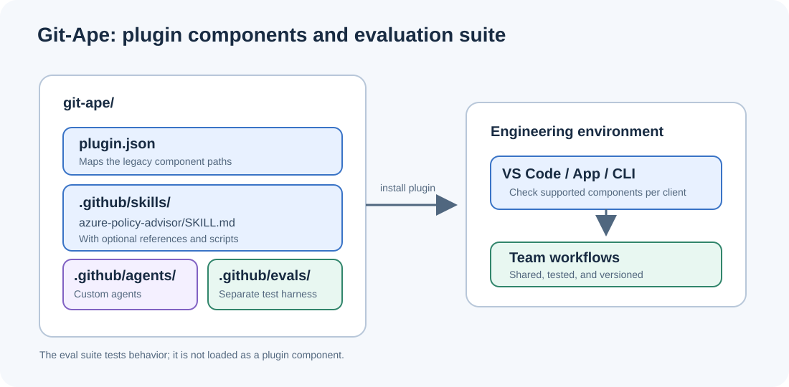
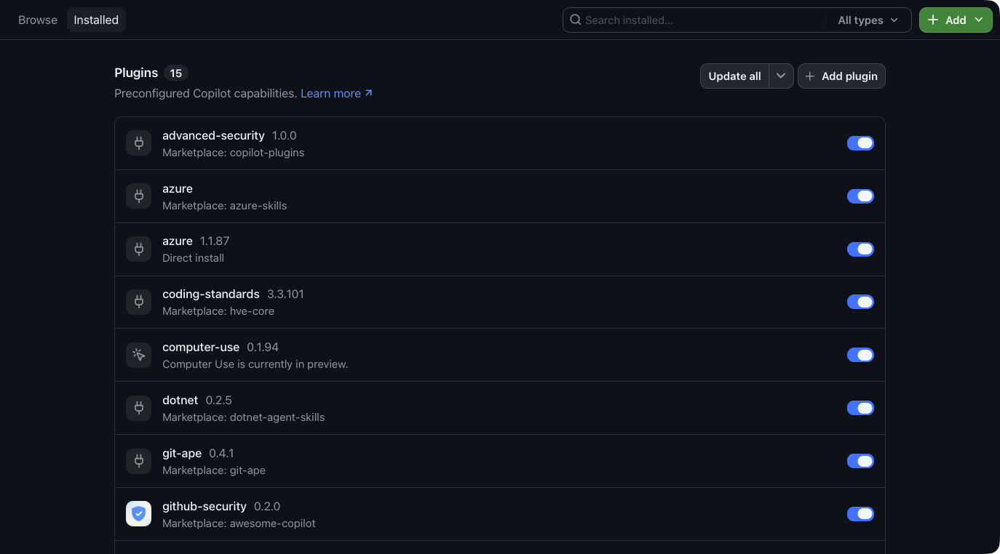
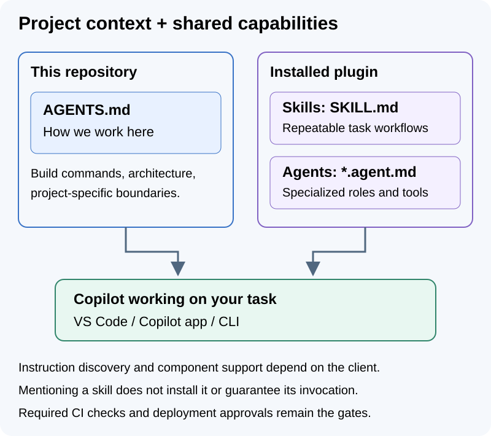

Reviewing a change, preparing release notes, or helping someone get started in a repository: these are tasks we repeat across projects. We usually have a process for each one, spread across documentation, scripts, and repository instructions.

GitHub Copilot plugins give us a way to package those practices into an installable toolkit. That toolkit can bring together instructions, tools, specialist agents, and even an interactive canvas in the Copilot app. Let's look at the building blocks and create a small plugin of our own.

<!-- truncate -->

*Engineering plugins series:* **1. Build a plugin** | 2. Evaluate its skills (coming soon) | 3. Distribute to the team (coming soon) | 4. Manage across the enterprise (coming soon)

*Plugin and canvas references checked November 12, 2026. Examples are based on documentation and source review; installation has not been reproduced end to end.*

## What can we put in a plugin?

A plugin is a package of related capabilities. Start with the ones your workflow needs:

| Component | Example use |
|---|---|
| **Skills** | Review a Terraform plan, prepare release notes, or follow an onboarding checklist. Include scripts, templates, and references beside `SKILL.md`. |
| **Custom agents** | Define a documentation reviewer or migration specialist with focused instructions and tools. |
| **Commands and rules** | Provide reusable slash-command prompts and guidance in clients that support them. |
| **Hooks** | Run code at supported lifecycle events, such as a check before a tool executes. |
| **MCP server configuration** | Connect to an issue tracker, documentation service, or deployment API. |
| **Language servers** | Configure language-aware code navigation in clients that support plugin LSP configuration. |
| **Extensions** | Add capabilities implemented in code, including session-aware tools or a shared canvas in the Copilot app. |
| **Automation templates** | Offer a reusable task prompt and schedule in VS Code. Users review and configure the automation before enabling it. |



For example, a **release toolkit** could combine a release-notes skill, an issue-tracker connection, a reviewer agent, and a release-checklist canvas. A **frontend toolkit** could package accessibility-review skills, design references, and supporting scripts. An **infrastructure toolkit** could bring together plan reviews, prerequisite checks, and deployment guidance.

These are possible combinations, not components you must implement. GitHub's [customization comparison](https://docs.github.com/en/copilot/concepts/customizations/comparing-customizations) helps choose the right mechanism.

## Choose the clients and package format

Plugins are available in **VS Code, the GitHub Copilot app, Copilot CLI, and Copilot cloud agent**, with different component support and installation flows. In VS Code, run **Chat: Open Customizations** to browse plugins. In the app, use **Customize > Plugins**; in the CLI, use `copilot plugin`.



*The Copilot app's installed plugin inventory, captured in October 2026.*

The [shared plugin reference](https://docs.github.com/en/copilot/reference/plugin-and-marketplace-reference#plugin-manifests) distinguishes the portable format from client-specific additions. **Agent Plugins 1.0** defines standard locations for skills and MCP configuration. Other components depend on the client and harness. The [VS Code authoring reference](https://code.visualstudio.com/docs/agents/reference/agent-plugin-reference) also documents automation templates; installing a template does not start a scheduled task.

Copilot CLI also supports a **legacy format** with configurable component paths. Choose one format before arranging the files; adding an Agent Plugins `$schema` to a legacy manifest changes how it is interpreted.

## Already have an AGENTS.md?

Keep project-specific instructions in `AGENTS.md` or `.github/copilot-instructions.md`: build commands, repository structure, and local conventions. Put reusable task workflows in skills that a plugin can distribute across projects.



The filenames matter. `AGENTS.md` provides instructions; `reviewer.agent.md` defines a custom agent. A file literally named `agent.md` is not automatically either one. Check GitHub's [instruction support matrix](https://docs.github.com/en/copilot/reference/custom-instructions-support) for the client and feature you use.

You can keep your existing repository guidance while adopting a plugin. Avoid maintaining competing copies of the same procedure in both places.

## Create a small plugin

Let's use an illustrative `engineering-toolkit` with one Terraform review skill. This Agent Plugins 1.0 layout leaves room for optional components:

```text
engineering-toolkit/
├── plugin.json
├── skills/
│   └── terraform-plan-review/
│       ├── SKILL.md
│       ├── references/             # Optional supporting material
│       └── scripts/                # Optional supporting code
├── mcp.json                        # Optional MCP configuration
└── com.github.copilot/             # Optional, client-specific
    ├── agents/
    ├── commands/
    ├── rules/
    ├── hooks/
    │   └── hooks.json
    └── lsp.json
```

Only create the files you need. For our skill-only example, add this root `plugin.json`:

```json
{
  "$schema": "https://agent-plugins.org/schemas/1.0.0/plugin.schema.json",
  "name": "engineering-toolkit",
  "version": "0.1.0",
  "description": "Reusable engineering workflows for our team"
}
```

For supported `plugin.json` fields, see GitHub's [CLI manifest reference](https://docs.github.com/en/copilot/reference/copilot-cli-reference/cli-plugin-reference#pluginjson). The [shared plugin manifest reference](https://docs.github.com/en/copilot/reference/plugin-and-marketplace-reference#plugin-manifests) explains portable locations and client-specific components.

Save the following as `skills/terraform-plan-review/SKILL.md`:

```markdown
---
name: terraform-plan-review
description: Review a Terraform plan for unintended infrastructure changes before it is applied.
---

# Terraform plan review

1. Read the supplied plan and identify additions, changes, and deletions.
2. Highlight changes affecting identity, network exposure, backups,
   availability, encryption, or data retention.
3. Explain each finding and cite the resource or plan detail.
4. Separate confirmed risks from questions needing more context.
5. Summarize findings by severity and recommend what to verify next.

Do not run terraform apply. Ask for missing plans or context.
```

The description helps Copilot select the skill. Keep the procedure focused, and place longer supporting material in the skill's references. GitHub's [skill authoring guide](https://docs.github.com/en/copilot/how-tos/copilot-cli/customize-copilot/add-skills) covers the format and script precautions.

## Can we include a canvas?

**Yes.** GitHub documents [canvas extensions delivered through plugins](https://docs.github.com/en/copilot/how-tos/github-copilot-app/working-with-canvas-extensions) in the Copilot app. A canvas provides a shared surface that both the person and agent can update: a triage board, release checklist, dashboard, or planning document.

[VS Code also supports canvases in preview](https://code.visualstudio.com/docs/agents/run/canvases), including compatible extensions from app-installed plugins. It requires `chat.canvases.enabled` and a Copilot harness session; support does not extend to every harness or browser client.

For our release toolkit, the skill could describe the release process while the canvas displays the checklist. People update items through controls, and the agent uses exposed actions to read or update the same state.

Canvas extensions commonly contain `package.json`, an entry file such as `extension.mjs`, and optional persisted artifacts. A **legacy Copilot plugin** can point to its extension directory:

```json
{
  "name": "release-workbench",
  "skills": "skills/",
  "extensions": ["extensions/"]
}
```

This is a separate legacy-format example. Its `extensions` path field has a different meaning from the namespaced `extensions` map in Agent Plugins 1.0. See the [legacy manifest fields](https://docs.github.com/en/copilot/reference/copilot-cli-reference/cli-plugin-reference#legacy-manifest-fields).

In the app, `/create-canvas` helps author a canvas; repository-scoped canvases live under `.github/extensions`, and personal ones under `~/.copilot/extensions`. Packaging supplies the code; rendering requires a supporting client and session. Check [extension support](https://docs.github.com/en/copilot/concepts/customizations/extensions) before promising equivalent behavior elsewhere.

## A real-world example: Git-Ape

[Git-Ape](https://github.com/Azure/git-ape) packages Azure engineering workflows. Its legacy manifest points at existing repository directories:

```json
{
  "name": "git-ape",
  "agents": ".github/agents/",
  "skills": ".github/skills/",
  "prompts": ".github/prompts/"
}
```

This shortened example shows how an established project can package its capabilities without moving them into our sample layout. Git-Ape is **experimental and not production-ready**; use a sandbox when exploring it.

## Try your plugin locally

With Copilot CLI installed and signed in, run these commands from the parent directory of `engineering-toolkit`:

```shell
copilot plugin install ./engineering-toolkit
copilot plugin list
```

Start a new interactive session, inspect `/skills list`, then supply a sample plan for review. Check that the response cites actual changes and leaves infrastructure untouched.

For this direct local install, reinstall after edits so the CLI refreshes its cached copy. When finished:

```shell
copilot plugin uninstall engineering-toolkit
```

GitHub's [plugin creation guide](https://docs.github.com/en/copilot/how-tos/copilot-cli/customize-copilot/plugins-creating) documents this flow. Installing a skill confirms availability; evaluating its selection and output is the subject of article 2.

## Now it's your turn

Choose one workflow and package the smallest useful set of capabilities. Review any scripts, hooks, extensions, and external connections before sharing them. Keep credentials outside the package and retain normal tool approvals and access controls.

Next, we will build evaluation cases to check whether the toolkit improves the work.

Happy building!

Arnaud
