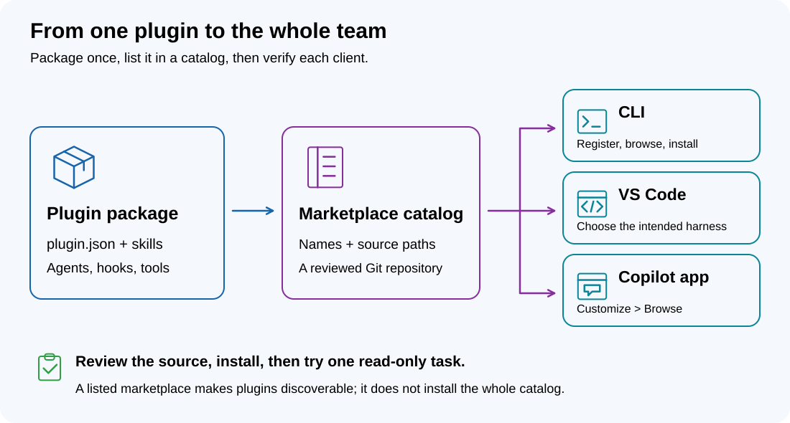
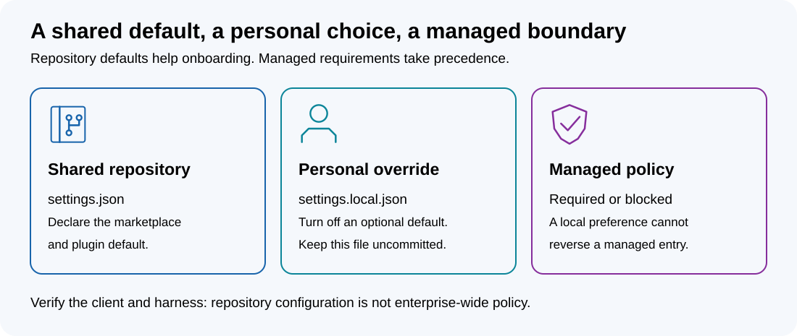
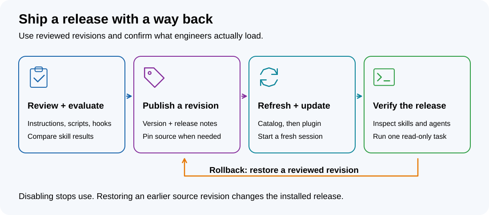

In [article 1](../2026-10-23-building-an-engineering-plugin-for-copilot-cli/index.md), we built a small engineering toolkit. In [article 2](../2026-11-12-evaluating-engineering-plugin-skills/index.md), we tested its skills. Now we need a repeatable way for teammates to install the package and adopt updates.

We will use Git-Ape's public catalog as a concrete distribution example: register a marketplace, install a plugin, and declare repository defaults. The same pattern works for the toolkit from the earlier articles.

**VS Code, the Copilot app, and CLI** support plugin marketplaces, with different installation and update interfaces. We will use CLI commands for the worked examples and call out those differences.

<!-- truncate -->

*Engineering plugins series:* [1. Build a plugin](../2026-10-23-building-an-engineering-plugin-for-copilot-cli/index.md) | [2. Evaluate its skills](../2026-11-12-evaluating-engineering-plugin-skills/index.md) | **3. Distribute to the team** | 4. Manage across the enterprise (coming soon)

*Verified November 17, 2026, on macOS with CLI 1.0.104: Git-Ape marketplace registration, browsing, installation, skill discovery, update checks, disabling, enabling, and removal. A synthetic local plugin covered live-directory behavior. Repository-default activation, upgrades between releases, model-driven use, private-repository access, and the other clients' flows were reviewed against documentation only.*

## Before you start

Use an account with Copilot access and install the client your team will use. For the CLI examples, have Git available and [install and authenticate Copilot CLI](https://docs.github.com/en/copilot/how-tos/set-up/install-copilot-cli). Check `copilot --version` and `copilot plugin --help` before following the commands.

Git-Ape's workflows have their own [tool and authentication prerequisites](https://github.com/Azure/git-ape#prerequisites). Installing the package does not configure Azure access or its external tools. Try it in a disposable project without production credentials, and keep normal tool approvals enabled.

## Start with the audience

Before choosing a distribution mechanism, decide what "everyone" means:

| Audience | Distribution approach |
|---|---|
| Engineers who want to try the plugin | Share the marketplace and installation commands. |
| Everyone working in a particular repository | Add repository defaults, then verify the behavior in the intended client and harness. |
| Users across many repositories | Include installation in developer onboarding or configure user-level settings. |
| Users on an enterprise's Copilot plan | Define enterprise-managed plugin standards, with device management where needed. |

Choose the narrowest scope that reaches your intended users. We will start with individual installation, then repository configuration; the next article covers enterprise policy.

Git-Ape is useful as a concrete example, but its [README](https://github.com/Azure/git-ape/blob/main/README.md) currently labels the project **experimental and not production-ready**. Use sandbox environments for this walkthrough. Distributing a deployment plugin does not authorize it to deploy resources or grant its users Azure access.

## Package versus catalog

The plugin and the marketplace have different responsibilities:

| File | Purpose |
|---|---|
| `plugin.json` | Describes the plugin and, in Git-Ape's legacy format, locates its component directories. |
| `.github/plugin/marketplace.json` | Describes a catalog and tells users where to find its plugins. |
| `.github/copilot/settings.json` | Declares marketplace and plugin defaults for a consuming repository on supported surfaces. |

A marketplace can be a Git repository containing a JSON catalog. The plugin may live in that repository or be referenced from another supported source. The [shared marketplace reference](https://docs.github.com/en/copilot/reference/plugin-and-marketplace-reference#marketplace-catalog) describes the catalog fields and plugin identities.



Git-Ape keeps its plugin at the repository root and its marketplace catalog under `.github/plugin/`:

```text
git-ape/
├── plugin.json
└── .github/
    ├── plugin/
    │   └── marketplace.json
    ├── agents/
    ├── skills/
    └── evals/
```

Here is a shortened version of its catalog, showing only the Git-Ape entry:

```json
{
  "name": "git-ape",
  "owner": {
    "name": "Microsoft",
    "url": "https://github.com/Azure/git-ape"
  },
  "metadata": {
    "description": "Git-Ape Azure deployment agents and skills"
  },
  "plugins": [
    {
      "name": "git-ape",
      "description": "Azure deployment workflows for GitHub Copilot",
      "source": "."
    }
  ]
}
```

The `"source": "."` points to the repository root, where Copilot finds `plugin.json`. Paths are relative to the marketplace root, not the directory containing `marketplace.json`. If you host several plugins in one repository, entries can point to directories such as `"./plugins/platform-review"`. See GitHub's [marketplace creation guide](https://docs.github.com/en/copilot/how-tos/copilot-on-github/customize-copilot/create-and-share-plugin-marketplaces).

Keep version metadata aligned when releasing a plugin. The complete [Git-Ape catalog](https://github.com/Azure/git-ape/blob/main/.github/plugin/marketplace.json) includes version information and another plugin entry; this shortened example omits them. Git-Ape uses the legacy manifest layout. Keep the Agent Plugins schema and fixed component locations from article 1 when packaging your own toolkit; adding a catalog does not require changing its format.

## Give users a short installation path

Before installing, review the publisher, bundled scripts, hooks, and external connections. Do this for packages from a marketplace as well as direct installations.

For Copilot CLI, [Git-Ape's installation guide](https://github.com/Azure/git-ape#option-c-copilot-cli-plugin) documents this flow. The browse step lets users inspect the catalog before installing:

```shell
copilot plugin marketplace add Azure/git-ape
copilot plugin marketplace browse git-ape
copilot plugin install git-ape@git-ape
copilot plugin list
```

There are two names in `git-ape@git-ape`: the plugin name comes before `@`, and the registered marketplace name comes after it. The repository name used when adding the marketplace is a source; the marketplace's own `name` becomes its registration key. See GitHub's [installation guide](https://docs.github.com/en/copilot/how-tos/copilot-cli/customize-copilot/plugins-finding-installing) for the complete command flow.

Start a new CLI session and inspect the available components:

```text
/skills list
/agent
```

Checking the inventory is only the first step. Try a low-risk prompt:

```text
Use the prereq-check skill to report which required tools are missing.
Do not install tools, change configuration, sign in, or deploy anything.
```

Inspect the proposed actions and the skill-loading evidence. Confirm that the response reports prerequisites without making changes. Use this same read-only check after installation in each client.

For a private internal marketplace, intended users need access to its Git repository and any separately referenced plugin repositories. Publishing a catalog does not bypass authentication or grant repository access. Explain required tools, network access, and sign-in steps in the onboarding documentation.

### Installing in the Copilot app

In the **GitHub Copilot app**, open **Customize**. Use the marketplace settings control beside the marketplace dropdown to add `Azure/git-ape` or its Git URL, then find the plugin in **Browse** and select **Install**. Use **Installed** to inspect the available source and version information and confirm the enabled state:


The screenshot shows the app's earlier layout; controls can move between releases. Check the current [app customization guide](https://docs.github.com/en/copilot/how-tos/github-copilot-app/customize-github-copilot-app#adding-plugins), then try the same read-only prerequisite task.

### Installing in VS Code

Select the **Copilot** harness, then run **Chat: Open Customizations**. In the Agent Customizations editor, open **Browse** and choose **Configure Marketplaces** from the source menu. Select **Add Marketplace** and enter `Azure/git-ape`, then return to **Browse** and select that source. Review the plugin's publisher and included customizations before selecting **Install**. Accept any trust prompt only after reviewing the source.

If the unified Browse page is unavailable, use **Plugins > Browse Marketplace**. The Experimental `chat.plugins.marketplaces` setting is another way to configure the catalog. This installs an agent plugin; Git-Ape also offers a separately packaged VS Code extension, which is a different distribution route.

VS Code also discovers CLI-installed plugins under `~/.copilot/installed-plugins/`. Its [plugin guide](https://code.visualstudio.com/docs/agent-customization/agent-plugins#_manage-plugins-with-slash-commands) notes that the `/plugin` interface and Agent Customizations editor have separate inventories, so manage the plugin through the interface where you installed it. Start a fresh session in the same harness and verify the prerequisite task.

## Make adoption part of the repository

Sharing commands works for early adopters. For a project team, put the intended plugin configuration under source control so it can be reviewed with the rest of the engineering environment.

For example, a consuming repository can include `.github/copilot/settings.json`:

```json
{
  "extraKnownMarketplaces": {
    "git-ape": {
      "source": {
        "source": "github",
        "repo": "Azure/git-ape"
      }
    }
  },
  "enabledPlugins": {
    "git-ape@git-ape": true
  }
}
```

Copilot CLI documents `enabledPlugins` as declarative auto-install configuration. A plugin enabled only through this repository setting installs and activates for that repository, rather than becoming globally active in unrelated projects.

The keys do different jobs: `extraKnownMarketplaces` makes the catalog available, while `enabledPlugins` requests a specific plugin from that catalog. Registering a marketplace alone does not install every plugin it lists. Keep the marketplace key consistent with its catalog name, and use the complete `plugin@marketplace` identity.



The plugin-related keys are also read by **Copilot in the cloud**. A repository can declare the same plugin for CLI and cloud work without copying its skill files into each environment. Check component compatibility, dependencies, network access, and authentication on each surface.

In VS Code's **Copilot harness**, this file supplies repository plugin and marketplace defaults; users can turn off optional defaults in the Agent Customizations editor. In the **Local harness**, VS Code documents a recommendation notification and a browse/install flow. These are different behaviors. See [workspace plugin recommendations](https://code.visualstudio.com/docs/agent-customization/agent-plugins#_workspace-plugin-recommendations) and test your team's selected harness.

Repository defaults are optional. For the CLI, a developer can turn off the default in `.github/copilot/settings.local.json`:

```json
{
  "enabledPlugins": {
    "git-ape@git-ape": false
  }
}
```

Add `.github/copilot/settings.local.json` to `.gitignore`; personal overrides should stay out of source control. Start a new session after changing the file. Enterprise-managed required or blocked entries take precedence over repository and local choices. GitHub's [local override guide](https://docs.github.com/en/copilot/how-tos/copilot-cli/customize-copilot/plugins-finding-installing#turn-off-a-repository-default) explains this distinction.

Review changes to `.github/copilot/settings.json` through pull requests, and protect it with CODEOWNERS and repository rulesets where appropriate. A repository template can seed the file for new projects, but existing repositories still need the change. An ordinary repository's settings do not automatically become policy for other repositories; enterprise governance uses a separate mechanism, covered in the next article.

Keep normal tool approvals, repository access controls, and deployment confirmations in place when using the installed plugin. See the [repository settings reference](https://docs.github.com/en/copilot/reference/copilot-cli-reference/cli-config-dir-reference#repository-settings-githubcopilotsettingsjson) for supported keys and scope.

## Reach users across repositories

For users who need the toolkit in their everyday environment, add the installation commands to the developer onboarding process. Run them in the intended user's environment rather than installing once as an administrator and assuming every account receives the plugin.

If you need an enterprise standard rather than voluntary onboarding, GitHub provides [enterprise-managed plugin standards](https://docs.github.com/en/copilot/concepts/enterprise/plugin-standards). These apply to users receiving Copilot through the enterprise on supported clients. The next article will cover the governance repository, required plugins, and team pilots.

## Update the catalog and the installed plugin



After publishing changes, users can refresh the catalog and update the installed plugin:

```shell
copilot plugin marketplace update git-ape
copilot plugin update git-ape
copilot plugin list
```

The first command refreshes marketplace information. The second updates the plugin itself. Start a new session and check the loaded skills and agents before relying on the new behavior.

For plugins sourced from a local-directory marketplace, CLI loads the plugin live. Edits take effect in a new session or after `/restart`; `plugin update` has nothing to download. Do not treat this local development behavior as a test of remote upgrades.

In VS Code, open **Plugins** in the Agent Customizations editor and choose **Check for and Apply Updates**, or run **Chat: Update Plugins**. Automatic updates follow `extensions.autoUpdate`, except that npm and PyPI sources require a manual update and confirmation. Use the interface where you installed the plugin; see the [VS Code update guide](https://code.visualstudio.com/docs/agent-customization/agent-plugins#_update-plugins).

Choose an explicit update policy for custom marketplaces. The [CLI update reference](https://docs.github.com/en/copilot/reference/copilot-cli-reference/cli-plugin-reference#copilot-plugin-update-options) documents session-start auto-update through user or managed settings for interactive and `-p` sessions. This mechanism does not apply to SDK or server sessions, and a repository-level marketplace `autoUpdate` entry is currently ignored.

For a broad rollout, I would keep the release process simple:

1. Review changes to instructions, scripts, hooks, dependencies, and external connections.
2. Run the skill evaluations and compare results with the previous release.
3. Publish a versioned release with notes explaining behavior and prerequisite changes.
4. Test installation and upgrade with a pilot group before updating the wider audience.

Version strings help identify a release. To pin the downloaded code, the CLI supports marketplace sources using `OWNER/REPO#ref`. For example, replace `ref` with a reviewed full commit SHA. Check the installed plugin's resolved source as well: an external plugin referenced by the catalog needs its own revision control. A catalog's `version` field alone does not freeze a Git source.

## Keep a way back

If the plugin causes a problem, users can stop using an unmanaged installation without deleting their engineering project:

```shell
copilot plugin disable git-ape
```

Or uninstall it:

```shell
copilot plugin uninstall git-ape
```

For a local-directory marketplace, uninstall disables the plugin and leaves its source files on disk. This preserves the development checkout. Check `copilot plugin list` and the command output before assuming files were removed.

If repository defaults control activation, use the local override above or change the shared defaults through a pull request. Conflicting CLI enable/disable commands are rejected with the controlling settings path. Required managed plugins cannot be turned off locally.

A release rollback needs an earlier reviewed source revision and a check of the loaded version. Disabling a plugin stops its use; it does not restore an older release.

Keep a short record of the plugin version, source revision, client version, and observed failure. That gives maintainers something useful to reproduce, and connects the rollout back to the [evaluations in article 2](../2026-11-12-evaluating-engineering-plugin-skills/index.md).

## Now it's your turn

Start by publishing a small marketplace and testing it with one other engineer. Then add repository configuration or managed rollout where that scope makes sense. Keep the installation simple, the update policy explicit, and the evaluation results attached to each release.

In the final article, we will use a governance repository and an enterprise-team pilot to introduce required plugins.

Happy sharing!

Arnaud
