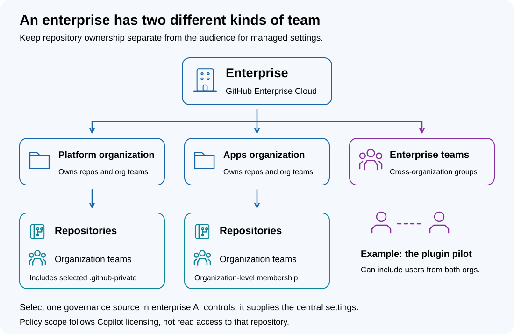
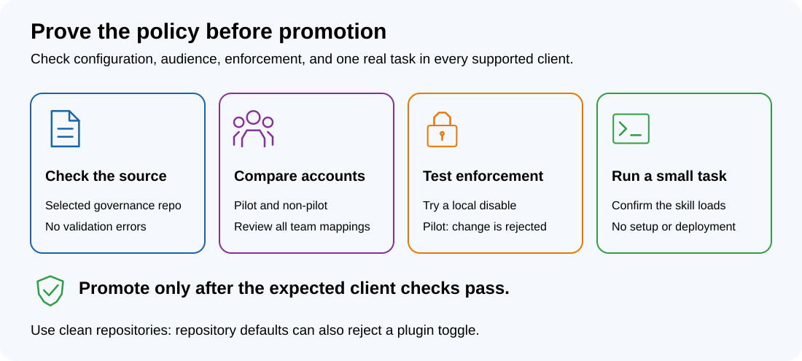

In the [previous article](../2026-10-24-distributing-an-engineering-plugin-to-your-team/index.md), we shared a marketplace and declared repository defaults. Now we want to introduce a required plugin across an enterprise, starting with a small pilot.

That requires a different configuration source and an explicit rollout boundary. We will separate enterprise teams from organization teams, require Git-Ape for one enterprise team, and check the result before promoting the requirement.

**VS Code, the Copilot app, and CLI** support enterprise plugin policy on supported versions. They receive settings from a central source, with component support and management interfaces depending on the client.

<!-- truncate -->

*Engineering plugins series:* [1. Build a plugin](../2026-10-23-building-an-engineering-plugin-for-copilot-cli/index.md) | [2. Evaluate its skills](../2026-11-12-evaluating-engineering-plugin-skills/index.md) | [3. Distribute to the team](../2026-10-24-distributing-an-engineering-plugin-to-your-team/index.md) | **4. Manage across the enterprise**

*References checked November 17, 2026. The JSON examples were parsed and cross-checked locally; the CLI inventory and disable commands were exercised against an optional local fixture. Governance-source selection, server-side validation, enterprise-team targeting, policy refresh, and managed enforcement remain documentation-only checks; they require an authorized GitHub Enterprise Cloud pilot. No live enterprise policy was changed.*

## Before you start

Use a GitHub Enterprise Cloud test environment where you are authorized to select the governance source, manage an enterprise team, and review changes to its policy repository. Have a pilot account licensed through that enterprise, a non-pilot comparison account, and the supported client versions you intend to deploy.

Check whether the enterprise already has a selected `.github-private` source. Client governance and enterprise custom agents share this source: selecting a different organization can affect both. Update the existing source deliberately, with a reviewed rollback plan, rather than creating a second repository and assuming it becomes active.

## Understand the hierarchy before applying policy

Organizations own repositories and organization teams. Enterprise teams are a different grouping: they can target users across organizations. The organization hosting the governance repository does not define the full audience of the enterprise policy. GitHub's [enterprise team guide](https://docs.github.com/en/enterprise-cloud@latest/admin/managing-accounts-and-repositories/managing-users-in-your-enterprise/create-enterprise-teams) documents their membership and organization access; the [managed-settings team guide](https://docs.github.com/en/copilot/how-tos/administer-copilot/manage-for-enterprise/use-managed-settings/override-settings-for-teams) explains policy targeting.



Continue with Git-Ape, the **experimental, non-production** sandbox example from article 3. Its [README](https://github.com/Azure/git-ape/blob/main/README.md) documents the project's status.

## Configure the governance repository

The server-managed route uses a designated `.github-private` repository. This is separate from both the plugin repository and the repositories consuming the plugin. GitHub announced this approach for **GitHub Enterprise Cloud** in its [managed-settings general availability post](https://github.blog/changelog/2026-07-01-enterprise-managed-settings-json-is-generally-available/); do not assume the same setup applies to GitHub Enterprise Server.

1. Choose an organization in your enterprise to own `.github-private`, or use the existing selected repository. GitHub recommends internal visibility so members can inspect the policy, with edits restricted to the administrators and AI managers responsible for it.
2. In the enterprise, open **AI controls > Agents > Configuration source** and select the organization containing that repository. Creating the repository alone does not select it as the enterprise's governance source.
3. Add `copilot/managed-settings.json` to that repository and commit the reviewed configuration to its default branch.

Follow GitHub's [governance repository setup guide](https://docs.github.com/en/copilot/how-tos/administer-copilot/manage-for-enterprise/manage-agents/create-github-private-repo) for the source selection and access requirements.

For new configurations, use `copilot/managed-settings.json`. The [general availability announcement](https://github.blog/changelog/2026-07-01-enterprise-managed-settings-json-is-generally-available/) also documents backward compatibility with `.github/copilot/settings.json` in the selected `.github-private` source. That legacy path is not evidence that settings in any repository become enterprise policy.

The resulting layout is:

```text
your-governance-org/.github-private/
└── copilot/
    └── managed-settings.json
```

Start the sandbox pilot with a catalog-only baseline in `copilot/managed-settings.json`. This makes Git-Ape's marketplace available without requiring its plugin for everyone:

```json
{
  "extraKnownMarketplaces": {
    "git-ape": {
      "source": {
        "source": "github",
        "repo": "Azure/git-ape"
      },
      "autoUpdate": false
    }
  }
}
```

We will add [`enabledPlugins`](https://docs.github.com/en/copilot/reference/enterprise-administrators/enterprise-managed-settings#enabledplugins) for the pilot team next. In managed settings, `true` requires a plugin to be enabled and `false` requires it to be disabled. Supported clients automatically install required plugins and reject conflicting local toggles.

The managed [`autoUpdate`](https://docs.github.com/en/copilot/reference/enterprise-administrators/enterprise-managed-settings#extraknownmarketplaces) value controls automatic updates for this marketplace. Setting it to `false` requires automatic updates to remain disabled, including for users who already installed Git-Ape. This baseline setting reaches all users in scope, even during the team pilot. It is not a version pin or a ban on every explicit update.

The policy applies to users licensed through your enterprise or its organizations, even if they cannot read the governance repository. That is different from access to a private plugin repository: required-plugin policy does not grant users access to the plugin's source or to Azure resources.

Check the current [client-support matrix](https://docs.github.com/en/copilot/reference/enterprise-administrators/enterprise-managed-settings#client-support-by-key) for each key. At the review date, `enabledPlugins`, `extraKnownMarketplaces`, and `strictKnownMarketplaces` are supported in CLI, VS Code, the Copilot app, JetBrains IDEs, and **Copilot in the cloud on GitHub Actions**. The matrix lists those three keys as **unsupported in cloud sandboxes**. Do not treat all cloud sessions as equivalent.

Receiving policy also does not make every plugin component portable. Verify both the client version and the capabilities the plugin needs.

## Treat marketplace restrictions as a separate rollout

Requiring one plugin does not block other plugins. The optional `strictKnownMarketplaces` key restricts marketplace-based installation to approved sources:

```json
{
  "strictKnownMarketplaces": [
    {
      "source": "github",
      "repo": "Azure/git-ape"
    }
  ]
}
```

**Leave this restriction out of the initial pilot baseline.** Adding it at the enterprise level affects all users in scope and disables the built-in marketplaces. The single-entry example permits only Git-Ape's marketplace; it could disrupt unrelated workflows.

After a separate review, merge the key into the existing managed file and include every source your policy intends to permit. The [`strictKnownMarketplaces` reference](https://docs.github.com/en/copilot/reference/enterprise-administrators/enterprise-managed-settings#strictknownmarketplaces) defines an empty array as complete marketplace lockdown. Omitting the key retains the existing marketplace policy; it does not impose this allowlist.

Tool execution still needs its own permissions and approvals. Before rolling out a restriction, test both permitted and rejected installation paths. See GitHub's [plugin management guide](https://docs.github.com/en/copilot/how-tos/administer-copilot/manage-for-enterprise/use-managed-settings/manage-plugin-marketplaces-and-plugins) for the distinction between making a catalog available and requiring a plugin.

## Add the requirement for one enterprise team

With the catalog in the baseline, we can require the plugin for a smaller group through an enterprise-team file.

In the enterprise account, open **People > Enterprise teams**. This is the enterprise-level team screen, not an organization's **Teams** page:


*Enterprise team management in GitHub Enterprise Cloud, captured in Microsoft Edge in October 2026. Managed settings are configured separately in the governance repository.*

Create or select an enterprise team for the pilot and confirm its members. In this example, its slug is `platform-plugin-pilot`. Then create `copilot/team-mappings.json` in the governance repository:

```json
{
  "plugin-pilot.json": ["platform-plugin-pilot"]
}
```

Then create `copilot/teams/plugin-pilot.json`:

```json
{
  "enabledPlugins": {
    "git-ape@git-ape": true
  }
}
```

The slug `platform-plugin-pilot` must identify an actual **enterprise team**, not just a similarly named organization team. Commit both files through the governance repository's review process to its default branch.

The pilot layout is now:

```text
your-governance-org/.github-private/
└── copilot/
    ├── managed-settings.json
    ├── team-mappings.json
    └── teams/
        └── plugin-pilot.json
```

Choose the team's organization access deliberately: assigning organization access can add members to those organizations and grant their base repository permissions. A policy pilot should not accidentally become an access-expansion exercise.

For this pilot, omit the Git-Ape entry from the enterprise-wide `enabledPlugins` map; do not set it to `false`, which would require it to be disabled. Team `enabledPlugins` entries are additive and cannot weaken the enterprise baseline. Other keys have their own override rules, so do not wrap `enabledPlugins` in `overridable` just because another setting uses that syntax.

Users outside the pilot receive no managed Git-Ape requirement from these files. They may still have the plugin through their own installation or repository settings. Check the resolved configuration when testing scope. GitHub's [team override guide](https://docs.github.com/en/copilot/how-tos/administer-copilot/manage-for-enterprise/use-managed-settings/override-settings-for-teams) documents the merge rules.

Review all enterprise-team mappings that match each test account. Another team's file can add a requirement too. Keep the first pilot simple, and avoid conflicting required/blocked entries for the same plugin across team files.

Do not generalize the additive plugin rule to every map: an overridable `extraKnownMarketplaces` map is replaced by the team's map. A team replacing it must retain any enterprise-declared catalogs it still needs. The [current marketplace reference](https://docs.github.com/en/copilot/reference/enterprise-administrators/enterprise-managed-settings#extraknownmarketplaces) documents this behavior.


The diagram shows plugin-specific policy resolution. Other managed keys have different merge rules, and device-managed settings can take precedence over server-managed values.

## Validate the pilot



GitHub validates server-managed configuration in the selected governance repository: the baseline, the team mapping, and the referenced team files. Review errors under **AI controls > Agents > Copilot settings validation**. If there are no issues, the section is not displayed. Absence of validation errors is only the configuration check; verify client behavior separately.

Supported clients normally receive server-managed changes within about an hour. Restarting the client or signing in again triggers an immediate refresh. Use a pilot test account and a clean test repository without repository plugin settings. Avoid manually installing Git-Ape first, so that a personal installation cannot mask a failed policy rollout.

For CLI verification, run:

```shell
copilot plugin list --json
```

The [CLI reference](https://docs.github.com/en/copilot/reference/copilot-cli-reference/cli-plugin-reference#copilot-plugin-list-options) specifies a flat array. Find the row with `name: "git-ape"` and `marketplace: "git-ape"`, inspect its version when present, and confirm `enabled: true`. The `source` field describes the installation source; the inventory alone does not prove that enterprise policy required it.

As a negative test on that pilot account, try:

```shell
copilot plugin disable git-ape
```

The command should be rejected because managed policy requires the plugin. If it succeeds, stop the rollout and investigate. A repository default can also reject this toggle, which is why the clean test repository matters. See the [CLI activation rules](https://docs.github.com/en/copilot/reference/copilot-cli-reference/cli-plugin-reference#cli-commands).

Record the outcomes rather than just taking an inventory screenshot:

| Check | Expected outcome |
|---|---|
| Pilot member in a repository with no plugin settings | Git-Ape is installed, enabled, and managed. |
| Same pilot member in another clean repository | The managed requirement still applies. |
| Pilot member attempts to disable Git-Ape | The client rejects the conflicting local change. |
| Non-pilot account, with no other matching requirement | No managed Git-Ape requirement from this pilot. An optional installation may still exist. |
| Pilot member runs the read-only prerequisite task from article 3 | The skill loads and reports tool/authentication status without setup or deployment. |

Repeat these checks in **VS Code and the Copilot app** if your engineers use them. Check the managed indicator and locked controls, then run the same low-risk task. A workspace recommendation or an ordinary enabled toggle is insufficient evidence of enterprise enforcement. See [VS Code plugin management](https://code.visualstudio.com/docs/agent-customization/agent-plugins#_enable-or-disable-plugins) and the [Copilot app customization guide](https://docs.github.com/en/copilot/how-tos/github-copilot-app/customize-github-copilot-app#adding-plugins).

If a user does not receive the policy, check their client version and license source. For users with access through multiple billing entities, check the **Usage billed to** selection in their personal Copilot settings. Use the [enterprise-managed settings setup guide](https://docs.github.com/en/copilot/how-tos/administer-copilot/manage-for-enterprise/use-managed-settings/get-started) for rollout and troubleshooting details.

Protect the governance repository with [CODEOWNERS](https://docs.github.com/en/repositories/managing-your-repositorys-settings-and-features/customizing-your-repository/about-code-owners) and an [active ruleset](https://docs.github.com/en/repositories/configuring-branches-and-merges-in-your-repository/managing-rulesets/creating-rulesets-for-a-repository) requiring the relevant approvals. CODEOWNERS alone does not require approval before merge. Review policy changes alongside the plugin's evaluation results, and document who can change the approved source or withdraw a problematic release.

## When device management is needed

Server-managed settings follow the enterprise's Copilot licensing scope, subject to each key's client coverage. MDM or file-based managed settings configure local clients independently of the user's license source; they do not deliver policy to cloud environments. The enterprise-team mapping mechanism described above is specific to server-managed delivery.

For ordinary settings, GitHub documents precedence as **MDM > server-managed > file-based > user settings**. Permission and sandbox rules have more restrictive composition rules. See [deployment methods and precedence](https://docs.github.com/en/copilot/how-tos/administer-copilot/manage-for-enterprise/use-managed-settings/deploy-managed-settings#precedence-of-deployment-methods) before mixing sources.

There is also an offline caveat: the CLI deployment guide says that if the server request fails and no cached policy exists, server-managed policy is unavailable for that session. Do not describe a remote policy as an unconditional offline guarantee.

For stronger startup freshness requirements, [`forceRemoteSettingsRefresh`](https://docs.github.com/en/copilot/reference/enterprise-administrators/enterprise-managed-settings#forceremotesettingsrefresh) requires a fresh server-policy download in CLI, VS Code, and the Copilot app, with restrictions if the refresh fails. Deliver it through MDM or file-based settings if it must apply from the first startup; a server-delivered value only governs subsequent startups after it has been received. Coordinate the network and availability trade-off with IT.

Avoid copying another user's internal `config.json` or installed-plugin cache to provision machines; use supported management settings and commands.

## Keep engineering gates in CI and access controls

These settings mandate the plugin's installation and enabled state, not that the model invokes a particular skill for every prompt. Skills are selected based on the task, and an installed plugin is not proof that an engineering control ran successfully.

If a check must block a deployment or merge, enforce it in the system that owns that operation: required CI checks, protected environments, approval policies, and least-privilege Azure access. Use the plugin to guide engineers through that process, with evaluations to check its behavior. Do not make prompt compliance your only enforcement boundary.

## Keep policy changes connected to releases

Once the pilot is complete, add the following top-level key to `copilot/managed-settings.json`, keeping the existing marketplace configuration:

```json
{
  "enabledPlugins": {
    "git-ape@git-ape": true
  }
}
```

This makes the requirement enterprise-wide for the licensed users in scope. Remove the redundant team entry after promotion.

Use article 3's [release checklist](../2026-10-24-distributing-an-engineering-plugin-to-your-team/index.md#update-the-catalog-and-the-installed-plugin) for source review, evaluation comparisons, and revision control, then validate the release with the pilot group. For a managed GitHub marketplace, set the source's optional `ref` field to the reviewed full commit SHA when reproducibility matters.

After a managed source rollback, verify the revision loaded in each supported client. For an emergency stop, change the controlling managed `enabledPlugins` entry to `false` and verify that the plugin is disabled. A team file cannot reverse an enterprise-wide requirement; change the baseline when it owns that requirement.

Removing the managed entry makes the plugin optional again only if no other policy requires it. That is different from requiring it to be disabled, and does not prove an installed copy was removed. A local uninstall cannot permanently remove a plugin that policy still requires. The [distribution article](../2026-10-24-distributing-an-engineering-plugin-to-your-team/index.md#keep-a-way-back) covers the difference between disabling a plugin and restoring an earlier release.

## Now it's your turn

Start with one enterprise team and a sandbox plugin. Confirm who receives the requirement, verify that conflicting local settings cannot override it, and check the behavior in the clients your engineers use. Only then promote the requirement to the enterprise baseline.

That completes the series: [build a plugin](../2026-10-23-building-an-engineering-plugin-for-copilot-cli/index.md), [evaluate its skills](../2026-11-12-evaluating-engineering-plugin-skills/index.md), [share with a team](../2026-10-24-distributing-an-engineering-plugin-to-your-team/index.md), then introduce enterprise requirements through a pilot. Keep the evaluations and rollout checks with each release so that the package remains useful as it evolves.

Happy building!

Arnaud
