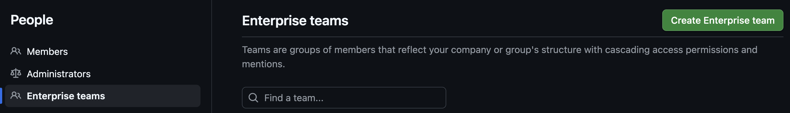
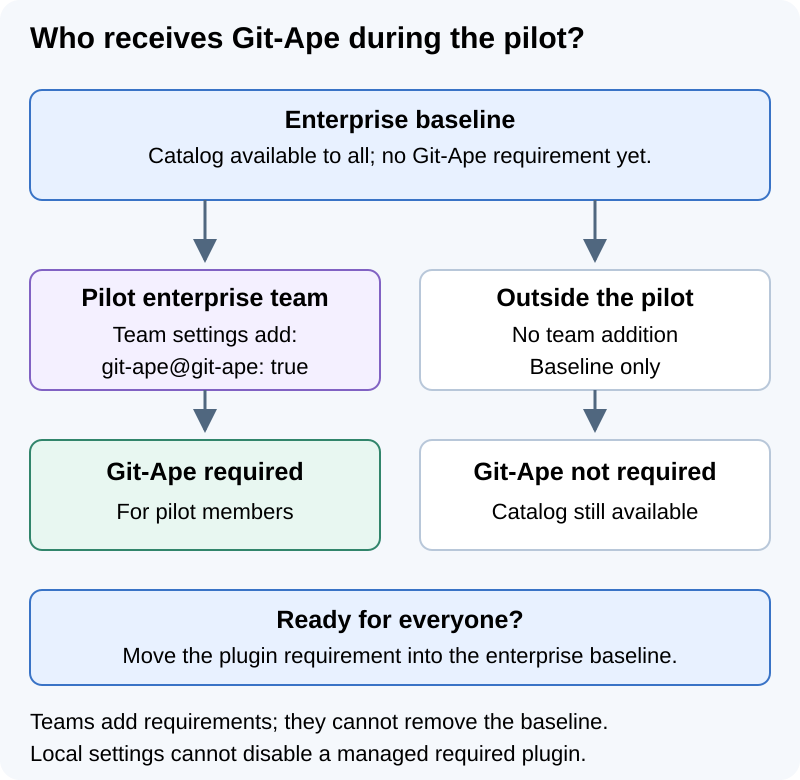

In the [previous article](../2026-10-24-distributing-an-engineering-plugin-to-your-team/index.md), we looked at sharing a marketplace and declaring plugins in team repositories. What if a plugin should be part of the standard engineering environment for everyone on your enterprise's Copilot plan?

This is where distribution becomes governance. Let's look at the enterprise configuration, separate enterprise teams from organization teams, and start with a pilot before making a plugin mandatory.

**VS Code, the Copilot app, and CLI** support enterprise plugin policy on supported versions. They receive settings from a central source, with component support and management interfaces depending on the client.

<!-- truncate -->

*Engineering plugins series:* [1. Build a plugin](../2026-10-23-building-an-engineering-plugin-for-copilot-cli/index.md) | [2. Evaluate its skills](../2026-11-12-evaluating-engineering-plugin-skills/index.md) | [3. Distribute to the team](../2026-10-24-distributing-an-engineering-plugin-to-your-team/index.md) | **4. Manage across the enterprise**

*Technical references checked October 24, 2026. This GitHub Enterprise Cloud walkthrough is based on documentation and source review; enterprise policy enforcement has not been tested here.*

## Understand the hierarchy before applying policy

Organizations own repositories and organization teams. Enterprise teams are a different grouping: they can target users across organizations. The organization hosting the governance repository does not define the full audience of the enterprise policy. GitHub's [enterprise team guide](https://docs.github.com/en/enterprise-cloud@latest/admin/managing-accounts-and-repositories/managing-users-in-your-enterprise/create-enterprise-teams) documents their membership and organization access; the [managed-settings team guide](https://docs.github.com/en/copilot/how-tos/administer-copilot/manage-for-enterprise/use-managed-settings/override-settings-for-teams) explains policy targeting.


For our pilot, we need an **enterprise team**. An organization team with the same name will not target these managed settings. The governance repository belongs to one organization, while the enterprise policy reaches users according to their Copilot license source.

Git-Ape remains our concrete example, not a production recommendation. Its [README](https://github.com/Azure/git-ape#readme) labels it experimental and not production-ready. Use sandbox environments for this walkthrough; plugin policy does not grant Azure access or deployment authorization.

## Configure the governance repository

The server-managed route uses a designated `.github-private` repository. This is separate from both the plugin repository and the repositories consuming the plugin. GitHub announced this approach for **GitHub Enterprise Cloud** in its [managed-settings general availability post](https://github.blog/changelog/2026-07-01-enterprise-managed-settings-json-is-generally-available/); do not assume the same setup applies to GitHub Enterprise Server.

1. Choose an organization in your enterprise to own a repository named `.github-private`. GitHub recommends internal visibility so members can inspect the policy, with edits restricted to the administrators and AI managers responsible for it.
2. In the enterprise, open **AI controls > Agents > Configuration source** and select the organization containing that repository. Creating the repository alone does not select it as the enterprise's governance source.
3. Add `copilot/managed-settings.json` to that repository and commit the reviewed configuration to its default branch.

Follow GitHub's [governance repository setup guide](https://docs.github.com/en/copilot/how-tos/administer-copilot/manage-for-enterprise/manage-agents/create-github-private-repo) for the source selection and access requirements.

For new configurations, use `copilot/managed-settings.json`. The [general availability announcement](https://github.blog/changelog/2026-07-01-enterprise-managed-settings-json-is-generally-available/) also documents backward compatibility with `.github/copilot/settings.json` in the selected `.github-private` source. That legacy path is not evidence that settings in any repository become enterprise policy.

The resulting layout is:

```text
your-governance-org/.github-private/
└── copilot/
    └── managed-settings.json
```

Start the sandbox pilot with a catalog-only baseline in `copilot/managed-settings.json`. This makes Git-Ape's marketplace available without requiring its plugin for everyone:

```json
{
  "extraKnownMarketplaces": {
    "git-ape": {
      "source": {
        "source": "github",
        "repo": "Azure/git-ape"
      },
      "autoUpdate": false
    }
  }
}
```

We will add [`enabledPlugins`](https://docs.github.com/en/copilot/reference/enterprise-administrators/enterprise-managed-settings#enabledplugins) for the pilot team next. In managed settings, `true` requires a plugin to be enabled and `false` requires it to be disabled. Supported clients automatically install required plugins and reject conflicting local toggles.

The managed [`autoUpdate`](https://docs.github.com/en/copilot/reference/enterprise-administrators/enterprise-managed-settings#extraknownmarketplaces) value controls automatic updates for this marketplace. Setting it to `false` keeps automatic updates disabled; it is not a version pin or a ban on every explicit update. Choose a reviewed source revision separately when you need reproducibility.

The policy applies to users licensed through your enterprise or its organizations, even if they cannot read the governance repository. That is different from access to a private plugin repository: required-plugin policy does not grant users access to the plugin's source or to Azure resources.

GitHub's [managed settings reference](https://docs.github.com/en/copilot/reference/enterprise-administrators/enterprise-managed-settings) lists plugin-policy support across CLI, VS Code, the Copilot app, cloud agent, and JetBrains IDEs. Verify supported client versions and the plugin's actual components before rollout; receiving the policy does not make an unsupported component portable.

## Restrict the approved marketplaces

Requiring one plugin does not, on its own, block other plugins. To restrict marketplace-based installation to approved sources, add `strictKnownMarketplaces` to the managed file:

```json
{
  "strictKnownMarketplaces": [
    {
      "source": "github",
      "repo": "Azure/git-ape"
    }
  ]
}
```

This is an additional top-level key to merge with the previous example, not a replacement for it. Include every marketplace your policy intends to permit. The [`strictKnownMarketplaces` reference](https://docs.github.com/en/copilot/reference/enterprise-administrators/enterprise-managed-settings#strictknownmarketplaces) defines an empty array as complete marketplace lockdown, not "use the defaults."

This controls marketplace-based installation. Tool execution needs its own permissions and approvals. Test both permitted and rejected installation paths with the pilot group.

## Add the requirement for one enterprise team

With the catalog in the baseline, we can require the plugin for a smaller group through an enterprise-team file.

In the enterprise account, open **People > Enterprise teams**. This is the enterprise-level team screen, not an organization's **Teams** page:



*Enterprise team management in GitHub Enterprise Cloud, captured in Microsoft Edge in October 2026. Managed settings are configured separately in the governance repository.*

Create or select an enterprise team for the pilot and confirm its members. In this example, its slug is `platform-plugin-pilot`. Then create `copilot/team-mappings.json` in the governance repository:

```json
{
  "plugin-pilot.json": ["platform-plugin-pilot"]
}
```

Then create `copilot/teams/plugin-pilot.json`:

```json
{
  "enabledPlugins": {
    "git-ape@git-ape": true
  }
}
```

The slug `platform-plugin-pilot` must identify an actual **enterprise team**, not just a similarly named organization team. Commit both files to the governance repository's default branch.

Choose the team's organization access deliberately: assigning organization access can add members to those organizations and grant their base repository permissions. A policy pilot should not accidentally become an access-expansion exercise.

For this pilot, omit the Git-Ape entry from the enterprise-wide `enabledPlugins` map; do not set it to `false`, which would require it to be disabled. Team `enabledPlugins` entries are additive and cannot weaken the enterprise baseline. Other keys have their own override rules, so do not wrap `enabledPlugins` in `overridable` just because another setting uses that syntax.

Users outside the pilot receive no managed Git-Ape requirement from these files. They may still have the plugin through their own installation or repository settings. Check the resolved configuration when testing scope. GitHub's [team override guide](https://docs.github.com/en/copilot/how-tos/administer-copilot/manage-for-enterprise/use-managed-settings/override-settings-for-teams) documents the merge rules.

Do not generalize the additive plugin rule to every map: the current [marketplace reference](https://docs.github.com/en/copilot/reference/enterprise-administrators/enterprise-managed-settings#extraknownmarketplaces) describes an overridable `extraKnownMarketplaces` map as a replacement. A team replacing it must retain any default catalogs it still needs. Use the current reference for this detail rather than older launch announcements.



The diagram shows plugin-specific policy resolution. Other managed keys have different merge rules, and device-managed settings can take precedence over server-managed values.

## Validate the pilot

GitHub validates server-managed configuration in the selected governance repository. Review errors under **AI controls > Agents > Copilot settings validation**; if there are no issues, that validation section is not displayed.

Supported clients normally receive server-managed changes within about an hour. Restarting the client or signing in again triggers an immediate refresh. For CLI verification, run:

```shell
copilot plugin list --json
```

Inspect the reported `name`, `marketplace`, `version`, `enabled`, and source information. Then try a low-risk task and verify that a conflicting local disable is rejected. Also test a repository without plugin settings, and an account outside the pilot team, to confirm both the enterprise policy and the rollout scope.

Repeat the rollout checks in **VS Code and the Copilot app** if those are part of your engineering environment. Inspect the plugin in each client's inventory, confirm that the managed requirement cannot be overridden locally, and run the same low-risk task. VS Code workspace recommendations are not the same as enterprise-managed requirements; validate the managed policy rather than treating a recommendation notification as proof of enforcement.

If a user does not receive the policy, check their client version and license source. For users with access through multiple billing entities, check the **Usage billed to** selection in their personal Copilot settings. Use the [enterprise-managed settings setup guide](https://docs.github.com/en/copilot/how-tos/administer-copilot/manage-for-enterprise/use-managed-settings/get-started) for rollout and troubleshooting details.

Protect the governance repository with CODEOWNERS and a ruleset requiring the relevant approvals. Review policy changes alongside the plugin's evaluation results, and document who can change the approved source or withdraw a problematic release.

## When device management is needed

Server-managed settings follow the enterprise's Copilot licensing scope. MDM or file-based managed settings configure local clients independently of the user's license source; they do not deliver policy to cloud-agent environments.

For ordinary settings, GitHub documents precedence as **MDM > server-managed > file-based > user settings**. Permission and sandbox rules have more restrictive composition rules. See [deployment methods and precedence](https://docs.github.com/en/copilot/how-tos/administer-copilot/manage-for-enterprise/use-managed-settings/deploy-managed-settings#precedence-of-deployment-methods) before mixing sources.

There is also an offline caveat: the CLI deployment guide says that if the server request fails and no cached policy exists, server-managed policy is unavailable for that session. Do not describe a remote policy as an unconditional offline guarantee.

For stronger startup freshness requirements, [`forceRemoteSettingsRefresh`](https://docs.github.com/en/copilot/reference/enterprise-administrators/enterprise-managed-settings#forceremotesettingsrefresh) requires a fresh server-policy download in CLI, VS Code, and the Copilot app, with restrictions if the refresh fails. Deliver it through MDM or file-based settings if it must apply from the first startup; a server-delivered value only governs subsequent startups after it has been received. Coordinate the network and availability trade-off with IT.

Avoid copying another user's internal `config.json` or installed-plugin cache to provision machines; use supported management settings and commands.

## Keep engineering gates in CI and access controls

These settings mandate the plugin's installation and enabled state, not that the model invokes a particular skill for every prompt. Skills are selected based on the task, and an installed plugin is not proof that an engineering control ran successfully.

If a check must block a deployment or merge, enforce it in the system that owns that operation: required CI checks, protected environments, approval policies, and least-privilege Azure access. Use the plugin to guide engineers through that process, with evaluations to check its behavior. Do not make prompt compliance your only enforcement boundary.

## Keep policy changes connected to releases

Once the pilot is complete, add the following top-level key to `copilot/managed-settings.json`, keeping the existing marketplace configuration:

```json
{
  "enabledPlugins": {
    "git-ape@git-ape": true
  }
}
```

This makes the requirement enterprise-wide for the licensed users in scope. Remove the redundant team entry after promotion.

A required plugin needs the same release discipline as a voluntarily installed one. Review the plugin's instructions, scripts, hooks, and connections; compare its evaluations with the previous release; then validate the new revision with the pilot group.

Keep the marketplace and plugin source revisions explicit. A version label and `autoUpdate: false` are not immutable pins. For reproducible releases, select reviewed source revisions, including any external plugin sources referenced by the catalog.

For a rollback, update the controlling policy or source revision and verify what clients actually load after refresh. A local uninstall cannot permanently remove a plugin that policy still requires. The [distribution article](../2026-10-24-distributing-an-engineering-plugin-to-your-team/index.md#keep-a-way-back) covers the distinction between disabling a plugin and restoring an earlier release.

## Now it's your turn

Start with one enterprise team and a sandbox plugin. Confirm who receives the requirement, verify that conflicting local settings cannot override it, and check the behavior in the clients your engineers use. Only then promote the requirement to the enterprise baseline.

That completes the series: [build a plugin](../2026-10-23-building-an-engineering-plugin-for-copilot-cli/index.md), [evaluate its skills](../2026-11-12-evaluating-engineering-plugin-skills/index.md), [share with a team](../2026-10-24-distributing-an-engineering-plugin-to-your-team/index.md), then introduce enterprise requirements through a pilot. Keep the evaluations and rollout checks with each release so that the package remains useful as it evolves.

Happy building!

Arnaud
