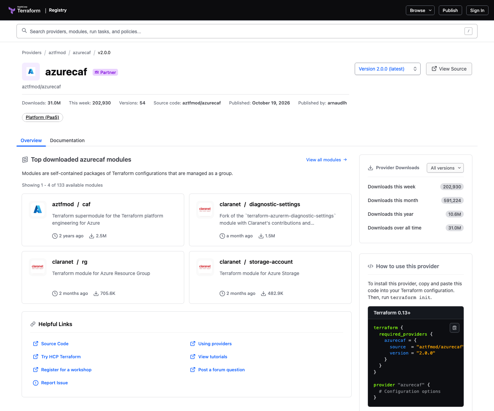
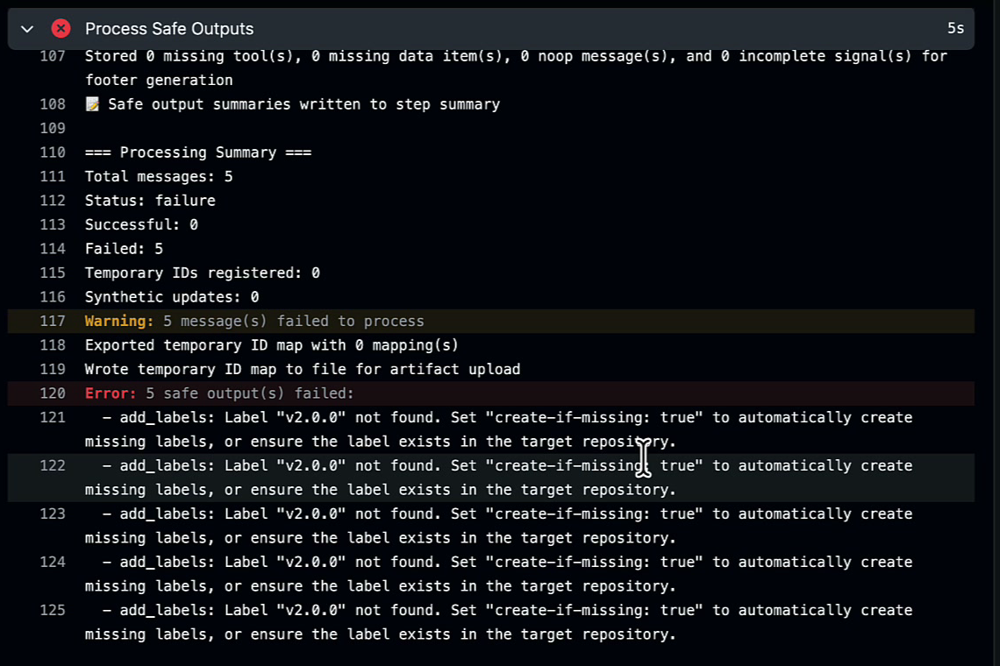

Before the 2.0 release, one Copilot-assisted update expanded AzureCAF's resource catalog by **22%**. The initial proposal was marked ready for review **43 minutes after assignment**; the reviewed change became available in a release about **11 days after the PR opened**.

<!-- truncate -->

Preparing AzureCAF 2.0.0, published on October 19, 2026, gave us a chance to improve the whole delivery process: discovering work, preparing changes, keeping maintainers informed, and getting a release out safely.

Testing was a particularly useful application of AI: we could expand the checks, investigate failures, and build release confidence over successive iterations.

The [provider](https://registry.terraform.io/providers/aztfmod/azurecaf/2.0.0) generates Azure resource names in Terraform. Its history gives us a practical case study in AI-assisted development, community contributions, and the maintainer time needed to bring them together.

## One repository connects the work

I use Copilot through the CLI, Visual Studio Code, and the desktop app for interactive work. The [cloud agent](https://docs.github.com/en/copilot/concepts/copilot-surfaces/copilot-on-github) handles delegated tasks, preparing changes in a cloud environment and bringing them back for review.

[GitHub Agentic Workflows](https://github.github.com/gh-aw/) runs recurring research and event-driven tasks. Findings, proposed changes, test results, and maintainer reports come back into the same repository.


*Shared issues, PRs, and checks connect the tools with maintainer decisions. Illustrations use [GitHub Octicons](https://github.com/primer/octicons); [editable diagram source](./agentic-repo-delivery.excalidraw).*

Before delegating, I want a clear task, an expected result, and a way to check it. A cloud agent can work on a bounded change while I investigate another problem locally. The PR becomes the handoff: a diff, supporting sources, and evidence from the checks. Release approval remains a maintainer decision.

Shared [repository skills](https://github.com/aztfmod/terraform-provider-azurecaf/tree/v2.0.0/.github/skills) give agents the research and testing procedures behind that handoff.

<details>
<summary>AzureCAF context: naming, usage, and the 2.0.0 changes</summary>

Back in 2021, I wrote about [my first contribution to AzureCAF](../2021-06-22-writing-your-first-contribution-to-caf-terraform-module/index.md): naming support for Azure Dedicated Hosts. As Azure added services, researching new entries and maintaining existing definitions became a growing part of our work.

The [AzureCAF provider](https://registry.terraform.io/providers/aztfmod/azurecaf/2.0.0) generates names using resource-specific Azure naming rules and CAF abbreviations. It handles differences in allowed characters, length, prefixes, suffixes, and random characters across a catalog of 520 definitions.

A shared Terraform naming module can also centralize rules, be versioned, and calculate names offline during planning. We use AzureCAF for its maintained catalog and the implementation and tests behind it. Teams can reuse that work across their Terraform configurations.

| Consideration | Naming inside each resource module | Shared naming module | AzureCAF provider |
| --- | --- | --- | --- |
| Rule ownership | Each module maintains its rules | One reusable module maintains the rules | One provider maintains a resource-specific catalog |
| Consistency | Depends on keeping implementations aligned | Shared implementation; callers select module versions | Shared implementation; Terraform resolves a compatible provider version |
| Azure constraints | Implement checks for the resource types you use | Implement and maintain the catalog your module supports | Reuse the catalog of 520 definitions and its existing checks |
| Planning without Azure access | Possible with pure HCL naming logic | Possible with pure HCL naming logic | Local name generation |
| Trade-off | Simple for a narrow convention; repeated logic needs coordination | Flexible, with naming logic and tests to maintain | Ready-made catalog; adds a provider dependency |

For modules with a fixed or specialized convention, accepting a caller-supplied name may be all you need. Global name availability still needs to be checked with Azure.

The Registry showed **31.0 million downloads** when I captured the page below on October 24, 2026. That count covers all published versions, repeat installations, and CI runs; one user may account for many downloads.



*Terraform Registry screenshot, October 24, 2026. Counts change over time.*

### What 2.0.0 gave us

After version 1.2.34, we had accumulated changes that could affect existing configurations:

- Removing the deprecated `azurecaf_naming_convention` resource in favor of `azurecaf_name`.
- Realigning 64 resource slugs with current CAF abbreviations.
- Adding 29 AzureRM naming definitions and removing three invalid or obsolete definitions, moving the catalog from 494 to 520 entries.
- Correcting Azure naming constraints for several resource types.
- Fixing seeded random generation to use the complete alphabet, which means a previously generated suffix can change.

An altered name can mean replacement of a real Azure resource in a Terraform plan. We developed the migration guide alongside the implementation so users could assess those changes before upgrading.

For v1, we chose a critical-fixes-only maintenance line that preserves existing naming behavior.

</details>

<details>
<summary>The building blocks: GitHub documentation and AzureCAF implementations</summary>

I started the release session with:

> Lets prepare for v2.0.0

The [repository skills](https://github.com/aztfmod/terraform-provider-azurecaf/tree/v2.0.0/.github/skills) gave Copilot procedures for researching naming rules, updating definitions, and testing changes.

For recurring work, we keep Markdown instructions alongside triggers, tools, and permissions, then compile them into `.lock.yml` workflows for GitHub Actions.

The [workflow guide](https://github.com/aztfmod/terraform-provider-azurecaf/blob/main/.github/README-workflows.md) documents the setup, including improvements made after 2.0.0.

The [GitHub Agentic Workflows quickstart](https://github.github.com/gh-aw/setup/quick-start/) walks through adding a recurring workflow to a repository. These references pair the general documentation with the files we use in AzureCAF:

| Building block | Documentation | AzureCAF implementation |
|---|---|---|
| Agent skills | [GitHub's guide to agent skills](https://docs.github.com/en/copilot/concepts/customizations/agent-skills) | [Naming research skill](https://github.com/aztfmod/terraform-provider-azurecaf/blob/main/.github/skills/azure-naming-research/SKILL.md) and [provider build/test skill](https://github.com/aztfmod/terraform-provider-azurecaf/blob/main/.github/skills/provider-build-test/SKILL.md) |
| Workflow structure and compilation | [How GitHub Agentic Workflows works](https://github.github.com/gh-aw/introduction/how-they-work/) | [Weekly Azure Sync Markdown source](https://github.com/aztfmod/terraform-provider-azurecaf/blob/main/.github/workflows/weekly-azure-sync.md) and its [compiled Actions workflow](https://github.com/aztfmod/terraform-provider-azurecaf/blob/main/.github/workflows/weekly-azure-sync.lock.yml) |
| Events, schedules, and filters | [Agentic workflow triggers](https://github.github.com/gh-aw/reference/triggers/) | [Issue-to-PR workflow](https://github.com/aztfmod/terraform-provider-azurecaf/blob/main/.github/workflows/issue-to-pr-agent.md), including the `new-resource` label filter |
| Permissions and controlled outputs | [Permissions](https://github.github.com/gh-aw/reference/permissions/) and [safe outputs](https://github.github.com/gh-aw/reference/safe-outputs/) | The [Issue-to-PR source](https://github.com/aztfmod/terraform-provider-azurecaf/blob/main/.github/workflows/issue-to-pr-agent.md) declares its tools, read permissions, and PR/comment outputs |
| Builds and scheduled tests | [GitHub Actions documentation](https://docs.github.com/en/actions) | [Provider CI and nightly regression](https://github.com/aztfmod/terraform-provider-azurecaf/blob/main/.github/workflows/go.yml) and [AzureRM mock validation](https://github.com/aztfmod/terraform-provider-azurecaf/blob/main/.github/workflows/mock-azurerm.yml) |
| Maintainer activity reports | [Agentic workflow quickstart](https://github.github.com/gh-aw/setup/quick-start/) | [Repo Status workflow](https://github.com/aztfmod/terraform-provider-azurecaf/blob/main/.github/workflows/daily-repo-status.md) |
| Code review and security | [Copilot code review](https://docs.github.com/en/copilot/concepts/agents/code-review) and [GitHub Advanced Security](https://docs.github.com/en/get-started/learning-about-github/about-github-advanced-security) | [CodeQL workflow](https://github.com/aztfmod/terraform-provider-azurecaf/blob/main/.github/workflows/codeql.yml) and [additional security checks](https://github.com/aztfmod/terraform-provider-azurecaf/blob/main/.github/workflows/security.yml) |

</details>

## Being proactive between releases

The [Weekly Azure Sync workflow](https://github.com/aztfmod/terraform-provider-azurecaf/blob/main/.github/workflows/weekly-azure-sync.md) compares our catalog with tracked AzureRM resources and investigates naming-guidance changes. [Issue Triage](https://github.com/aztfmod/terraform-provider-azurecaf/blob/main/.github/workflows/issue-triage-agent.md) and [Issue Arborist](https://github.com/aztfmod/terraform-provider-azurecaf/blob/main/.github/workflows/issue-arborist.md) help organize the resulting backlog.

Selected issues labeled `new-resource` can trigger the [Issue-to-PR workflow](https://github.com/aztfmod/terraform-provider-azurecaf/blob/main/.github/workflows/issue-to-pr-agent.md). It follows the [research procedure](https://github.com/aztfmod/terraform-provider-azurecaf/blob/main/.github/skills/azure-naming-research/SKILL.md), updates the [catalog](https://github.com/aztfmod/terraform-provider-azurecaf/blob/main/resourceDefinition.json), builds the provider, and proposes a PR with supporting sources.

An upstream change can become a research issue before a user reports a failure. Maintainers choose which findings deserve implementation. Each resulting PR should explain its sources, compatibility implications, and remaining uncertainty. Fresh upstream inputs and explicit reporting of incomplete checks are part of maintaining this loop.

### A briefing for the maintainer

The [Repo Status workflow](https://github.com/aztfmod/terraform-provider-azurecaf/blob/main/.github/workflows/daily-repo-status.md) gathers recent activity and recommends next steps. It helps me return to the project and decide what to review, investigate, or defer.

When maintenance competes with other commitments, I want a briefing I can act on: the changes awaiting review, the issues behind them, and the next decisions to make. Links to the underlying work let me check a recommendation before committing maintainer time.

Originally daily, it now covers the previous seven days on a weekly schedule. We adjusted the cadence alongside other [workflow improvements](https://github.com/aztfmod/terraform-provider-azurecaf/pull/936) to keep maintainer attention focused.

### Security stays in the review path

[GitHub Advanced Security](https://docs.github.com/en/get-started/learning-about-github/about-github-advanced-security) and other checks supply review evidence: [CodeQL](https://github.com/aztfmod/terraform-provider-azurecaf/blob/main/.github/workflows/codeql.yml) scans Go and Actions code; Dependabot security updates, secret scanning, and push protection are enabled. These controls cover agent-prepared changes too. Private-repository availability depends on the relevant GitHub security products.

## Where the time went

To understand where time was spent, I followed Copilot-opened changes from **draft PR to review-ready proposal, merge, and publication**. The table measures the pace through those stages, using the records available for each milestone.

| Measure | Median elapsed time | Sample |
|---|---|---|
| Draft PR opened to marked ready for review | **2h 35m** | 22 PRs with a readiness event |
| PR opened to merged | **4.53 days** | 14 merged PRs |
| Merge to first stable release containing the change | **3.98 days** | The same 14 merged PRs |
| PR opened to first stable release containing the change | **12.03 days** | The same 14 merged PRs |

The recorded proposals typically reached review in hours, while the merged changes reached publication in days. These are calendar times, including waiting between steps. The samples differ, so read each median independently.

The merged PRs in this sample shipped in earlier 1.x releases. Human-led, AI-assisted work, including the 2.0.0 preparation, sits outside this Copilot-author timing sample.

The [bulk update](https://github.com/aztfmod/terraform-provider-azurecaf/pull/481) behind the opening figures shows the work between those milestones. Review removed **16 invalid candidates** from the initial proposal. The final change added **89 definitions**, taking the catalog from 405 to 494, before publication about 11 days after PR creation.

The 2.0.0 [release PR](https://github.com/aztfmod/terraform-provider-azurecaf/pull/733) also closed **18 issues** with a median age of **497 days**, incorporating earlier community work and checking resolutions against the original reports.

Earlier unmarked merged PRs had a median **7.90 days** to publication across 99 PRs. Different tasks, periods, and release conditions make that an imperfect baseline. A causal comparison would need comparable work and recorded effort.

<details>
<summary>Timing definitions and additional case studies</summary>

The snapshot covers the [public PR history](https://github.com/aztfmod/terraform-provider-azurecaf/pulls) and [release records](https://github.com/aztfmod/terraform-provider-azurecaf/releases) through October 28, 2026. Of 32 Copilot-authored PRs, 14 merged and 18 closed without merging, including superseded or consolidated work. Readiness events were available for 22 PRs. Merge and release medians cover the 14 directly merged PRs; closed, unmerged proposals are excluded from those durations.

Each release is the first published, non-prerelease standard-semver tag containing the merged commit. The medians describe separate distributions and cannot be added together. The earlier unmarked group predates the first visible Copilot PR in May 2025; unrecorded AI assistance remains possible.

The individual timelines vary considerably:

| Change | Issue opened to first review-ready event | PR opened to stable release |
|---|---|---|
| [Azure Dev Center support](https://github.com/aztfmod/terraform-provider-azurecaf/pull/311) | **10m 20s** | **1h 46m** |
| [Dev Center regex correction](https://github.com/aztfmod/terraform-provider-azurecaf/pull/322) | **40m 54s** | **12.08 days** |
| [Bulk catalog expansion](https://github.com/aztfmod/terraform-provider-azurecaf/pull/481) | **1h 47m** | **10.98 days** |

There is a long tail too. The [Network Connection Monitor PR](https://github.com/aztfmod/terraform-provider-azurecaf/pull/357) was marked ready about 28 hours after opening and took approximately **183 days** to reach a release.

Earlier unmarked merged PRs had a median **1.34 days** to merge and **7.90 days** to publication across 99 PRs. That group predates the first visible Copilot PR in May 2025 and covers different work and release conditions. Some AI use may also be unrecorded. A causal speed comparison would need comparable tasks and a measure of the effort involved.

</details>

## Building release confidence over time

Testing was one of the clearest benefits of working with Copilot. The [Copilot-coauthored testing work](https://github.com/aztfmod/terraform-provider-azurecaf/pull/305) added edge cases and integration checks. Re-running historical provider tests shows statement coverage rising from **82.5%** at the earlier baseline to **95.6%** in 2.0.0, while named Go test functions grew from **33 to 124**.

My confidence built gradually. Reviews and test runs exposed names changing unexpectedly, inputs unavailable during planning, and invalid test fixtures. We investigated each failure, added regression checks, and reran the release gates. That repeated cycle made me more comfortable publishing the release.

The final release evidence included **445 passing AzureRM mock workspaces**, plus lifecycle and packaging checks. AI helped us expand and exercise those checks; their results supported the decision to release.

<details>
<summary>A runnable AzureRM mock-provider example and the local maintenance commands</summary>

### Historical testing checkpoints

I reproduced provider-package coverage on isolated historical checkouts using the same `go test` command and Go 1.27.3:

| Checkpoint | Statement coverage | Named provider test functions |
|---|---|---|
| Before the testing expansion | 82.5% | 33 |
| After the [Copilot-coauthored expansion](https://github.com/aztfmod/terraform-provider-azurecaf/pull/305) | 99.3% | 61 |
| v2.0.0 | 95.6% | 124 |

The implementation changed between snapshots: the coverage denominators were 263, 270, and 321 executable statements. The v2 default run passed 117 top-level tests and skipped seven. These counts describe test functions and exercised statements; measuring production reliability would require defect or incident data. Human contributions and production-code changes are part of the comparison.

### AzureRM mock-provider example

A regex test derived from our own catalog can reproduce an error in that catalog, so we also check generated names against AzureRM's configuration validation and exercise the provider lifecycle.

For 2.0.0, the AzureRM v5.0.1 mock sweep covered 445 matching definitions from the 520-entry catalog. The other entries were aliases, non-AzureRM types, or absent from that provider version. All 445 workspaces eventually passed their generated scenarios. Provider-package statement coverage reached 95.6%.

Terraform's [`mock_provider`](https://developer.hashicorp.com/terraform/language/tests/mocking) made that possible without Azure credentials. **AzureCAF stayed real; AzureRM was mocked.** The mock forwards configuration validation to AzureRM and simulates its planning and apply behavior. AzureRM's real `CustomizeDiff` hooks, Azure API behavior, and global name availability sit outside the scope of this check.

Lifecycle tests check that a generated name stays stable across creation, subsequent applies, and planning. Testing the published package separately from the local development build also helps us check the delivery path.

Live Azure acceptance and deployment behavior require their own integration checks.

Here is a reduced, runnable example using the released providers. It requires Terraform 1.7 or later. I added the override variable to demonstrate the negative control below.

```hcl
# main.tf
terraform {
  required_version = ">= 1.7.0"

  required_providers {
    azurecaf = {
      source  = "aztfmod/azurecaf"
      version = "= 2.0.0"
    }
    azurerm = {
      source  = "hashicorp/azurerm"
      version = "= 5.0.1"
    }
  }
}

provider "azurecaf" {}

provider "azurerm" {
  features {}
  subscription_id = "00000000-0000-0000-0000-000000000000"
}

variable "azurerm_name_override" {
  type    = string
  default = null
}

resource "azurecaf_name" "example" {
  name          = "myproject"
  resource_type = "azurerm_resource_group"
  prefixes      = ["prod"]
  clean_input   = true
}

resource "azurerm_resource_group" "example" {
  name     = coalesce(var.azurerm_name_override, azurecaf_name.example.result)
  location = "westeurope"
}

output "result" {
  value = azurecaf_name.example.result
}
```

```hcl
# tests/validate.tftest.hcl
mock_provider "azurerm" {}

run "validate_generated_name" {
  command = apply

  assert {
    condition     = output.result != ""
    error_message = "AzureCAF returned an empty name."
  }

  assert {
    condition     = length(output.result) >= 1 && length(output.result) <= 90
    error_message = "The resource group name must contain 1 to 90 characters."
  }

  assert {
    condition     = can(regex("^[a-zA-Z0-9-._\\(\\)]{0,89}[a-zA-Z0-9-_\\(\\)]$", output.result))
    error_message = "The name does not match the CAF resource group definition."
  }

  assert {
    condition     = azurerm_resource_group.example.name == azurecaf_name.example.result
    error_message = "The AzureRM resource name must match the AzureCAF result."
  }
}

run "second_apply" {
  command = apply

  assert {
    condition     = output.result == run.validate_generated_name.result
    error_message = "The generated name changed on the second apply."
  }
}

run "replan" {
  command = plan

  assert {
    condition     = output.result == run.validate_generated_name.result
    error_message = "The generated name changed during the next plan."
  }
}
```

The later runs reuse the test file's state and check the name after a second apply and another plan. These assertions cover name stability within the mock test. Verifying a real Azure deployment's lifecycle requires a live integration test.

Run the example in a fresh directory with the following CLI configuration. Direct Registry installation isolates this check from local development overrides and implicit filesystem mirrors:

```hcl
# registry.tfrc
provider_installation {
  direct {}
}
```

```bash
TF_CLI_CONFIG_FILE="$PWD/registry.tfrc" terraform init
TF_CLI_CONFIG_FILE="$PWD/registry.tfrc" \
  terraform test -filter=tests/validate.tftest.hcl -verbose
```

For a negative control, pass an invalid name directly to the AzureRM resource:

```bash
TF_CLI_CONFIG_FILE="$PWD/registry.tfrc" \
  TF_VAR_azurerm_name_override='invalid!name' \
  terraform test -filter=tests/validate.tftest.hcl
```

This command should fail with an AzureRM name-validation diagnostic. That failure confirms AzureRM's configuration validation is active in the test.

### Testing the provider we were actually changing

The [release harness](https://github.com/aztfmod/terraform-provider-azurecaf/tree/v2.0.0/scripts/mock-test) tested the AzureCAF binary built from our changes. Each generated workspace had a CLI configuration like this, using an absolute directory containing `terraform-provider-azurecaf`:

```hcl
# terraform.rc
provider_installation {
  dev_overrides {
    "aztfmod/azurecaf" = "/absolute/path/to/local-provider-build"
  }
  direct {}
}
```

The runner isolated provider installation during `terraform init`, then verified and activated the local override for `terraform test`. In the provider repository, these targets perform the build, setup, generation, and execution:

```bash
make test_mock_azurerm_changed
make test_mock_azurerm_all
```

The generator supplies default, prefixed, and seeded-random naming variations, plus the other arguments needed for each resource's configuration validation. The results apply to those fixtures and the provider version used.

</details>

## Keep the automation worth running

The [no-op tracker](https://github.com/aztfmod/terraform-provider-azurecaf/issues/588) recorded **401 reports from distinct runs** between June 11 and September 9, 2026; **251 came from Issue-to-PR**. Some explicitly reported unrelated labels. Clean health checks can be useful; those irrelevant event-triggered runs showed where filtering needed attention.

We used that feedback to refine the process. After the release, [aztfmod/terraform-provider-azurecaf#936](https://github.com/aztfmod/terraform-provider-azurecaf/pull/936) moved predictable test jobs into ordinary scheduled Actions and tightened agent triggers or reduced their frequency.

Agents remain useful for research, interpretation, and proposed changes. Their schedules and outputs need the same attention as other automation. The tracker measures activity; financial cost would require billing data.

<details>
<summary>One release incident that exposed the difference between instructions and controls</summary>

The first Release Labeler run failed on a missing `v2.0.0` label. Its instructions assumed the tool could create labels; the safe-output configuration required them to exist already. Applying release labels also started unrelated issue-agent runs because their label check happened after activation.

This excerpt from the Issue-to-PR workflow's frontmatter shows the label filter before agent activation and the permitted PR output. The full source also configures the agent's tools and permissions:

```yaml
on:
  issues:
    types: [labeled]
    names: [new-resource]

safe-outputs:
  create-pull-request:
    title-prefix: "[auto] "
    labels: [automated, new-resource]
```

The task description, trigger, and permitted outputs all need to agree.



*A frame from the release recording showing the failure at the safe-output step.*

[aztfmod/terraform-provider-azurecaf#929](https://github.com/aztfmod/terraform-provider-azurecaf/pull/929) subsequently tightened the triggers, output configuration, release metadata checks, and failure propagation. We now have additional checks for how the automation starts, applies outputs, and reports failures.

</details>

## Turning capacity into outcomes

A researched proposal gives me useful preparation capacity. A richer test suite gives me more evidence for review. Both help, and both still need maintainer time, prioritization, and a path to release. The timestamps show the elapsed time; understanding each delay takes further investigation.

I would read enterprise AI productivity figures the same way. More prepared changes can increase the queue at an already-busy review or integration stage. Realizing the benefit also depends on approvals, rollout windows, and adoption by users.

For engineering leaders, I would follow three measures together:

- **Preparation:** time to a review-ready change, including the rework needed to make it acceptable.
- **Delivery:** time through review, integration, and release, with attention to growing queues.
- **Outcomes:** whether users adopt the change and receive the intended benefit.

In AzureCAF, publication is the milestone we can observe. User adoption and production reliability would need their own evidence.

If changes wait for review, the next improvement might be clearer PR evidence, smaller changes, or protected reviewer time. If they wait after merge, look at release preparation and rollout constraints. Tracking the handoffs helps a team choose an investment that can move delivery forward.

<details>
<summary>Trying 2.0.0: installation and migration examples</summary>

For a new configuration, this example uses the [`azurecaf_name` data source](https://registry.terraform.io/providers/aztfmod/azurecaf/2.0.0/docs/data-sources/azurecaf_name) without any Azure deployment:

```hcl
terraform {
  required_providers {
    azurecaf = {
      source  = "aztfmod/azurecaf"
      version = "~> 2.0"
    }
  }
}

data "azurecaf_name" "example" {
  name          = "myproject"
  resource_type = "azurerm_resource_group"
  prefixes      = ["prod"]
  suffixes      = ["001"]
}

output "resource_group_name" {
  value = data.azurecaf_name.example.result
}
```

`~> 2.0` allows compatible 2.x releases; use `= 2.0.0` to reproduce that exact version.

For an existing configuration, read the [v2.0.0 migration guide](https://github.com/aztfmod/terraform-provider-azurecaf/blob/v2.0.0/docs/migration-v2.md) **before upgrading**. Migrate `azurecaf_naming_convention` while still on v1.x, record existing names, and review the complete plan. The [`azurecaf_name` resource](https://registry.terraform.io/providers/aztfmod/azurecaf/2.0.0/docs/resources/azurecaf_name) supports passthrough mode when you need to retain an existing name:

```hcl
resource "azurecaf_name" "current" {
  name          = "stdevmyapp001"
  resource_type = "azurerm_storage_account"
  passthrough   = true
}
```

Complete the guide's import and reference-update steps to migrate the old state before removing the legacy resource.

</details>

## Now it's your turn

Start with one recurring maintenance task, give it a clear output and owner, and follow it through review and release. Leave the useful checks and procedures in the repository for the next run. Then use the delivery data to decide where to spend the next hour.

The [AzureCAF workflows](https://github.com/aztfmod/terraform-provider-azurecaf/tree/main/.github/workflows) and [release notes](https://github.com/aztfmod/terraform-provider-azurecaf/releases/tag/v2.0.0) are public. Happy to hear what you find!

Thanks,

Arnaud
