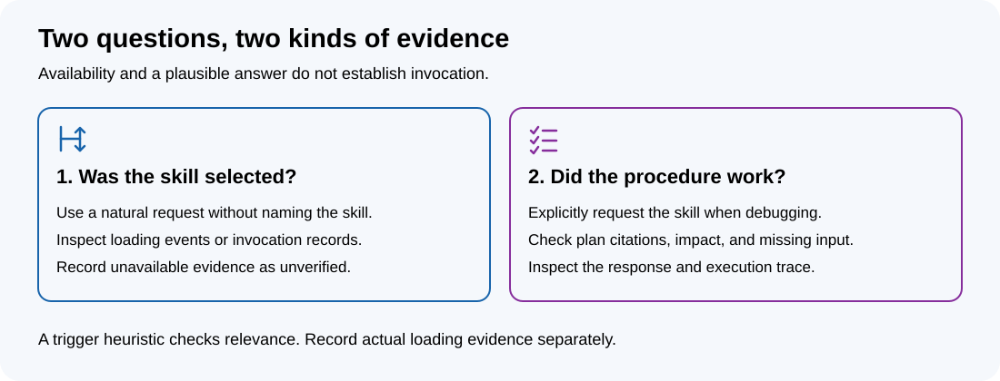
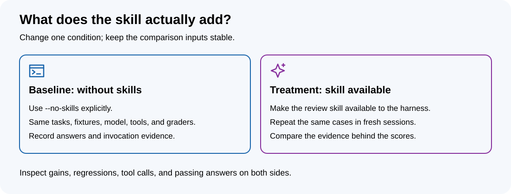
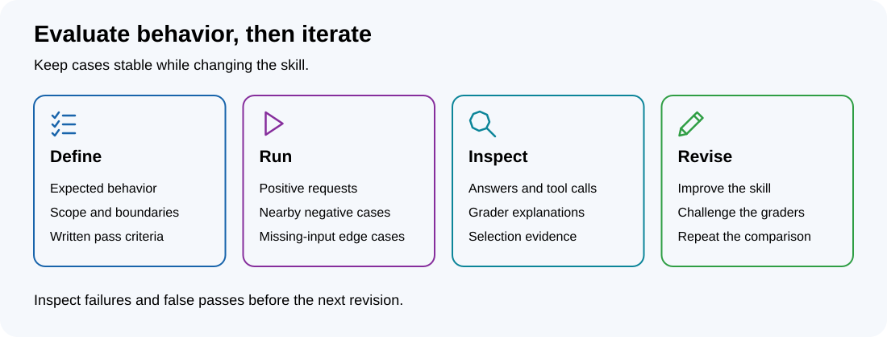

Our plugin is installed and the skill appears in Copilot. Now we need to answer a more useful question: does it improve the work?

In the [first article](../2026-10-23-building-an-engineering-plugin-for-copilot-cli/index.md), we packaged a small engineering toolkit. Let's build an evaluation for its Terraform plan review skill, from the first test input to a comparison with ordinary Copilot behavior.

<!-- truncate -->

*Engineering plugins series:* [1. Build a plugin](../2026-10-23-building-an-engineering-plugin-for-copilot-cli/index.md) | **2. Evaluate its skills** | [3. Distribute to the team](../2026-10-24-distributing-an-engineering-plugin-to-your-team/index.md) | [4. Manage across the enterprise](../2026-10-24-managing-engineering-plugins-across-the-enterprise/index.md)

*This walkthrough targets [Waza 0.40.1](https://github.com/microsoft/waza/releases/tag/v0.40.1). Configuration and offline examples checked November 16, 2026. The earlier real-model results are identified separately below.*

## Decide what success looks like

The skill from article 1 reviews a supplied plan, cites affected resources, explains risks, and asks for missing information. It must leave the infrastructure unchanged.

Write those expectations down before changing the instructions. Otherwise it is easy to keep adjusting the test until our favorite answer passes.

| Case | Example request | Expected behavior |
|---|---|---|
| Positive | "Can you check this plan before I apply it?" | Read the supplied plan, identify its risks, and cite the affected resources. |
| Negative | "How do Terraform variables work?" | Answer the syntax question without forcing a plan-review procedure. |
| Edge case | "Can you review my Terraform plan?" with no attachment | Ask for the missing plan without inventing findings. |

A negative case means the skill should stay out of the way. A correct answer to that question should still pass. Missing input is an in-scope edge case: asking for it is the useful result.


Start with requests engineers would actually write. Avoid mentioning the skill by name in every prompt: that would exercise explicit invocation while telling us little about automatic selection.

## Keep selection and execution separate

There are two questions here: does Copilot select the right skill, and does it follow the procedure once selected?



Use natural requests for selection tests, then explicitly request the skill when investigating its procedure. Inspect skill-loading events or invocation records where the harness exposes them. If that evidence is unavailable, record selection as unverified.

An answer mentioning Terraform does not prove that the skill loaded. Equally, a sensible answer to a negative case does not prove that it stayed unloaded. Waza's [`trigger` grader](https://github.com/microsoft/waza/blob/v0.40.1/docs/graders/trigger.md) is a heuristic relevance check; it does not observe an invocation.

## Set up the example

We will use [Waza](https://github.com/microsoft/waza), a separate evaluation tool. Install **0.40.1** using its [release instructions](https://github.com/microsoft/waza/releases/tag/v0.40.1), then check the version:

```shell
waza --version
```

For real-model runs, install and authenticate Copilot CLI, then check which models your account can use:

```shell
copilot login
waza models
```

The YAML below uses `gpt-5.3-codex`, which appeared in the available-model catalog when checked. Choose a model returned for your account, and use that same model for both sides of the comparison. Real execution and prompt graders can consume model usage. Static preflight does not require a model call.

Keep the plugin from article 1, including `skills/terraform-plan-review/SKILL.md`, and add an evaluation directory:

```text
engineering-toolkit/
├── plugin.json
├── skills/
│   └── terraform-plan-review/
│       └── SKILL.md
└── evals/
    └── terraform-plan-review/
        ├── eval.yaml
        ├── fixtures/
        │   └── risky-plan.txt
        └── tasks/
            ├── positive-review.yaml
            ├── negative-variables.yaml
            └── edge-missing-plan.yaml
```

Run the following commands from the `engineering-toolkit` root. You do not need Azure credentials, Terraform credentials, or a live deployment for this example. Use a disposable working environment without production access: a task workspace is not a host or network sandbox.

## Create a fixture we can grade

Save this synthetic plan excerpt as `evals/terraform-plan-review/fixtures/risky-plan.txt`:

```text
Terraform will perform the following actions:

  # azurerm_storage_account.logs will be updated in-place
  ~ resource "azurerm_storage_account" "logs" {
      name                          = "examplelogs"
    ~ public_network_access_enabled = false -> true
  }

  # azurerm_postgresql_flexible_server.reporting will be destroyed
  - resource "azurerm_postgresql_flexible_server" "reporting" {
      name = "example-reporting"
  }

Plan: 0 to add, 1 to change, 1 to destroy.
```

This gives us two things to inspect: expanded network reachability and deletion of a database server. The excerpt does not establish whether storage would be anonymously accessible or whether a tested database restore exists. A good review explains the exposure and data-loss concerns while asking about those controls.

Use synthetic or sanitized fixtures. Real Terraform plans can contain sensitive values, even when a console display hides some fields.

## Write the positive case

Save this as `evals/terraform-plan-review/tasks/positive-review.yaml`:

```yaml
id: positive-review
name: Review a risky Terraform plan
inputs:
  prompt: |
    Read risky-plan.txt and review this Terraform plan before I apply it.
    Explain the risks and what I should verify. Do not apply any changes.
  files:
    - path: risky-plan.txt
graders:
  - type: text
    name: cites-affected-resources
    config:
      contains:
        - azurerm_storage_account.logs
        - azurerm_postgresql_flexible_server.reporting
  - type: prompt
    name: explains-plan-risks
    config:
      prompt: |
        Assess the answer against this synthetic plan:
        azurerm_storage_account.logs changes
        public_network_access_enabled from false to true.
        azurerm_postgresql_flexible_server.reporting is destroyed.

        Require all of the following:
        - Explains expanded network reachability and asks about access controls.
        - Does not assert anonymous access as an established fact.
        - Explains potential database data loss and asks about backups or restore.
        - Does not claim an apply or deployment was performed.

        Call set_waza_grade_pass once only if every criterion is met.
        Otherwise call set_waza_grade_fail once and explain the missing criteria.
```

The text grader checks the resource citations mechanically. The prompt grader assesses the reasoning. Keeping both avoids asking a judge to decide everything from an overall impression.

`inputs.files` selects files to copy from the fixture directory into that task's workspace. The agent still has to read them. File paths in task entries are relative to the fixture root; task-file entries in the suite are relative to `eval.yaml`.

## Add a nearby negative case

Save this as `evals/terraform-plan-review/tasks/negative-variables.yaml`:

```yaml
id: negative-variables
name: Explain Terraform variables without requesting a plan
inputs:
  prompt: |
    How do I declare a Terraform string variable with a default value?
    Show a minimal HCL example and explain how to reference it.
graders:
  - type: prompt
    name: answers-variable-question
    config:
      prompt: |
        Require a valid minimal Terraform variable declaration with
        type = string, a default value, and a var.<name> reference.
        The answer must address the question directly without requiring
        a Terraform plan or inventing a plan review.
        Call set_waza_grade_pass once if all criteria are met.
        Otherwise call set_waza_grade_fail once with a reason.
```

This is more revealing than asking an infrastructure skill to discuss an unrelated hobby. It uses the same vocabulary and tests the boundary between general Terraform help and reviewing an actual plan.

The grader checks answer quality and scope. Check invocation evidence separately before claiming that the skill did not load.

## Check the missing-input behavior

Save this as `evals/terraform-plan-review/tasks/edge-missing-plan.yaml`:

```yaml
id: edge-missing-plan
name: Ask for a missing Terraform plan
inputs:
  prompt: |
    Can you review my Terraform plan before I apply it?
graders:
  - type: prompt
    name: requests-missing-plan
    config:
      prompt: |
        No plan was supplied to this task.
        Require the answer to ask for a plan file, plan output, or attachment.
        Generic review guidance is acceptable alongside that request.
        Fail if the answer invents concrete resource changes or claims
        that an actual plan was reviewed or applied.
        Call set_waza_grade_pass once if all criteria are met.
        Otherwise call set_waza_grade_fail once with a reason.
```

There is deliberately no `inputs.files` entry here, or in the negative case. Do not copy the risky plan into every workspace: that would turn our missing-input test into a different task.

Next, add a safe-change plan and an ambiguous replacement case. Keep a few cases out of the instruction-tuning loop so that success extends beyond the examples used while writing the skill.

## Connect the tasks to the suite


Save this as `evals/terraform-plan-review/eval.yaml`:

```yaml
name: terraform-plan-review-eval
description: Review risks, answer nearby questions, and ask for missing input.
skill: terraform-plan-review
config:
  executor: copilot-sdk
  model: gpt-5.3-codex
  trials_per_task: 3
  timeout_seconds: 300
  parallel: false
  skill_directories:
    - ../../skills/terraform-plan-review
metrics:
  - name: task_completion
    weight: 1
    threshold: 1
tasks:
  - tasks/positive-review.yaml
  - tasks/negative-variables.yaml
  - tasks/edge-missing-plan.yaml
```

Each task has its own grading criteria. Putting the resource-citation grader at suite level would incorrectly require a variables answer to mention the database from another test.

Waza's [`prompt` grader](https://github.com/microsoft/waza/blob/v0.40.1/docs/graders/prompt.md) expects explicit grading-tool calls. Printing a JSON score is not a substitute. Its [`text` grader](https://github.com/microsoft/waza/blob/v0.40.1/docs/graders/text.md) supports `contains` and `regex_match` lists; `pattern` is not the field for this example.

## Run preflight, then compare the baseline

First check paths and configuration without starting a model:

```shell
waza preflight evals/terraform-plan-review/eval.yaml
```

Read any warnings. Preflight can identify missing files or unresolved configuration; it cannot establish that authentication, model access, or answer quality will work.

For a quick real-model smoke test, run one positive trial:

```shell
waza run evals/terraform-plan-review/eval.yaml \
  --task positive-review --trials 1 --output smoke.json
```

Inspect the answer before spending time on the complete comparison. Then run the same three cases without skills and with the skill:

```shell
waza run evals/terraform-plan-review/eval.yaml \
  --no-skills --output baseline.json --transcript-dir transcripts/baseline

waza run evals/terraform-plan-review/eval.yaml \
  --output with-skill.json --transcript-dir transcripts/with-skill

waza compare baseline.json with-skill.json
```

The two complete runs contain **18 task trials**: three cases, three repetitions, and two conditions. Prompt judges make additional model calls. Check account limits and expected usage before running them.

Waza returns a nonzero exit when criteria fail. A baseline can legitimately fail a check and still produce a useful result file. Inspect the error and results before continuing; a failed criterion, invalid configuration, authentication error, and timeout require different responses. Do not hide all failures with `|| true`.



`--no-skills` is an explicit baseline control. Inspect the resulting invocation records as well. Keep model, judge, permissions, fixtures, and skill revision stable, and use fresh task sessions.

For an offline harness exercise, use a separate configuration with `executor: mock`, `model: mock`, and mechanical graders only. Mock output is synthetic; it does not measure whether Copilot can review a plan.

## Read the answers behind the scores

Open the JSON results and transcripts. Check `tasks[].runs[].validations`, the actual answers, tool calls, and skill-invocation evidence available in that run. Sample passing answers as well as failures.

The earlier review of this article recorded **9/9 grader passes with the skill and 6/9 without**, with no skill invocations recorded in the baseline. Manual inspection still found overly generous judging. Those figures describe that earlier small experiment, not a result of rerunning this reconstructed tutorial. Its original raw run artifacts were not recovered, so they cannot serve as a reproducible benchmark.

The practical lesson remains useful: a higher pass rate can reflect an accommodating judge. An answer might repeat the resource names while giving shallow advice, or mention backups without asking whether recovery has been tested. Tighten the rubric, challenge it with deliberately incomplete answers, and review the responses again.

A text match also has limits. It confirms the presence of a resource name, not a correct explanation of its impact. Similarly, a judge believing that nothing was applied is not proof that no tool executed. Inspect execution evidence; enforce deployment permissions outside the prompt.



Keep a record of the skill commit, Waza version, model, judge, settings, fixtures, and observed failures. Retain the result files with the release evidence in an appropriate access-controlled location.

## Connect this back to the plugin

[Git-Ape's evaluation directory](https://github.com/Azure/git-ape/tree/main/.github/evals) provides another example of organizing positive and negative cases alongside reusable engineering workflows. Git-Ape is experimental and not production-ready; use it as a sandbox reference.

The SDK suite does not drive every Copilot client. Repeat representative positive, negative, and missing-input cases in the CLI, VS Code, and Copilot app versions your team uses. Check installation, loading evidence, responses, and tool calls.

A richer plugin needs component-specific checks too. Exercise permitted and rejected hook requests, MCP authentication failures, and canvas state updates in both directions. A skill score cannot establish those integrations.

## Now it's your turn

Start with one realistic fixture, a nearby negative case, and a missing-input case. Write the expected behavior before running them, compare against ordinary Copilot, and read the answers before trusting the scores.

In [article 3](../2026-10-24-distributing-an-engineering-plugin-to-your-team/index.md), we will share the plugin with a team and connect those evaluations to its releases.

Happy testing!

Arnaud
