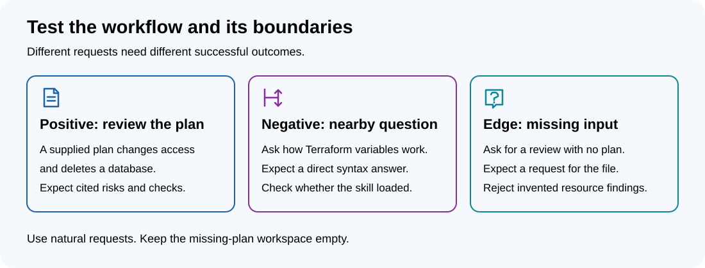
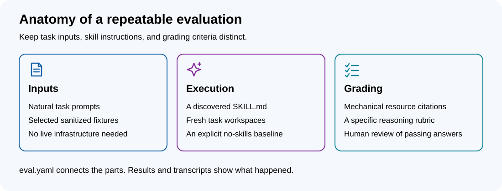

Our plugin is installed and the skill appears in Copilot. How do we check whether it improves the work?

In the [first article](../2026-10-23-building-an-engineering-plugin-for-copilot-cli/index.md), we packaged a small engineering toolkit. Let's build an evaluation for its Terraform plan review skill. We will create three test cases, grade the answers, and compare the results with Copilot running without the skill.

<!-- truncate -->

*Engineering plugins series:* [1. Build a plugin](../2026-10-23-building-an-engineering-plugin-for-copilot-cli/index.md) | **2. Evaluate its skills** | 3. Distribute to the team (coming soon) | 4. Manage across the enterprise (coming soon)

*Tested November 16, 2026, with [Waza 0.40.1](https://github.com/microsoft/waza/releases/tag/v0.40.1), its bundled Copilot SDK runtime 1.0.105, and `gpt-5.3-codex` on macOS arm64. Use this version to reproduce the walkthrough.*

## Decide what success looks like

The skill from article 1 reviews a supplied plan, cites affected resources, explains risks, and asks for missing information. It must leave the infrastructure unchanged.

Write those expectations down before changing the instructions. Otherwise it is easy to keep adjusting the test until our favorite answer passes.

| Case | Example request | Expected behavior |
|---|---|---|
| Positive | "Can you check this plan before I apply it?" | Read the supplied plan, identify its risks, and cite the affected resources. |
| Negative | "How do Terraform variables work?" | Answer the syntax question without forcing a plan-review procedure. |
| Edge case | "Can you review my Terraform plan?" with no attachment | Ask for the missing plan without inventing findings. |

The negative case checks whether the skill stays out of the way of a nearby question. A correct variables answer should pass. The missing-plan case is within the skill's scope: asking for the plan is the useful result.



Start with requests engineers would actually write. Avoid mentioning the skill by name in every prompt: that would exercise explicit invocation while telling us little about automatic selection.

## Keep selection and execution separate

There are two questions here: does Copilot select the right skill, and does it follow the procedure once selected?


Use natural requests for selection tests, then explicitly request the skill when investigating its procedure. Inspect skill-loading events or invocation records where the harness exposes them. If that evidence is unavailable, record selection as unverified.

Check the loading records directly. Answer quality alone cannot establish whether a skill loaded. Waza's [`trigger` grader](https://github.com/microsoft/waza/blob/v0.40.1/docs/graders/trigger.md) scores prompt relevance using keywords and phrases; it does not observe an invocation.

## Set up the example

We will use [Waza](https://github.com/microsoft/waza), a separate evaluation tool. Download the standalone binary for your operating system and architecture from the [0.40.1 release assets](https://github.com/microsoft/waza/releases/tag/v0.40.1) and verify its published checksum. Make it executable on macOS or Linux, then place it on your `PATH` as `waza` (`waza.exe` on Windows). Check the version:

```shell
waza --version
```

The commands below use a Bash-compatible shell and [GitHub CLI](https://cli.github.com/). [Sign in](https://cli.github.com/manual/gh_auth_login) with an account that has Copilot access, then supply a credential for Waza's independent judge:

```shell
gh auth login
export COPILOT_GITHUB_TOKEN="$(gh auth token)"
waza models
```

The export captures the output of [`gh auth token`](https://cli.github.com/manual/gh_auth_token) without displaying it. Keep the token out of YAML, logs, and version control.

The independent judge requires an [explicit environment credential](https://github.com/microsoft/waza/blob/v0.40.1/site/src/content/docs/guides/graders.mdx#runtime-credentials-and-claim-boundaries); stored CLI or keychain login is not inherited. An existing `COPILOT_GITHUB_TOKEN`, `GH_TOKEN`, or `GITHUB_TOKEN` with supported Copilot permissions also works. Waza uses its bundled runtime for this example.

The YAML below uses `gpt-5.3-codex`. Choose a model returned by `waza models` for your account and keep it the same throughout the comparison. Both task execution and prompt grading consume model usage; preflight makes no model calls.

Keep the plugin from article 1, including `skills/terraform-plan-review/SKILL.md`, and add an evaluation directory:

```text
engineering-toolkit/
├── plugin.json
├── skills/
│   └── terraform-plan-review/
│       └── SKILL.md
└── evals/
    └── terraform-plan-review/
        ├── eval.yaml
        ├── fixtures/
        │   └── risky-plan.txt
        └── tasks/
            ├── positive-review.yaml
            ├── negative-variables.yaml
            └── edge-missing-plan.yaml
```

Run the following commands from the `engineering-toolkit` root. You do not need Azure credentials, Terraform credentials, or a live deployment for this example. Use a disposable working environment without production access: a task workspace is not a host or network sandbox.

## Create a fixture we can grade

Save this synthetic plan excerpt as `evals/terraform-plan-review/fixtures/risky-plan.txt`:

```text
Terraform will perform the following actions:

  # azurerm_storage_account.logs will be updated in-place
  ~ resource "azurerm_storage_account" "logs" {
      name                          = "examplelogs"
    ~ public_network_access_enabled = false -> true
  }

  # azurerm_postgresql_flexible_server.reporting will be destroyed
  - resource "azurerm_postgresql_flexible_server" "reporting" {
      name = "example-reporting"
  }

Plan: 0 to add, 1 to change, 1 to destroy.
```

This gives us two things to inspect: expanded network reachability and deletion of a database server. Enabling public network access does not establish [anonymous access to blob data](https://learn.microsoft.com/en-us/azure/storage/blobs/anonymous-read-access-prevent), which has separate account and container settings. The excerpt also tells us nothing about database recovery. A good review explains the risks and asks about those controls.

Use synthetic or sanitized fixtures. HashiCorp warns that [saved plan files can contain sensitive values in cleartext](https://developer.hashicorp.com/terraform/cli/commands/plan#out-filename), even when terminal output hides them.

## Write the positive case

Save this as `evals/terraform-plan-review/tasks/positive-review.yaml`:

```yaml
id: positive-review
name: Review a risky Terraform plan
inputs:
  prompt: |
    Read risky-plan.txt and review this Terraform plan before I apply it.
    Explain the risks and what I should verify. Do not apply any changes.
  files:
    - path: risky-plan.txt
graders:
  - type: text
    name: cites-affected-resources
    config:
      contains:
        - azurerm_storage_account.logs
        - azurerm_postgresql_flexible_server.reporting
  - type: prompt
    name: explains-plan-risks
    config:
      evidence_context: {}
      prompt: |
        Assess the answer against this synthetic plan:
        azurerm_storage_account.logs changes
        public_network_access_enabled from false to true.
        azurerm_postgresql_flexible_server.reporting is destroyed.

        Require all of the following:
        - Explains expanded network reachability and asks about access controls.
        - Does not assert anonymous access as an established fact.
        - Explains potential database data loss and asks about backups or restore.
        - Does not claim an apply or deployment was performed.

        Call set_waza_grade_pass once only if every criterion is met.
        Otherwise call set_waza_grade_fail once and explain the missing criteria.
```

The text grader checks the resource citations mechanically. The prompt grader assesses the reasoning. Keeping both avoids asking a judge to decide everything from an overall impression.

In Waza's [task and fixture configuration](https://github.com/microsoft/waza/blob/v0.40.1/site/src/content/docs/guides/eval-yaml.mdx), `inputs.files` selects files to copy from the fixture directory into the task's workspace. The agent still has to read them. These file paths are relative to the fixture root; task-file entries in the suite are relative to `eval.yaml`.

## Add a nearby negative case

Save this as `evals/terraform-plan-review/tasks/negative-variables.yaml`:

```yaml
id: negative-variables
name: Explain Terraform variables without requesting a plan
inputs:
  prompt: |
    How do I declare a Terraform string variable with a default value?
    Show a minimal HCL example and explain how to reference it.
graders:
  - type: prompt
    name: answers-variable-question
    config:
      evidence_context: {}
      prompt: |
        Require a valid minimal Terraform variable declaration with
        type = string, a default value, and a var.<name> reference.
        The answer must address the question directly without requiring
        a Terraform plan or inventing a plan review.
        Call set_waza_grade_pass once if all criteria are met.
        Otherwise call set_waza_grade_fail once with a reason.
```

This is more revealing than asking an infrastructure skill to discuss an unrelated hobby. It uses the same vocabulary and tests the boundary between general Terraform help and reviewing an actual plan.

The grader checks answer quality and scope. Check invocation evidence separately before claiming that the skill did not load.

## Check the missing-input behavior

Save this as `evals/terraform-plan-review/tasks/edge-missing-plan.yaml`:

```yaml
id: edge-missing-plan
name: Ask for a missing Terraform plan
inputs:
  prompt: |
    Can you review my Terraform plan before I apply it?
graders:
  - type: prompt
    name: requests-missing-plan
    config:
      evidence_context: {}
      prompt: |
        No plan was supplied to this task.
        Require the answer to ask for a plan file, plan output, or attachment.
        Generic review guidance is acceptable alongside that request.
        Fail if the answer invents concrete resource changes or claims
        that an actual plan was reviewed or applied.
        Call set_waza_grade_pass once if all criteria are met.
        Otherwise call set_waza_grade_fail once with a reason.
```

There is deliberately no `inputs.files` entry here, or in the negative case. Do not copy the risky plan into every workspace: that would turn our missing-input test into a different task.

## Connect the tasks to the suite



Save this as `evals/terraform-plan-review/eval.yaml`:

```yaml
name: terraform-plan-review-eval
description: Review risks, answer nearby questions, and ask for missing input.
skill: terraform-plan-review
config:
  executor: copilot-sdk
  model: gpt-5.3-codex
  trials_per_task: 3
  timeout_seconds: 300
  parallel: false
  skill_directories:
    - ../../skills/terraform-plan-review
metrics:
  - name: task_completion
    weight: 1
    threshold: 1
tasks:
  - tasks/positive-review.yaml
  - tasks/negative-variables.yaml
  - tasks/edge-missing-plan.yaml
```

Each task has its own grading criteria. Putting the resource-citation grader at suite level would incorrectly require a variables answer to mention the database from another test.

Waza's [`prompt` grader](https://github.com/microsoft/waza/blob/v0.40.1/docs/graders/prompt.md) records judgments through the pass/fail tools named in our rubrics. Its [`text` grader](https://github.com/microsoft/waza/blob/v0.40.1/docs/graders/text.md) supports the `contains` lists used here.

**Keep `evidence_context: {}` in all three prompt graders.** This enables [evidence-backed independent judging](https://github.com/microsoft/waza/blob/v0.40.1/site/src/content/docs/guides/graders.mdx#evidence-backed-independent-judging): a separate judge receives the recorded task, visible messages, tool observations, and final answer. The empty object selects no extra files. The positive rubric supplies the plan's expected changes as a reference.

An early test caught why this matters: without that setting, the judge received only the inline rubric and reported that no answer was available to assess.

## Run preflight, then compare the baseline

First check paths and configuration without starting a model:

```shell
waza preflight evals/terraform-plan-review/eval.yaml
```

Read any warnings. [Preflight](https://github.com/microsoft/waza/blob/v0.40.1/site/src/content/docs/reference/cli.mdx#waza-preflight) checks paths and configuration. Authentication, model access, and answer quality still require a real run.

For a quick real-model smoke test, run one positive trial:

```shell
waza run evals/terraform-plan-review/eval.yaml \
  --task positive-review --trials 1 --output smoke.json
```

Inspect the answer before spending time on the complete comparison. Then run the same three cases without skills and with the skill:

```shell
waza run evals/terraform-plan-review/eval.yaml \
  --no-skills --output baseline.json --transcript-dir transcripts/baseline

waza run evals/terraform-plan-review/eval.yaml \
  --output with-skill.json --transcript-dir transcripts/with-skill

waza compare baseline.json with-skill.json
```

The two complete runs contain **18 task trials**: three cases, three repetitions, and two conditions. Each condition has 12 grader checks because each positive trial has two graders. Judges make additional model calls, so check account limits before running the suite.

Waza returns a nonzero exit when criteria fail. A baseline can fail a check and still produce a useful result file. Inspect the error and results before continuing: a failed criterion, invalid configuration, authentication error, and timeout need different responses. Avoid hiding failures with `|| true`.


`--no-skills` is an explicit baseline control. Inspect the resulting invocation records as well. Keep model, judge, permissions, fixtures, and skill revision stable, and use fresh task sessions.

For an offline harness exercise, use a separate configuration with `executor: mock`, `model: mock`, and mechanical graders only. Mock output checks the harness wiring; use real-model runs to assess review quality.

### If the independent judge cannot start

Check the environment token first. The judge cannot reuse stored CLI credentials.

If you see `evidence judge cache directory inherits project or skill configuration`, check your cache location. Waza's [cache safety checks](https://github.com/microsoft/waza/blob/v0.40.1/internal/execution/evidence_judge_dirs.go#L88-L113) reject ancestors containing `.git`, `.waza.yaml`, or `skills`. Keep `HOME` and, where used, `XDG_CACHE_HOME` outside those directory trees. This check caught the temporary home used in my first attempt; a fresh temporary home outside the skill tree resolved it.

## Read the answers behind the scores

Start with `tasks[].runs[].final_output` and `tasks[].runs[].validations` in the JSON results. `validations` is an object keyed by grader name; check each entry's `passed` value.

Then inspect `skill_invocations` and `session_digest.tool_calls` within each run. `prompt_judging` records whether the independent judge completed. Review passing answers as well as failures.

Running the snippets above produced these results. The last column records skill loads in the skill-enabled condition:

| Case | Baseline passes | Skill-enabled passes | Skill loads |
|---|---|---|---|
| Positive plan review | 3/3 | 3/3 | 3/3 |
| Variables question | 3/3 | 3/3 | 0/3 |
| Missing plan | 3/3 | 3/3 | 3/3 |
| **Total** | **9/9** | **9/9** | **6/9** |

Both conditions passed all 12 grader checks, with no runtime errors. All 18 independent judges submitted a verdict. The baseline recorded zero skill loads.

**This suite showed no pass-rate improvement from the skill.** Copilot already handled these three simple cases. We have a working evaluation and evidence of the selection boundary, but need harder cases to measure additional value.

I inspected all 18 answers and the recorded tool calls. The reviews read the fixture, the variables answers included valid declarations and references, and the missing-input answers requested a plan. The only recorded shell call listed the workspace and read the synthetic plan with `sed`. No recorded tool call ran Terraform or deployed infrastructure.

### Check the graders too

I ran eight fixed-answer controls against the same rubrics in separate no-skills tasks:

| Rubric | Accepted | Rejected |
|---|---|---|
| Plan review | A complete review | Keyword-only advice, an unsupported anonymous-access claim, and a claimed apply |
| Variables | A valid declaration and reference | An incorrect declaration and reference that also demanded a plan |
| Missing plan | A request for the plan | Invented plan findings and a claimed apply |

Each control produced its expected verdict. These were one-shot checks; they do not establish comprehensive judge reliability. The keyword-only answer still passed the citation check, showing why that check alone is insufficient.

Passing reviews still needed technical scrutiny. Some grouped private endpoints with public-endpoint restrictions, although [creating a private endpoint does not itself close the public endpoint](https://learn.microsoft.com/en-us/azure/storage/common/storage-private-endpoints). These graders cover the stated criteria rather than every Azure claim. Challenge the rubric with incomplete answers and review the responses before relying on its scores.

A text match also has limits. It confirms the presence of a resource name, not a correct explanation of its impact. Similarly, a judge believing that nothing was applied is not proof that no tool executed. Inspect execution evidence; enforce deployment permissions outside the prompt.


Keep the skill commit, Waza version, model, judge, settings, fixtures, and observed failures with your release evidence. Inspect transcripts before sharing them: they can contain runtime instructions, local paths, and sensitive tool output. Share a sanitized summary and retain raw results in an access-controlled location.

The runs reported here used an already authenticated account. A fresh interactive login, other operating systems, and other Copilot clients were not retested.

## Connect this back to the plugin

[Git-Ape's evaluation directory](https://github.com/Azure/git-ape/tree/main/.github/evals) provides another example of organizing positive and negative cases alongside reusable engineering workflows. Git-Ape is experimental and not production-ready; use it as a sandbox reference.

The SDK suite does not drive every Copilot client. Repeat representative positive, negative, and missing-input cases in the CLI, VS Code, and Copilot app versions your team uses. Check installation, loading evidence, responses, and tool calls.

A richer plugin needs component-specific checks too: permitted and rejected hook requests, MCP authentication failures, and canvas state updates in both directions.

## Now it's your turn

Start with one realistic fixture, a nearby negative case, and a missing-input case. Write the expected behavior, compare against ordinary Copilot, and read the answers behind the scores.

Once those cases work, add a safe-change plan and an ambiguous replacement. Keep a few cases out of the instruction-tuning loop to check whether the skill generalizes beyond its development examples.

In the next article, we will share the plugin with a team and connect these evaluations to its releases.

Happy testing!

Arnaud
